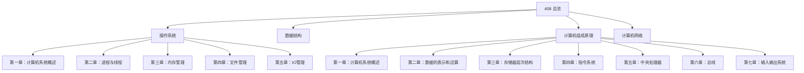
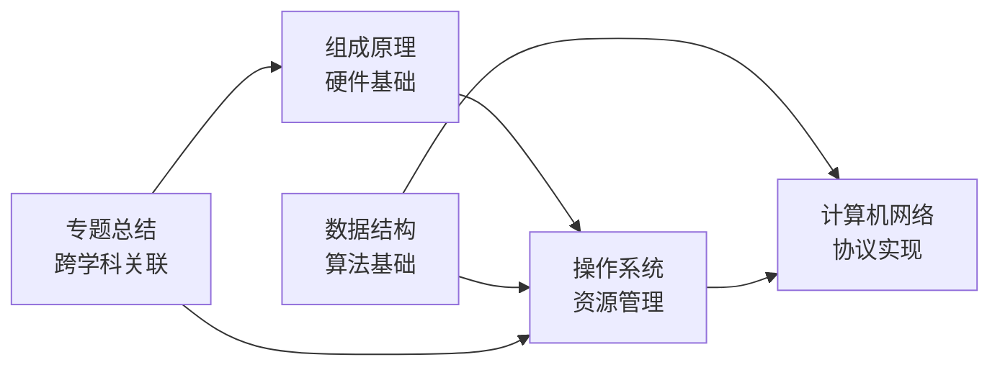
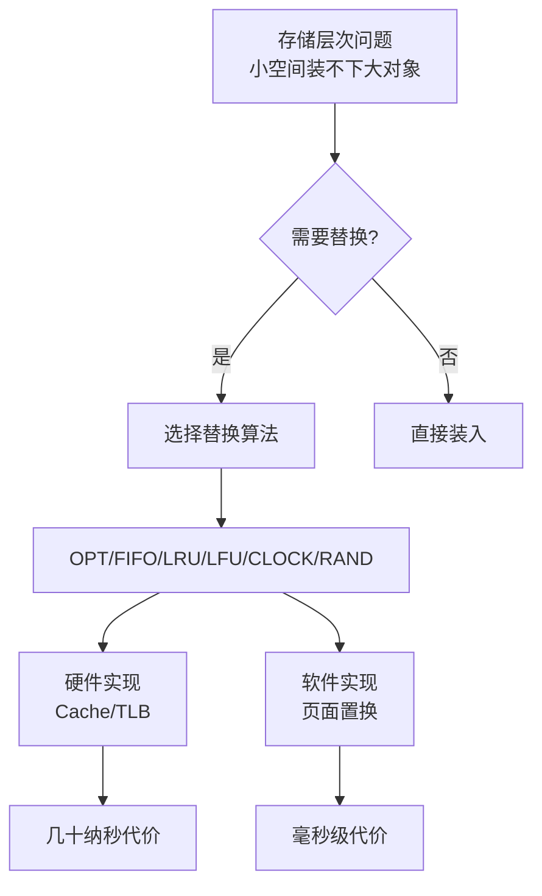
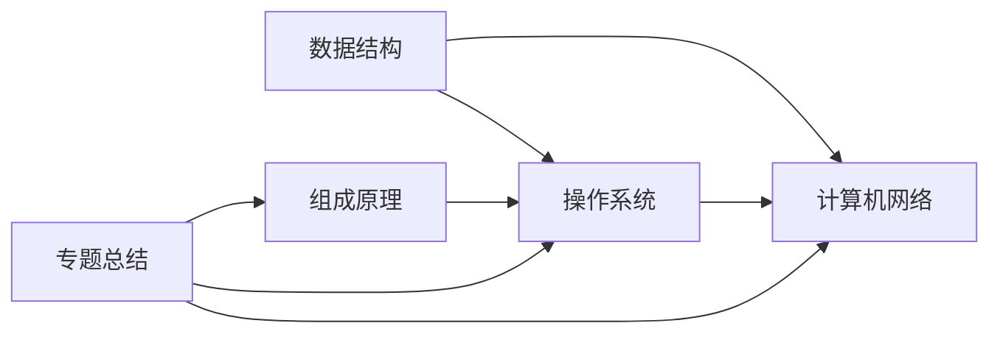

# 408专业课学习指南

<cite>
**本文引用的文件**
- [408.md](file://408\408.md)
- [操作系统总览.md](file://408\操作系统\操作系统.md)
- [计算机组成原理总览.md](file://408\计算机组成原理\计算机组成原理.md)
- [计算机系统概述（OS）.md](file://408\操作系统\第一章——计算机系统概述\第一章——计算机系统概述.md)
- [计算机系统概述（CO）.md](file://408\计算机组成原理\第一章——计算机系统概述.md)
- [替换算法专题.md](file://408\专题总结\专题01——替换算法.md)
</cite>

## 更新摘要
**变更内容**
- 重构了操作系统和计算机组成原理的课程结构与知识组织方式
- 增强了跨章节关联，特别是替换算法的跨科目统一视图
- 更新了文件系统、内存管理等核心章节的组织结构
- 完善了各课程的专题总结体系

## 目录
1. [引言](#引言)
2. [项目结构与知识地图](#项目结构与知识地图)
3. [核心课程与复习策略](#核心课程与复习策略)
4. [架构与知识关联总览](#架构与知识关联总览)
5. [详细组件分析（按课程）](#详细组件分析按课程)
6. [依赖关系与跨学科映射](#依赖关系与跨学科映射)
7. [性能与效率：学习方法论](#性能与效率学习方法论)
8. [Obsidian 组织与管理指南](#obsidian-组织与管理指南)
9. [常见问题与排错](#常见问题与排错)
10. [结论](#结论)

## 引言
本指南面向准备408计算机考研的同学，系统梳理四门核心课程的知识体系、重点难点、学习方法与时间分配建议。基于最新的仓库重构，特别强化了操作系统和计算机组成原理之间的跨学科关联，通过统一的替换算法专题等工具，帮助考生建立完整的知识网络。

## 项目结构与知识地图
仓库经过全面重构，形成了更加清晰的知识组织结构：

**图表来源**
- [408.md:5-15](file://408\408.md#L5-L15)
- [操作系统总览.md:15-23](file://408\操作系统\操作系统.md#L15-L23)
- [计算机组成原理总览.md:11-64](file://408\计算机组成原理\计算机组成原理.md#L11-L64)

**章节来源**
- [408.md:1-22](file://408\408.md#L1-L22)
- [操作系统总览.md:1-132](file://408\操作系统\操作系统.md#L1-L132)
- [计算机组成原理总览.md:1-95](file://408\计算机组成原理\计算机组成原理.md#L1-L95)

## 核心课程与复习策略

### 操作系统：重构后的知识体系
**更新** 操作系统课程现在采用更清晰的章节化组织，每章都有独立的索引页面和详细的知识点导航。

- **重点强化**：第二章（进程/同步/死锁）与第三章（内存管理）仍然是核心
- **新增特色**：每个章节都包含"考点分布与分值统计"和"核心概念速查"模块
- **跨章节专题**：通过专题总结实现知识点的横向串联

**章节来源**
- [操作系统总览.md:6-10](file://408\操作系统\操作系统.md#L6-L10)
- [操作系统总览.md:35-64](file://408\操作系统\操作系统.md#L35-L64)

### 计算机组成原理：系统化重构
**更新** 计算机组成原理现在拥有完整的七章体系，每章都有详细的知识点覆盖。

- **完整覆盖**：从数据表示到I/O系统的完整硬件视角
- **计算能力**：强调IEEE 754浮点数转换、Cache地址计算、流水线性能计算
- **对比记忆**：SRAM vs DRAM、CISC vs RISC等关键对比点

**章节来源**
- [计算机组成原理总览.md:19-64](file://408\计算机组成原理\计算机组成原理.md#L19-L64)
- [计算机组成原理总览.md:71-90](file://408\计算机组成原理\计算机组成原理.md#L71-L90)

### 数据结构与计算机网络
保持原有的高效组织结构，继续作为算法基础和协议栈理解的核心支撑。

## 架构与知识关联总览
重构后的知识体系更加强调跨学科的深度关联：

**更新** 新增的专题总结体系成为连接各课程的关键纽带，特别是替换算法专题实现了计组与操作系统的深度整合。

## 详细组件分析（按课程）

### 操作系统：增强的章节化组织
**更新** 操作系统现在采用标准化的章节结构，每个章节都包含：
- 章节概述和知识框架
- 考点分布与分值统计  
- 核心概念速查表
- 学习建议和易错点提示

**章节来源**
- [计算机系统概述（OS）.md:16-45](file://408\操作系统\第一章——计算机系统概述\第一章——计算机系统概述.md#L16-L45)
- [计算机系统概述（OS）.md:48-113](file://408\操作系统\第一章——计算机系统概述\第一章——计算机系统概述.md#L48-L113)

### 计算机组成原理：完整的知识体系
**更新** 计算机组成原理现在提供完整的七章内容，从基础的计算机发展史到高级的I/O系统。

**章节来源**
- [计算机系统概述（CO）.md:7-28](file://408\计算机组成原理\第一章——计算机系统概述.md#L7-L28)
- [计算机系统概述（CO）.md:114-187](file://408\计算机组成原理\第一章——计算机系统概述.md#L114-L187)

### 跨学科专题：替换算法的统一视图
**更新** 新增的替换算法专题是本次重构的最大亮点，实现了操作系统页面置换和计算机组成原理Cache/TLB替换的统一理解。

**图表来源**
- [替换算法专题.md:10-41](file://408\专题总结\专题01——替换算法.md#L10-L41)

**章节来源**
- [替换算法专题.md:44-56](file://408\专题总结\专题01——替换算法.md#L44-L56)
- [替换算法专题.md:60-127](file://408\专题总结\专题01——替换算法.md#L60-L127)

## 依赖关系与跨学科映射
重构后的知识体系建立了更加清晰的依赖关系：

**更新** 专题总结体系成为连接各课程的重要桥梁，特别是替换算法专题实现了计组与操作系统的深度整合。

## 性能与效率：学习方法论
**更新** 基于重构后的知识体系，推荐以下学习方法：

1. **利用专题总结**：通过跨学科专题建立知识关联
2. **章节化学习**：按照新的章节结构进行系统性学习
3. **对比记忆**：利用各章节提供的对比表格加深理解
4. **计算训练**：重点关注各章节的计算题模板

## Obsidian 组织与管理指南
**更新** 基于重构后的文件结构，优化Obsidian使用策略：

### 新的文件组织模式
- **章节化结构**：每门课程按章节组织，便于定位和学习
- **专题总结独立**：跨学科专题集中在`408/专题总结/`目录下
- **标准化模板**：每个章节都遵循统一的笔记格式

### 标签与链接策略
- **课程标签**：#操作系统 #计算机组成原理 #数据结构 #计算机网络
- **章节标签**：#第二章 #第三章 等
- **专题标签**：#替换算法 #跨学科专题
- **双向链接**：充分利用Obsidian的双向链接功能建立知识网络

### 可视化增强
- **Mermaid图表**：各章节都包含丰富的流程图和概念图
- **Graph视图**：利用重构后的知识关联查看整体知识图谱
- **专题导航**：通过专题总结快速定位跨学科知识点

## 常见问题与排错
**更新** 基于重构后的知识体系，常见问题的解决方案：

### 操作系统相关问题
- **调度题**：利用第二章的详细调度算法对比表
- **内存管理**：参考第三章的分页/分段存储管理详解
- **文件系统**：通过第四章的物理结构和磁盘调度专题

### 计算机组成原理问题  
- **数据表示**：第二章的IEEE 754标准详解
- **存储器层次**：第三章的Cache/TLB联合访问时序
- **CPU设计**：第五章的流水线冲突与解决策略

### 跨学科问题
- **替换算法混淆**：通过专题01的统一视图理解不同层次的替换机制
- **性能指标差异**：理解硬件层（ns级）和软件层（ms级）的性能差异

**章节来源**
- [操作系统总览.md:83-105](file://408\操作系统\操作系统.md#L83-L105)
- [计算机组成原理总览.md:85-90](file://408\计算机组成原理\计算机组成原理.md#L85-L90)
- [替换算法专题.md:477-489](file://408\专题总结\专题01——替换算法.md#L477-L489)

## 结论
本次重构显著提升了408专业课学习资料的质量和可用性。通过章节化的组织结构、统一的专题总结体系、以及跨学科的深度关联，为考生提供了更加系统和高效的学习路径。

**主要改进**：
1. **结构化程度提升**：每门课程都有清晰的章节划分和导航
2. **跨学科关联增强**：通过专题总结实现知识点的横向串联
3. **学习体验优化**：标准化的笔记格式和丰富的可视化图表
4. **复习效率提高**：重点突出、考点明确、易错点提示

建议考生充分利用重构后的知识体系，按照"先框架后细节、先高频后低频、先理解后刷题"的节奏推进学习，结合专题总结建立完整的知识网络，稳步提升解题能力与综合素养。