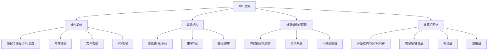
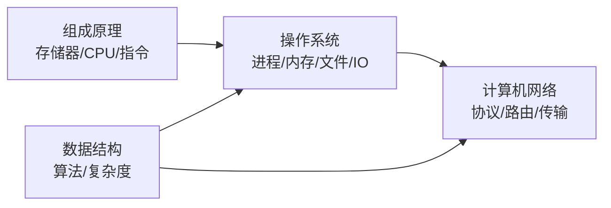
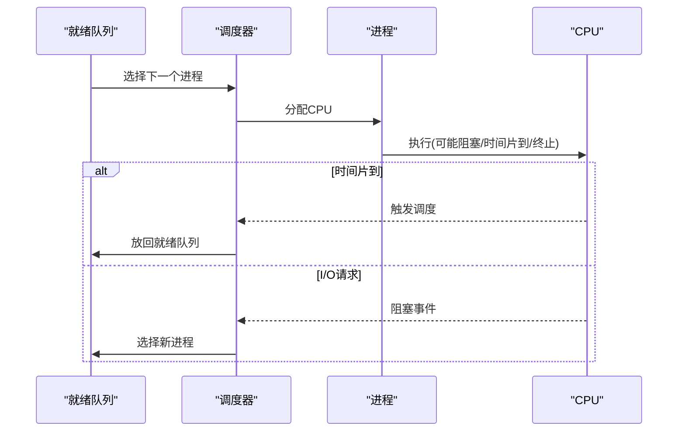
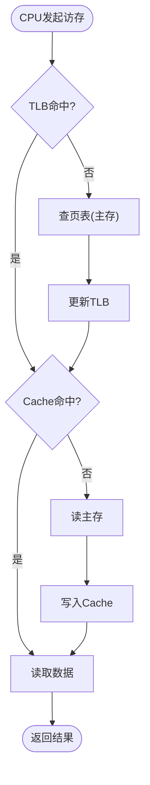
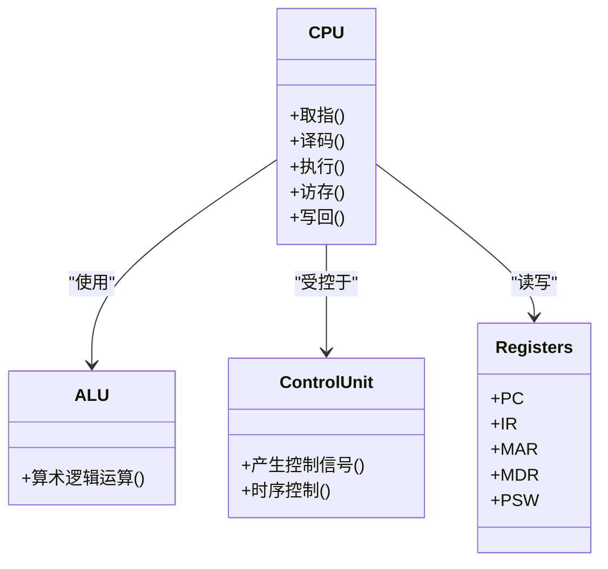
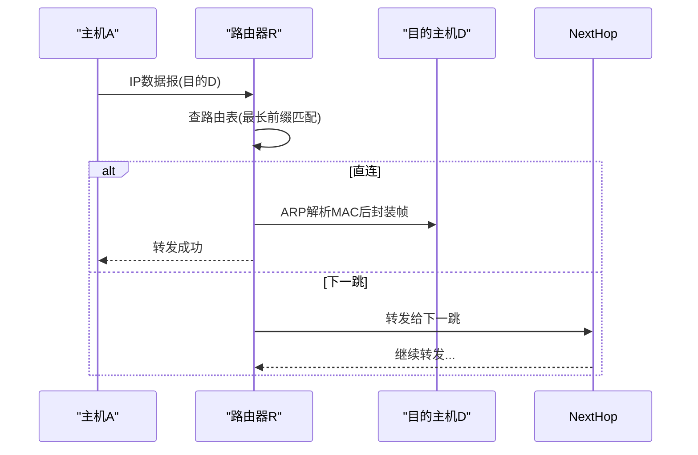
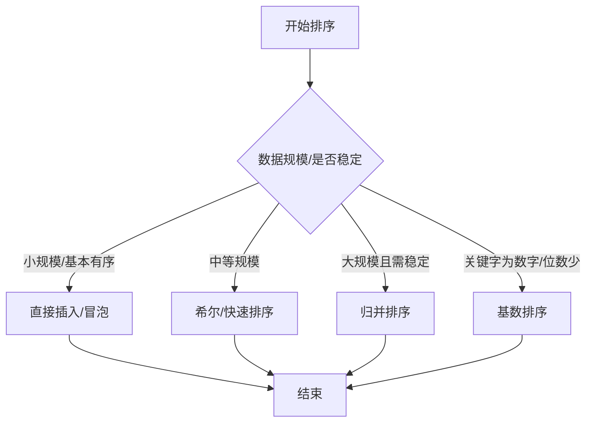
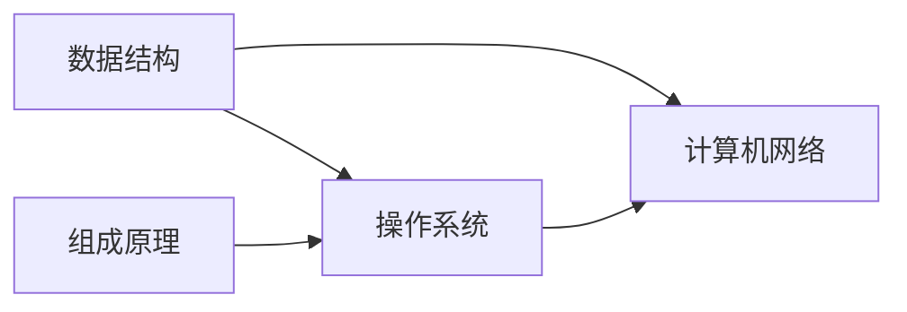

# 408专业课学习指南

<cite>
**本文引用的文件**
- [408.md](file://408\408.md)
- [操作系统总览.md](file://408\操作系统\操作系统.md)
- [CPU调度.md](file://408\操作系统\02-进程与线程\CPU调度.md)
- [存储器层次结构.md](file://408\计算机组成原理\第三章——存储器层次结构.md)
- [中央处理器.md](file://408\计算机组成原理\第五章——中央处理器.md)
- [计算机网络体系结构.md](file://408\计算机网络\第一章——计算机网络体系结构.md)
- [网络层.md](file://408\计算机网络\第四章——网络层.md)
- [数据结构总览.md](file://408\数据结构\数据结构.md)
- [排序.md](file://408\数据结构\第七章——排序.md)
</cite>

## 目录
1. [引言](#引言)
2. [项目结构与知识地图](#项目结构与知识地图)
3. [核心课程与复习策略](#核心课程与复习策略)
4. [架构与知识关联总览](#架构与知识关联总览)
5. [详细组件分析（按课程）](#详细组件分析按课程)
6. [依赖关系与跨学科映射](#依赖关系与跨学科映射)
7. [性能与效率：学习方法论](#性能与效率学习方法论)
8. [Obsidian 组织与管理指南](#obsidian-组织与管理指南)
9. [常见问题与排错](#常见问题与排错)
10. [结论](#结论)

## 引言
本指南面向准备408计算机考研的同学，系统梳理四门核心课程的知识体系、重点难点、学习方法与时间分配建议，并结合你在 Obsidian 中的现有笔记结构，给出可落地的知识组织与复习计划。内容基于仓库中已有笔记进行提炼与整合，帮助你高效构建“知识点—题型—方法”的闭环。

## 项目结构与知识地图
仓库以“408/四门课程”为顶层分类，每门课程下按章节或主题组织笔记，形成清晰的层级结构。根索引提供跨课程导航入口。

**图表来源**
- [408.md:1-16](file://408\408.md#L1-L16)
- [操作系统总览.md:1-31](file://408\操作系统\操作系统.md#L1-L31)
- [数据结构总览.md:1-36](file://408\数据结构\数据结构.md#L1-L36)

**章节来源**
- [408.md:1-16](file://408\408.md#L1-L16)
- [操作系统总览.md:1-31](file://408\操作系统\操作系统.md#L1-L31)
- [数据结构总览.md:1-36](file://408\数据结构\数据结构.md#L1-L36)

## 核心课程与复习策略
- 操作系统
  - 重点：进程与线程（调度、同步互斥、死锁）、内存管理（分页/分段/虚拟内存）、文件系统、I/O管理
  - 难点：调度算法计算与指标、页表与TLB访问时序、文件系统元数据与磁盘调度
  - 方法：以“问题—模型—算法—计算”为主线，结合甘特图/流程图推导
  - 时间建议：占总时长约25%
- 数据结构
  - 重点：线性表、树与二叉树、图、查找、排序；复杂度与稳定性
  - 难点：快速排序划分过程、堆调整、图的遍历与最短路径、哈希冲突处理
  - 方法：先掌握抽象数据类型与操作接口，再聚焦典型算法实现与复杂度分析
  - 时间建议：占总时长约25%
- 计算机组成原理
  - 重点：存储器层次（SRAM/DRAM、Cache映射/替换/写策略、虚拟存储+TLB）、CPU结构与流水线、指令系统
  - 难点：地址划分与计算、流水线冲突与转发、微程序控制器
  - 方法：从“数据通路—控制信号—时序”三要素理解，配合公式与示例反复演练
  - 时间建议：占总时长约25%
- 计算机网络
  - 重点：OSI/TCP/IP五层模型、网络层（IP/ARP/ICMP、路由算法RIP/OSPF/BGP、NAT/DHCP、IPv6/组播/SDN）
  - 难点：路由协议收敛与度量、子网划分与CIDR聚合、时延带宽积与吞吐
  - 方法：分层自顶向下理解协议交互，用序列图串联握手/转发流程
  - 时间建议：占总时长约25%

[本节不直接分析具体文件，故无章节来源]

## 架构与知识关联总览
四门课程在底层硬件到上层应用的视角上相互支撑：
- 组成原理提供“硬件能力边界”（存储、CPU、指令），操作系统在其上实现资源抽象与调度
- 数据结构是算法基础，贯穿操作系统内核、网络协议栈与编译优化
- 计算机网络通过协议栈将分布式资源连接起来，依赖操作系统提供的进程/内存/IO能力

[此图为概念性示意，不绑定具体源码文件，故无图表来源]

## 详细组件分析（按课程）

### 操作系统：CPU调度与三级调度
- 关键要点
  - 三级调度：高级（作业）、中级（内存）、低级（进程）的对象、频率与功能
  - 调度时机与方式：抢占式与非抢占式的适用场景
  - 性能指标：周转时间、带权周转时间、等待时间、响应时间与吞吐量
  - 调度算法：FCFS、SJF/SRTN、优先级、HRRN、RR、MLFQ的执行过程与对比
- 推荐练习
  - 用甘特图推演各算法执行顺序并计算指标
  - 比较不同时间片对RR的影响
- 易错点
  - 混淆“周转时间”和“等待时间”
  - RR切换开销计入总时间的细节

**图表来源**
- [CPU调度.md:67-76](file://408\操作系统\02-进程与线程\CPU调度.md#L67-L76)

**章节来源**
- [CPU调度.md:22-113](file://408\操作系统\02-进程与线程\CPU调度.md#L22-L113)
- [CPU调度.md:115-144](file://408\操作系统\02-进程与线程\CPU调度.md#L115-L144)
- [CPU调度.md:146-521](file://408\操作系统\02-进程与线程\CPU调度.md#L146-L521)

### 计算机组成原理：存储器层次与Cache/虚拟存储
- 关键要点
  - 存储器层次：寄存器→Cache→主存→辅存的特性与局部性原理
  - Cache：映射方式（直接/全相联/组相联）、替换算法（LRU等）、写策略（写回/全写）
  - 虚拟存储：页表、TLB命中/未命中的访问时序与平均访问时间计算
- 推荐练习
  - 地址划分与Tag/Index/Offset计算
  - TLB+Cache联合访问的平均时间计算
- 易错点
  - 组号=主存块号 mod 组数
  - DRAM刷新周期与“死区”
  - 写回法仅在替换时写回主存

**图表来源**
- [存储器层次结构.md:286-331](file://408\计算机组成原理\第三章——存储器层次结构.md#L286-L331)

**章节来源**
- [存储器层次结构.md:7-134](file://408\计算机组成原理\第三章——存储器层次结构.md#L7-L134)
- [存储器层次结构.md:136-284](file://408\计算机组成原理\第三章——存储器层次结构.md#L136-L284)
- [存储器层次结构.md:286-342](file://408\计算机组成原理\第三章——存储器层次结构.md#L286-L342)

### 计算机组成原理：CPU与流水线
- 关键要点
  - CPU基本结构：运算器、控制器、主要寄存器（PC/IR/MAR/MDR/PSW）
  - 控制器：硬布线 vs 微程序（优缺点、适用场景）
  - 流水线：五段流水线、吞吐率/加速比/效率、冲突（结构/数据/控制）与解决（转发/分支预测）
- 推荐练习
  - 流水线时钟周期确定、总时间与加速比计算
  - 数据冲突的转发路径与控制冲突的预测策略
- 易错点
  - 时钟周期取最长段
  - 加速比极限等于段数k

**图表来源**
- [中央处理器.md:20-94](file://408\计算机组成原理\第五章——中央处理器.md#L20-L94)

**章节来源**
- [中央处理器.md:9-94](file://408\计算机组成原理\第五章——中央处理器.md#L9-L94)
- [中央处理器.md:97-156](file://408\计算机组成原理\第五章——中央处理器.md#L97-L156)
- [中央处理器.md:159-324](file://408\计算机组成原理\第五章——中央处理器.md#L159-L324)

### 计算机网络：体系结构与网络层
- 关键要点
  - OSI/TCP/IP/五层模型：各层功能、PDU、协议对应关系
  - 网络层：IPv4地址与子网划分、CIDR聚合、IP分片重组、TTL
  - ARP/ICMP：解析过程、ping/traceroute原理
  - 路由算法：距离向量（RIP）与链路状态（OSPF）、BGP外部网关
  - NAT/DHCP工作过程、IPv6基础与ICMPv6、组播与IGMP、SDN架构
- 推荐练习
  - 子网掩码与CIDR聚合计算
  - 路由表最长前缀匹配与转发流程
  - RIP/OSPF收敛与度量差异
- 易错点
  - 发送时延与传播时延的区别
  - 默认路由与前缀长度优先级

**图表来源**
- [网络层.md:337-378](file://408\计算机网络\第四章——网络层.md#L337-L378)

**章节来源**
- [计算机网络体系结构.md:91-227](file://408\计算机网络\第一章——计算机网络体系结构.md#L91-L227)
- [网络层.md:5-176](file://408\计算机网络\第四章——网络层.md#L5-L176)
- [网络层.md:178-241](file://408\计算机网络\第四章——网络层.md#L178-L241)
- [网络层.md:243-467](file://408\计算机网络\第四章——网络层.md#L243-L467)
- [网络层.md:470-598](file://408\计算机网络\第四章——网络层.md#L470-L598)
- [网络层.md:600-793](file://408\计算机网络\第四章——网络层.md#L600-L793)

### 数据结构：排序与复杂度
- 关键要点
  - 插入/交换/选择/归并/基数排序的思想、复杂度、稳定性与适用场景
  - 快速排序Partition过程与递归树分析
  - 堆排序建堆与调整过程
  - 选择排序的依据：规模、稳定性、内存限制
- 推荐练习
  - 手写Partition与HeapAdjust
  - 对比不同算法在不同输入下的表现
- 易错点
  - 堆排序建堆时间复杂度O(n)
  - 快速排序最坏情况与优化（随机基准/三数取中）

**图表来源**
- [排序.md:498-539](file://408\数据结构\第七章——排序.md#L498-L539)

**章节来源**
- [排序.md:5-41](file://408\数据结构\第七章——排序.md#L5-L41)
- [排序.md:42-167](file://408\数据结构\第七章——排序.md#L42-L167)
- [排序.md:169-283](file://408\数据结构\第七章——排序.md#L169-L283)
- [排序.md:285-407](file://408\数据结构\第七章——排序.md#L285-L407)
- [排序.md:410-447](file://408\数据结构\第七章——排序.md#L410-L447)
- [排序.md:449-495](file://408\数据结构\第七章——排序.md#L449-L495)
- [排序.md:498-556](file://408\数据结构\第七章——排序.md#L498-L556)

## 依赖关系与跨学科映射
- 操作系统依赖组成原理的硬件能力（如Cache/TLB、中断、I/O设备），并通过数据结构实现高效内核机制（如红黑树、哈希表、队列）
- 计算机网络协议栈的实现与优化也依赖数据结构（如路由表、邻接表、优先队列）
- 组成原理中的流水线与缓存设计直接影响操作系统调度与网络协议栈的性能

[此图为概念性示意，不绑定具体源码文件，故无图表来源]

## 性能与效率：学习方法论
- 建立“模型—算法—复杂度—实现—验证”的学习闭环
- 针对高频考点（如调度指标、Cache地址划分、路由算法）进行专项训练
- 用图示化思维（甘特图、流程图、序列图）辅助理解复杂过程
- 错题复盘：记录错误类型（概念混淆/计算失误/思路偏差），针对性补强

[本节为方法论总结，不直接分析具体文件，故无章节来源]

## Obsidian 组织与管理指南
- 笔记结构
  - 以“408/四门课程”为根，每门课程按章节或主题建文件夹，保持扁平化便于检索
  - 每个知识点独立成页，标题清晰，首行包含“知识定位/考点提示/易错点”
- 标签与链接
  - 统一标签：如 #408 #操作系统 #CPU调度 #Cache #网络层
  - 双向链接：在相关页面之间建立引用，形成知识图谱
  - 别名：为同一概念设置多个别名，提升搜索命中率
- 知识关联策略
  - 跨课程关联：例如“虚拟存储”同时链接到“操作系统—内存管理”和“组成原理—存储器层次”
  - 题型关联：在知识点页内加入“典型题型/解题模板”模块
- 可视化
  - 使用Mermaid绘制流程图/序列图/类图，增强理解
  - 利用Graph视图查看知识关联密度，发现薄弱节点

[本节为实践建议，不直接分析具体文件，故无章节来源]

## 常见问题与排错
- 调度题
  - 误把“周转时间”当作“等待时间”：注意周转=等待+运行
  - RR切换开销遗漏：统计切换次数×上下文切换时间
- 组成原理
  - Cache地址划分错误：确认Index/Offset位宽与映射规则
  - TLB未命中多算一次主存访问：注意TLB未命中需查页表
- 计算机网络
  - 发送时延与传播时延混淆：前者与数据长度/速率有关，后者与距离/速度有关
  - 路由转发未考虑默认路由与前缀长度优先级

**章节来源**
- [CPU调度.md:115-144](file://408\操作系统\02-进程与线程\CPU调度.md#L115-L144)
- [存储器层次结构.md:344-371](file://408\计算机组成原理\第三章——存储器层次结构.md#L344-L371)
- [计算机网络体系结构.md:229-302](file://408\计算机网络\第一章——计算机网络体系结构.md#L229-L302)
- [网络层.md:337-378](file://408\计算机网络\第四章——网络层.md#L337-L378)

## 结论
本指南基于你的Obsidian笔记库，系统化梳理了408四门课程的知识地图、重点难点与复习策略，并提供了Obsidian组织方法与可视化技巧。建议按“先框架后细节、先高频后低频、先理解后刷题”的节奏推进，结合甘特图/流程图/序列图强化过程性理解，持续完善知识关联与错题本，稳步提升解题能力与综合素养。

[本节为总结性内容，不直接分析具体文件，故无章节来源]