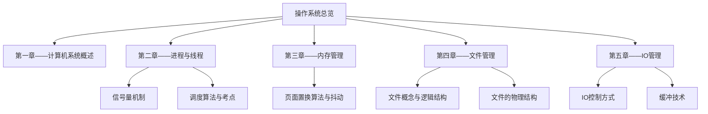
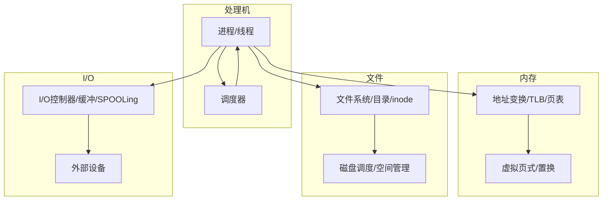
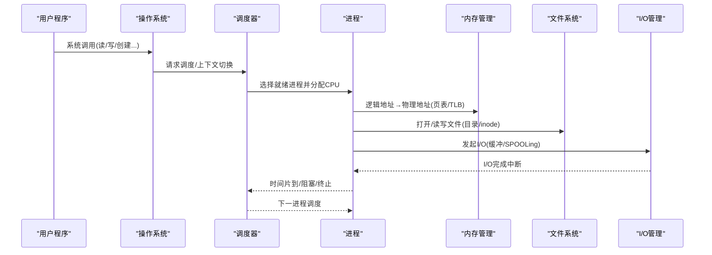
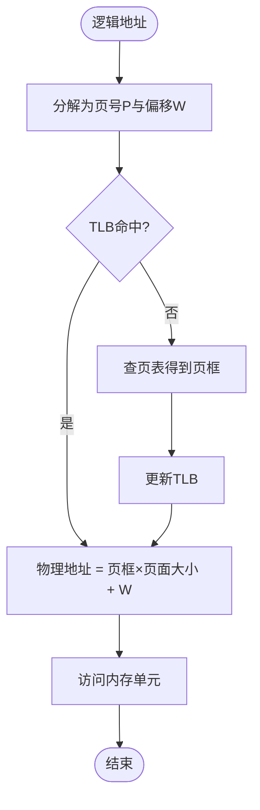
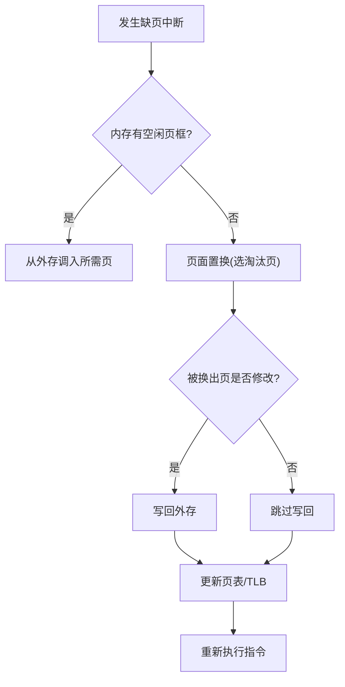
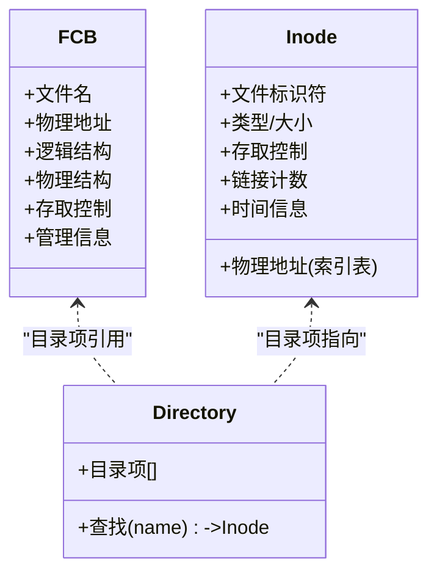
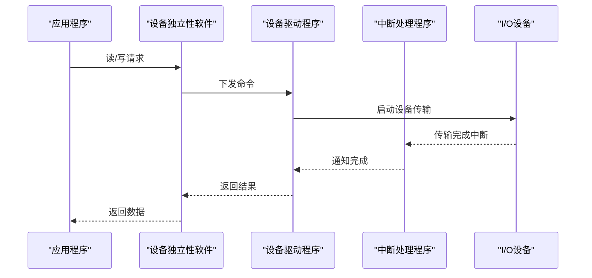
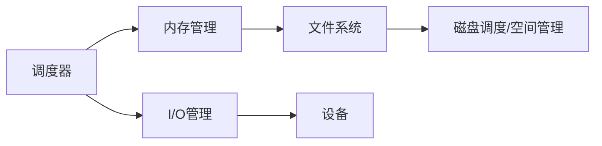

# 操作系统学习指南

<cite>
**本文引用的文件**
- [操作系统.md](file://408/操作系统/操作系统.md)
- [第一章——计算机系统概述.md](file://408/操作系统/第一章——计算机系统概述/第一章——计算机系统概述.md)
- [第二章——进程与线程.md](file://408/操作系统/第二章——进程与线程/第二章——进程与线程.md)
- [信号量机制.md](file://408/操作系统/第二章——进程与线程/信号量机制.md)
- [调度算法与考点.md](file://408/操作系统/第二章——进程与线程/调度算法与考点.md)
- [第三章——内存管理.md](file://408/操作系统/第三章——内存管理/第三章——内存管理.md)
- [页面置换算法与抖动.md](file://408/操作系统/第三章——内存管理/页面置换算法与抖动.md)
- [第四章——文件管理.md](file://408/操作系统/第四章——文件管理/第四章——文件管理.md)
- [第五章——IO管理.md](file://408/操作系统/第五章——IO管理/第五章——IO管理.md)
</cite>

## 更新摘要
**所做更改**
- 更新了项目结构以反映从编号系统（01-、02-、03-）到中文命名系统（第一章、第二章、第三章）的文件重组
- 新增了专题化文件引用，包括信号量机制、调度算法、页面置换算法等专门主题
- 更新了章节导航和交叉引用以匹配新的文件组织结构
- 增强了各章节间的关联关系，突出跨章节知识点的联系

## 目录
1. [引言](#引言)
2. [项目结构](#项目结构)
3. [核心组件](#核心组件)
4. [架构总览](#架构总览)
5. [详细组件分析](#详细组件分析)
6. [依赖关系分析](#依赖关系分析)
7. [性能考量](#性能考量)
8. [故障排查指南](#故障排查指南)
9. [结论](#结论)
10. [附录：Obsidian知识图谱构建与复习方法](#附录obsidian知识图谱构建与复习方法)

## 引言
本指南面向操作系统课程学习者，围绕五大核心模块系统梳理：计算机系统概述、进程与线程管理、内存管理、文件管理与I/O管理。内容涵盖核心概念、关键算法（如FCFS/SJF/RR等调度、连续分配/分页/分段等内存策略、文件系统结构与磁盘调度）、典型应用与考点解析，并提供在Obsidian中建立双向链接的知识图谱方法与复习策略。

**更新** 根据最新的文件重组，现在采用更加清晰的中文命名系统，每个章节都包含专门的子主题文档，便于深入学习和检索。

## 项目结构
仓库以"408/操作系统"为核心，按中文章节名称组织笔记，每章包含概览与多个专题化子文档，支持分层学习与精准检索。

**图表来源**
- [操作系统.md:13-23](file://408/操作系统/操作系统.md#L13-L23)

**章节来源**
- [操作系统.md:13-23](file://408/操作系统/操作系统.md#L13-L23)

## 核心组件
- **计算机系统概述**：四大特征、五大功能、运行环境（内核态/用户态、中断/异常、系统调用）
- **进程与线程管理**：状态转换、三级调度、调度算法与指标、同步互斥与死锁、信号量机制
- **内存管理**：连续分配、分页/分段/段页式、TLB、虚拟页式与页面置换、抖动与工作集
- **文件管理**：文件逻辑/物理结构、FCB与inode、目录结构、磁盘调度与空间管理
- **I/O管理**：I/O软件层次、控制方式、缓冲技术、SPOOLing

**章节来源**
- [第一章——计算机系统概述.md:16-134](file://408/操作系统/第一章——计算机系统概述/第一章——计算机系统概述.md#L16-L134)
- [第二章——进程与线程.md:17-199](file://408/操作系统/第二章——进程与线程/第二章——进程与线程.md#L17-L199)
- [第三章——内存管理.md:1-116](file://408/操作系统/第三章——内存管理/第三章——内存管理.md#L1-L116)
- [第四章——文件管理.md:1-75](file://408/操作系统/第四章——文件管理/第四章——文件管理.md#L1-L75)
- [第五章——IO管理.md:1-144](file://408/操作系统/第五章——IO管理/第五章——IO管理.md#L1-L144)

## 架构总览
下图展示操作系统五大模块的协作关系与数据流：进程由CPU调度驱动，访问内存与文件，I/O设备通过缓冲与SPOOLing提升吞吐；内存子系统提供地址映射与虚拟存储能力，文件系统负责持久化。

**图表来源**
- [第二章——进程与线程.md:22-48](file://408/操作系统/第二章——进程与线程/第二章——进程与线程.md#L22-L48)
- [第三章——内存管理.md:61-85](file://408/操作系统/第三章——内存管理/第三章——内存管理.md#L61-L85)
- [第四章——文件管理.md:13-26](file://408/操作系统/第四章——文件管理/第四章——文件管理.md#L13-L26)
- [第五章——IO管理.md:16-26](file://408/操作系统/第五章——IO管理/第五章——IO管理.md#L16-L26)

## 详细组件分析

### 计算机系统概述
- **核心要点**：四大特征（并发、共享、虚拟、异步）、五大功能（处理机/存储器/文件/设备/用户接口）、运行环境（内核态/用户态、中断/异常、系统调用）
- **学习方法**：先理解"为什么需要OS"，再掌握"如何切换执行环境"，最后用真题选择题巩固

**章节来源**
- [第一章——计算机系统概述.md:68-134](file://408/操作系统/第一章——计算机系统概述/第一章——计算机系统概述.md#L68-L134)

### 进程与线程管理
- **概念与状态**：进程/线程区别、五态模型、PCB、进程通信
- **CPU调度**：三级调度、时机、抢占/非抢占、性能指标（周转时间、带权周转时间、等待时间、响应时间、吞吐量、CPU利用率）
- **调度算法**：FCFS、SJF、SRTN、优先级、HRRN、RR、MLFQ；对比与适用场景
- **同步互斥与死锁**：临界区、信号量PV、经典问题、银行家算法、资源分配图

**图表来源**
- [调度算法与考点.md:10-59](file://408/操作系统/第二章——进程与线程/调度算法与考点.md#L10-L59)
- [第三章——内存管理.md:38-45](file://408/操作系统/第三章——内存管理/第三章——内存管理.md#L38-L45)
- [第四章——文件管理.md:32-47](file://408/操作系统/第四章——文件管理/第四章——文件管理.md#L32-L47)
- [第五章——IO管理.md:30-51](file://408/操作系统/第五章——IO管理/第五章——IO管理.md#L30-L51)

**章节来源**
- [第二章——进程与线程.md:52-78](file://408/操作系统/第二章——进程与线程/第二章——进程与线程.md#L52-L78)
- [调度算法与考点.md:10-200](file://408/操作系统/第二章——进程与线程/调度算法与考点.md#L10-L200)
- [信号量机制.md:1-200](file://408/操作系统/第二章——进程与线程/信号量机制.md#L1-L200)

### 内存管理
- **连续分配**：单一/固定分区/动态分区，FF/BF/WF/NF算法，内部/外部碎片
- **分页存储**：基本分页、TLB、多级页表、虚拟页式、页面置换（OPT/FIFO/LRU/CLOCK）、Belady异常、抖动与工作集
- **分段存储**：段表、地址变换、分页vs分段、段页式
- **重点计算**：地址变换、EAT、缺页率、混合索引容量

**图表来源**
- [第三章——内存管理.md:38-45](file://408/操作系统/第三章——内存管理/第三章——内存管理.md#L38-L45)

**图表来源**
- [页面置换算法与抖动.md:1-200](file://408/操作系统/第三章——内存管理/页面置换算法与抖动.md#L1-L200)

**章节来源**
- [第三章——内存管理.md:1-116](file://408/操作系统/第三章——内存管理/第三章——内存管理.md#L1-L116)
- [页面置换算法与抖动.md:1-200](file://408/操作系统/第三章——内存管理/页面置换算法与抖动.md#L1-L200)

### 文件管理
- **文件逻辑结构**：无结构（流式）与有结构（顺序/索引/索引顺序）
- **文件物理结构**：连续分配、链接分配（隐式/显式FAT）、索引分配（含混合索引）
- **FCB与inode**：分离设计动机与优势
- **目录结构**：单级、两级、树形、无环图（硬链接）
- **磁盘调度与空间管理**：常见调度算法、位示图/成组链接法

**图表来源**
- [第四章——文件管理.md:32-47](file://408/操作系统/第四章——文件管理/第四章——文件管理.md#L32-L47)

**章节来源**
- [第四章——文件管理.md:1-75](file://408/操作系统/第四章——文件管理/第四章——文件管理.md#L1-L75)

### I/O管理
- **I/O软件层次**：用户层、设备独立性、设备驱动、中断处理
- **I/O控制方式**：程序直接控制、中断驱动、DMA、通道控制
- **缓冲技术**：单/双/循环缓冲、缓冲池
- **SPOOLing**：假脱机与共享打印机原理

**图表来源**
- [第五章——IO管理.md:30-51](file://408/操作系统/第五章——IO管理/第五章——IO管理.md#L30-L51)

**章节来源**
- [第五章——IO管理.md:1-144](file://408/操作系统/第五章——IO管理/第五章——IO管理.md#L1-L144)

## 依赖关系分析
- **进程调度**依赖内存管理（地址变换/TLB）与I/O管理（I/O中断唤醒）
- **内存管理**中的虚拟页式依赖文件系统（缺页时从外存调入）
- **文件系统**依赖磁盘调度与空间管理
- **I/O管理**通过缓冲与SPOOLing缓解设备与CPU速度差异

**图表来源**
- [调度算法与考点.md:10-59](file://408/操作系统/第二章——进程与线程/调度算法与考点.md#L10-L59)
- [页面置换算法与抖动.md:1-200](file://408/操作系统/第三章——内存管理/页面置换算法与抖动.md#L1-L200)
- [第四章——文件管理.md:32-47](file://408/操作系统/第四章——文件管理/第四章——文件管理.md#L32-L47)
- [第五章——IO管理.md:30-51](file://408/操作系统/第五章——IO管理/第五章——IO管理.md#L30-L51)

**章节来源**
- [调度算法与考点.md:10-59](file://408/操作系统/第二章——进程与线程/调度算法与考点.md#L10-L59)
- [页面置换算法与抖动.md:1-200](file://408/操作系统/第三章——内存管理/页面置换算法与抖动.md#L1-L200)
- [第四章——文件管理.md:32-47](file://408/操作系统/第四章——文件管理/第四章——文件管理.md#L32-L47)
- [第五章——IO管理.md:30-51](file://408/操作系统/第五章——IO管理/第五章——IO管理.md#L30-L51)

## 性能考量
- **调度**：时间片大小影响公平性与开销；MLFQ兼顾长短作业；避免饥饿（老化/轮转）
- **内存**：TLB命中率直接影响EAT；多级页表增加访存次数但解决连续页表问题；LRU/CLOCK平衡实现复杂度与性能
- **文件**：索引分配支持随机访问但需维护索引；FAT常驻内存提高查找效率；混合索引扩展大文件容量
- **I/O**：缓冲降低设备与CPU速度差；SPOOLing将独占设备虚拟化；DMA减少CPU参与

## 故障排查指南
- **调度相关**：确认调度时机（进程终止/阻塞/时间片到/I/O完成/高优先级到达），区分可调度与不可调度场景
- **内存相关**：检查越界（页号/段号+偏移）、TLB命中计算、缺页中断处理流程、Belady异常仅出现在FIFO
- **文件相关**：核对目录结构路径解析、inode与FCB职责分离、FAT链遍历与索引块层级
- **I/O相关**：识别控制方式与缓冲策略对吞吐的影响，SPOOLing打印队列的正确性

**章节来源**
- [调度算法与考点.md:10-200](file://408/操作系统/第二章——进程与线程/调度算法与考点.md#L10-L200)
- [页面置换算法与抖动.md:1-200](file://408/操作系统/第三章——内存管理/页面置换算法与抖动.md#L1-L200)
- [第四章——文件管理.md:32-47](file://408/操作系统/第四章——文件管理/第四章——文件管理.md#L32-L47)
- [第五章——IO管理.md:30-51](file://408/操作系统/第五章——IO管理/第五章——IO管理.md#L30-L51)

## 结论
本指南基于最新重组的笔记体系，系统化梳理了操作系统的五大模块及其关键算法与考点。新的中文命名系统和专题化文件组织使得学习内容更加清晰，便于深入理解和记忆。建议以"概念—算法—计算—真题"为主线推进学习，结合Obsidian双向链接构建知识图谱，强化跨章节关联与记忆。

## 附录：Obsidian知识图谱构建与复习方法
- **建立节点**：为每个核心概念创建独立笔记（如"进程状态""FCFS""分页地址变换""TLB""inode""SPOOLing"）
- **双向链接**：使用[[ ]]互相引用，形成概念网络（例如"分页存储管理"链接到"TLB""页面置换""虚拟页式"）
- **标签与元数据**：添加tags（如"408""操作系统""内存管理"），便于筛选与复习
- **可视化图谱**：利用Obsidian Graph视图观察关联密度，发现薄弱点
- **复习策略**：
  - **概念理解**：先读概览，再深入细节，绘制流程图/类图辅助记忆
  - **算法推导**：手推FCFS/SJF/SRTN/RR/MLFQ的执行过程与指标；模拟OPT/FIFO/LRU/CLOCK缺页序列
  - **实际案例**：结合真题进行计算题训练（地址变换、EAT、缺页率、磁盘调度、混合索引容量）
  - **错题归因**：标注易错点（如"只有FIFO有Belady异常""分段二维地址空间""两次越界检查"）

**更新** 新的文件组织结构支持更精细化的知识点管理，每个专题都有独立的文档，便于建立更精确的双向链接关系。