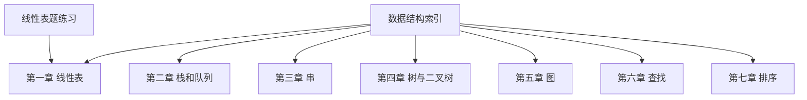
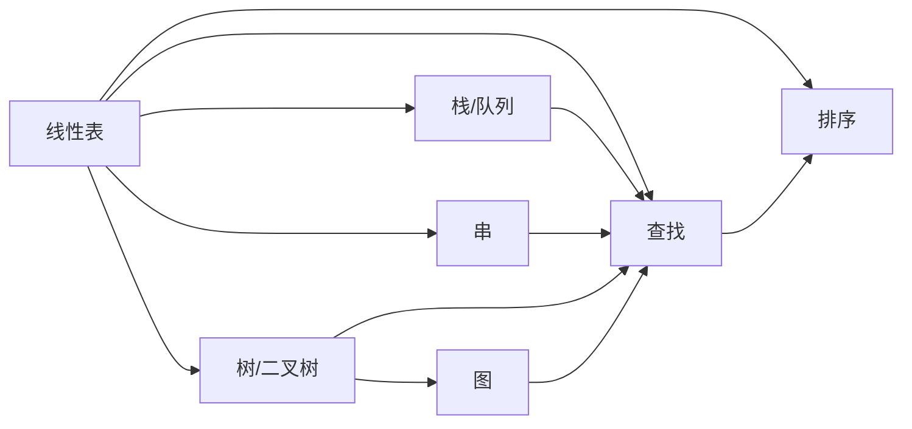
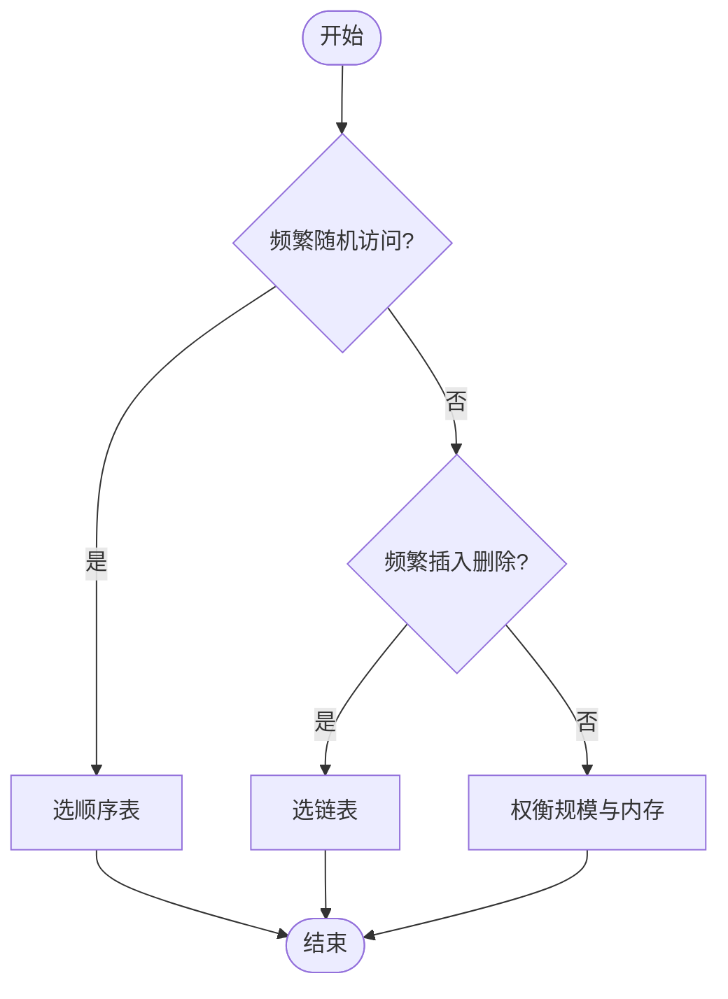
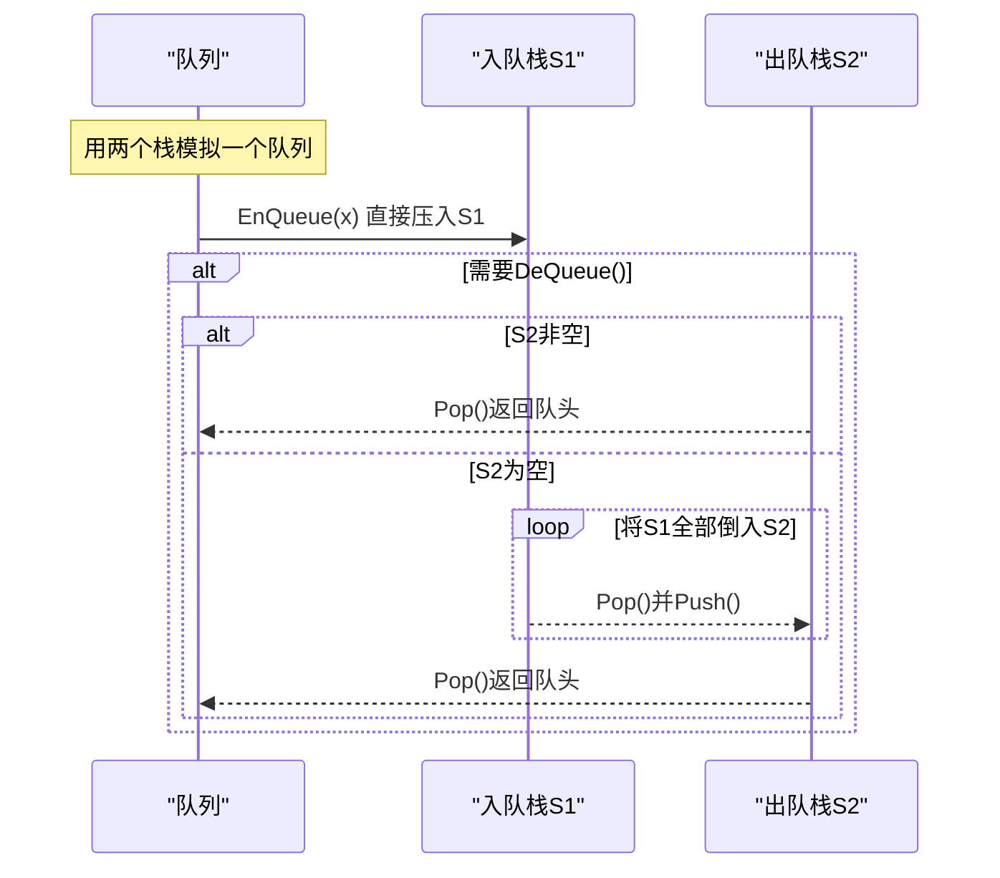
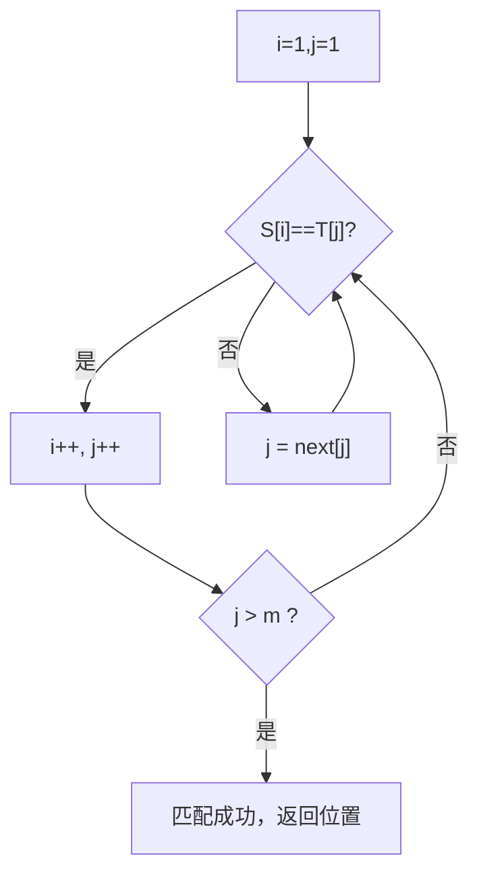
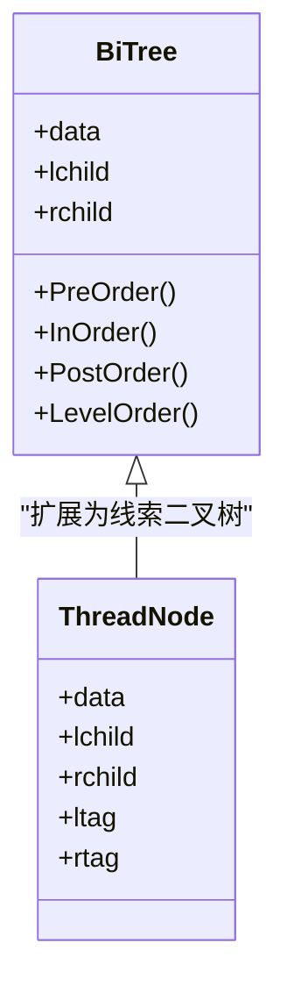
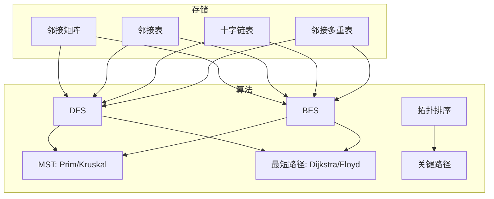
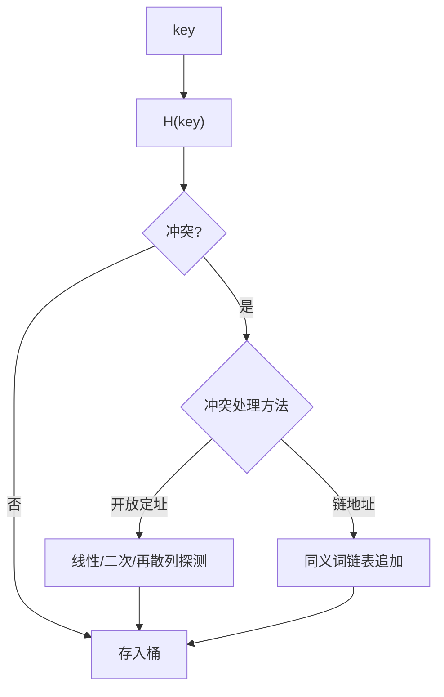
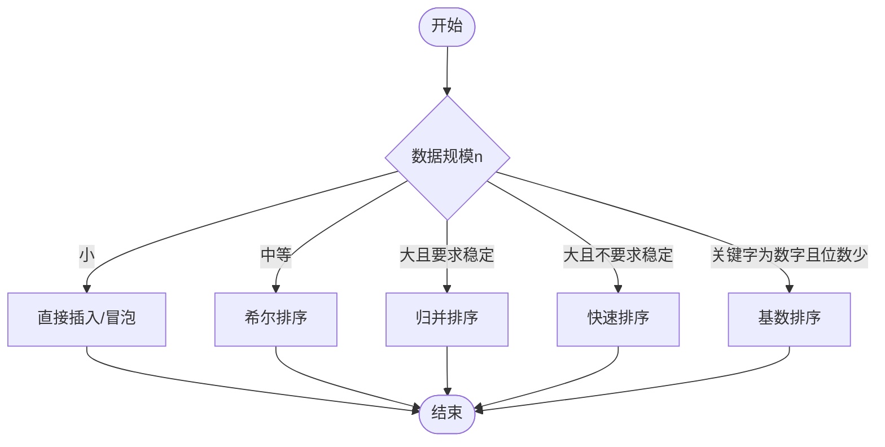
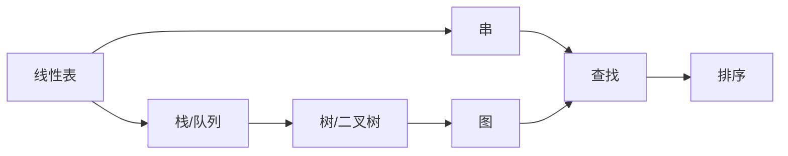

# 数据结构学习指南

<cite>
**本文引用的文件**
- [数据结构.md](file://408\数据结构\数据结构.md)
- [第一章——线性表.md](file://408\数据结构\第一章——线性表.md)
- [第二章——栈和队列.md](file://408\数据结构\第二章——栈和队列.md)
- [第三章——串.md](file://408\数据结构\第三章——串.md)
- [第四章——树与二叉树.md](file://408\数据结构\第四章——树与二叉树.md)
- [第五章——图.md](file://408\数据结构\第五章——图.md)
- [第六章——查找.md](file://408\数据结构\第六章——查找.md)
- [第七章——排序.md](file://408\数据结构\第七章——排序.md)
- [线性表题.md](file://线性表题.md)
</cite>

## 目录
1. [引言](#引言)
2. [项目结构](#项目结构)
3. [核心组件](#核心组件)
4. [架构总览](#架构总览)
5. [详细组件分析](#详细组件分析)
6. [依赖关系分析](#依赖关系分析)
7. [性能考量](#性能考量)
8. [故障排查指南](#故障排查指南)
9. [结论](#结论)
10. [附录](#附录)

## 引言
本指南面向数据结构课程学习者，系统梳理线性表、栈与队列、串、树与二叉树、图等核心结构的定义、性质与操作；详解顺序查找、折半查找、散列表等查找方法，以及插入/选择/交换/归并/基数等排序算法的时间复杂度与适用场景。结合代码片段路径与可视化图示，帮助你在 Obsidian 中高效组织笔记、理解算法执行过程，并提供典型例题与面试常见问题解答，强调实际编程中的应用与优化策略。

## 项目结构
仓库以“408 数据结构”为核心，按章节组织笔记：线性表、栈与队列、串、树与二叉树、图、查找、排序，并配套线性表选择题练习。该结构便于分层学习与检索。

图表来源
- [数据结构.md:1-36](file://408\数据结构\数据结构.md#L1-L36)

章节来源
- [数据结构.md:1-36](file://408\数据结构\数据结构.md#L1-L36)

## 核心组件
- 线性表：顺序表与链表的基本操作、时间复杂度对比、头插/尾插建表、双链与循环结构要点。
- 栈与队列：顺序/链式实现、循环队列判空判满、共享栈、双端队列、两栈模拟队列/两队列模拟栈、最小栈。
- 串：定长/堆分配/块链存储，BF 与 KMP 模式匹配及 next/nextval 求解。
- 树与二叉树：基本术语与公式、遍历（递归与非递归）、线索化、哈夫曼树与编码。
- 图：邻接矩阵/表/十字链表/邻接多重表，DFS/BFS，最小生成树（Prim/Kruskal），最短路径（Dijkstra/Floyd），拓扑排序与关键路径。
- 查找：顺序/折半/二叉排序树/平衡二叉树/AVL旋转、B/B+树、散列函数与冲突处理、ASL 计算。
- 排序：插入/冒泡/快速/选择/堆/归并/基数，稳定性与复杂度对比，选择依据。

章节来源
- [第一章——线性表.md:1-363](file://408\数据结构\第一章——线性表.md#L1-L363)
- [第二章——栈和队列.md:1-614](file://408\数据结构\第二章——栈和队列.md#L1-L614)
- [第三章——串.md:1-290](file://408\数据结构\第三章——串.md#L1-L290)
- [第四章——树与二叉树.md:1-525](file://408\数据结构\第四章——树与二叉树.md#L1-L525)
- [第五章——图.md:1-715](file://408\数据结构\第五章——图.md#L1-L715)
- [第六章——查找.md:1-515](file://408\数据结构\第六章——查找.md#L1-L515)
- [第七章——排序.md:1-556](file://408\数据结构\第七章——排序.md#L1-L556)

## 架构总览
下图展示数据结构知识体系在笔记中的层次关系与相互依赖，便于构建 Obsidian 图谱与复习路径。

图表来源
- [数据结构.md:1-36](file://408\数据结构\数据结构.md#L1-L36)

## 详细组件分析

### 线性表：顺序表与链表
- 顺序表支持 O(1) 随机访问，插入删除需移动元素 O(n)。
- 链表插入删除本身 O(1)，但定位前驱 O(n)。
- 头插法建表逆序，尾插法建表保持输入顺序。
- 双链表维护 prior/next 双向指针，注意操作顺序避免断链。
- 循环链表可从任意节点遍历全表。

图表来源
- [第一章——线性表.md:126-133](file://408\数据结构\第一章——线性表.md#L126-L133)
- [第一章——线性表.md:331-348](file://408\数据结构\第一章——线性表.md#L331-L348)

章节来源
- [第一章——线性表.md:35-133](file://408\数据结构\第一章——线性表.md#L35-L133)
- [第一章——线性表.md:135-329](file://408\数据结构\第一章——线性表.md#L135-L329)
- [线性表题.md:1-271](file://线性表题.md#L1-L271)

### 栈与队列
- 栈：后进先出，顺序/链式实现，共享栈，表达式求值与括号匹配，递归调用栈。
- 队列：先进先出，循环队列牺牲单元判满，链式队列出队时更新 rear 的特殊情况。
- 变体：两栈模拟队列（均摊 O(1) 出队），两队列模拟栈（必有一端 O(n)）。
- 最小栈：辅助栈同步记录最小值。

图表来源
- [第二章——栈和队列.md:479-507](file://408\数据结构\第二章——栈和队列.md#L479-L507)

章节来源
- [第二章——栈和队列.md:5-199](file://408\数据结构\第二章——栈和队列.md#L5-L199)
- [第二章——栈和队列.md:201-361](file://408\数据结构\第二章——栈和队列.md#L201-L361)
- [第二章——栈和队列.md:364-594](file://408\数据结构\第二章——栈和队列.md#L364-L594)

### 串与模式匹配
- BF 朴素匹配：最坏 O(mn)，主串指针回退。
- KMP：主串不回退，利用 next/nextval 加速，O(m+n)。
- next 数组含义：最长相等前后缀长度 + 1。

图表来源
- [第三章——串.md:66-99](file://408\数据结构\第三章——串.md#L66-L99)
- [第三章——串.md:111-234](file://408\数据结构\第三章——串.md#L111-L234)

章节来源
- [第三章——串.md:1-61](file://408\数据结构\第三章——串.md#L1-L61)
- [第三章——串.md:62-284](file://408\数据结构\第三章——串.md#L62-L284)

### 树与二叉树
- 基本性质：叶子数 n0=n2+1，完全二叉树高度与编号关系。
- 遍历：先/中/后序递归与非递归，层序遍历借助队列。
- 线索化：利用空指针域建立前驱/后继线索。
- 哈夫曼树：WPL 最小，构造与编码。

图表来源
- [第四章——树与二叉树.md:175-201](file://408\数据结构\第四章——树与二叉树.md#L175-L201)
- [第四章——树与二叉树.md:359-401](file://408\数据结构\第四章——树与二叉树.md#L359-L401)

章节来源
- [第四章——树与二叉树.md:1-152](file://408\数据结构\第四章——树与二叉树.md#L1-L152)
- [第四章——树与二叉树.md:175-336](file://408\数据结构\第四章——树与二叉树.md#L175-L336)
- [第四章——树与二叉树.md:404-477](file://408\数据结构\第四章——树与二叉树.md#L404-L477)

### 图
- 存储：邻接矩阵/邻接表/十字链表/邻接多重表，空间与查询特性对比。
- 遍历：DFS（栈/递归）、BFS（队列），复杂度 O(n+e)/O(n^2)。
- 最小生成树：Prim（稠密图 O(n^2)）、Kruskal（稀疏图 O(e log e)）。
- 最短路径：Dijkstra（单源无负权）、Floyd（多源可负权）。
- 拓扑排序与关键路径：AOV/AOE 网，ve/vl/e/l 计算。

图表来源
- [第五章——图.md:55-218](file://408\数据结构\第五章——图.md#L55-L218)
- [第五章——图.md:221-333](file://408\数据结构\第五章——图.md#L221-L333)
- [第五章——图.md:335-400](file://408\数据结构\第五章——图.md#L335-L400)
- [第五章——图.md:403-512](file://408\数据结构\第五章——图.md#L403-L512)
- [第五章——图.md:515-647](file://408\数据结构\第五章——图.md#L515-L647)

章节来源
- [第五章——图.md:1-218](file://408\数据结构\第五章——图.md#L1-L218)
- [第五章——图.md:221-647](file://408\数据结构\第五章——图.md#L221-L647)

### 查找
- 顺序查找：ASL=(n+1)/2，失败 ASL=n+1。
- 折半查找：仅适用于有序顺序表，判定树与 ASL≈log2(n+1)-1。
- BST/AVL：BST 查找/插入/删除，AVL 四种旋转恢复平衡。
- B/B+ 树：多路平衡查找树，B+ 树叶子链接支持范围查询。
- 散列表：散列函数（直接/除留余数/数字分析），冲突处理（开放定址/链地址），ASL 与装填因子影响。

图表来源
- [第六章——查找.md:355-497](file://408\数据结构\第六章——查找.md#L355-L497)

章节来源
- [第六章——查找.md:1-129](file://408\数据结构\第六章——查找.md#L1-L129)
- [第六章——查找.md:132-272](file://408\数据结构\第六章——查找.md#L132-L272)
- [第六章——查找.md:274-353](file://408\数据结构\第六章——查找.md#L274-L353)
- [第六章——查找.md:355-511](file://408\数据结构\第六章——查找.md#L355-L511)

### 排序
- 插入类：直接插入、折半插入、希尔（不稳定）。
- 交换类：冒泡（稳定）、快速（不稳定，平均最优）。
- 选择类：简单选择（不稳定）、堆排序（不稳定，最坏 O(n log n)）。
- 归并：稳定 O(n log n)，空间 O(n)。
- 基数：不基于比较，适合数字/字符串，稳定。

图表来源
- [第七章——排序.md:498-538](file://408\数据结构\第七章——排序.md#L498-L538)

章节来源
- [第七章——排序.md:1-167](file://408\数据结构\第七章——排序.md#L1-L167)
- [第七章——排序.md:169-283](file://408\数据结构\第七章——排序.md#L169-L283)
- [第七章——排序.md:285-408](file://408\数据结构\第七章——排序.md#L285-L408)
- [第七章——排序.md:410-495](file://408\数据结构\第七章——排序.md#L410-L495)
- [第七章——排序.md:498-556](file://408\数据结构\第七章——排序.md#L498-L556)

## 依赖关系分析
- 栈/队列作为基础容器，广泛用于图的遍历、表达式求值、递归模拟等。
- 串的模式匹配依赖线性表与栈/队列思想（如回溯与状态推进）。
- 树/图建立在线性结构之上，遍历与搜索广泛使用栈/队列。
- 查找与排序常与树（BST/AVL/B/B+）和哈希表结合，形成高效索引与组织方式。

图表来源
- [数据结构.md:1-36](file://408\数据结构\数据结构.md#L1-L36)

章节来源
- [数据结构.md:1-36](file://408\数据结构\数据结构.md#L1-L36)

## 性能考量
- 时间复杂度优先：大规模数据首选快速/归并/堆；小规模或基本有序选插入/冒泡。
- 空间复杂度权衡：归并需额外空间；原地排序更省内存。
- 稳定性需求：若需稳定排序，选择归并/插入/冒泡/基数。
- 查找场景：有序静态表用折半；动态集合用 BST/AVL；海量键值对用散列表。
- 图算法选择：稠密图用 Prim/Dijkstra（邻接矩阵），稀疏图用 Kruskal/Dijkstra（邻接表+堆）。

[本节为通用指导，无需特定文件引用]

## 故障排查指南
- 循环队列判空判满混淆：采用“牺牲一单元”约定，队满条件 (rear+1)%MaxSize==front。
- 链式队列出队空指针：当队列仅剩一个元素时，出队后需更新 rear 指向头节点。
- KMP next/nextval 计算错误：严格依据“最长相等前后缀长度+1”，注意下标从 1 开始的约定。
- AVL 旋转类型误判：根据新插入节点相对失衡节点的方位判断 LL/RR/LR/RL。
- 散列表 ASL 计算偏差：区分成功与失败两种情形，注意堆积现象导致失败 ASL 增大。
- 排序稳定性误用：明确各算法稳定性，避免在不稳定算法上依赖相对顺序。

章节来源
- [第二章——栈和队列.md:275-285](file://408\数据结构\第二章——栈和队列.md#L275-L285)
- [第二章——栈和队列.md:324-337](file://408\数据结构\第二章——栈和队列.md#L324-L337)
- [第三章——串.md:121-179](file://408\数据结构\第三章——串.md#L121-L179)
- [第六章——查找.md:193-272](file://408\数据结构\第六章——查找.md#L193-L272)
- [第六章——查找.md:421-497](file://408\数据结构\第六章——查找.md#L421-L497)
- [第七章——排序.md:514-538](file://408\数据结构\第七章——排序.md#L514-L538)

## 结论
本指南基于现有笔记材料，构建了从线性结构到图、从查找到排序的完整知识框架，并通过流程图与时序图强化理解。建议在学习过程中配合 Obsidian 的图谱功能，将各章节互链，形成可视化的知识网络；通过代码片段路径定位具体实现，逐步掌握算法细节与工程实践。

[本节为总结性内容，无需特定文件引用]

## 附录
- Obsidian 组织建议
  - 使用“文件夹+标签”管理章节与主题，如 #数据结构/线性表、#算法/排序。
  - 在每个笔记顶部添加“返回目录”链接，便于导航。
  - 使用 Mermaid 绘制算法流程与结构图，增强直观理解。
  - 将代码片段以“路径引用”形式标注，避免粘贴冗长代码。
  - 建立“错题集”与“面试题”笔记，持续迭代。

[本节为通用建议，无需特定文件引用]