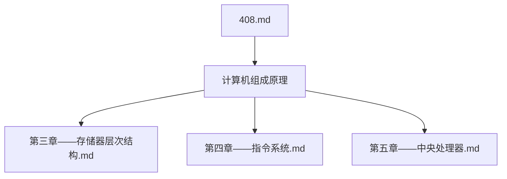
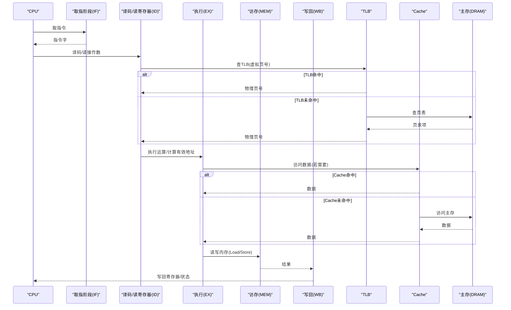
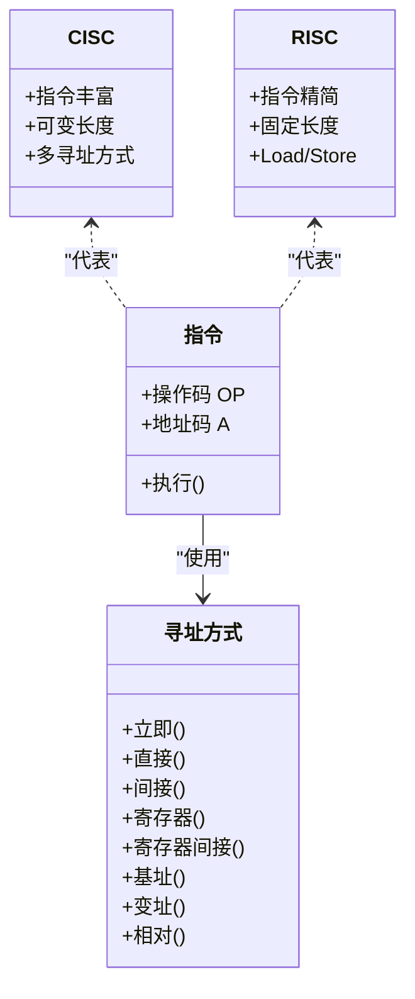
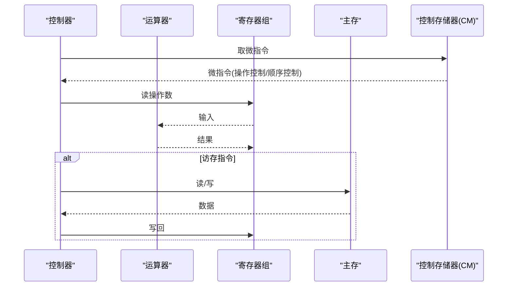
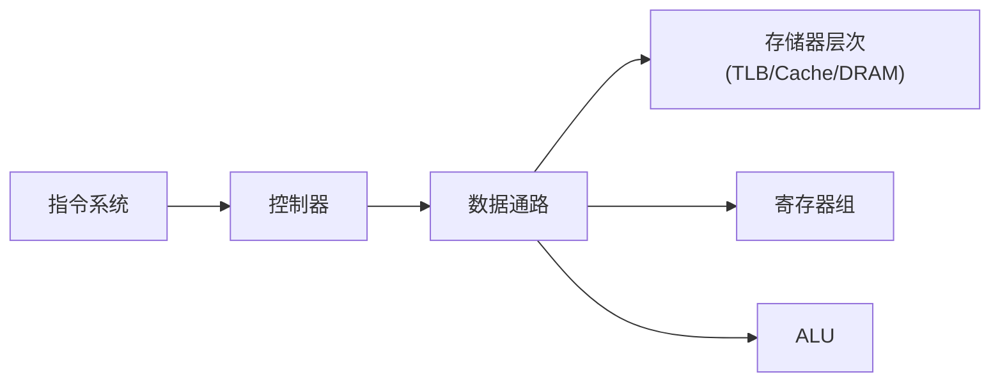

# 计算机组成原理学习指南

<cite>
**本文引用的文件**
- [第三章——存储器层次结构.md](file://408\计算机组成原理\第三章——存储器层次结构.md)
- [第四章——指令系统.md](file://408\计算机组成原理\第四章——指令系统.md)
- [第五章——中央处理器.md](file://408\计算机组成原理\第五章——中央处理器.md)
- [408.md](file://408\408.md)
</cite>

## 更新摘要
**变更内容**
- 大幅扩展了存储器层次结构章节，新增SDRAM/DDR演进、DRAM刷新机制、存储器芯片架构和外部存储详细内容
- 增强了中央处理器章节的指令周期与时序分析内容
- 更新了Cache映射方式、替换算法和写策略的详细实现细节
- 完善了虚拟存储器和TLB的工作原理说明

## 目录
1. [引言](#引言)
2. [项目结构](#项目结构)
3. [核心组件](#核心组件)
4. [架构总览](#架构总览)
5. [详细组件分析](#详细组件分析)
6. [依赖关系分析](#依赖关系分析)
7. [性能考量](#性能考量)
8. [故障排查与常见错误](#故障排查与常见错误)
9. [结论](#结论)
10. [附录：Obsidian可视化实践](#附录obsidian可视化实践)

## 引言
本指南面向计算机组成原理课程的学习者，围绕三大核心主题展开：存储器层次结构（Cache、主存、辅存的层次关系与替换算法）、指令系统设计（指令格式、寻址方式、CISC与RISC比较）以及中央处理器（CPU结构、数据通路与控制单元设计）。文档在讲解工作原理、性能指标和优化策略的同时，提供典型计算题的解法思路（如Cache命中率、TLB+Cache联合访问、指令周期与流水线吞吐/加速比），并给出如何在Obsidian中利用可视化能力展示CPU内部结构与数据流向的实践建议。最后强调软硬件协同设计的思想，帮助读者从系统视角理解各组件之间的协作关系。

## 项目结构
本仓库以"408"为根目录组织计算机组成原理相关笔记，包含操作系统、数据结构、计算机网络等子领域；其中计算机组成原理部分聚焦于存储器层次结构、指令系统与中央处理器三个章节。该结构便于按主题检索与串联知识点，适合构建知识图谱与复习路径。

**图表来源**
- [408.md:1-16](file://408\408.md#L1-L16)

**节内来源**
- [408.md:1-16](file://408\408.md#L1-L16)

## 核心组件
- **存储器层次结构**：涵盖SRAM/DRAM特性、SDRAM/DDR演进、刷新机制、存储器芯片架构、扩展方法、Cache映射与替换、写策略、虚拟存储与TLB、磁盘与SSD等。
- **指令系统**：涵盖指令格式、地址码扩展、数据与指令寻址方式、CISC与RISC对比。
- **中央处理器**：涵盖CPU基本结构、控制器实现（硬布线/微程序）、指令周期与时序分析、指令流水线（吞吐/加速/效率）、冲突类型与解决策略。

这些内容构成计算机体系结构的基石，贯穿"取指—译码—执行—访存—写回"的数据通路与控制流。

**节内来源**
- [第三章——存储器层次结构.md:1-1834](file://408\计算机组成原理\第三章——存储器层次结构.md#L1-L1834)
- [第四章——指令系统.md:1-574](file://408\计算机组成原理\第四章——指令系统.md#L1-L574)
- [第五章——中央处理器.md:1-510](file://408\计算机组成原理\第五章——中央处理器.md#L1-L510)

## 架构总览
下图展示了从指令到执行的总体流程，以及存储器层次与CPU关键部件的交互关系。

**图表来源**
- [第五章——中央处理器.md:159-324](file://408\计算机组成原理\第五章——中央处理器.md#L159-L324)
- [第三章——存储器层次结构.md:286-331](file://408\计算机组成原理\第三章——存储器层次结构.md#L286-L331)

## 详细组件分析

### 存储器层次结构（Cache、主存、辅存）

#### 现代存储器技术演进

**SDRAM与DDR技术**：
- SDRAM（同步动态存储器）：与系统时钟同步工作，所有操作由时钟边沿驱动，延迟可预测
- DDR（双倍数据速率）：上升沿和下降沿都传输数据，带宽翻倍
- DDR5：预取16位（BL16），一次读命令=64B缓存行，双子通道设计

**DRAM刷新机制详解**：
- 刷新以行为单位，每行激活→电荷上到位线→灵敏放大器放大并回写恢复
- 三种刷新方式：集中刷新（死区N×T）、分散刷新（无死区但速度慢）、异步刷新（最常用）
- RAS-only刷新：只需行地址，与引脚复用完美配合

**存储器芯片架构**：
- 五大组成部分：存储体、地址译码器、读写电路、片选线、读写控制线
- 单译码vs双译码：大容量芯片采用二维矩阵降低译码规模
- 存取周期与连续读取：取决于字长与对齐方式

**图表来源**
- [第三章——存储器层次结构.md:136-283](file://408\计算机组成原理\第三章——存储器层次结构.md#L136-L283)

**外存储器技术**：
- 磁盘层次结构：盘片→盘面→磁道→扇区→柱面
- SSD技术：页读写、块擦除、FTL映射、磨损均衡
- 存取时间计算：寻道时间+旋转延迟+传输时间的三段式模型

**节内来源**
- [第三章——存储器层次结构.md:133-221](file://408\计算机组成原理\第三章——存储器层次结构.md#L133-L221)
- [第三章——存储器层次结构.md:222-337](file://408\计算机组成原理\第三章——存储器层次结构.md#L222-L337)
- [第三章——存储器层次结构.md:547-664](file://408\计算机组成原理\第三章——存储器层次结构.md#L547-L664)

### 指令系统设计（指令格式、寻址方式、CISC与RISC）

#### ISA概念深化
- ISA定义：软件与硬件之间的界面契约
- 七大类规定内容：指令格式、寻址方式、数据类型、寄存器组织、地址空间、I/O与中断、工作状态与保护
- 透明性辨析：ISA不规定的实现细节（流水线级数、Cache配置、控制器实现等）

#### 扩展操作码编码法
- 核心原则：短操作码不能是长操作码的前缀
- 通用计算方法：通过递推公式计算各级指令的最大可用条数
- 与VLSM子网划分的类比：前缀码的数学本质

#### 十种数据寻址方式
- 立即寻址、直接寻址、间接寻址、寄存器寻址、寄存器间接寻址
- 基址寻址、变址寻址、相对寻址、隐含寻址、堆栈寻址
- 节拍级微操作对比：不同寻址方式的MAR数据来源差异

**图表来源**
- [第四章——指令系统.md:7-74](file://408\计算机组成原理\第四章——指令系统.md#L7-L74)
- [第四章——指令系统.md:77-193](file://408\计算机组成原理\第四章——指令系统.md#L77-L193)
- [第四章——指令系统.md:196-233](file://408\计算机组成原理\第四章——指令系统.md#L196-L233)

**节内来源**
- [第四章——指令系统.md:7-130](file://408\计算机组成原理\第四章——指令系统.md#L7-L130)
- [第四章——指令系统.md:133-247](file://408\计算机组成原理\第四章——指令系统.md#L133-L247)
- [第四章——指令系统.md:250-485](file://408\计算机组成原理\第四章——指令系统.md#L250-L485)
- [第四章——指令系统.md:488-525](file://408\计算机组成原理\第四章——指令系统.md#L488-L525)

### 中央处理器（CPU结构、数据通路、控制单元设计）

#### 指令周期与时序分析
- 四级时序层级：指令周期→机器周期→节拍→时钟脉冲
- 各周期节拍级微操作序列：取指周期、间址周期、执行周期、中断周期
- 完整示例：`ADD R1, R2`全过程微操作（共7拍）

#### 控制器工作方式
- 硬布线控制器：组合逻辑直接产生控制信号，速度快但设计复杂
- 微程序控制器：微指令存放在控制存储器（CM），灵活可扩展
- 总线传输控制：三态门电平控制与寄存器装载端时钟沿触发的区别

#### 指令流水线深度优化
- 五段流水线：IF/ID/EX/MEM/WB各阶段功能详解
- 性能计算：吞吐率TP=1/Δt、加速比S=n×k/(k+n−1)、效率E=n/(k+n−1)
- 冲突处理：结构冲突、数据冲突（转发/停顿）、控制冲突（分支预测）

**图表来源**
- [第五章——中央处理器.md:7-94](file://408\计算机组成原理\第五章——中央处理器.md#L7-L94)
- [第五章——中央处理器.md:97-156](file://408\计算机组成原理\第五章——中央处理器.md#L97-L156)
- [第五章——中央处理器.md:159-324](file://408\计算机组成原理\第五章——中央处理器.md#L159-L324)

**节内来源**
- [第五章——中央处理器.md:7-94](file://408\计算机组成原理\第五章——中央处理器.md#L7-L94)
- [第五章——中央处理器.md:97-243](file://408\计算机组成原理\第五章——中央处理器.md#L97-L243)
- [第五章——中央处理器.md:246-305](file://408\计算机组成原理\第五章——中央处理器.md#L246-L305)
- [第五章——中央处理器.md:308-473](file://408\计算机组成原理\第五章——中央处理器.md#L308-L473)

## 依赖关系分析
- 指令系统对CPU控制器的依赖：指令格式与寻址方式决定控制信号生成与数据通路配置
- CPU对存储器的依赖：取指与访存阶段涉及TLB、Cache、主存的层级访问，影响平均访问时间与吞吐
- 流水线的依赖：各阶段划分与时钟周期由最长段决定；冲突处理依赖硬件转发与编译器调度

**图表来源**
- [第四章——指令系统.md:7-74](file://408\计算机组成原理\第四章——指令系统.md#L7-L74)
- [第五章——中央处理器.md:7-94](file://408\计算机组成原理\第五章——中央处理器.md#L7-L94)
- [第三章——存储器层次结构.md:286-331](file://408\计算机组成原理\第三章——存储器层次结构.md#L286-L331)

**节内来源**
- [第四章——指令系统.md:7-74](file://408\计算机组成原理\第四章——指令系统.md#L7-L74)
- [第五章——中央处理器.md:7-94](file://408\计算机组成原理\第五章——中央处理器.md#L7-L94)
- [第三章——存储器层次结构.md:286-331](file://408\计算机组成原理\第三章——存储器层次结构.md#L286-L331)

## 性能考量
- **Cache性能**：命中率h、平均访问时间ta、效率e的计算；映射方式与替换算法对命中率的影响
- **虚拟存储性能**：TLB命中率与Cache命中率的联合访问模型，考虑多次访存代价
- **流水线性能**：吞吐率TP=1/Δt、加速比S=n×k/(k+n−1)、效率E=n/(k+n−1)；时钟周期Δt取最长段
- **存储器带宽优化**：多模块交叉编址、DRAM行缓冲、DDR突发传输等技术的应用
- **优化策略**：
  - 增大Cache容量、降低缺失率（合理映射与替换）
  - 采用写回+写分配或全写+非写分配的组合
  - 引入数据旁路/转发减少数据冲突停顿
  - 分支预测提高控制冲突下的流水线利用率
  - 编译器指令重排避免RAW/WAR/WAW冲突

## 故障排查与常见错误
- **Cache命中率与地址划分错误**：
  - 直接映射行号 = 主存块号 mod Cache行数；组相联组号 = 主存块号 mod 组数
  - 标记位 = 主存地址位 − Index位 − Offset位
- **DRAM刷新误用**：刷新以行为单位，不是位；注意死区时间与刷新间隔
- **寻址方式误判**：
  - 相对寻址EA=(PC)+A，注意PC已指向下一条指令
  - 基址寻址由OS管理基址寄存器；变址寻址由用户修改变址寄存器
- **流水线冲突处理不当**：
  - RAW冲突可通过转发解决大部分情况；Load-Use冲突可能需要插入气泡
  - 控制冲突采用静态/动态分支预测，预测错误需清空流水线
- **微程序控制器概念混淆**：
  - 微命令是最基本控制信号；微指令是微命令集合；微程序是微指令序列；控制存储器CM存放微程序
- **存储器技术理解偏差**：
  - SRAM ≠ SDRAM：前者触发器不刷新（Cache），后者同步化DRAM仍靠电容、仍需刷新（主存）
  - 位扩展是并行而非串行：片选并联，多片同时输出拼字
  - DMA不经Cache引发一致性问题：需要flush/invalidate操作

**节内来源**
- [第三章——存储器层次结构.md:344-371](file://408\计算机组成原理\第三章——存储器层次结构.md#L344-L371)
- [第四章——指令系统.md:251-278](file://408\计算机组成原理\第四章——指令系统.md#L251-L278)
- [第五章——中央处理器.md:326-352](file://408\计算机组成原理\第五章——中央处理器.md#L326-L352)

## 结论
本指南围绕存储器层次结构、指令系统与中央处理器三大主题，系统化梳理了工作原理、性能指标与优化策略，并通过典型计算题强化理解。结合Obsidian的可视化能力，可将CPU内部结构与数据流向直观呈现，有助于建立从指令到执行的完整认知。在实际学习与设计中，应坚持软硬件协同思想：指令集设计需考虑硬件实现成本与性能，而硬件设计需服务于指令语义与系统目标。

## 附录：Obsidian可视化实践
- 使用Mermaid绘制CPU数据通路图：将IF/ID/EX/MEM/WB各阶段与寄存器、ALU、存储器连接，标注数据流向与控制信号
- 使用流程图展示Cache替换过程：从命中判断到替换策略与写策略的选择
- 使用类图表达指令系统与控制器关系：指令格式、寻址方式与控制器生成的微操作之间的关系
- 使用序列图描述TLB与Cache联合访问：体现TLB命中/未命中的不同路径与访存次数
- 使用思维导图整理考点与公式：如命中率、加速比、效率等常用公式速查
- 使用架构图展示存储器层次：从寄存器到辅存的完整层次结构与技术演进