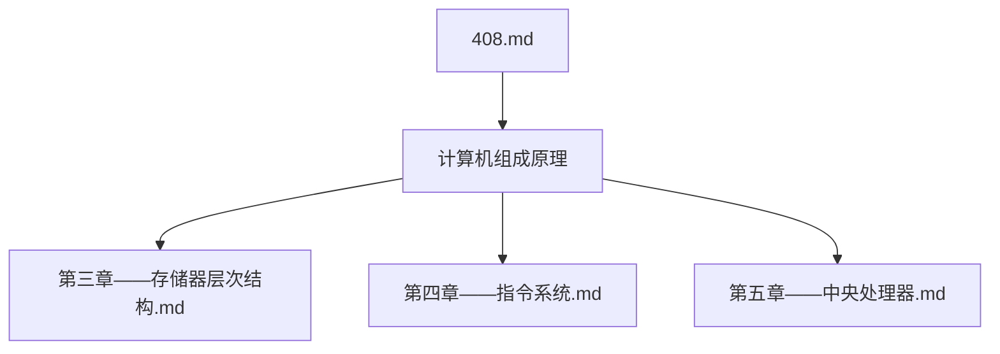
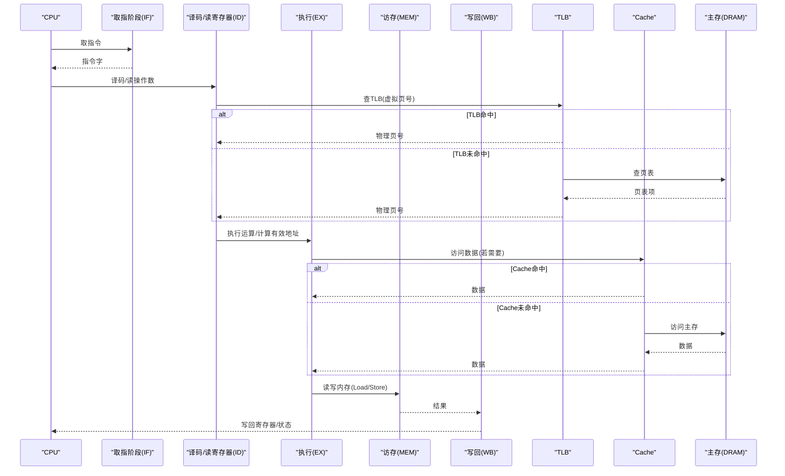
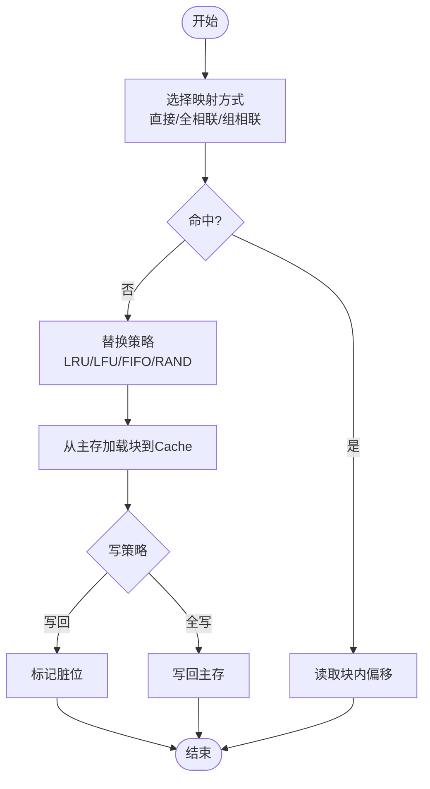
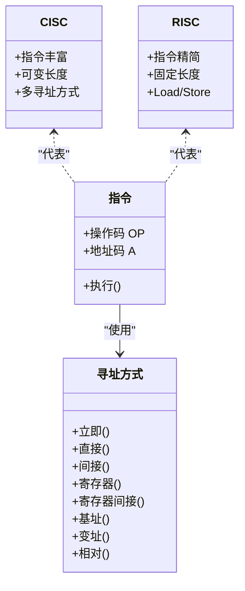
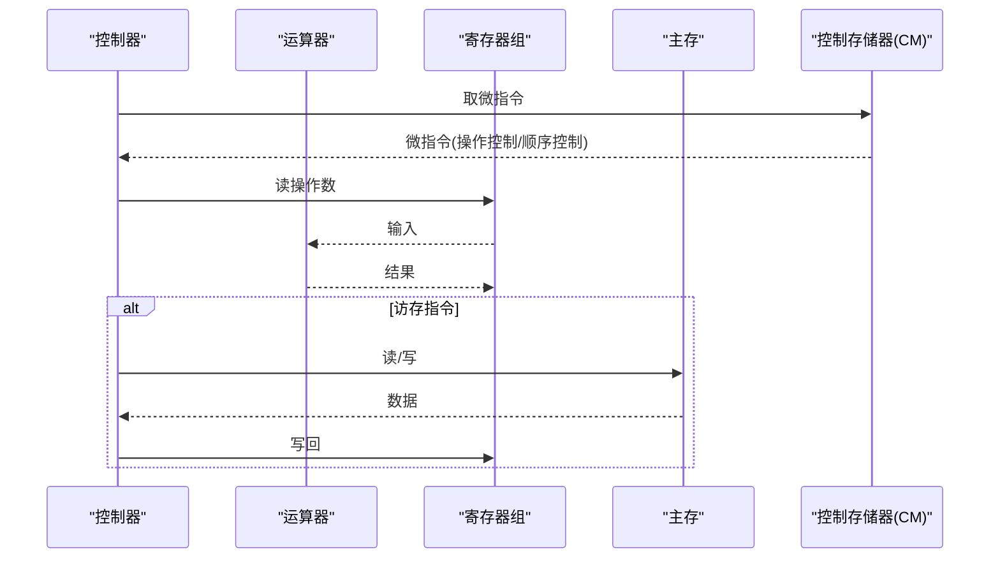
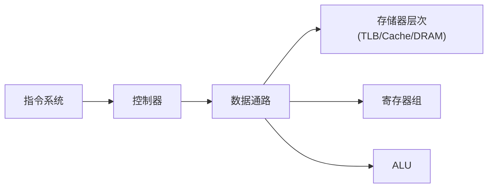

# 计算机组成原理学习指南

<cite>
**本文引用的文件**
- [第三章——存储器层次结构.md](file://408\计算机组成原理\第三章——存储器层次结构.md)
- [第四章——指令系统.md](file://408\计算机组成原理\第四章——指令系统.md)
- [第五章——中央处理器.md](file://408\计算机组成原理\第五章——中央处理器.md)
- [408.md](file://408\408.md)
</cite>

## 目录
1. [引言](#引言)
2. [项目结构](#项目结构)
3. [核心组件](#核心组件)
4. [架构总览](#架构总览)
5. [详细组件分析](#详细组件分析)
6. [依赖关系分析](#依赖关系分析)
7. [性能考量](#性能考量)
8. [故障排查与常见错误](#故障排查与常见错误)
9. [结论](#结论)
10. [附录：Obsidian可视化实践](#附录obsidian可视化实践)

## 引言
本指南面向计算机组成原理课程的学习者，围绕三大核心主题展开：存储器层次结构（Cache、主存、辅存的层次关系与替换算法）、指令系统设计（指令格式、寻址方式、CISC与RISC比较）以及中央处理器（CPU结构、数据通路与控制单元设计）。文档在讲解工作原理、性能指标和优化策略的同时，提供典型计算题的解法思路（如Cache命中率、TLB+Cache联合访问、指令周期与流水线吞吐/加速比），并给出如何在Obsidian中利用可视化能力展示CPU内部结构与数据流向的实践建议。最后强调软硬件协同设计的思想，帮助读者从系统视角理解各组件之间的协作关系。

## 项目结构
本仓库以“408”为根目录组织计算机组成原理相关笔记，包含操作系统、数据结构、计算机网络等子领域；其中计算机组成原理部分聚焦于存储器层次结构、指令系统与中央处理器三个章节。该结构便于按主题检索与串联知识点，适合构建知识图谱与复习路径。

**图表来源**
- [408.md:1-16](file://408\408.md#L1-L16)

**节内来源**
- [408.md:1-16](file://408\408.md#L1-L16)

## 核心组件
- 存储器层次结构：涵盖SRAM/DRAM特性、刷新机制、扩展方法、Cache映射与替换、写策略、虚拟存储与TLB等。
- 指令系统：涵盖指令格式、地址码扩展、数据与指令寻址方式、CISC与RISC对比。
- 中央处理器：涵盖CPU基本结构、控制器实现（硬布线/微程序）、指令流水线（吞吐/加速/效率）、冲突类型与解决策略。

这些内容构成计算机体系结构的基石，贯穿“取指—译码—执行—访存—写回”的数据通路与控制流。

**节内来源**
- [第三章——存储器层次结构.md:1-375](file://408\计算机组成原理\第三章——存储器层次结构.md#L1-L375)
- [第四章——指令系统.md:1-282](file://408\计算机组成原理\第四章——指令系统.md#L1-L282)
- [第五章——中央处理器.md:1-356](file://408\计算机组成原理\第五章——中央处理器.md#L1-L356)

## 架构总览
下图展示了从指令到执行的总体流程，以及存储器层次与CPU关键部件的交互关系。

**图表来源**
- [第五章——中央处理器.md:159-324](file://408\计算机组成原理\第五章——中央处理器.md#L159-L324)
- [第三章——存储器层次结构.md:286-331](file://408\计算机组成原理\第三章——存储器层次结构.md#L286-L331)

## 详细组件分析

### 存储器层次结构（Cache、主存、辅存）
- 层次关系与局部性原理：寄存器→Cache→主存→辅存，基于时间/空间局部性提升整体性能。
- SRAM与DRAM：SRAM用于Cache（无需刷新、速度快），DRAM用于主存（需刷新、集成度高、成本低）。
- DRAM刷新：集中/分散/异步刷新，刷新周期通常为2ms，以行为单位。
- 存储器扩展：位扩展（增加字长）、字扩展（增加容量）、字位同时扩展。
- Cache映射与替换：直接映射、全相联、组相联；替换算法包括LRU、LFU、FIFO、RAND。
- Cache写策略：写命中（全写法/写回法）、写不命中（写分配/非写分配）。
- 虚拟存储与TLB：TLB缓存页表项，减少访存次数；TLB与Cache联合访问的平均访问时间计算。

**图表来源**
- [第三章——存储器层次结构.md:136-283](file://408\计算机组成原理\第三章——存储器层次结构.md#L136-L283)

**节内来源**
- [第三章——存储器层次结构.md:58-134](file://408\计算机组成原理\第三章——存储器层次结构.md#L58-L134)
- [第三章——存储器层次结构.md:136-283](file://408\计算机组成原理\第三章——存储器层次结构.md#L136-L283)
- [第三章——存储器层次结构.md:286-331](file://408\计算机组成原理\第三章——存储器层次结构.md#L286-L331)

### 指令系统设计（指令格式、寻址方式、CISC与RISC）
- 指令格式：操作码+地址码；定长/变长指令字；按地址码数目分类（三/二/一/零地址）。
- 扩展操作码：短操作码不能是长操作码的前缀，通过地址码字段借用扩展操作码数量。
- 数据寻址方式：立即、直接、间接、寄存器、寄存器间接、基址、变址、相对等九种方式及其有效地址计算与时序代价。
- 指令寻址：顺序与跳跃（条件/无条件/调用返回/循环控制）。
- CISC与RISC对比：指令集规模、长度规整性、访存限制（Load/Store）、控制器实现（硬布线/微程序）、流水线友好度等。

**图表来源**
- [第四章——指令系统.md:7-74](file://408\计算机组成原理\第四章——指令系统.md#L7-L74)
- [第四章——指令系统.md:77-193](file://408\计算机组成原理\第四章——指令系统.md#L77-L193)
- [第四章——指令系统.md:196-233](file://408\计算机组成原理\第四章——指令系统.md#L196-L233)

**节内来源**
- [第四章——指令系统.md:7-74](file://408\计算机组成原理\第四章——指令系统.md#L7-L74)
- [第四章——指令系统.md:77-193](file://408\计算机组成原理\第四章——指令系统.md#L77-L193)
- [第四章——指令系统.md:196-233](file://408\计算机组成原理\第四章——指令系统.md#L196-L233)

### 中央处理器（CPU结构、数据通路、控制单元设计）
- CPU基本结构：运算器（ALU、通用寄存器、ACC、PSW等）与控制器（PC、IR、MAR、MDR、时序、微操作信号发生器）。
- 控制器实现：
  - 硬布线控制器：组合逻辑直接产生控制信号，速度快但设计复杂，适合RISC。
  - 微程序控制器：微指令存放在控制存储器（CM），灵活可扩展，适合CISC。
- 指令流水线：五段流水线（IF/ID/EX/MEM/WB），吞吐率、加速比、效率的计算；冲突类型及解决（结构冲突、数据冲突转发/停顿、控制冲突分支预测）。
- 关键寄存器可见性：PC/IR/MAR/MDR对用户透明，通用寄存器与PSW可见。

**图表来源**
- [第五章——中央处理器.md:7-94](file://408\计算机组成原理\第五章——中央处理器.md#L7-L94)
- [第五章——中央处理器.md:97-156](file://408\计算机组成原理\第五章——中央处理器.md#L97-L156)
- [第五章——中央处理器.md:159-324](file://408\计算机组成原理\第五章——中央处理器.md#L159-L324)

**节内来源**
- [第五章——中央处理器.md:7-94](file://408\计算机组成原理\第五章——中央处理器.md#L7-L94)
- [第五章——中央处理器.md:97-156](file://408\计算机组成原理\第五章——中央处理器.md#L97-L156)
- [第五章——中央处理器.md:159-324](file://408\计算机组成原理\第五章——中央处理器.md#L159-L324)

## 依赖关系分析
- 指令系统对CPU控制器的依赖：指令格式与寻址方式决定控制信号生成与数据通路配置。
- CPU对存储器的依赖：取指与访存阶段涉及TLB、Cache、主存的层级访问，影响平均访问时间与吞吐。
- 流水线的依赖：各阶段划分与时钟周期由最长段决定；冲突处理依赖硬件转发与编译器调度。

**图表来源**
- [第四章——指令系统.md:7-74](file://408\计算机组成原理\第四章——指令系统.md#L7-L74)
- [第五章——中央处理器.md:7-94](file://408\计算机组成原理\第五章——中央处理器.md#L7-L94)
- [第三章——存储器层次结构.md:286-331](file://408\计算机组成原理\第三章——存储器层次结构.md#L286-L331)

**节内来源**
- [第四章——指令系统.md:7-74](file://408\计算机组成原理\第四章——指令系统.md#L7-L74)
- [第五章——中央处理器.md:7-94](file://408\计算机组成原理\第五章——中央处理器.md#L7-L94)
- [第三章——存储器层次结构.md:286-331](file://408\计算机组成原理\第三章——存储器层次结构.md#L286-L331)

## 性能考量
- Cache性能：命中率h、平均访问时间ta、效率e的计算；映射方式与替换算法对命中率的影响。
- 虚拟存储性能：TLB命中率与Cache命中率的联合访问模型，考虑多次访存代价。
- 流水线性能：吞吐率TP=1/Δt、加速比S=n×k/(k+n−1)、效率E=n/(k+n−1)；时钟周期Δt取最长段。
- 优化策略：
  - 增大Cache容量、降低缺失率（合理映射与替换）。
  - 采用写回+写分配或全写+非写分配的组合。
  - 引入数据旁路/转发减少数据冲突停顿。
  - 分支预测提高控制冲突下的流水线利用率。
  - 编译器指令重排避免RAW/WAR/WAW冲突。

[本节为通用性能讨论，不直接分析具体文件]

## 故障排查与常见错误
- Cache命中率与地址划分错误：
  - 直接映射行号 = 主存块号 mod Cache行数；组相联组号 = 主存块号 mod 组数。
  - 标记位 = 主存地址位 − Index位 − Offset位。
- DRAM刷新误用：刷新以行为单位，不是位；注意死区时间与刷新间隔。
- 寻址方式误判：
  - 相对寻址EA=(PC)+A，注意PC已指向下一条指令。
  - 基址寻址由OS管理基址寄存器；变址寻址由用户修改变址寄存器。
- 流水线冲突处理不当：
  - RAW冲突可通过转发解决大部分情况；Load-Use冲突可能需要插入气泡。
  - 控制冲突采用静态/动态分支预测，预测错误需清空流水线。
- 微程序控制器概念混淆：
  - 微命令是最基本控制信号；微指令是微命令集合；微程序是微指令序列；控制存储器CM存放微程序。

**节内来源**
- [第三章——存储器层次结构.md:344-371](file://408\计算机组成原理\第三章——存储器层次结构.md#L344-L371)
- [第四章——指令系统.md:251-278](file://408\计算机组成原理\第四章——指令系统.md#L251-L278)
- [第五章——中央处理器.md:326-352](file://408\计算机组成原理\第五章——中央处理器.md#L326-L352)

## 结论
本指南围绕存储器层次结构、指令系统与中央处理器三大主题，系统化梳理了工作原理、性能指标与优化策略，并通过典型计算题强化理解。结合Obsidian的可视化能力，可将CPU内部结构与数据流向直观呈现，有助于建立从指令到执行的完整认知。在实际学习与设计中，应坚持软硬件协同思想：指令集设计需考虑硬件实现成本与性能，而硬件设计需服务于指令语义与系统目标。

[本节为总结性内容，不直接分析具体文件]

## 附录：Obsidian可视化实践
- 使用Mermaid绘制CPU数据通路图：将IF/ID/EX/MEM/WB各阶段与寄存器、ALU、存储器连接，标注数据流向与控制信号。
- 使用流程图展示Cache替换过程：从命中判断到替换策略与写策略的选择。
- 使用类图表达指令系统与控制器关系：指令格式、寻址方式与控制器生成的微操作之间的关系。
- 使用序列图描述TLB与Cache联合访问：体现TLB命中/未命中的不同路径与访存次数。
- 使用思维导图整理考点与公式：如命中率、加速比、效率等常用公式速查。

[本节为工具使用建议，不直接分析具体文件]