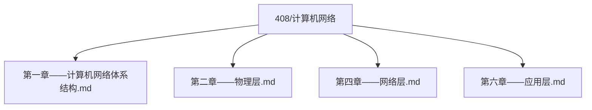
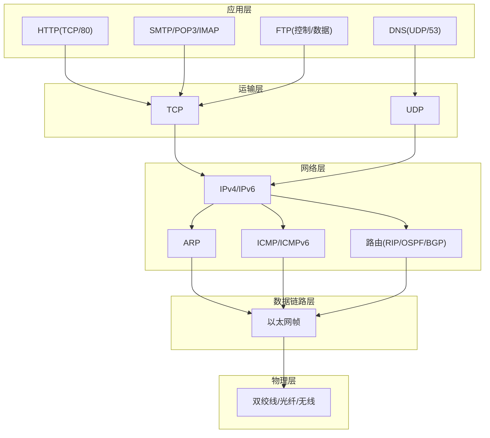
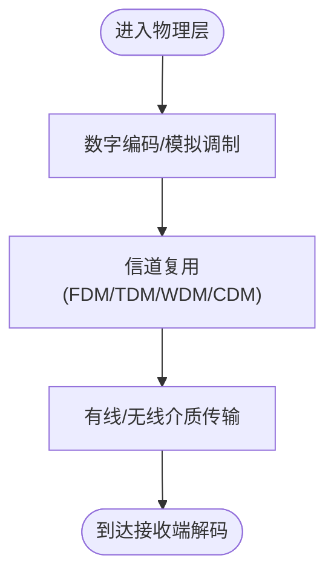
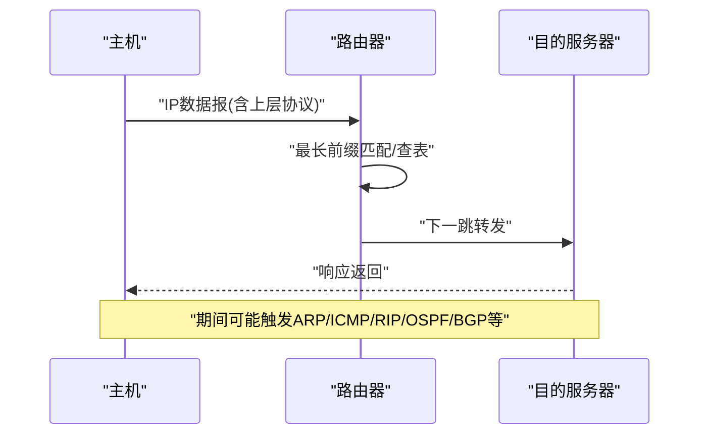
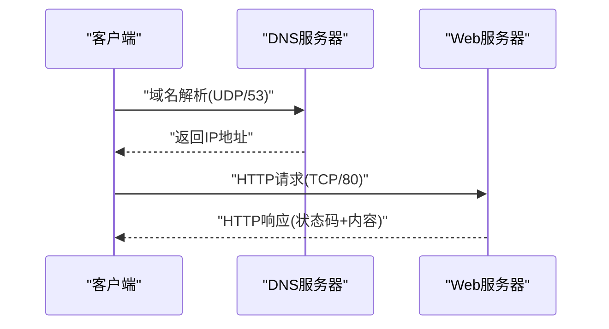
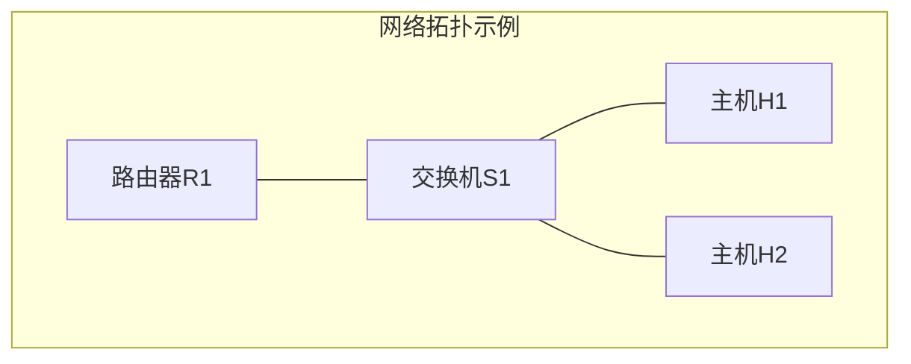

# 计算机网络学习指南

<cite>
**本文引用的文件**
- [第一章——计算机网络体系结构.md](file://408/计算机网络/第一章——计算机网络体系结构.md)
- [第二章——物理层.md](file://408/计算机网络/第二章——物理层.md)
- [第四章——网络层.md](file://408/计算机网络/第四章——网络层.md)
- [第六章——应用层.md](file://408/计算机网络/第六章——应用层.md)
- [graph.json](file://.obsidian/graph.json)
- [workspace.json](file://.obsidian/workspace.json)
</cite>

## 目录
1. [引言](#引言)
2. [项目结构](#项目结构)
3. [核心组件](#核心组件)
4. [架构总览](#架构总览)
5. [详细组件分析](#详细组件分析)
6. [依赖关系分析](#依赖关系分析)
7. [性能与优化](#性能与优化)
8. [故障排查指南](#故障排查指南)
9. [结论](#结论)
10. [附录：Obsidian绘制网络拓扑与协议交互图](#附录obsidian绘制网络拓扑与协议交互图)

## 引言
本指南面向计算机网络课程学习者，系统梳理OSI七层模型与TCP/IP协议族，覆盖物理层传输介质与编码、网络层IP与路由、应用层HTTP/DNS等协议工作原理；深入讲解数据包封装/解封装、路由选择、流量控制机制；提供网络配置与故障排查案例；说明如何在Obsidian中绘制网络拓扑与协议交互流程图；并给出性能优化与安全加固建议。强调分层设计思想与协议标准化的重要性，帮助读者建立从理论到实践的系统化认知。

## 项目结构
仓库以“408/计算机网络”为核心知识区，按章节组织笔记：
- 第一章：体系结构与参考模型（OSI/TCP/IP/五层）、网络性能指标
- 第二章：物理层（数据通信基础、奈奎斯特/香农定理、编码调制、传输介质、复用）
- 第四章：网络层（IPv4/IPv6、ARP/ICMP、路由算法与协议RIP/OSPF/BGP、NAT/DHCP、SDN、组播、移动IP）
- 第六章：应用层（DNS、HTTP、邮件SMTP/POP3/IMAP、FTP）



图表来源
- [第一章——计算机网络体系结构.md:1-323](file://408/计算机网络/第一章——计算机网络体系结构.md#L1-L323)
- [第二章——物理层.md:1-264](file://408/计算机网络/第二章——物理层.md#L1-L264)
- [第四章——网络层.md:1-968](file://408/计算机网络/第四章——网络层.md#L1-L968)
- [第六章——应用层.md:1-393](file://408/计算机网络/第六章——应用层.md#L1-L393)

章节来源
- [第一章——计算机网络体系结构.md:1-323](file://408/计算机网络/第一章——计算机网络体系结构.md#L1-L323)
- [第二章——物理层.md:1-264](file://408/计算机网络/第二章——物理层.md#L1-L264)
- [第四章——网络层.md:1-968](file://408/计算机网络/第四章——网络层.md#L1-L968)
- [第六章——应用层.md:1-393](file://408/计算机网络/第六章——应用层.md#L1-L393)

## 核心组件
- 参考模型与分层思想：OSI七层、TCP/IP四层、五层教学模型，明确各层职责与PDU形态，理解封装/解封装流程。
- 物理层：数据通信基础、奈奎斯特/香农极限、数字编码与模拟调制、有线/无线介质、信道复用（FDM/TDM/WDM/CDMA）。
- 网络层：IPv4地址与子网/CIDR、IP分片与TTL、ARP/ICMP、路由算法（距离向量/链路状态）、RIP/OSPF/BGP、NAT/DHCP、SDN与OpenFlow、IPv6与ICMPv6、组播与IGMP。
- 应用层：DNS解析过程、HTTP请求/响应与状态码、Cookie/Session、邮件协议（SMTP/POP3/IMAP）、FTP控制/数据连接。

章节来源
- [第一章——计算机网络体系结构.md:91-227](file://408/计算机网络/第一章——计算机网络体系结构.md#L91-L227)
- [第二章——物理层.md:5-264](file://408/计算机网络/第二章——物理层.md#L5-L264)
- [第四章——网络层.md:5-968](file://408/计算机网络/第四章——网络层.md#L5-L968)
- [第六章——应用层.md:5-393](file://408/计算机网络/第六章——应用层.md#L5-L393)

## 架构总览
下图展示从应用层到物理层的典型数据流与关键协议，体现分层封装与跨层协作。



图表来源
- [第一章——计算机网络体系结构.md:91-227](file://408/计算机网络/第一章——计算机网络体系结构.md#L91-L227)
- [第四章——网络层.md:103-467](file://408/计算机网络/第四章——网络层.md#L103-L467)
- [第六章——应用层.md:5-393](file://408/计算机网络/第六章——应用层.md#L5-L393)

## 详细组件分析

### 参考模型与数据封装/解封装
- OSI七层与TCP/IP四层映射清晰，五层模型便于教学与实践对照。
- 发送端自上而下逐层封装（报文→段→包→帧→比特），接收端自下而上解封装。
- 关键PDU：应用层报文、运输层报文段、网络层数据报、链路层帧、物理层比特。

```mermaid
sequenceDiagram
participant App as "应用层"
participant Trans as "运输层"
participant Net as "网络层"
participant Link as "数据链路层"
participant Phy as "物理层"
App->>Trans : "生成应用报文"
Trans->>Net : "封装为报文段"
Net->>Link : "封装为数据报"
Link->>Phy : "封装为帧"
Phy-->>Phy : "比特流在介质上传输"
Note over Phy,App : "接收端反向解封装"
```

图表来源
- [第一章——计算机网络体系结构.md:91-227](file://408/计算机网络/第一章——计算机网络体系结构.md#L91-L227)

章节来源
- [第一章——计算机网络体系结构.md:91-227](file://408/计算机网络/第一章——计算机网络体系结构.md#L91-L227)

### 物理层：编码、调制与复用
- 奈奎斯特定理（无噪声）与香农定理（有噪声）决定信道容量上限。
- 数字编码（NRZ、曼彻斯特、差分曼彻斯特）与模拟调制（ASK/FSK/PSK/QAM）用于不同介质与场景。
- 复用技术（FDM/TDM/STDM/WDM/CDMA）提升信道利用率，CDMA通过正交码片序列实现多址接入。



图表来源
- [第二章——物理层.md:55-243](file://408/计算机网络/第二章——物理层.md#L55-L243)

章节来源
- [第二章——物理层.md:5-264](file://408/计算机网络/第二章——物理层.md#L5-L264)

### 网络层：IP、ARP/ICMP与路由
- IPv4地址分类、子网划分、CIDR聚合；IP分片与重组、TTL防环。
- ARP将IP解析为MAC（局域网内广播请求、单播响应）；ICMP用于差错与控制（ping/traceroute原理）。
- 路由算法：距离向量（RIP）与链路状态（OSPF）对比；BGP用于AS间路径选择。
- NAT/NAPT解决地址不足；DHCP自动分配网络参数；SDN/OpenFlow实现集中式控制与可编程转发。
- IPv6简化首部、取消广播、引入任播；ICMPv6承载邻居发现等功能。
- 组播通过IGMP管理组成员，PIM构建分发树。



图表来源
- [第四章——网络层.md:103-467](file://408/计算机网络/第四章——网络层.md#L103-L467)

章节来源
- [第四章——网络层.md:5-968](file://408/计算机网络/第四章——网络层.md#L5-L968)

### 应用层：DNS与HTTP
- DNS采用层次化命名与递归/迭代查询，本地DNS缓存加速解析。
- HTTP基于TCP，请求/响应格式、状态码、持久连接与流水线；Cookie/Session补充无状态会话。
- 邮件系统：SMTP推送、POP3/IMAP拉取；FTP控制/数据分离连接。



图表来源
- [第六章——应用层.md:5-209](file://408/计算机网络/第六章——应用层.md#L5-L209)

章节来源
- [第六章——应用层.md:5-393](file://408/计算机网络/第六章——应用层.md#L5-L393)

## 依赖关系分析
- 应用层依赖运输层（TCP/UDP）提供端到端服务；DNS使用UDP，HTTP/邮件/FTP使用TCP。
- 网络层依赖数据链路层进行帧级交付，依赖物理层进行比特传输；路由协议（RIP/OSPF/BGP）在网络层运行或封装于IP。
- 物理层为上层提供带宽与时延特性，影响整体吞吐与时延。


图表来源
- [第一章——计算机网络体系结构.md:91-227](file://408/计算机网络/第一章——计算机网络体系结构.md#L91-L227)

章节来源
- [第一章——计算机网络体系结构.md:91-227](file://408/计算机网络/第一章——计算机网络体系结构.md#L91-L227)

## 性能与优化
- 时延与带宽：发送时延、传播时延、处理时延、排队时延共同构成总时延；时延带宽积反映链路“管道容量”。
- 吞吐量受瓶颈链路限制；丢包率反映拥塞程度。
- 优化方向：
  - 物理层：提高信噪比、合理编码与调制、选择合适介质与复用策略。
  - 网络层：合理子网划分与路由聚合、启用快速收敛的路由协议、避免环路（TTL）、利用NAT缓解地址压力。
  - 应用层：使用持久连接、减少握手开销、合理使用缓存与压缩。

章节来源
- [第一章——计算机网络体系结构.md:229-303](file://408/计算机网络/第一章——计算机网络体系结构.md#L229-L303)
- [第二章——物理层.md:55-104](file://408/计算机网络/第二章——物理层.md#L55-L104)
- [第四章——网络层.md:169-176](file://408/计算机网络/第四章——网络层.md#L169-L176)
- [第六章——应用层.md:155-176](file://408/计算机网络/第六章——应用层.md#L155-L176)

## 故障排查指南
- 连通性测试：使用ping（ICMP回送请求/回答）检测可达性与延迟；traceroute利用TTL递增定位中间节点。
- 地址解析问题：检查ARP缓存与局域网可达性；跨网段通信需确认默认网关与路由表。
- 路由问题：查看路由表最长前缀匹配是否正确；检查RIP/OSPF邻接与LSA洪泛；BGP会话与路径属性。
- 应用层问题：验证DNS解析（本地缓存、权威服务器）；HTTP状态码定位错误；邮件协议端口与认证。
- 工具与命令：结合操作系统工具（如ping、tracert/traceroute、nslookup/dig、netstat、ipconfig/ifconfig）定位问题。

章节来源
- [第四章——网络层.md:202-241](file://408/计算机网络/第四章——网络层.md#L202-L241)
- [第六章——应用层.md:354-393](file://408/计算机网络/第六章——应用层.md#L354-L393)

## 结论
通过分层设计与协议标准化，计算机网络实现了复杂系统的模块化与可演进性。掌握OSI/TCP/IP模型、物理层编码与复用、网络层IP与路由、应用层协议工作原理，是理解数据包传输、路由选择与流量控制的基础。配合Obsidian可视化与实战排查，可将抽象概念转化为可操作的知识体系，支撑工程实践与持续学习。

## 附录：Obsidian绘制网络拓扑与协议交互图
- 使用Mermaid语法在Markdown中直接绘制拓扑与流程图，无需外部插件即可渲染。
- Obsidian图谱视图可用于展示笔记之间的关联，便于构建知识网络。
- 工作区配置支持侧边栏与面板布局，便于同时编辑与预览。



图表来源
- [graph.json:1-30](file://.obsidian/graph.json#L1-L30)
- [workspace.json:191-234](file://.obsidian/workspace.json#L191-L234)

章节来源
- [graph.json:1-30](file://.obsidian/graph.json#L1-L30)
- [workspace.json:191-234](file://.obsidian/workspace.json#L191-L234)