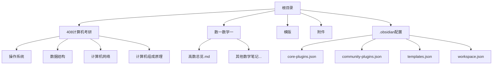
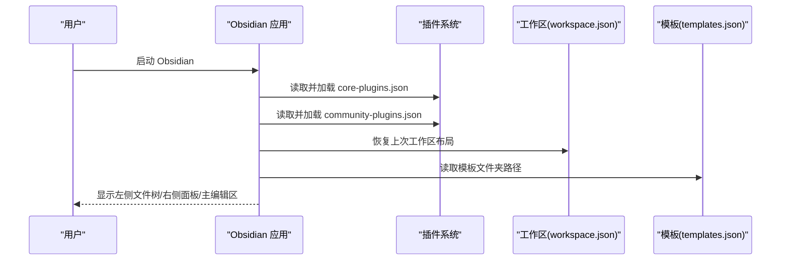
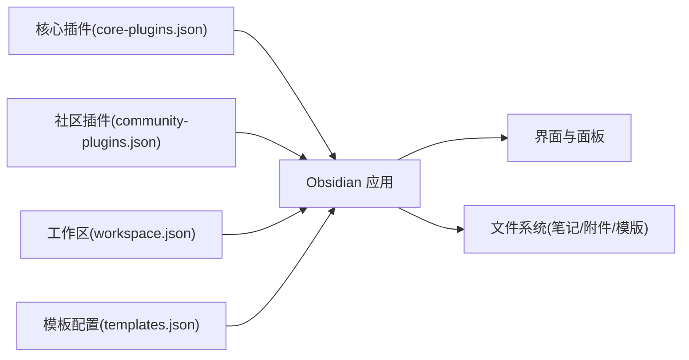

# 快速开始

<cite>
**本文引用的文件**
- [community-plugins.json](file://.obsidian/community-plugins.json)
- [core-plugins.json](file://.obsidian/core-plugins.json)
- [templates.json](file://.obsidian/templates.json)
- [workspace.json](file://.obsidian/workspace.json)
- [高数总览.md](file://数一/高数总览.md)
- [操作系统.md](file://408/操作系统/操作系统.md)
- [数据结构.md](file://408/数据结构/数据结构.md)
</cite>

## 目录
1. [简介](#简介)
2. [项目结构](#项目结构)
3. [核心组件](#核心组件)
4. [架构总览](#架构总览)
5. [详细组件分析](#详细组件分析)
6. [依赖关系分析](#依赖关系分析)
7. [性能与使用建议](#性能与使用建议)
8. [故障排查指南](#故障排查指南)
9. [结论](#结论)
10. [附录：常用操作速查](#附录：常用操作速查)

## 简介
本指南面向首次接触该 Obsidian 知识库的新手，目标是让你在最短时间完成环境搭建、插件安装与配置，并能够浏览现有笔记、创建新笔记、使用模板以及建立知识链接。仓库已内置社区插件清单与工作区布局，便于你直接复用。

## 项目结构
该知识库采用“主题目录 + 索引页”的组织方式：
- 顶层包含多个学科或主题目录（如 408、数一），每个目录下有若干专题笔记。
- 各主题目录内通常有一篇“索引/总览”笔记，通过双向链接串联相关子笔记，形成知识网络。
- .obsidian 目录保存 Obsidian 应用配置与插件设置；模版目录用于存放模板文件。

**图表来源**
- [core-plugins.json:1-33](file://.obsidian/core-plugins.json#L1-L33)
- [community-plugins.json:1-12](file://.obsidian/community-plugins.json#L1-L12)
- [templates.json:1-3](file://.obsidian/templates.json#L1-L3)
- [workspace.json:1-267](file://.obsidian/workspace.json#L1-L267)

**章节来源**
- [core-plugins.json:1-33](file://.obsidian/core-plugins.json#L1-L33)
- [community-plugins.json:1-12](file://.obsidian/community-plugins.json#L1-L12)
- [templates.json:1-3](file://.obsidian/templates.json#L1-L3)
- [workspace.json:1-267](file://.obsidian/workspace.json#L1-L267)

## 核心组件
- 核心插件：文件浏览器、全局搜索、切换器、图谱、反向链接、大纲、属性、每日笔记、模板、命令面板等均已启用，开箱即用。
- 社区插件：dataview、templater、obsidian-git、excalidraw、kanban、tag-wrangler、copilot、local-rest-api、realclaudian、terminal 等已注册，需在 Obsidian 中安装后启用。
- 工作区：左侧为文件列表/搜索/书签，右侧为反向链接/出链/标签/属性/大纲/Copilot/Claudian/Git 视图，主区域打开当前笔记。

**章节来源**
- [core-plugins.json:1-33](file://.obsidian/core-plugins.json#L1-L33)
- [community-plugins.json:1-12](file://.obsidian/community-plugins.json#L1-L12)
- [workspace.json:1-267](file://.obsidian/workspace.json#L1-L267)

## 架构总览
下图展示了从启动 Obsidian 到加载工作区与插件的完整流程，帮助你理解“为什么你的界面会这样显示”。

**图表来源**
- [core-plugins.json:1-33](file://.obsidian/core-plugins.json#L1-L33)
- [community-plugins.json:1-12](file://.obsidian/community-plugins.json#L1-L12)
- [workspace.json:1-267](file://.obsidian/workspace.json#L1-L267)
- [templates.json:1-3](file://.obsidian/templates.json#L1-L3)

## 详细组件分析

### 环境搭建步骤（从零到可用）
- 安装 Obsidian
  - 前往官网下载并安装 Obsidian（Windows/macOS/Linux）。
  - 首次运行后选择“新建库”，将本仓库所在目录作为库根目录打开。
- 启用核心插件
  - 进入“设置 > 核心插件”，确保以下插件处于开启状态：文件浏览器、全局搜索、切换器、图谱、反向链接、大纲、属性、每日笔记、模板、命令面板等。
  - 参考：[core-plugins.json:1-33](file://.obsidian/core-plugins.json#L1-L33)
- 安装社区插件
  - 在“设置 > 第三方插件”中，先关闭“安全模式”，然后依次安装以下插件并启用：
    - dataview
    - templater
    - obsidian-git
    - obsidian-excalidraw-plugin
    - obsidian-kanban
    - tag-wrangler
    - copilot
    - obsidian-local-rest-api
    - realclaudian
    - terminal
  - 参考：[community-plugins.json:1-12](file://.obsidian/community-plugins.json#L1-L12)
- 恢复工作区
  - 重启 Obsidian 后会自动恢复上次的工作区布局（左侧文件树/搜索/书签，右侧反向链接/出链/标签/属性/大纲/Copilot/Claudian/Git 视图）。
  - 参考：[workspace.json:1-267](file://.obsidian/workspace.json#L1-L267)
- 配置模板
  - 在“设置 > 模板”中将模板文件夹设置为“模版”。
  - 参考：[templates.json:1-3](file://.obsidian/templates.json#L1-L3)

**章节来源**
- [core-plugins.json:1-33](file://.obsidian/core-plugins.json#L1-L33)
- [community-plugins.json:1-12](file://.obsidian/community-plugins.json#L1-L12)
- [templates.json:1-3](file://.obsidian/templates.json#L1-L3)
- [workspace.json:1-267](file://.obsidian/workspace.json#L1-L267)

### 如何浏览现有笔记
- 使用左侧“文件列表”导航到 408 或 数一 目录，点击任意“.md”文件即可打开。
- 使用“图谱”查看知识关联：在左侧侧边栏点击“图谱”，可直观看到笔记之间的链接关系。
- 使用“反向链接/出链”面板了解某条笔记被哪些笔记引用、又引用了哪些笔记。
- 示例索引页：
  - “高数总览”提供微分学、积分学、微分方程等专题入口。
  - “操作系统”“数据结构”等目录也提供了清晰的章节索引。

**章节来源**
- [高数总览.md:1-53](file://数一/高数总览.md#L1-L53)
- [操作系统.md:1-31](file://408/操作系统/操作系统.md#L1-L31)
- [数据结构.md:1-36](file://408/数据结构/数据结构.md#L1-L36)

### 如何创建新笔记并使用模板
- 新建笔记
  - 方法一：在文件列表中右键新建 Markdown 文件。
  - 方法二：使用“命令面板”输入“新建笔记”。
- 插入模板
  - 在编辑器中使用“插入模板”命令，或在侧边栏点击“模板”按钮，选择对应模板插入。
  - 模板文件夹位置已在配置中指定。
- 添加元数据（属性）
  - 在笔记顶部使用 YAML 块添加标题、日期、标签、别名等，便于检索与展示。
  - 可在右侧“属性”面板中可视化编辑。

**章节来源**
- [templates.json:1-3](file://.obsidian/templates.json#L1-L3)
- [workspace.json:1-267](file://.obsidian/workspace.json#L1-L267)

### 如何建立知识链接
- 内部链接
  - 使用双括号语法 [[目标笔记名]] 快速创建链接；若目标不存在，可直接创建。
  - 在索引页中集中列出相关笔记，形成知识导航。
- 反向链接与图谱
  - 通过“反向链接”面板查看谁引用了当前笔记。
  - 通过“图谱”观察整体知识网络。
- 标签与搜索
  - 为笔记添加统一标签，配合全局搜索快速定位内容。

**章节来源**
- [高数总览.md:1-53](file://数一/高数总览.md#L1-L53)
- [操作系统.md:1-31](file://408/操作系统/操作系统.md#L1-L31)
- [数据结构.md:1-36](file://408/数据结构/数据结构.md#L1-L36)

### 工作区与面板说明
- 左侧面板
  - 文件列表：按字母序排序，支持搜索与自动揭示。
  - 搜索：支持全文检索与过滤。
  - 书签：收藏常用笔记。
- 右侧面板
  - 反向链接：查看引用当前笔记的其他笔记。
  - 出链：查看当前笔记引用的外部笔记。
  - 标签：按频率或层级浏览标签。
  - 属性：可视化编辑笔记属性。
  - 大纲：快速跳转标题。
  - Copilot/Claudian：AI 助手视图。
  - Git：版本控制视图。
- 主区域
  - 当前打开的笔记编辑/预览。

**章节来源**
- [workspace.json:1-267](file://.obsidian/workspace.json#L1-L267)

## 依赖关系分析
下图展示了 Obsidian 在本仓库中的关键依赖：核心插件、社区插件、工作区与模板配置之间的关系。

**图表来源**
- [core-plugins.json:1-33](file://.obsidian/core-plugins.json#L1-L33)
- [community-plugins.json:1-12](file://.obsidian/community-plugins.json#L1-L12)
- [workspace.json:1-267](file://.obsidian/workspace.json#L1-L267)
- [templates.json:1-3](file://.obsidian/templates.json#L1-L3)

**章节来源**
- [core-plugins.json:1-33](file://.obsidian/core-plugins.json#L1-L33)
- [community-plugins.json:1-12](file://.obsidian/community-plugins.json#L1-L12)
- [workspace.json:1-267](file://.obsidian/workspace.json#L1-L267)
- [templates.json:1-3](file://.obsidian/templates.json#L1-L3)

## 性能与使用建议
- 合理组织目录与索引：以“索引页”聚合相关笔记，减少深层嵌套带来的查找成本。
- 善用标签与属性：统一命名规范，提高检索效率。
- 合理使用图谱与反向链接：定期审视知识网络，发现断链或重复内容。
- 谨慎使用重型插件：按需启用，避免同时开启过多插件影响性能。
- 备份与版本管理：结合 Git 插件进行版本控制，重要修改前提交。

## 故障排查指南
- 无法找到模板
  - 检查“设置 > 模板”中的模板文件夹是否指向“模版”。
  - 参考：[templates.json:1-3](file://.obsidian/templates.json#L1-L3)
- 社区插件未生效
  - 确认“安全模式”已关闭，并在“第三方插件”中逐一安装并启用所需插件。
  - 参考：[community-plugins.json:1-12](file://.obsidian/community-plugins.json#L1-L12)
- 工作区布局异常
  - 删除 workspace.json 后重启 Obsidian 会重置为默认布局；或重新调整窗口布局后保存。
  - 参考：[workspace.json:1-267](file://.obsidian/workspace.json#L1-L267)
- 链接无效或找不到目标
  - 检查笔记名称是否一致，必要时使用“反向链接”面板定位引用情况。
  - 参考：[高数总览.md:1-53](file://数一/高数总览.md#L1-L53)
- 图谱不显示或卡顿
  - 减少同时打开的笔记数量，清理无用链接，或暂时禁用部分插件测试。

**章节来源**
- [templates.json:1-3](file://.obsidian/templates.json#L1-L3)
- [community-plugins.json:1-12](file://.obsidian/community-plugins.json#L1-L12)
- [workspace.json:1-267](file://.obsidian/workspace.json#L1-L267)
- [高数总览.md:1-53](file://数一/高数总览.md#L1-L53)

## 结论
通过本指南，你可以在最短时间内完成 Obsidian 环境搭建、插件安装与配置，并顺利浏览、创建与管理知识库中的笔记。建议逐步熟悉索引页、双向链接、标签与属性等核心能力，构建高效的知识体系。

## 附录：常用操作速查
- 新建笔记：命令面板输入“新建笔记”，或在文件列表右键新建。
- 插入模板：命令面板“插入模板”，或使用侧边栏“模板”按钮。
- 创建链接：使用 [[笔记名]] 语法，自动创建或跳转到目标笔记。
- 查看图谱：左侧侧边栏点击“图谱”，观察知识关联。
- 查看反向链接/出链：右侧面板选择“反向链接”或“出链”。
- 添加标签/属性：在笔记顶部 YAML 块或右侧“属性”面板编辑。
- 版本控制：使用 Git 插件进行提交、分支与合并。