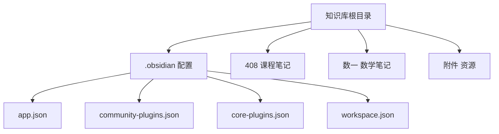
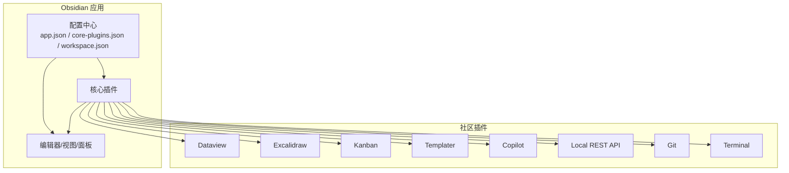
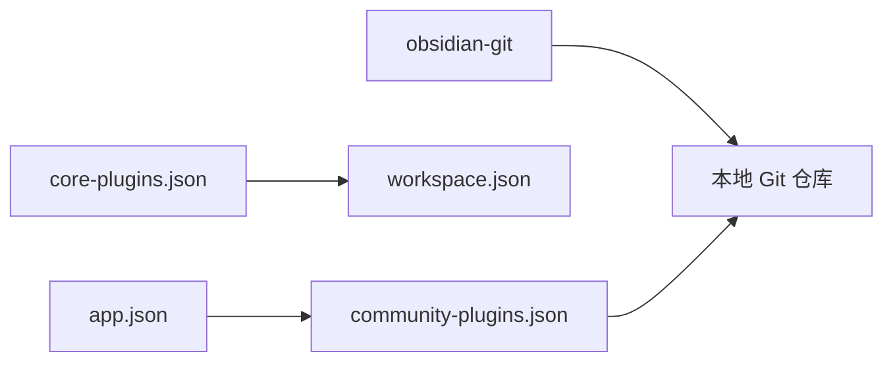
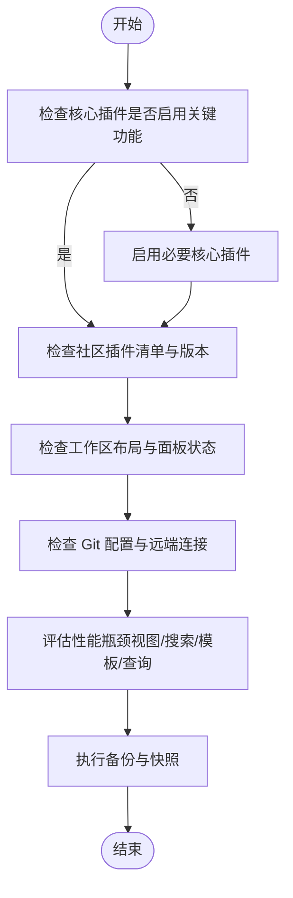

# 故障排除

<cite>
**本文引用的文件**
- [app.json](file://.obsidian/app.json)
- [community-plugins.json](file://.obsidian/community-plugins.json)
- [core-plugins.json](file://.obsidian/core-plugins.json)
- [workspace.json](file://.obsidian/workspace.json)
- [408.md](file://408/408.md)
- [高数总览.md](file://数一/高数总览.md)
</cite>

## 目录
1. [简介](#简介)
2. [项目结构](#项目结构)
3. [核心组件](#核心组件)
4. [架构总览](#架构总览)
5. [详细组件分析](#详细组件分析)
6. [依赖关系分析](#依赖关系分析)
7. [性能注意事项](#性能注意事项)
8. [故障排除指南](#故障排除指南)
9. [结论](#结论)
10. [附录](#附录)

## 简介
本指南面向使用 Obsidian 管理知识库的用户，聚焦于常见问题与解决方案：应用启动异常、插件冲突、同步失败、性能问题等。内容基于当前仓库中的 Obsidian 配置与插件清单，提供可操作的诊断步骤、备份恢复流程、日志查看方法以及预防性维护建议，帮助你快速定位并解决问题，保障数据安全与使用体验。

## 项目结构
该仓库是一个以 Markdown 为主的 Obsidian 知识库，包含课程笔记（如 408、高等数学）与附件资源。Obsidian 的配置集中在 .obsidian 目录下，包括应用设置、社区插件列表、核心插件开关与工作区布局等。

图表来源
- [app.json:1-4](file://.obsidian/app.json#L1-L4)
- [community-plugins.json:1-12](file://.obsidian/community-plugins.json#L1-L12)
- [core-plugins.json:1-33](file://.obsidian/core-plugins.json#L1-L33)
- [workspace.json:1-267](file://.obsidian/workspace.json#L1-L267)

章节来源
- [app.json:1-4](file://.obsidian/app.json#L1-L4)
- [community-plugins.json:1-12](file://.obsidian/community-plugins.json#L1-L12)
- [core-plugins.json:1-33](file://.obsidian/core-plugins.json#L1-L33)
- [workspace.json:1-267](file://.obsidian/workspace.json#L1-L267)

## 核心组件
- 应用设置（app.json）：控制链接更新策略与附件文件夹路径，影响文件引用与资源组织。
- 社区插件（community-plugins.json）：启用 Dataview、Excalidraw、Kanban、Templater、Copilot、Local REST API、Git、Terminal 等扩展能力。
- 核心插件（core-plugins.json）：开启文件浏览器、全局搜索、图谱、反向链接、属性面板、模板、工作区、同步等内置功能。
- 工作区（workspace.json）：记录窗口布局、标签页状态、侧边栏面板与最近打开的文件，便于恢复编辑上下文。

章节来源
- [app.json:1-4](file://.obsidian/app.json#L1-L4)
- [community-plugins.json:1-12](file://.obsidian/community-plugins.json#L1-L12)
- [core-plugins.json:1-33](file://.obsidian/core-plugins.json#L1-L33)
- [workspace.json:1-267](file://.obsidian/workspace.json#L1-L267)

## 架构总览
下图展示了 Obsidian 在本仓库中的运行架构：应用加载核心插件与社区插件，读取工作区与配置，渲染笔记与视图；Git 插件负责版本管理与同步；终端与 REST API 插件提供外部工具集成。

图表来源
- [core-plugins.json:1-33](file://.obsidian/core-plugins.json#L1-L33)
- [community-plugins.json:1-12](file://.obsidian/community-plugins.json#L1-L12)
- [workspace.json:1-267](file://.obsidian/workspace.json#L1-L267)
- [app.json:1-4](file://.obsidian/app.json#L1-L4)

## 详细组件分析

### 插件生态与潜在冲突点
- 数据与查询：Dataview 用于动态查询与展示，若与其他插件的数据源或缓存不一致，可能导致查询结果异常或性能下降。
- 可视化与绘图：Excalidraw 与 Kanban 在大量画布或看板时可能占用较多内存。
- 自动化与模板：Templater 在复杂模板执行时可能阻塞主线程，需关注模板复杂度与变量计算。
- AI 助手：Copilot 与 Claudian 视图同时存在，可能产生并发请求与界面负载。
- 版本控制：Git 插件用于提交、推送与拉取，若远程仓库权限或分支策略不当，会导致同步失败。
- 系统交互：Terminal 与 Local REST API 提供外部调用能力，需注意权限与安全策略。

章节来源
- [community-plugins.json:1-12](file://.obsidian/community-plugins.json#L1-L12)
- [core-plugins.json:1-33](file://.obsidian/core-plugins.json#L1-L33)
- [workspace.json:1-267](file://.obsidian/workspace.json#L1-L267)

### 工作区与视图状态
- 右侧面板包含反向链接、出链、标签、大纲、Copilot、Claudian、Source Control 等视图，频繁切换或长时间保持多个重型视图可能影响性能。
- 左侧面板包含文件浏览器、搜索、书签，搜索查询与索引会影响响应速度。
- 主区域当前打开“泰勒展开”笔记，最近打开文件列表显示近期编辑轨迹，有助于回溯问题发生时的上下文。

章节来源
- [workspace.json:1-267](file://.obsidian/workspace.json#L1-L267)

### 笔记结构与链接
- 408 入口文件聚合各学科总览，通过内部链接导航到具体主题，确保知识体系清晰。
- 高数总览采用 YAML 元数据与表格组织专题索引，便于检索与复习。

章节来源
- [408.md:1-16](file://408/408.md#L1-L16)
- [高数总览.md:1-53](file://数一/高数总览.md#L1-L53)

## 依赖关系分析
- 应用设置与插件的耦合：app.json 的附件路径与 community-plugins.json 的插件启用状态共同决定资源组织与功能可用性。
- 核心插件与工作区：core-plugins.json 启用的功能直接影响 workspace.json 中面板与视图的呈现。
- Git 插件与仓库：obsidian-git 依赖本地 Git 环境，需要正确的仓库初始化、远端配置与权限。

图表来源
- [app.json:1-4](file://.obsidian/app.json#L1-L4)
- [community-plugins.json:1-12](file://.obsidian/community-plugins.json#L1-L12)
- [core-plugins.json:1-33](file://.obsidian/core-plugins.json#L1-L33)
- [workspace.json:1-267](file://.obsidian/workspace.json#L1-L267)

章节来源
- [app.json:1-4](file://.obsidian/app.json#L1-L4)
- [community-plugins.json:1-12](file://.obsidian/community-plugins.json#L1-L12)
- [core-plugins.json:1-33](file://.obsidian/core-plugins.json#L1-L33)
- [workspace.json:1-267](file://.obsidian/workspace.json#L1-L267)

## 性能注意事项
- 减少重型视图常驻：关闭不使用的反向链接、标签、大纲、Copilot/Claudian 等面板，降低内存占用。
- 控制搜索范围：避免在全库进行大规模模糊搜索，优先使用精确查询或限定目录。
- 优化模板与查询：简化 Templater 模板逻辑，限制 Dataview 查询的扫描范围与排序字段。
- 合理组织附件：将大文件放入附件目录，避免直接嵌入正文导致渲染缓慢。
- 定期清理与归档：对历史笔记进行归档，减少主库体积，提升索引与加载速度。

[本节为通用性能建议，不直接分析具体文件]

## 故障排除指南

### 应用启动问题
常见症状
- 启动卡顿或崩溃
- 无法加载工作区或视图空白
- 插件加载失败提示

排查步骤
- 检查核心插件是否被禁用关键功能（如文件浏览器、全局搜索、同步）。
- 临时禁用部分社区插件，观察是否能正常启动，逐步缩小冲突范围。
- 检查工作区文件是否损坏，尝试重置工作区或新建工作区恢复默认布局。
- 确认附件路径配置正确，避免因路径不存在导致资源加载失败。

参考配置位置
- 核心插件开关：[core-plugins.json:1-33](file://.obsidian/core-plugins.json#L1-L33)
- 社区插件清单：[community-plugins.json:1-12](file://.obsidian/community-plugins.json#L1-L12)
- 工作区布局：[workspace.json:1-267](file://.obsidian/workspace.json#L1-L267)
- 应用设置：[app.json:1-4](file://.obsidian/app.json#L1-L4)

章节来源
- [core-plugins.json:1-33](file://.obsidian/core-plugins.json#L1-L33)
- [community-plugins.json:1-12](file://.obsidian/community-plugins.json#L1-L12)
- [workspace.json:1-267](file://.obsidian/workspace.json#L1-L267)
- [app.json:1-4](file://.obsidian/app.json#L1-L4)

### 插件冲突
常见症状
- 特定功能不可用或报错
- 界面元素重复或遮挡
- 查询结果异常或延迟

排查步骤
- 按功能域分组禁用插件：先关闭所有社区插件，再逐个启用，定位冲突源。
- 针对数据类插件（如 Dataview）与可视化插件（如 Excalidraw、Kanban）分别测试。
- 检查插件版本兼容性，必要时降级或升级至稳定版本。
- 若涉及 AI 助手（Copilot、Claudian），单独测试其视图与命令是否干扰其他插件。

参考配置位置
- 社区插件清单：[community-plugins.json:1-12](file://.obsidian/community-plugins.json#L1-L12)

章节来源
- [community-plugins.json:1-12](file://.obsidian/community-plugins.json#L1-L12)

### 同步失败
常见症状
- Git 提交失败、推送被拒绝
- 拉取冲突或合并失败
- 远程仓库连接超时或认证错误

排查步骤
- 确认本地 Git 仓库已初始化且远端地址正确。
- 检查用户信息与签名配置，确保提交信息完整。
- 验证分支策略与权限，避免强制推送覆盖他人变更。
- 处理合并冲突：优先保留本地或远端版本，必要时手动编辑解决。
- 若使用 HTTPS，检查凭据存储；若使用 SSH，确认密钥可用。

参考配置位置
- Git 插件启用：[community-plugins.json:1-12](file://.obsidian/community-plugins.json#L1-L12)
- 工作区 Source Control 面板：[workspace.json:1-267](file://.obsidian/workspace.json#L1-L267)

章节来源
- [community-plugins.json:1-12](file://.obsidian/community-plugins.json#L1-L12)
- [workspace.json:1-267](file://.obsidian/workspace.json#L1-L267)

### 性能问题
常见症状
- 编辑器响应慢、滚动卡顿
- 搜索耗时过长
- 图谱渲染缓慢

排查步骤
- 关闭不必要的视图与面板，减少内存占用。
- 限制搜索范围，避免全库模糊匹配。
- 优化模板与查询，减少复杂计算与大数据集扫描。
- 将大附件移至附件目录，避免正文嵌入。
- 定期重建索引与清理缓存（通过 Obsidian 设置或重启应用）。

参考配置位置
- 工作区面板与视图：[workspace.json:1-267](file://.obsidian/workspace.json#L1-L267)
- 应用设置（附件路径）：[app.json:1-4](file://.obsidian/app.json#L1-L4)

章节来源
- [workspace.json:1-267](file://.obsidian/workspace.json#L1-L267)
- [app.json:1-4](file://.obsidian/app.json#L1-L4)

### 备份与恢复知识库
备份策略
- 使用 Git 进行版本化备份：定期提交并推送到远端仓库，形成时间线。
- 本地快照：复制整个知识库目录到外部存储或云盘，作为离线备份。
- 配置备份：单独备份 .obsidian 目录，保留插件与工作区状态。

恢复流程
- 从远端仓库拉取最新代码，或从本地快照还原目录。
- 重新安装并启用所需插件，确保社区插件清单一致。
- 导入工作区配置，恢复编辑布局与面板状态。
- 校验附件路径与链接有效性，修复可能的路径差异。

参考配置位置
- Git 插件启用：[community-plugins.json:1-12](file://.obsidian/community-plugins.json#L1-L12)
- 工作区布局：[workspace.json:1-267](file://.obsidian/workspace.json#L1-L267)
- 应用设置：[app.json:1-4](file://.obsidian/app.json#L1-L4)

章节来源
- [community-plugins.json:1-12](file://.obsidian/community-plugins.json#L1-L12)
- [workspace.json:1-267](file://.obsidian/workspace.json#L1-L267)
- [app.json:1-4](file://.obsidian/app.json#L1-L4)

### 日志查看与问题定位技巧
- 启用开发者模式后，通过控制台查看插件加载与错误堆栈。
- 使用 Terminal 插件执行系统命令，检查 Git 状态、网络连通性与磁盘空间。
- 利用 Local REST API 插件获取应用状态与日志接口（注意安全与权限）。
- 结合工作区最近打开文件与搜索记录，回溯问题发生时的上下文。

参考配置位置
- Terminal 插件启用：[community-plugins.json:1-12](file://.obsidian/community-plugins.json#L1-L12)
- Local REST API 插件启用：[community-plugins.json:1-12](file://.obsidian/community-plugins.json#L1-L12)
- 工作区最近文件：[workspace.json:1-267](file://.obsidian/workspace.json#L1-L267)

章节来源
- [community-plugins.json:1-12](file://.obsidian/community-plugins.json#L1-L12)
- [workspace.json:1-267](file://.obsidian/workspace.json#L1-L267)

### 社区资源与支持渠道
- Obsidian 官方论坛与文档：获取官方支持与最佳实践。
- 插件作者文档与 Issues：定位插件特定问题与已知缺陷。
- GitHub 仓库：查阅源码与变更记录，参与讨论与反馈。
- 中文社区与群组：交流经验与解决方案。

[本节为通用支持信息，不直接分析具体文件]

### 预防性维护与最佳实践
- 定期提交与推送：保持版本可控，便于回滚与协作。
- 小步快跑：每次变更仅修改少量文件，降低冲突概率。
- 规范命名与结构：统一目录与文件名，提升检索效率。
- 控制插件数量：仅启用必要插件，减少冲突与性能开销。
- 监控附件大小：避免大文件拖慢渲染与同步。
- 定期审计工作区：关闭无用面板，保持界面简洁。

[本节为通用维护建议，不直接分析具体文件]

## 结论
通过对 Obsidian 配置与插件生态的分析，可以系统化地定位并解决启动、冲突、同步与性能等问题。结合备份恢复流程、日志查看方法与预防性维护建议，能够有效保障知识库的安全与稳定。建议在日常使用中遵循最佳实践，持续优化插件与工作区配置，以获得更佳的使用体验。

## 附录

### 快速诊断流程图

[此图为概念性流程，不映射到具体文件]