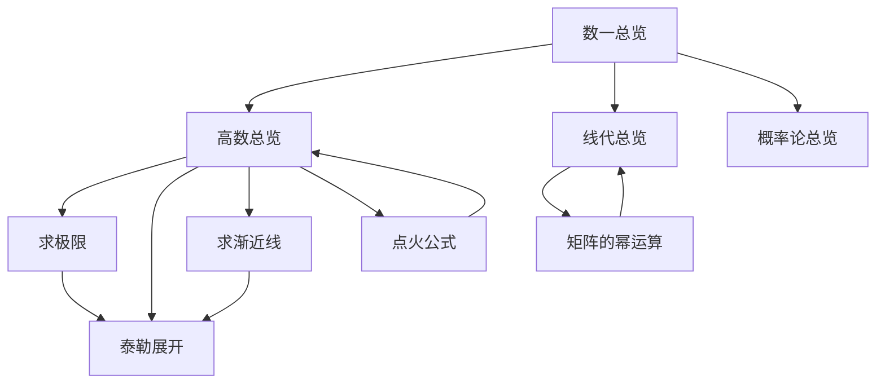
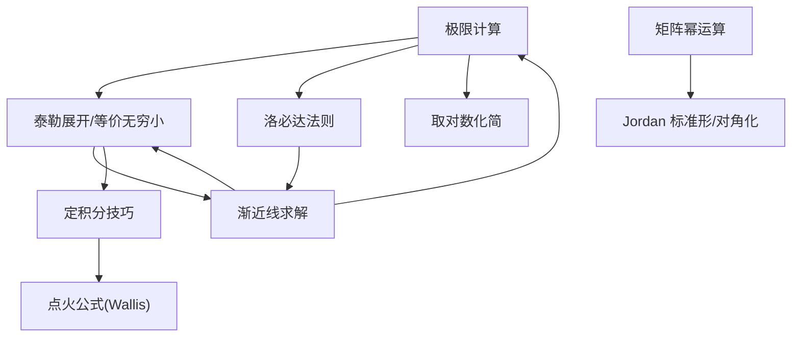
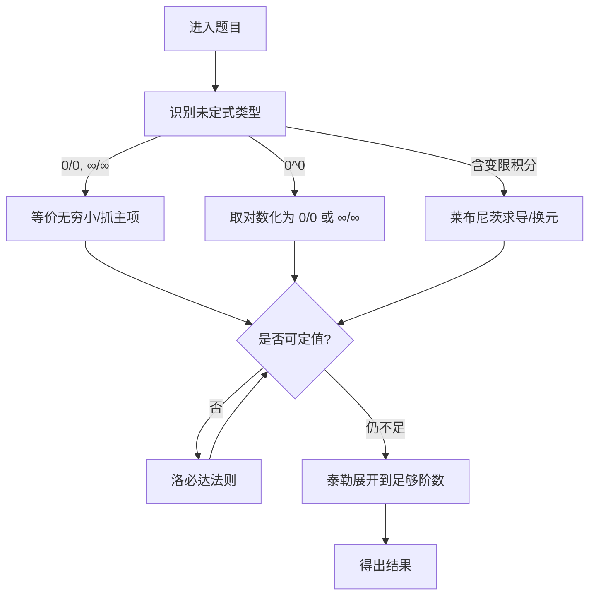
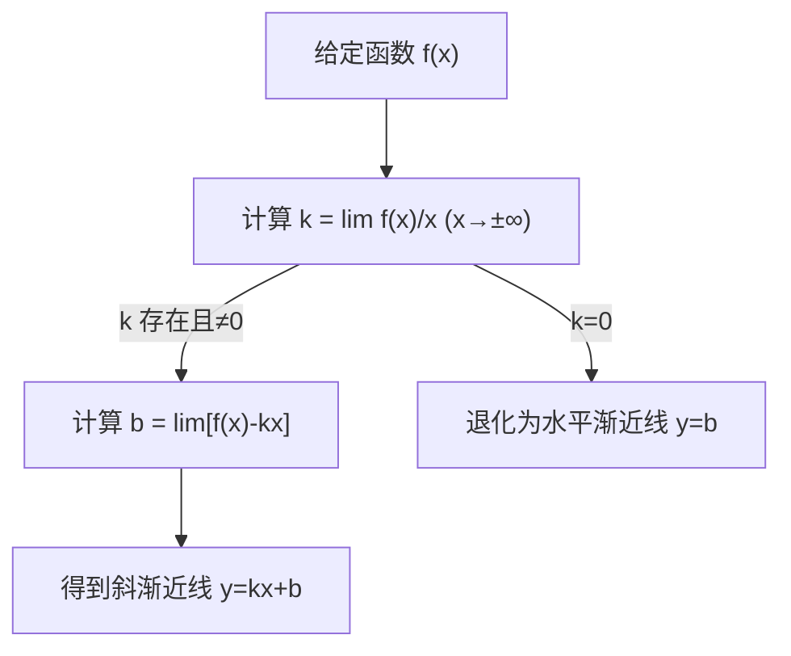
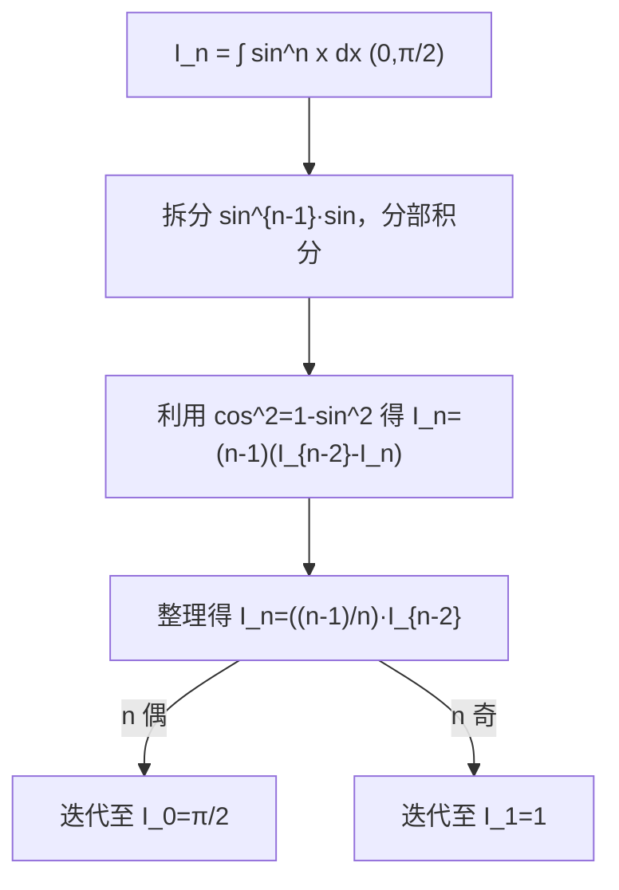
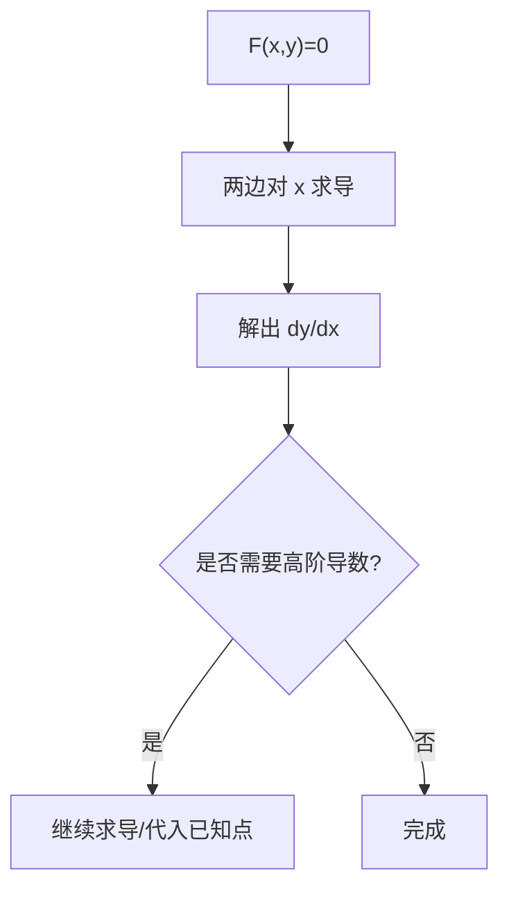
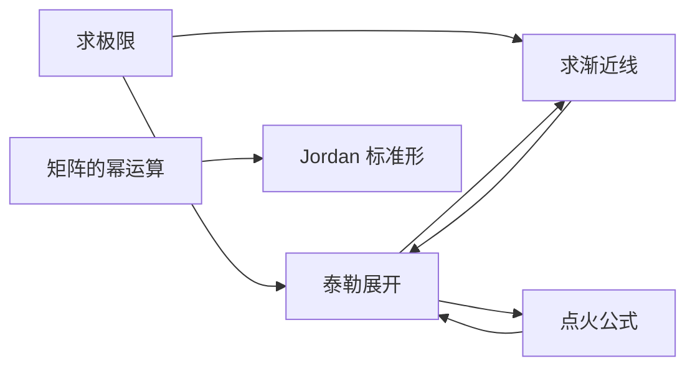

# 数学一学习指南

<cite>
**本文引用的文件**
- [高数总览.md](file://数一/高数总览.md)
- [线代总览.md](file://数一/线代总览.md)
- [概率论总览.md](file://数一/概率论总览.md)
- [一元微分.md](file://数一/一元微分.md)
- [求极限.md](file://数一/求极限.md)
- [泰勒展开.md](file://数一/泰勒展开.md)
- [求渐近线.md](file://数一/求渐近线.md)
- [点火公式.md](file://数一/点火公式.md)
- [矩阵的幂运算.md](file://矩阵的幂运算.md)
- [隐函数求导.md](file://数一/隐函数求导.md)
- [曲率.md](file://曲率.md)
- [模板配置.json](file://.obsidian/templates.json)
</cite>

## 目录
1. [引言](#引言)
2. [项目结构](#项目结构)
3. [核心组件](#核心组件)
4. [架构总览](#架构总览)
5. [详细组件分析](#详细组件分析)
6. [依赖关系分析](#依赖关系分析)
7. [性能与效率建议](#性能与效率建议)
8. [故障排查与易错点](#故障排查与易错点)
9. [结论](#结论)
10. [附录：Obsidian 工作流与复习计划](#附录obsidian-工作流与复习计划)

## 引言
本指南面向“数学一”考研备考，围绕高等数学、线性代数、概率论三门课程构建系统化知识框架与学习方法。内容基于仓库中已有的专题笔记，结合 Obsidian 的双向链接能力，帮助你在概念理解、定理推导、题型归纳与错题复盘之间建立强关联的知识网络，并提供可执行的复习计划与练习建议。

## 项目结构
仓库以“学科—专题”的方式组织笔记，便于按模块检索与串联：
- 数一：包含高数、线代、概率论的总览与各专题笔记（如极限、泰勒、渐近线、积分技巧等）
- 根目录：部分独立专题（如矩阵的幂运算、曲率、隐函数求导等）
- .obsidian：Obsidian 工作区与插件配置，支持模板、图谱、看板等增强功能



图表来源
- [高数总览.md:19-46](file://数一/高数总览.md#L19-L46)
- [线代总览.md:19-33](file://数一/线代总览.md#L19-L33)
- [概率论总览.md:19-25](file://数一/概率论总览.md#L19-L25)

章节来源
- [高数总览.md:19-46](file://数一/高数总览.md#L19-L46)
- [线代总览.md:19-33](file://数一/线代总览.md#L19-L33)
- [概率论总览.md:19-25](file://数一/概率论总览.md#L19-L25)

## 核心组件
- 高等数学
  - 微分学：导数与微分、隐函数求导、微分应用（渐近线、曲率）
  - 积分学：基本积分表、对称换元、点火公式（Wallis）
  - 级数与逼近：泰勒展开（含余项）、等价无穷小
  - 极限计算：未定式类型识别与方法优先级（等价→洛必达→泰勒→取对数）
- 线性代数
  - 矩阵与行列式：矩阵运算、Jordan 标准形与矩阵幂运算
- 概率论
  - 事件与分布、数字特征、大数定律与中心极限定理、数理统计基础（待补充）

章节来源
- [高数总览.md:19-46](file://数一/高数总览.md#L19-L46)
- [线代总览.md:19-33](file://数一/线代总览.md#L19-L33)
- [概率论总览.md:19-25](file://数一/概率论总览.md#L19-L25)

## 架构总览
下图展示“方法—工具—题型”的联动关系：极限计算依赖等价无穷小与泰勒展开；渐近线求解需要极限与展开技巧；积分技巧（如点火公式）服务于定积分题型；矩阵幂运算通过 Jordan 标准形统一处理不可对角化情形。



图表来源
- [求极限.md:19-33](file://数一/求极限.md#L19-L33)
- [泰勒展开.md:110-125](file://数一/泰勒展开.md#L110-L125)
- [求渐近线.md:55-73](file://数一/求渐近线.md#L55-L73)
- [点火公式.md:21-35](file://数一/点火公式.md#L21-L35)
- [矩阵的幂运算.md:85-139](file://矩阵的幂运算.md#L85-L139)

## 详细组件分析

### 高等数学：极限与泰勒
- 目标：掌握未定式识别与解法优先级，熟练运用等价无穷小、洛必达与泰勒展开
- 关键点
  - 未定式类型：0^0、0/0、∞/∞、含变限积分等
  - 方法优先级：等价无穷小 → 洛必达 → 泰勒展开 → 取对数
  - 泰勒展开：皮亚诺余项用于极限，拉格朗日余项用于证明与误差估计
- 典型流程（求极限）



图表来源
- [求极限.md:19-33](file://数一/求极限.md#L19-L33)
- [求极限.md:105-121](file://数一/求极限.md#L105-L121)
- [泰勒展开.md:110-125](file://数一/泰勒展开.md#L110-L125)

章节来源
- [求极限.md:19-33](file://数一/求极限.md#L19-L33)
- [求极限.md:105-121](file://数一/求极限.md#L105-L121)
- [泰勒展开.md:110-125](file://数一/泰勒展开.md#L110-L125)

### 高等数学：渐近线与微分应用
- 目标：系统掌握水平、垂直、斜渐近线的判定与求法，理解曲率基本概念
- 要点
  - 水平渐近线：x→±∞ 时 f(x) 趋于有限常数
  - 垂直渐近线：间断点处单侧极限为无穷
  - 斜渐近线：k=lim f(x)/x，b=lim[f(x)-kx]，同一方向上水平与斜互斥
  - 曲率：曲线弯曲程度的度量（定义、半径、圆）
- 流程图（斜渐近线）



图表来源
- [求渐近线.md:55-73](file://数一/求渐近线.md#L55-L73)
- [求渐近线.md:78-90](file://数一/求渐近线.md#L78-L90)

章节来源
- [求渐近线.md:19-73](file://数一/求渐近线.md#L19-L73)
- [求渐近线.md:78-90](file://数一/求渐近线.md#L78-L90)
- [曲率.md:12-22](file://曲率.md#L12-L22)

### 高等数学：积分技巧（点火公式）
- 目标：快速计算三角函数高次幂定积分，理解递推本质与扩展形式
- 要点
  - 核心递推：I_n = ((n-1)/n)·I_{n-2}
  - 偶数 n：结果含 π/2；奇数 n：结果为有理数
  - 扩展：混合幂次、区间推广、Beta/Gamma 联系、Wallis 无穷乘积
- 流程图（Wallis 递推）



图表来源
- [点火公式.md:50-82](file://数一/点火公式.md#L50-L82)
- [点火公式.md:83-111](file://数一/点火公式.md#L83-L111)

章节来源
- [点火公式.md:21-35](file://数一/点火公式.md#L21-L35)
- [点火公式.md:50-82](file://数一/点火公式.md#L50-L82)
- [点火公式.md:83-111](file://数一/点火公式.md#L83-L111)
- [点火公式.md:130-179](file://数一/点火公式.md#L130-L179)

### 线性代数：矩阵的幂运算
- 目标：掌握对角化与 Jordan 标准形两种通用方法，能根据矩阵特性选择最优路径
- 要点
  - 可对角化：A=PΛP^{-1}，A^n=PΛ^nP^{-1}
  - 不可对角化：分解为 λI+N（N 幂零），用二项式展开求幂
  - 最小多项式降次：将高次幂表示为低次幂线性组合
- 类图（方法与对象关系）

```mermaid
classDiagram
class 矩阵A {
+特征值/特征向量()
+最小多项式()
+Jordan标准形()
+幂运算(n)
}
class 对角化 {
+P, Λ
+A^n = P·Λ^n·P^{-1}
}
class Jordan块 {
+J_n(λ)
+N=J-λI 幂零
+二项式展开求幂
}
class 最小多项式法 {
+m_A(x)
+降次表示 A^n
}
矩阵A --> 对角化 : "若可对角化"
矩阵A --> Jordan块 : "一般情形"
矩阵A --> 最小多项式法 : "降次"
```

图表来源
- [矩阵的幂运算.md:85-139](file://矩阵的幂运算.md#L85-L139)
- [矩阵的幂运算.md:162-184](file://矩阵的幂运算.md#L162-L184)
- [矩阵的幂运算.md:204-239](file://矩阵的幂运算.md#L204-L239)

章节来源
- [矩阵的幂运算.md:85-139](file://矩阵的幂运算.md#L85-L139)
- [矩阵的幂运算.md:162-184](file://矩阵的幂运算.md#L162-L184)
- [矩阵的幂运算.md:204-239](file://矩阵的幂运算.md#L204-L239)

### 高等数学：隐函数与参数方程求导
- 目标：掌握隐函数直接求导、对数求导法与参数方程求导的基本思路
- 要点
  - 隐函数：两边同时对 x 求导，解出 dy/dx
  - 对数求导：适用于幂指函数，先取对数再求导
  - 参数方程：dy/dx = (dy/dt)/(dx/dt)
- 流程图（隐函数求导）



图表来源
- [隐函数求导.md:13-24](file://数一/隐函数求导.md#L13-L24)

章节来源
- [隐函数求导.md:13-24](file://数一/隐函数求导.md#L13-L24)

## 依赖关系分析
- 方法依赖
  - 极限计算依赖等价无穷小与泰勒展开；渐近线求解依赖极限与展开
  - 积分技巧（点火公式）与泰勒/等价无穷小在近似与精度控制上互补
  - 矩阵幂运算依赖特征值/特征向量与 Jordan 标准形的理论支撑
- 知识网络（双向链接示意）



图表来源
- [求极限.md:19-33](file://数一/求极限.md#L19-L33)
- [泰勒展开.md:110-125](file://数一/泰勒展开.md#L110-L125)
- [求渐近线.md:55-73](file://数一/求渐近线.md#L55-L73)
- [点火公式.md:21-35](file://数一/点火公式.md#L21-L35)
- [矩阵的幂运算.md:85-139](file://矩阵的幂运算.md#L85-L139)

章节来源
- [高数总览.md:19-46](file://数一/高数总览.md#L19-L46)
- [线代总览.md:19-33](file://数一/线代总览.md#L19-L33)
- [概率论总览.md:19-25](file://数一/概率论总览.md#L19-L25)

## 性能与效率建议
- 解题效率
  - 极限题优先等价无穷小，其次洛必达，最后泰勒展开；必要时取对数化简
  - 渐近线问题先判水平/垂直，再求斜渐近线；注意左右极限分别讨论
  - 三角高次幂积分首选点火公式，复杂情形考虑换元与对称性
  - 矩阵幂运算先判断是否可对角化，否则走 Jordan 标准形或最小多项式降次
- 学习与记忆
  - 使用 Obsidian 的标签与别名统一管理术语（如“极限计算”“未定式求极限”）
  - 将常用展开式与等价替换整理为速查表，形成“模板化”调用
  - 通过双向链接将“方法—题型—易错点”串联，提升检索与迁移效率

[本节为通用建议，不直接分析具体文件]

## 故障排查与易错点
- 极限与泰勒
  - 展开阶数不足导致相消后仍为 0/0；需展开到第一个非零项
  - 等价无穷小误用范围（仅在 x→0 附近成立）
- 渐近线
  - 忽略左右极限差异；水平与斜在同一方向互斥
  - 把可去间断点误判为垂直渐近线
- 积分
  - 点火公式仅适用于特定区间与形式；混合幂次要正确降幂
- 矩阵幂
  - 忽视几何重数小于代数重数的情形，强行对角化
  - 忘记幂零矩阵的高次为零，导致展开项过多

章节来源
- [求极限.md:105-121](file://数一/求极限.md#L105-L121)
- [求渐近线.md:41-49](file://数一/求渐近线.md#L41-L49)
- [求渐近线.md:61-73](file://数一/求渐近线.md#L61-L73)
- [点火公式.md:130-179](file://数一/点火公式.md#L130-L179)
- [矩阵的幂运算.md:110-112](file://矩阵的幂运算.md#L110-L112)
- [矩阵的幂运算.md:229-239](file://矩阵的幂运算.md#L229-L239)

## 结论
本指南以现有专题笔记为基础，构建了“方法—工具—题型”的清晰路径：极限与泰勒是贯穿高数的核心工具；渐近线与积分技巧是高频考点；矩阵幂运算提供统一的代数处理范式。借助 Obsidian 的双向链接与标签体系，可将知识点、题型与易错点有机串联，形成可检索、可扩展的个人知识库。配合系统的复习计划与练习策略，有助于在备考过程中稳步提升解题速度与准确率。

[本节为总结性内容，不直接分析具体文件]

## 附录：Obsidian 工作流与复习计划

### 使用 Obsidian 整理数学知识
- 公式与定理
  - 使用 LaTeX 书写公式，保持统一排版
  - 为每个重要定理创建独立笔记，并在相关题型笔记中双向链接
- 推导与证明
  - 将关键步骤拆分为子节点，逐步推进；用“摘要/提示/警告”等标注强调重点与易错点
- 错题记录
  - 每道错题建立独立笔记，标注“错误原因—正确思路—同类题型—反思”
  - 通过标签（如 #错题 #极限 #渐近线）进行归类与检索

章节来源
- [模板配置.json:1-3](file://.obsidian/templates.json#L1-L3)

### 复习计划（建议）
- 阶段一：基础巩固（2–3 周）
  - 高数：极限、导数与微分、泰勒展开、渐近线
  - 线代：矩阵运算、特征值/特征向量、Jordan 标准形
  - 概率论：事件与概率、随机变量与分布（待补充）
- 阶段二：专题突破（2–3 周）
  - 高数：积分技巧（点火公式）、微分方程（待补充）
  - 线代：矩阵幂运算、二次型（待补充）
  - 概率论：数字特征、大数定律与中心极限定理（待补充）
- 阶段三：综合训练（2–3 周）
  - 跨专题综合题训练，强化方法迁移
  - 错题复盘与薄弱点补强

### 练习建议
- 以题型为单位进行集中训练，完成后立即归入“错题本”并更新知识卡片
- 每周进行一次“方法对比”梳理（如等价无穷小 vs 洛必达 vs 泰勒）
- 利用 Obsidian 图谱查看知识关联，发现断链并补齐

[本节为通用建议，不直接分析具体文件]