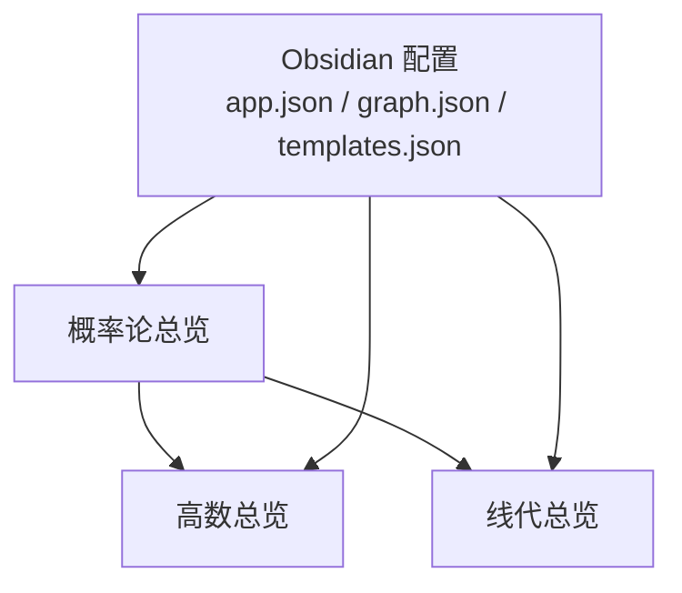
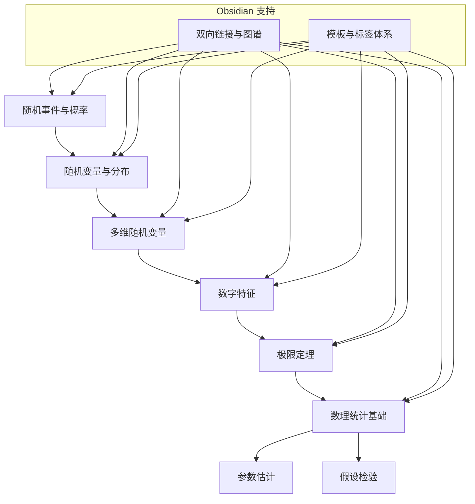
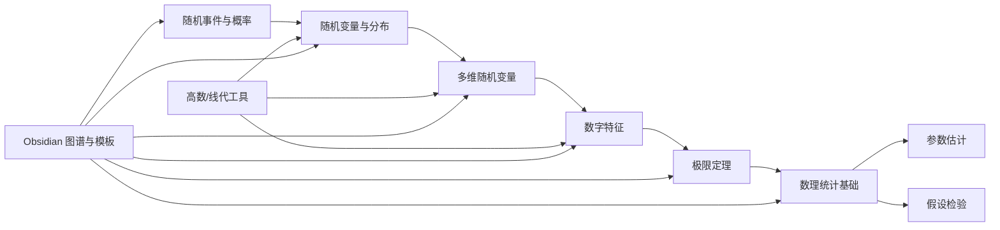

# 概率论与数理统计学习指南

<cite>
**本文引用的文件**
- [概率论总览.md](file://数一/概率论总览.md)
- [高数总览.md](file://数一/高数总览.md)
- [线代总览.md](file://数一/线代总览.md)
- [app.json](file://.obsidian/app.json)
- [templates.json](file://.obsidian/templates.json)
- [graph.json](file://.obsidian/graph.json)
</cite>

## 目录
1. [引言](#引言)
2. [项目结构](#项目结构)
3. [核心组件](#核心组件)
4. [架构总览](#架构总览)
5. [详细组件分析](#详细组件分析)
6. [依赖关系分析](#依赖关系分析)
7. [性能与效率建议](#性能与效率建议)
8. [故障排查指南](#故障排查指南)
9. [结论](#结论)
10. [附录](#附录)

## 引言
本指南面向概率论与数理统计的系统学习，覆盖随机事件与概率、随机变量及其分布函数、多维随机变量的联合与边缘分布、数字特征（期望、方差、协方差）、大数定律与中心极限定理、参数估计与假设检验等核心主题。同时提供在 Obsidian 中构建知识图谱与统计推断逻辑链的实践方法，帮助学习者以“概念—公式—应用—关联”的方式组织与复习知识。

## 项目结构
当前仓库包含一个概率论索引页，以及高等数学、线性代数等总览笔记；Obsidian 配置用于启用双向链接、附件路径与可视化图谱。整体结构便于将概率论各专题逐步扩展为相互链接的知识网络。

图表来源
- [概率论总览.md:13-30](file://数一/概率论总览.md#L13-L30)
- [高数总览.md:13-53](file://数一/高数总览.md#L13-L53)
- [线代总览.md:13-39](file://数一/线代总览.md#L13-L39)
- [app.json:1-4](file://.obsidian/app.json#L1-L4)
- [graph.json:1-30](file://.obsidian/graph.json#L1-L30)
- [templates.json:1-3](file://.obsidian/templates.json#L1-L3)

章节来源
- [概率论总览.md:13-30](file://数一/概率论总览.md#L13-L30)
- [高数总览.md:13-53](file://数一/高数总览.md#L13-L53)
- [线代总览.md:13-39](file://数一/线代总览.md#L13-L39)
- [app.json:1-4](file://.obsidian/app.json#L1-L4)
- [graph.json:1-30](file://.obsidian/graph.json#L1-L30)
- [templates.json:1-3](file://.obsidian/templates.json#L1-L3)

## 核心组件
围绕概率论与数理统计的学习主线，可将内容划分为以下模块：
- 随机事件与概率：样本空间、事件运算、条件概率、全概率公式、贝叶斯公式、独立性
- 随机变量与分布：离散型与连续型随机变量、分布函数、概率密度/质量函数、常见分布族
- 多维随机变量：联合分布、边缘分布、条件分布、独立性、函数变换
- 数字特征：期望、方差、协方差、相关系数、矩母函数/特征函数（可选）
- 极限定理：大数定律、中心极限定理及其应用场景
- 数理统计基础：总体与样本、抽样分布、点估计与区间估计、假设检验、回归与相关（可选）

章节来源
- [概率论总览.md:19-25](file://数一/概率论总览.md#L19-L25)

## 架构总览
下图展示从“基本概念”到“统计推断”的递进式学习路径，并标注与 Obsidian 笔记的对应关系，便于通过双向链接构建知识图谱。

图表来源
- [概率论总览.md:19-25](file://数一/概率论总览.md#L19-L25)
- [app.json:1-4](file://.obsidian/app.json#L1-L4)
- [graph.json:1-30](file://.obsidian/graph.json#L1-L30)
- [templates.json:1-3](file://.obsidian/templates.json#L1-L3)

## 详细组件分析

### 随机事件与概率
- 学习目标：掌握样本空间与事件的集合表示、加法与乘法原理、条件概率与独立性、全概率与贝叶斯公式的应用场景
- 典型问题：独立重复试验、条件概率建模、反证法与补集思想
- 与后续内容的衔接：为随机变量定义、分布函数与期望计算奠定概率基础

章节来源
- [概率论总览.md:19-25](file://数一/概率论总览.md#L19-L25)

### 随机变量与分布函数
- 学习目标：理解分布函数的定义与性质、离散型与连续型随机变量的区别、常见分布（如二项、泊松、指数、正态等）的性质与应用
- 关键能力：由分布求概率、由密度/质量函数求分布函数、利用分布函数进行不等式概率估计
- 与后续内容的衔接：为多维随机变量、数字特征、极限定理提供工具

章节来源
- [概率论总览.md:19-25](file://数一/概率论总览.md#L19-L25)

### 多维随机变量的联合分布与边缘分布
- 学习目标：掌握联合分布函数/密度、边缘分布、条件分布、独立性判定、随机变量函数的分布
- 关键能力：对联合密度积分求边缘密度、判断独立性、处理和差积商的分布
- 与后续内容的衔接：为协方差、相关性、抽样分布与统计推断做准备

章节来源
- [概率论总览.md:19-25](file://数一/概率论总览.md#L19-L25)

### 数字特征：期望、方差、协方差
- 学习目标：理解期望与方差的定义与性质、协方差与相关系数的意义、矩与特征函数的作用
- 关键能力：利用期望的线性性简化计算、用方差衡量波动、用协方差刻画相关性
- 与后续内容的衔接：为大数定律、中心极限定理、参数估计与假设检验提供理论基础

章节来源
- [概率论总览.md:19-25](file://数一/概率论总览.md#L19-L25)

### 大数定律与中心极限定理
- 学习目标：理解弱大数定律与切比雪夫不等式的联系、中心极限定理的适用条件与近似精度
- 关键能力：用大数定律解释频率稳定性、用中心极限定理做正态近似与区间估计
- 与后续内容的衔接：为统计推断中的置信区间与假设检验提供依据

章节来源
- [概率论总览.md:19-25](file://数一/概率论总览.md#L19-L25)

### 数理统计基础：参数估计与假设检验
- 学习目标：掌握点估计（矩估计、极大似然估计）、区间估计（枢轴量法）、假设检验的基本步骤与两类错误
- 关键能力：构造估计量与检验统计量、选择显著性水平、解读 p 值与置信区间
- 与前后内容的衔接：基于随机变量与数字特征的理论，结合极限定理完成推断

章节来源
- [概率论总览.md:19-25](file://数一/概率论总览.md#L19-L25)

### 各类概率分布的性质对比与典型应用
- 目标：建立“分布—性质—场景”的对照表，便于快速定位与迁移
- 建议维度：支撑集、参数含义、期望与方差、典型应用场景（如计数、等待时间、误差建模等）
- 实践方式：在 Obsidian 中以表格或卡片形式整理，并通过双向链接与“随机变量与分布”“数字特征”“极限定理”“统计推断”等节点相连

[本节为概念性总结，不直接分析具体文件]

### 使用 Obsidian 构建概率论知识图谱与统计推断逻辑链
- 双向链接：在各专题笔记中使用 [[ ]] 链接到“概率论总览”“高数总览”“线代总览”，形成跨学科知识网络
- 标签体系：为每个专题添加统一标签（如 #概率论 #随机变量 #估计），便于检索与聚合
- 图谱可视化：通过 Obsidian Graph 视图查看节点连接强度与聚类，辅助发现知识盲区
- 模板化写作：在“模版”文件夹下创建“专题笔记模板”，固定标题、日期、标签、待办清单与参考链接，提升一致性

章节来源
- [概率论总览.md:13-30](file://数一/概率论总览.md#L13-L30)
- [高数总览.md:13-53](file://数一/高数总览.md#L13-L53)
- [线代总览.md:13-39](file://数一/线代总览.md#L13-L39)
- [app.json:1-4](file://.obsidian/app.json#L1-L4)
- [templates.json:1-3](file://.obsidian/templates.json#L1-L3)
- [graph.json:1-30](file://.obsidian/graph.json#L1-L30)

## 依赖关系分析
- 内容依赖：概率论各专题之间存在强依赖关系，遵循“事件与概率 → 随机变量 → 多维变量 → 数字特征 → 极限定理 → 统计推断”的递进顺序
- 工具依赖：Obsidian 的双向链接与图谱功能支撑知识网络的可视化与检索
- 外部依赖：高等数学（微积分、级数）与线性代数（矩阵、向量）为概率论与统计推断提供计算工具

图表来源
- [概率论总览.md:19-25](file://数一/概率论总览.md#L19-L25)
- [高数总览.md:13-53](file://数一/高数总览.md#L13-L53)
- [线代总览.md:13-39](file://数一/线代总览.md#L13-L39)
- [app.json:1-4](file://.obsidian/app.json#L1-L4)
- [graph.json:1-30](file://.obsidian/graph.json#L1-L30)
- [templates.json:1-3](file://.obsidian/templates.json#L1-L3)

章节来源
- [概率论总览.md:19-25](file://数一/概率论总览.md#L19-L25)
- [高数总览.md:13-53](file://数一/高数总览.md#L13-L53)
- [线代总览.md:13-39](file://数一/线代总览.md#L13-L39)
- [app.json:1-4](file://.obsidian/app.json#L1-L4)
- [graph.json:1-30](file://.obsidian/graph.json#L1-L30)
- [templates.json:1-3](file://.obsidian/templates.json#L1-L3)

## 性能与效率建议
- 学习节奏：按“概念—推导—例题—应用—关联”的顺序推进，避免跳跃式学习导致知识断层
- 记忆策略：用 Obsidian 的卡片与表格整理“分布—性质—场景”，配合间隔重复提高长期记忆
- 练习策略：每章配套少量高质量题目，注重思路归纳而非题海战术
- 工具优化：合理使用 Obsidian 的搜索、标签与图谱，定期复盘知识连接，及时补齐断链

[本节为通用建议，不直接分析具体文件]

## 故障排查指南
- 链接失效：检查笔记间是否正确使用 [[ ]] 双向链接，确保目标笔记存在且名称一致
- 图谱异常：确认 Obsidian 的 Graph 设置已开启显示未解析链接，必要时清理孤立节点
- 附件路径：根据 app.json 配置，将图片与附件放入指定目录，保证引用正确
- 模板缺失：若模板未生效，检查 templates.json 指向的文件夹是否存在且包含模板文件

章节来源
- [app.json:1-4](file://.obsidian/app.json#L1-L4)
- [graph.json:1-30](file://.obsidian/graph.json#L1-L30)
- [templates.json:1-3](file://.obsidian/templates.json#L1-L3)

## 结论
本指南以“概率论总览”为核心索引，构建了从基础概念到统计推断的完整学习路径，并结合 Obsidian 的双向链接与图谱能力，帮助学习者系统化地组织与复习知识。建议在实践中持续完善各专题笔记，强化概念间的逻辑链条，并通过可视化图谱发现薄弱环节，针对性强化。

[本节为总结性内容，不直接分析具体文件]

## 附录
- 推荐学习流程：先通读“概率论总览”的待办清单，逐项补充专题笔记；每完成一个专题，更新双向链接与标签
- 复习策略：利用 Obsidian 的 Graph 视图回顾知识网络，重点检查“数字特征”“极限定理”“统计推断”之间的连接是否完整
- 拓展方向：在“数理统计基础”中引入抽样分布、置信区间、假设检验的具体案例，形成从理论到应用的闭环

[本节为扩展建议，不直接分析具体文件]