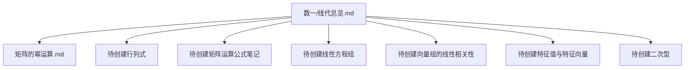
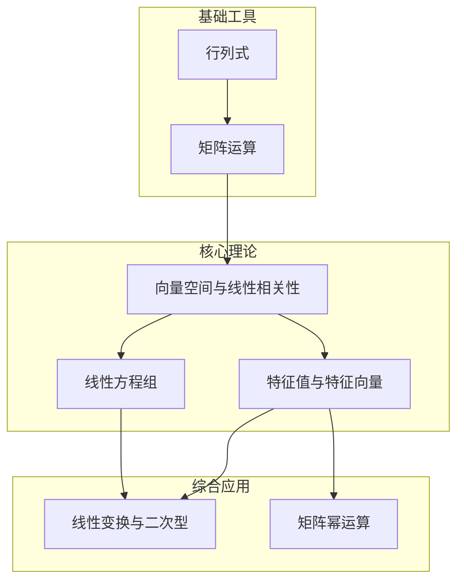
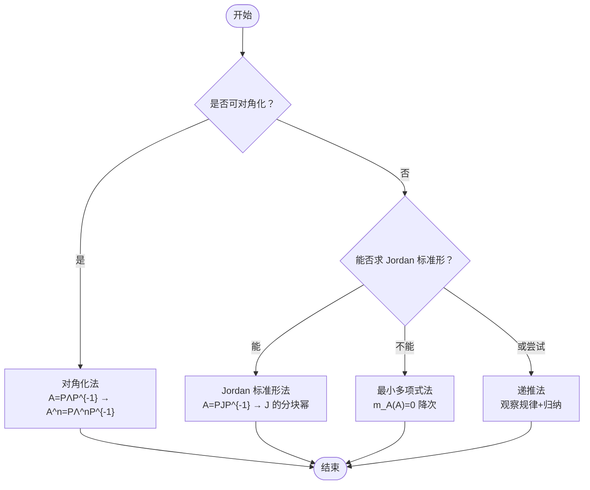
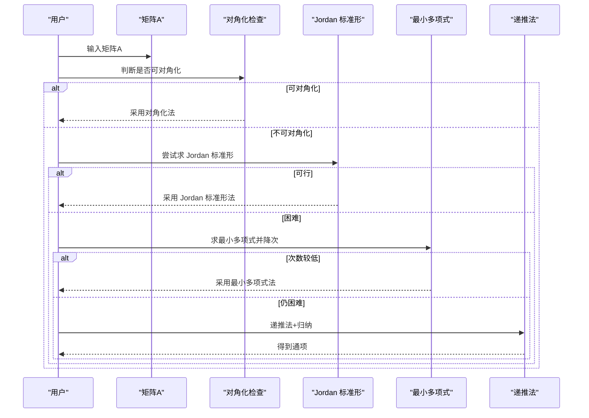
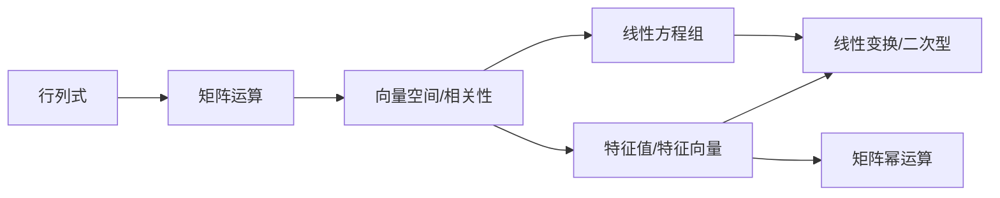

# 线性代数学习指南

<cite>
**本文引用的文件**
- [线代总览.md](file://数一/线代总览.md)
- [矩阵的幂运算.md](file://矩阵的幂运算.md)
- [app.json](file://.obsidian/app.json)
</cite>

## 目录
1. [引言](#引言)
2. [项目结构](#项目结构)
3. [核心组件](#核心组件)
4. [架构总览](#架构总览)
5. [详细组件分析](#详细组件分析)
6. [依赖关系分析](#依赖关系分析)
7. [性能与效率考量](#性能与效率考量)
8. [疑难排解指南](#疑难排解指南)
9. [结论](#结论)
10. [附录：Obsidian 知识框架搭建](#附录obsidian-知识框架搭建)

## 引言
本指南面向考研数学一的线性代数复习，系统梳理矩阵运算、向量空间、线性变换等核心概念，重点覆盖行列式计算、矩阵秩与逆、特征值与特征向量、向量组线性相关性与线性方程组解的结构。同时结合 Obsidian 笔记体系，给出知识框架组织与公式推导流程建议，帮助构建可检索、可关联、可演进的学习系统。

## 项目结构
当前仓库中与线性代数直接相关的资料主要位于“数一”和根目录下的专题笔记中，已具备“索引+专题”的雏形：
- 索引页：提供线性代数各专题导航与待补充清单
- 专题页：以“矩阵的幂运算”为代表，展示 Jordan 标准形、对角化、递推与最小多项式等方法论

图表来源
- [线代总览.md:19-33](file://数一/线代总览.md#L19-L33)

章节来源
- [线代总览.md:19-33](file://数一/线代总览.md#L19-L33)

## 核心组件
围绕线性代数主线，将内容划分为以下模块，并与现有笔记建立映射：
- 行列式：计算方法（展开、性质、特殊矩阵）、几何意义、与体积/面积的关系
- 矩阵运算：转置、伴随、逆、分块矩阵、初等变换与等价标准形
- 向量空间与线性相关性：线性组合、极大无关组、秩、基与维数
- 线性方程组：齐次与非齐次解的结构、通解表达、参数讨论
- 特征值与特征向量：特征多项式、可对角化条件、谱分解、Jordan 标准形
- 线性变换：表示矩阵、相似、合同、正交变换与二次型
- 矩阵幂运算：对角化法、Jordan 标准形法、递推法、最小多项式法（已有专题）

章节来源
- [线代总览.md:19-33](file://数一/线代总览.md#L19-L33)

## 架构总览
下图展示线性代数知识体系的层次结构与相互依赖关系，便于从“基础工具—核心理论—综合应用”逐步推进。

[此图为概念性架构图，不直接对应具体源码文件]

## 详细组件分析

### 行列式
- 目标：掌握按行/列展开、性质（交换、倍加、数乘）、特殊矩阵（三角、分块、范德蒙德）与快速技巧
- 典型题型：数值计算、含参行列式、证明题（利用性质构造）
- 与后续内容的联系：行列式为特征多项式的基础；与矩阵秩、线性方程组有内在关联

章节来源
- [线代总览.md:21-25](file://数一/线代总览.md#L21-L25)

### 矩阵运算与秩、逆
- 目标：熟练转置、伴随、逆矩阵公式与性质；分块矩阵运算；初等变换求秩与逆
- 典型题型：求逆、解矩阵方程、秩的不等式与等式证明
- 与后续内容的联系：秩决定线性方程组解的存在性与自由度；伴随与逆在特征多项式与Cramer法则中发挥作用

章节来源
- [线代总览.md:21-25](file://数一/线代总览.md#L21-L25)

### 向量组的线性相关性
- 目标：理解线性相关/无关的定义与判定（定义法、矩阵秩法、齐次方程组法）；极大无关组与基
- 典型题型：判断相关性、求极大无关组、向量组等价与秩的比较
- 与后续内容的联系：线性相关性是解空间维数与自由变量个数的根源

章节来源
- [线代总览.md:29-33](file://数一/线代总览.md#L29-L33)

### 线性方程组的解的结构
- 目标：齐次方程组基础解系与通解；非齐次特解与通解；含参讨论
- 典型题型：求基础解系、讨论解的存在唯一性、用解的结构反推参数
- 与后续内容的联系：解空间的维数=未知量个数-秩；与特征子空间、不变子空间密切相关

章节来源
- [线代总览.md:29-33](file://数一/线代总览.md#L29-L33)

### 特征值与特征向量
- 目标：特征多项式与特征值求解；几何重数与代数重数；可对角化条件；谱分解
- 典型题型：求特征值/特征向量、判别可对角化、构造对角化矩阵
- 与后续内容的联系：为矩阵幂运算、二次型标准化、线性变换标准形奠定基础

章节来源
- [线代总览.md:29-33](file://数一/线代总览.md#L29-L33)

### 线性变换与二次型
- 目标：线性变换的矩阵表示、相似与合同、正交变换；二次型的标准形与规范形
- 典型题型：求变换矩阵、合同/相似判定、配方法与正交变换化二次型
- 与后续内容的联系：二次型与对称矩阵的特征值符号密切相关

章节来源
- [线代总览.md:29-33](file://数一/线代总览.md#L29-L33)

### 矩阵幂运算（已有专题）
- 目标：掌握对角化法、Jordan 标准形法、递推法、最小多项式法的选择与使用
- 关键要点：
  - 若矩阵可对角化，优先对角化法
  - 不可对角化时，使用 Jordan 标准形法或最小多项式降次
  - 低阶或特殊结构可用递推法
- 方法选择策略与 Jordan 块幂公式已在专题中给出

图表来源
- [矩阵的幂运算.md:85-200](file://矩阵的幂运算.md#L85-L200)

章节来源
- [矩阵的幂运算.md:85-200](file://矩阵的幂运算.md#L85-L200)

#### 矩阵幂运算的方法选择流程图（代码级映射）

图表来源
- [矩阵的幂运算.md:85-200](file://矩阵的幂运算.md#L85-L200)

## 依赖关系分析
- 行列式与矩阵运算构成基础工具层，支撑向量空间与线性方程组
- 向量空间与线性相关性是理解解空间与特征子空间的桥梁
- 特征值与特征向量贯穿线性变换、二次型与矩阵幂运算
- 矩阵幂运算是上述理论的集中应用，体现“标准形—幂运算—降次”的统一思想

[此图为概念性依赖图，不直接对应具体源码文件]

## 性能与效率考量
- 计算复杂度：高维矩阵运算应避免重复计算，优先利用分块、稀疏结构、正交化与标准形
- 数值稳定性：特征值问题注意条件数；求逆与解方程优先使用分解法（LU/QR/SVD）而非显式求逆
- 算法选择：优先判断可对角化；否则考虑 Jordan 标准形或最小多项式降次；低阶矩阵可用递推

[本节为通用指导，不直接分析具体文件]

## 疑难排解指南
- 行列式计算卡壳：回到基本性质（交换、倍加、数乘），尝试按行/列展开或化为三角/分块形式
- 秩与线性相关性混淆：统一用“矩阵秩=列向量组的秩”来判定；必要时写出增广矩阵进行初等变换
- 特征值与特征向量：先求特征多项式，再解特征方程；注意几何重数与代数重数的关系
- 线性方程组含参：先讨论系数矩阵秩与增广矩阵秩的关系，再确定解的存在性与通解结构
- 矩阵幂运算：优先判断可对角化；不可对角化时，Jordan 标准形法最通用；低阶或特殊结构用递推

章节来源
- [矩阵的幂运算.md:85-200](file://矩阵的幂运算.md#L85-L200)

## 结论
线性代数的核心在于“标准形与秩”的思想：通过行列式与矩阵运算建立工具，借助向量空间与线性相关性理解解结构，再以特征值与特征向量贯通线性变换与二次型，最终在矩阵幂运算中实现方法的综合运用。配合 Obsidian 的知识网络，可将碎片化的知识点串联为可检索、可推理、可演进的体系。

[本节为总结性内容，不直接分析具体文件]

## 附录：Obsidian 知识框架搭建
- 索引页：以“线代总览.md”为中心，维护专题链接与待办清单，确保知识地图完整
- 标签与别名：为每篇笔记设置统一标签（如“线性代数”“数学笔记”），并配置别名提升检索体验
- 附件管理：在 app.json 中配置附件文件夹，便于图片与公式截图集中管理
- 模板与插件：可引入模板快速生成专题笔记；使用 Graph 视图查看知识关联

章节来源
- [线代总览.md:1-11](file://数一/线代总览.md#L1-L11)
- [app.json:1-4](file://.obsidian/app.json#L1-L4)