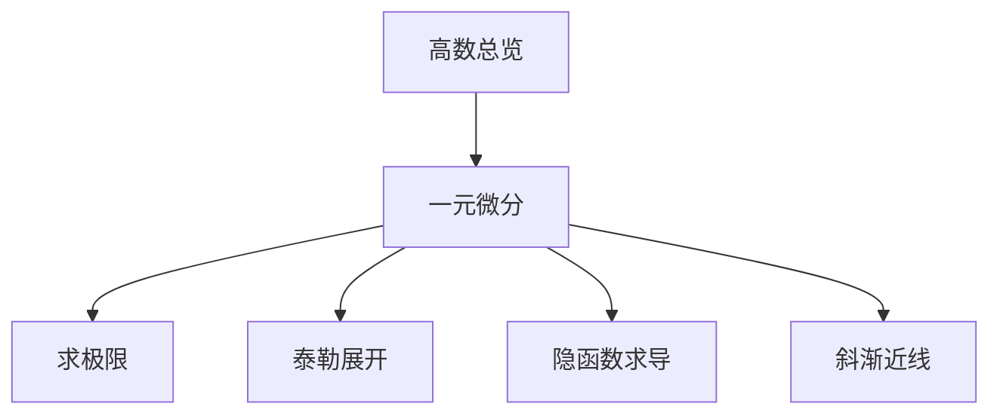
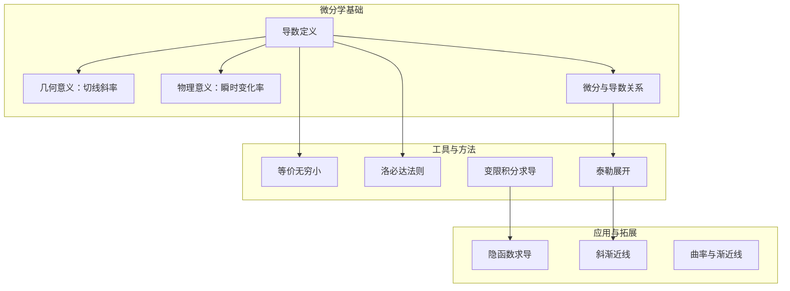
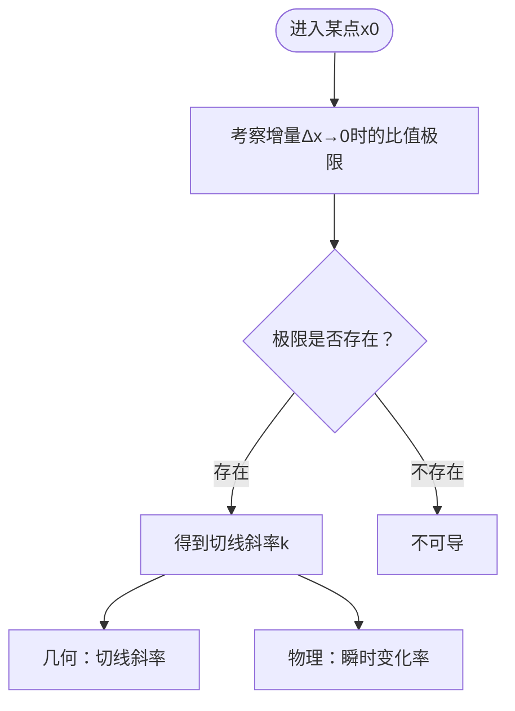
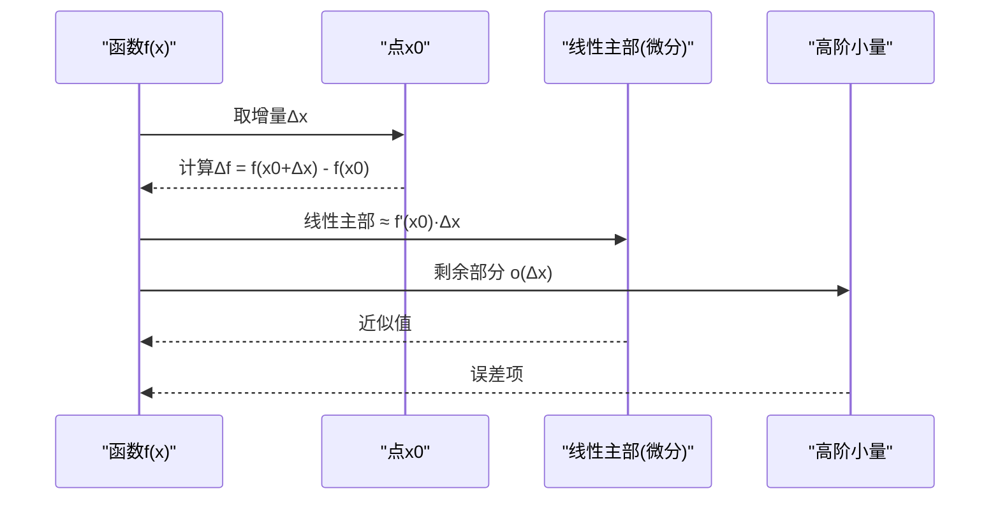
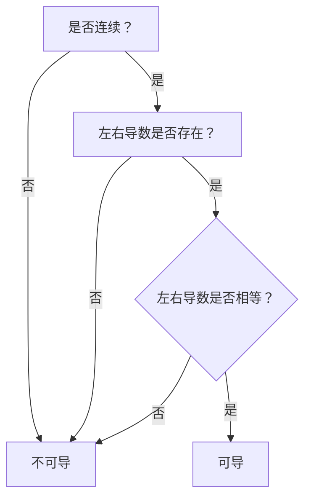
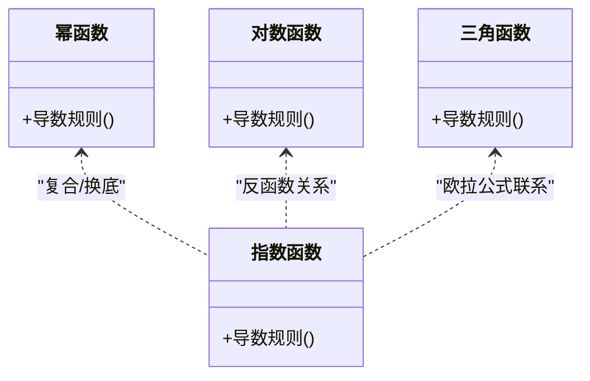
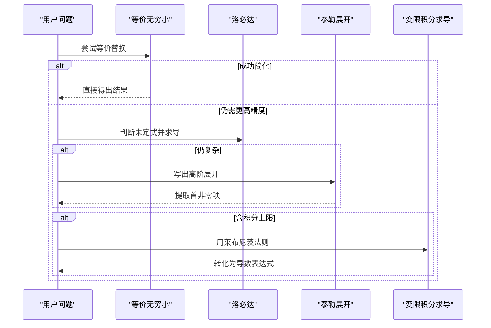
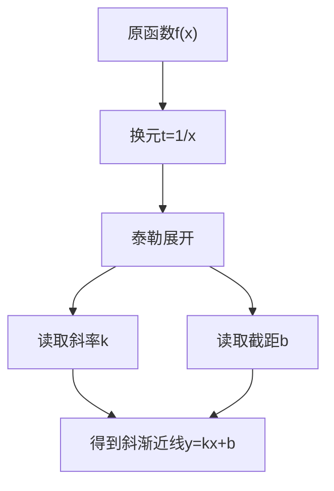
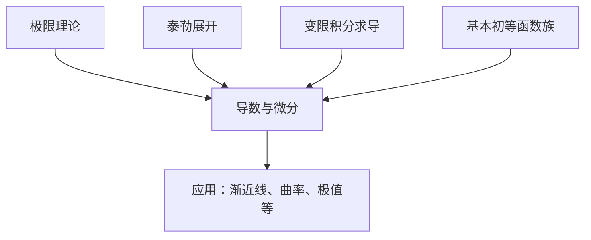

# 导数与微分概念

<cite>
**本文引用的文件**
- [一元微分.md](file://数一/一元微分.md)
- [高数总览.md](file://数一/高数总览.md)
- [求极限.md](file://数一/求极限.md)
- [泰勒展开.md](file://数一/泰勒展开.md)
- [隐函数求导.md](file://隐函数求导.md)
- [斜渐近线.md](file://斜渐近线.md)
</cite>

## 目录
1. [引言](#引言)
2. [项目结构](#项目结构)
3. [核心组件](#核心组件)
4. [架构总览](#架构总览)
5. [详细组件分析](#详细组件分析)
6. [依赖关系分析](#依赖关系分析)
7. [性能与学习效率建议](#性能与学习效率建议)
8. [疑难排错指南](#疑难排错指南)
9. [结论](#结论)
10. [附录：系统化学习路径与记忆技巧](#附录系统化学习路径与记忆技巧)

## 引言
本章节围绕“导数与微分”的核心概念进行系统梳理，目标是帮助读者建立从定义到几何、物理意义，再到基本初等函数求导法则的完整认知框架。内容涵盖：
- 导数的严格定义及其几何（切线斜率）与物理（瞬时变化率）意义
- 微分的概念及其与导数的关系
- 可导性与连续性的关系、左右导数的概念与应用
- 基本初等函数的导数公式推导思路与求导法则
- 通过典型例题展示计算流程，归纳常见错误与易混淆点
- 提供系统化学习路径与高效记忆技巧

## 项目结构
本项目以“高等数学”专题笔记组织知识，导数与微分相关内容主要分布在以下文件：
- 一元微分：导数、微分与求导法则的入口导航
- 高数总览：微分学在整体知识体系中的定位
- 求极限：等价无穷小、洛必达、变限积分求导等与导数密切相关的工具
- 泰勒展开：基本初等函数的展开式与高阶导数、极限求解方法
- 隐函数求导：隐函数、参数方程、反函数等求导方法的索引
- 斜渐近线：利用导数与泰勒展开求斜渐近线的技巧

图表来源
- [高数总览.md:19-31](file://数一/高数总览.md#L19-L31)
- [一元微分.md:13-26](file://数一/一元微分.md#L13-L26)

章节来源
- [高数总览.md:19-31](file://数一/高数总览.md#L19-L31)
- [一元微分.md:13-26](file://数一/一元微分.md#L13-L26)

## 核心组件
- 导数定义与几何意义：导数是函数在某点的瞬时变化率，几何上对应曲线在该点的切线斜率。
- 导数与微分的关系：微分是导数的线性主部，二者在局部线性近似中紧密关联。
- 可导性与连续性：可导必连续，但连续不一定可导；左右导数决定可导性。
- 基本初等函数求导：幂函数、指数函数、对数函数、三角函数等的导数公式及推导思路。
- 求导工具链：等价无穷小、洛必达法则、泰勒展开、变限积分求导等。

章节来源
- [求极限.md:19-32](file://数一/求极限.md#L19-L32)
- [泰勒展开.md:20-31](file://数一/泰勒展开.md#L20-L31)
- [隐函数求导.md:13-24](file://隐函数求导.md#L13-L24)

## 架构总览
下图展示了导数与微分在知识体系中的位置以及与其他工具的协作关系：

图表来源
- [高数总览.md:19-31](file://数一/高数总览.md#L19-L31)
- [求极限.md:19-32](file://数一/求极限.md#L19-L32)
- [泰勒展开.md:20-31](file://数一/泰勒展开.md#L20-L31)
- [隐函数求导.md:13-24](file://隐函数求导.md#L13-L24)
- [斜渐近线.md:277-278](file://斜渐近线.md#L277-L278)

## 详细组件分析

### 导数的定义与几何、物理意义
- 定义要点：导数刻画函数在某点的局部线性变化趋势，是极限过程下的“瞬时变化率”。
- 几何意义：导数值等于曲线在该点的切线斜率，反映曲线的局部倾斜程度。
- 物理意义：如位移对时间的导数为速度，速度对时间的导数为加速度，体现“瞬时变化率”的物理本质。

图表来源
- [求极限.md:19-32](file://数一/求极限.md#L19-L32)
- [泰勒展开.md:20-31](file://数一/泰勒展开.md#L20-L31)

章节来源
- [求极限.md:19-32](file://数一/求极限.md#L19-L32)
- [泰勒展开.md:20-31](file://数一/泰勒展开.md#L20-L31)

### 微分与导数的关系
- 微分是导数的线性主部，用于局部线性近似与误差估计。
- 在可导点附近，函数增量可分解为线性主部与高阶小量，前者即微分。
- 微分与导数在形式上密切相关，但在概念层次上，微分强调“线性近似”，导数强调“变化率”。

图表来源
- [泰勒展开.md:20-31](file://数一/泰勒展开.md#L20-L31)

章节来源
- [泰勒展开.md:20-31](file://数一/泰勒展开.md#L20-L31)

### 可导性与连续性、左右导数
- 可导必连续：若函数在某点可导，则必在该点连续。
- 连续未必可导：例如绝对值函数在原点连续但不可导。
- 左右导数：左导数与右导数均存在且相等时，函数在该点可导；否则不可导。

图表来源
- [求极限.md:19-32](file://数一/求极限.md#L19-L32)

章节来源
- [求极限.md:19-32](file://数一/求极限.md#L19-L32)

### 基本初等函数的导数公式与推导思路
- 幂函数：导数遵循“降幂乘系数”的规则，注意常数幂与变量幂的区别。
- 指数函数：底数为e时导数最简洁；一般底数a需引入ln a因子。
- 对数函数：自然对数导数为倒数形式；换底公式可将其他底数化为自然对数。
- 三角函数：正弦、余弦互为导数关系；正切、余切可通过商或复合规则处理。
- 推导思路：优先使用已知基本公式与复合、乘积、商的求导法则；必要时借助泰勒展开或等价无穷小验证。

图表来源
- [泰勒展开.md:44-81](file://数一/泰勒展开.md#L44-L81)

章节来源
- [泰勒展开.md:44-81](file://数一/泰勒展开.md#L44-L81)

### 求导工具链与典型流程
- 等价无穷小：快速替换常用等价形式，适用于极限与近似。
- 洛必达法则：针对未定式类型，通过求导化简极限。
- 泰勒展开：高阶精度逼近，常用于差值型极限与高阶导数。
- 变限积分求导：莱布尼茨法则将积分上限函数转化为导数表达式。

图表来源
- [求极限.md:19-32](file://数一/求极限.md#L19-L32)
- [求极限.md:105-120](file://数一/求极限.md#L105-L120)
- [泰勒展开.md:110-125](file://数一/泰勒展开.md#L110-L125)

章节来源
- [求极限.md:19-32](file://数一/求极限.md#L19-L32)
- [求极限.md:105-120](file://数一/求极限.md#L105-L120)
- [泰勒展开.md:110-125](file://数一/泰勒展开.md#L110-L125)

### 典型例题与常见错误
- 例题方向：
  - 幂指函数极限：取对数后化为分式，再用等价无穷小或洛必达。
  - 变限积分极限：先等价替换被积函数主部，再换元或莱布尼茨求导。
- 常见错误：
  - 忽略收敛域与条件限制（如对数、根号定义域）。
  - 等价替换阶数不足导致差值型极限误判。
  - 洛必达滥用（不满足未定式条件或循环求导无解）。
  - 忘记复合函数链式法则与乘积/商法则的顺序。

章节来源
- [求极限.md:36-103](file://数一/求极限.md#L36-L103)
- [求极限.md:105-120](file://数一/求极限.md#L105-L120)
- [泰勒展开.md:83-107](file://数一/泰勒展开.md#L83-L107)

### 斜渐近线与导数、泰勒展开的结合
- 核心思想：通过换元与泰勒展开，一步读出斜率与截距。
- 适用场景：当函数趋于无穷时，利用展开式确定线性渐近行为。

图表来源
- [斜渐近线.md:277-278](file://斜渐近线.md#L277-L278)

章节来源
- [斜渐近线.md:277-278](file://斜渐近线.md#L277-L278)

## 依赖关系分析
导数与微分的学习依赖于以下工具与前置知识：
- 极限理论：等价无穷小、洛必达法则
- 级数与展开：泰勒展开、麦克劳林展开
- 积分与导数互逆：变限积分求导
- 函数族关系：幂、指、对、三角之间的导数与展开关系

图表来源
- [高数总览.md:19-31](file://数一/高数总览.md#L19-L31)
- [求极限.md:19-32](file://数一/求极限.md#L19-L32)
- [泰勒展开.md:20-31](file://数一/泰勒展开.md#L20-L31)

章节来源
- [高数总览.md:19-31](file://数一/高数总览.md#L19-L31)
- [求极限.md:19-32](file://数一/求极限.md#L19-L32)
- [泰勒展开.md:20-31](file://数一/泰勒展开.md#L20-L31)

## 性能与学习效率建议
- 优先级策略：等价无穷小 → 洛必达 → 泰勒展开 → 取对数化简。
- 精度控制：差值型极限需展开到足够阶数，避免低阶项抵消导致误判。
- 工具选择：变限积分优先等价替换主部，必要时用莱布尼茨法则。
- 记忆技巧：掌握基本初等函数的展开式与导数关系，形成“看到特征→调用方法”的直觉。

章节来源
- [求极限.md:105-120](file://数一/求极限.md#L105-L120)
- [泰勒展开.md:83-107](file://数一/泰勒展开.md#L83-L107)

## 疑难排错指南
- 未定式识别：明确类型（0/0、∞/∞、0^0等），选择合适方法。
- 等价替换陷阱：确保同阶展开，避免错误抵消。
- 洛必达条件：确认可导性与未定式成立，避免循环求导。
- 变限积分求导：正确使用莱布尼茨法则，注意上下限函数与偏导项。

章节来源
- [求极限.md:19-32](file://数一/求极限.md#L19-L32)
- [求极限.md:105-120](file://数一/求极限.md#L105-L120)
- [泰勒展开.md:110-125](file://数一/泰勒展开.md#L110-L125)

## 结论
导数与微分是微分学的基石，理解其定义、几何与物理意义，掌握可导性与连续性的关系、左右导数的作用，以及基本初等函数的求导法则与工具链，是构建完整知识体系的关键。通过系统化的学习路径与记忆技巧，结合等价无穷小、洛必达、泰勒展开等方法，能够有效提升解题效率与准确性。

## 附录：系统化学习路径与记忆技巧
- 学习路径：
  - 从极限入手，掌握等价无穷小与洛必达法则
  - 深入泰勒展开，理解高阶导数与局部线性近似
  - 练习变限积分求导，打通积分与导数的互逆关系
  - 综合应用：斜渐近线、曲率、极值等
- 记忆技巧：
  - 基本初等函数的展开式与导数关系成对记忆
  - 差值型极限记住“展开到首非零项”的原则
  - 工具优先级：等价无穷小 → 洛必达 → 泰勒展开 → 取对数

章节来源
- [高数总览.md:19-31](file://数一/高数总览.md#L19-L31)
- [求极限.md:105-120](file://数一/求极限.md#L105-L120)
- [泰勒展开.md:163-189](file://数一/泰勒展开.md#L163-L189)