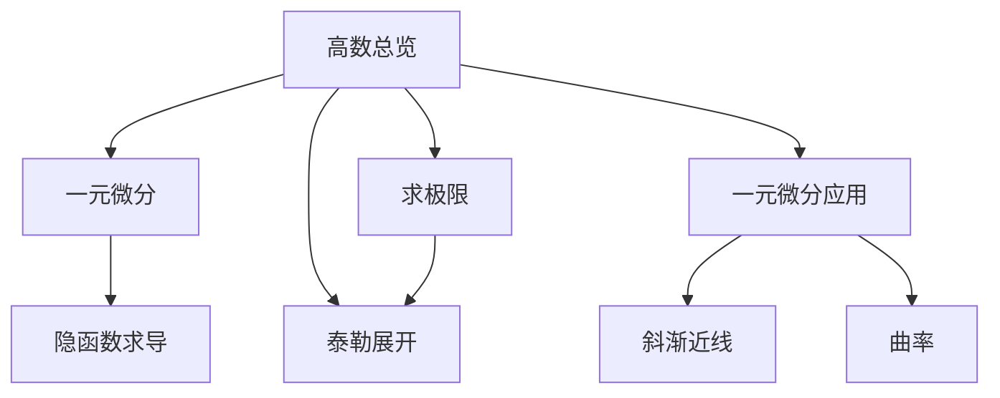
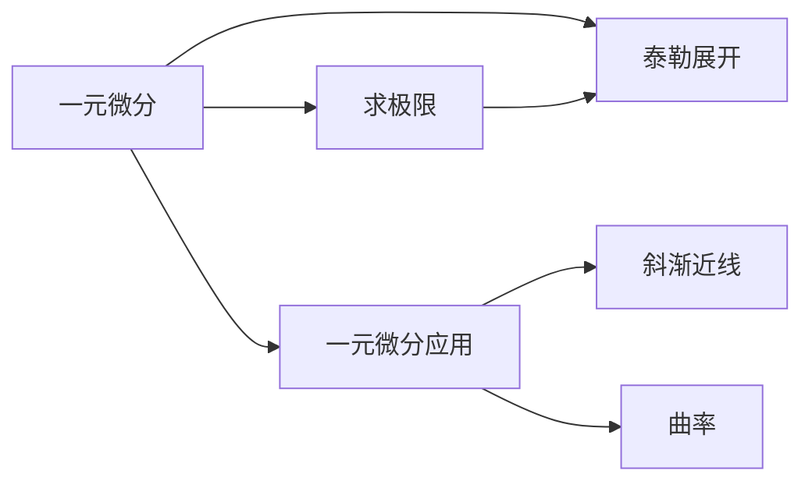
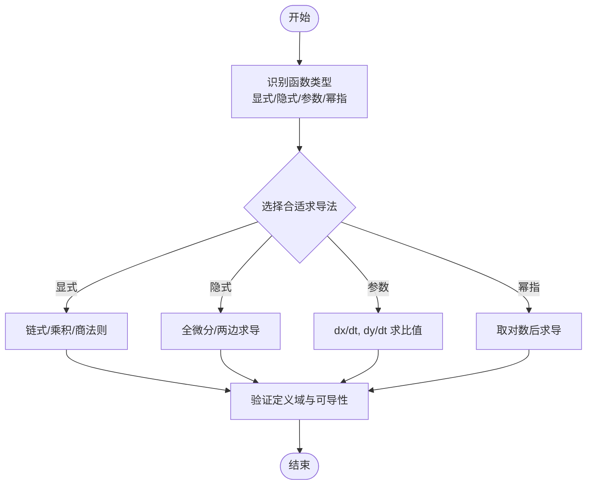
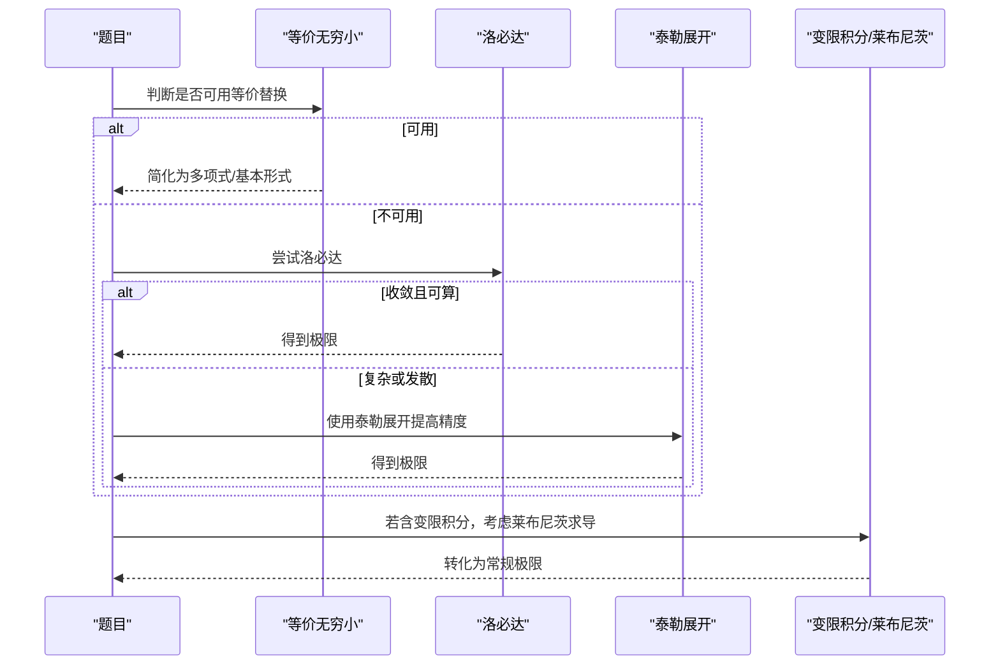
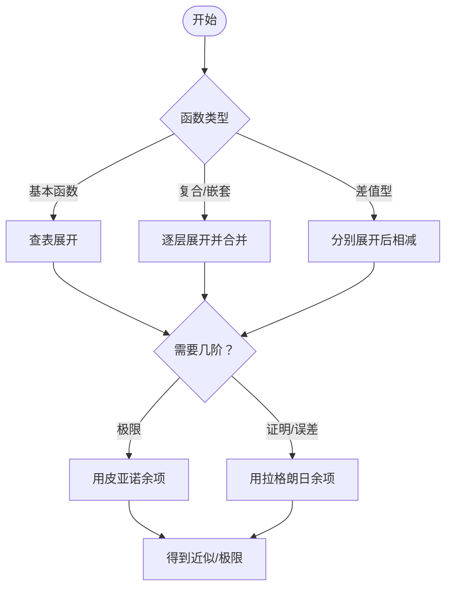
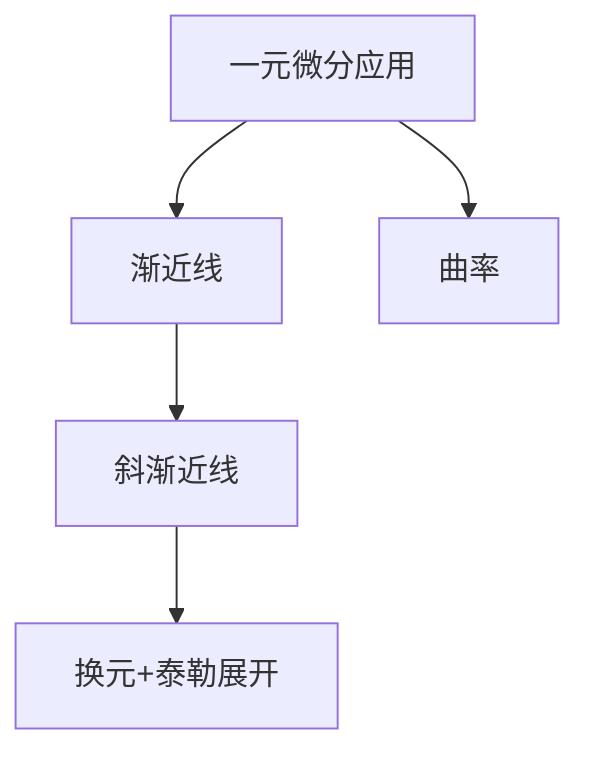

# 微分学基础

<cite>
**本文引用的文件**
- [一元微分.md](file://数一/一元微分.md)
- [求极限.md](file://数一/求极限.md)
- [泰勒展开.md](file://数一/泰勒展开.md)
- [高数总览.md](file://数一/高数总览.md)
- [隐函数求导.md](file://隐函数求导.md)
- [一元微分应用.md](file://数一/一元微分应用.md)
- [斜渐近线.md](file://斜渐近线.md)
- [曲率.md](file://曲率.md)
</cite>

## 目录
1. [引言](#引言)
2. [项目结构](#项目结构)
3. [核心组件](#核心组件)
4. [架构总览](#架构总览)
5. [详细组件分析](#详细组件分析)
6. [依赖关系分析](#依赖关系分析)
7. [性能与效率考量](#性能与效率考量)
8. [疑难排错指南](#疑难排错指南)
9. [结论](#结论)
10. [附录：学习方法与策略](#附录学习方法与策略)

## 引言
本学习文档围绕“微分学基础”系统梳理导数与微分的概念、基本求导法则、极限计算（洛必达、等价无穷小）、以及泰勒公式与麦克劳林展开在函数近似与极限中的核心应用。内容以笔记仓库为依据，结合具体例题展示解题思路、常见错误分析与易混淆概念辨析，并提供系统化学习方法与问题解决策略，帮助读者建立从概念到应用的完整知识框架。

## 项目结构
该仓库以专题笔记组织微积分相关内容，与微分学直接相关的核心文件包括：
- 一元微分与相关方法：[一元微分.md]、[隐函数求导.md]
- 极限与未定式处理：[求极限.md]
- 泰勒展开与常用展开表：[泰勒展开.md]
- 微分学应用（渐近线、曲率等）：[一元微分应用.md]、[斜渐近线.md]、[曲率.md]
- 知识体系导航：[高数总览.md]

图表来源
- [高数总览.md:19-31](file://数一/高数总览.md#L19-L31)
- [一元微分.md:19-26](file://数一/一元微分.md#L19-L26)
- [求极限.md:13-33](file://数一/求极限.md#L13-L33)
- [泰勒展开.md:14-32](file://数一/泰勒展开.md#L14-L32)
- [一元微分应用.md:13-27](file://数一/一元微分应用.md#L13-L27)
- [斜渐近线.md:1-11](file://斜渐近线.md#L1-L11)
- [曲率.md:12-22](file://曲率.md#L12-L22)

章节来源
- [高数总览.md:19-31](file://数一/高数总览.md#L19-L31)

## 核心组件
- 导数与微分：理解导数的几何意义（切线斜率）与物理意义（瞬时变化率），掌握基本初等函数的求导公式与复合、乘积、商、反函数等求导法则；隐函数与参数方程的求导方法。
- 极限计算：识别并处理未定式（0/0、∞/∞、0^0等），优先使用等价无穷小替换，其次洛必达法则，必要时用泰勒展开提高精度；变限积分与莱布尼茨求导技巧。
- 泰勒与麦克劳林展开：掌握基本函数展开式、差值型展开、嵌套函数展开与余项选择（皮亚诺用于极限，拉格朗日用于证明与误差估计）。
- 微分学应用：渐近线判定与求解（水平、垂直、斜），曲率与曲率半径的概念与计算。

章节来源
- [一元微分.md:13-26](file://数一/一元微分.md#L13-L26)
- [求极限.md:19-33](file://数一/求极限.md#L19-L33)
- [泰勒展开.md:20-32](file://数一/泰勒展开.md#L20-L32)
- [一元微分应用.md:13-27](file://数一/一元微分应用.md#L13-L27)

## 架构总览
下图展示了微分学基础的知识结构与调用关系：从“一元微分”出发，通过“求极限”和“泰勒展开”支撑未定式与函数近似问题；“微分学应用”将导数工具用于渐近线与曲率等实际问题。

图表来源
- [高数总览.md:19-31](file://数一/高数总览.md#L19-L31)
- [求极限.md:13-33](file://数一/求极限.md#L13-L33)
- [泰勒展开.md:14-32](file://数一/泰勒展开.md#L14-L32)
- [一元微分应用.md:13-27](file://数一/一元微分应用.md#L13-L27)
- [斜渐近线.md:1-11](file://斜渐近线.md#L1-L11)
- [曲率.md:12-22](file://曲率.md#L12-L22)

## 详细组件分析

### 组件A：导数与微分（概念、几何与物理意义、基本求导法则）
- 概念理解
  - 导数：函数在某点的局部线性化斜率，几何上为切线斜率，物理上为瞬时变化率。
  - 微分：基于导数的线性主部，用于近似与误差估计。
- 基本求导法则
  - 复合函数链式法则、乘积与商法则、反函数求导、幂指函数对数求导。
  - 隐函数与参数方程求导：通过全微分或参数消元得到导数表达式。
- 常见误区
  - 忽略定义域与可导性条件。
  - 对复合函数求导时漏掉内层导数。
  - 幂指函数直接使用指数法则而未取对数化简。

图表来源
- [隐函数求导.md:13-25](file://隐函数求导.md#L13-L25)
- [一元微分.md:13-26](file://数一/一元微分.md#L13-L26)

章节来源
- [隐函数求导.md:13-25](file://隐函数求导.md#L13-L25)
- [一元微分.md:13-26](file://数一/一元微分.md#L13-L26)

### 组件B：极限计算（未定式、等价无穷小、洛必达、变限积分）
- 未定式类型与优先级
  - 0/0、∞/∞、0^0等；推荐顺序：等价无穷小 → 洛必达 → 泰勒展开 → 取对数。
- 典型技巧
  - 等价无穷小替换：e^u−1∼u、sin u∼u、ln(1+u)∼u。
  - 洛必达法则：适用于0/0或∞/∞，注意逐项求导与简化。
  - 变限积分：利用莱布尼茨法则对含参积分求导。
- 例题要点
  - 0^0型幂指函数：取对数化为0/0或∞/∞后用洛必达。
  - 变限积分极限：先等价替换再换元或直接洛必达验证。

图表来源
- [求极限.md:19-33](file://数一/求极限.md#L19-L33)
- [求极限.md:36-121](file://数一/求极限.md#L36-L121)

章节来源
- [求极限.md:19-33](file://数一/求极限.md#L19-L33)
- [求极限.md:36-121](file://数一/求极限.md#L36-L121)

### 组件C：泰勒公式与麦克劳林展开（函数近似与极限）
- 基本概念
  - 泰勒展开：用多项式逼近函数，在x0处各阶导数一致。
  - 麦克劳林展开：x0=0的特例，考研中最常用。
- 常用展开与差值型
  - e^x、sin x、cos x、ln(1+x)、(1+x)^a等标准展开。
  - 差值型展开：如x−sin x、tan x−x等，用于抵消低阶项，暴露首项非零项。
- 余项选择
  - 皮亚诺余项：适合极限与阶数判断。
  - 拉格朗日余项：适合不等式证明与误差估计。
- 应用
  - 高阶导数系数法、极限计算、级数收敛性与幂级数和函数。

图表来源
- [泰勒展开.md:20-32](file://数一/泰勒展开.md#L20-L32)
- [泰勒展开.md:83-107](file://数一/泰勒展开.md#L83-L107)
- [泰勒展开.md:110-126](file://数一/泰勒展开.md#L110-L126)
- [泰勒展开.md:129-160](file://数一/泰勒展开.md#L129-L160)

章节来源
- [泰勒展开.md:20-32](file://数一/泰勒展开.md#L20-L32)
- [泰勒展开.md:83-107](file://数一/泰勒展开.md#L83-L107)
- [泰勒展开.md:110-126](file://数一/泰勒展开.md#L110-L126)
- [泰勒展开.md:129-160](file://数一/泰勒展开.md#L129-L160)

### 组件D：微分学应用（渐近线与曲率）
- 渐近线
  - 水平、垂直、斜渐近线的判定与求法；斜渐近线常用换元t=1/x后泰勒展开一步读出k与b。
- 曲率
  - 曲线弯曲程度的度量，涉及曲率与曲率半径的定义与计算。

图表来源
- [一元微分应用.md:13-27](file://数一/一元微分应用.md#L13-L27)
- [斜渐近线.md:1-11](file://斜渐近线.md#L1-L11)
- [曲率.md:12-22](file://曲率.md#L12-L22)

章节来源
- [一元微分应用.md:13-27](file://数一/一元微分应用.md#L13-L27)
- [斜渐近线.md:14-125](file://斜渐近线.md#L14-L125)
- [曲率.md:12-22](file://曲率.md#L12-L22)

## 依赖关系分析
- 一元微分是基础，提供导数与微分工具。
- 求极限依赖等价无穷小、洛必达与泰勒展开。
- 泰勒展开既服务于极限，也支撑渐近线与曲率的计算。
- 微分学应用将上述工具落地到具体问题（渐近线、曲率）。

图表来源
- [高数总览.md:19-31](file://数一/高数总览.md#L19-L31)
- [求极限.md:13-33](file://数一/求极限.md#L13-L33)
- [泰勒展开.md:14-32](file://数一/泰勒展开.md#L14-L32)
- [一元微分应用.md:13-27](file://数一/一元微分应用.md#L13-L27)

章节来源
- [高数总览.md:19-31](file://数一/高数总览.md#L19-L31)

## 性能与效率考量
- 方法选择优先级直接影响计算效率：等价无穷小最快，洛必达次之，泰勒展开更通用但计算量更大。
- 在极限中合理选择展开阶数：仅展开到首个非零项即可，避免过度展开导致冗余计算。
- 变限积分极限优先考虑等价替换与换元，必要时再用洛必达验证。

[本节为一般性指导，不直接分析具体文件]

## 疑难排错指南
- 未定式误判：确认类型后再选择方法；0^0需取对数化简。
- 等价替换滥用：仅在乘除因子中使用，加减情形需谨慎，必要时改用泰勒展开。
- 洛必达循环：若多次使用后仍无法收敛，应切换至泰勒展开。
- 变限积分求导：正确使用莱布尼茨法则，注意上下限与被积函数对参数的偏导。
- 泰勒展开阶数不足：差值型问题常需更高阶展开以消除低阶项。

章节来源
- [求极限.md:19-33](file://数一/求极限.md#L19-L33)
- [求极限.md:36-121](file://数一/求极限.md#L36-L121)
- [泰勒展开.md:83-107](file://数一/泰勒展开.md#L83-L107)
- [泰勒展开.md:110-126](file://数一/泰勒展开.md#L110-L126)

## 结论
微分学基础以导数与微分为核心，借助极限方法与泰勒展开构建起函数近似与未定式处理的统一框架。通过系统化的方法选择与严谨的展开策略，能够有效解决各类微分学问题，并在渐近线与曲率等应用中体现其价值。建议学习者按“等价无穷小→洛必达→泰勒展开”的顺序逐步推进，配合差值型展开与余项理论，形成稳定可靠的解题路径。

[本节为总结性内容，不直接分析具体文件]

## 附录：学习方法与策略
- 建立知识地图：以“高数总览”为索引，串联一元微分、极限、泰勒与应用专题。
- 强化题型分类：针对未定式、变限积分、幂指函数、差值型展开等高频题型进行专项训练。
- 重视方法优先级：优先等价无穷小，其次洛必达，最后泰勒展开；精度不够时升阶。
- 错题归因：记录错误类型（概念不清、方法不当、计算失误），针对性改进。
- 实践与验证：利用数值验证（如斜渐近线数值检验）增强直观理解。

章节来源
- [高数总览.md:19-31](file://数一/高数总览.md#L19-L31)
- [求极限.md:105-121](file://数一/求极限.md#L105-L121)
- [斜渐近线.md:115-125](file://斜渐近线.md#L115-L125)
- [斜渐近线.md:258-267](file://斜渐近线.md#L258-L267)