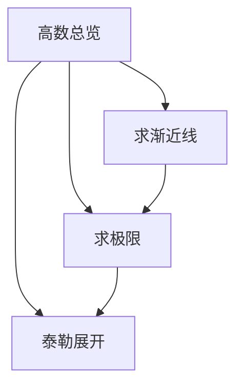
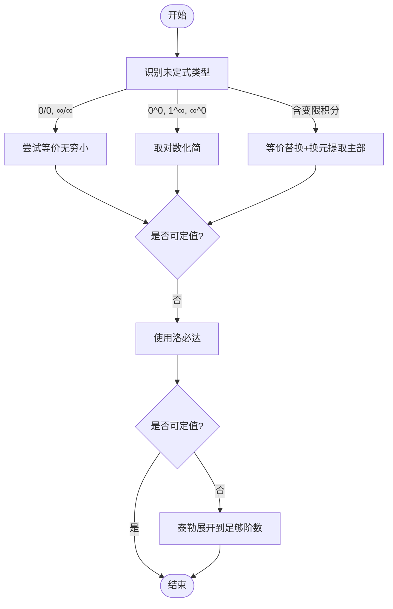
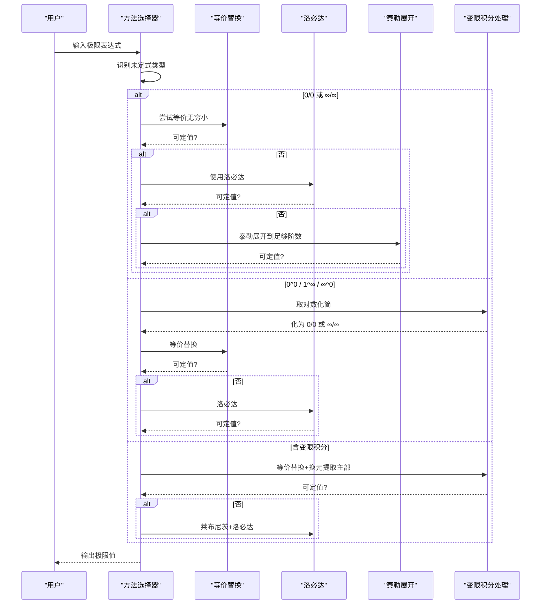
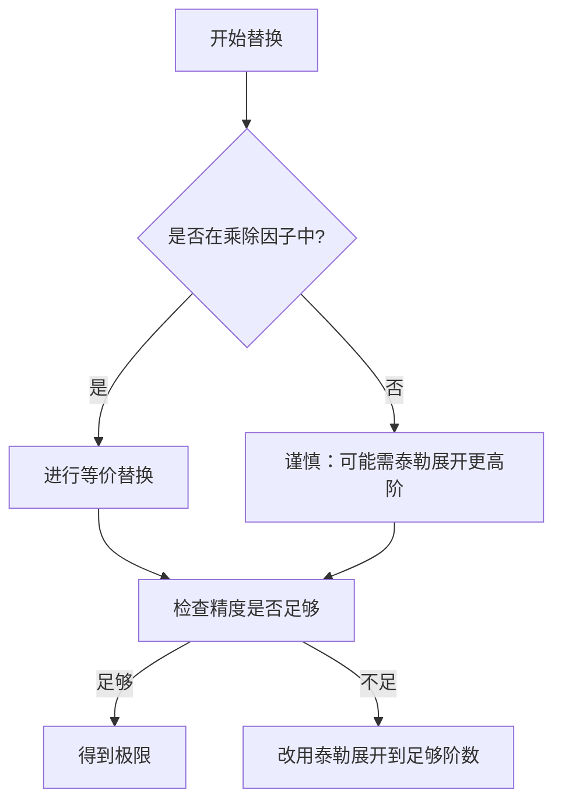
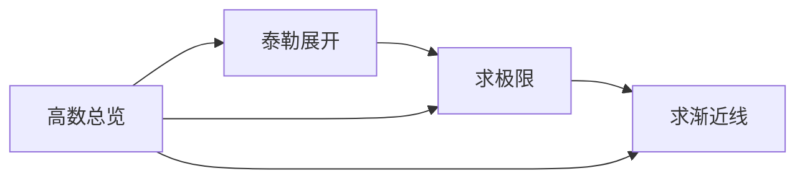

# 极限计算方法

<cite>
**本文引用的文件**
- [求极限.md](file://数一/求极限.md)
- [泰勒展开.md](file://数一/泰勒展开.md)
- [高数总览.md](file://数一/高数总览.md)
- [求渐近线.md](file://数一/求渐近线.md)
</cite>

## 目录
1. [引言](#引言)
2. [项目结构](#项目结构)
3. [核心组件](#核心组件)
4. [架构总览](#架构总览)
5. [详细组件分析](#详细组件分析)
6. [依赖关系分析](#依赖关系分析)
7. [性能与效率考量](#性能与效率考量)
8. [疑难排错指南](#疑难排错指南)
9. [结论](#结论)
10. [附录：常用等价与公式速查](#附录常用等价与公式速查)

## 引言
本学习材料围绕“极限计算方法”构建，系统梳理未定式识别、等价无穷小替换、洛必达法则、泰勒展开、变限积分处理、幂指函数取对数化简等核心技巧，并结合典型例题展示解题流程与优先级。同时给出系统化步骤与常见陷阱规避建议，帮助读者在面对复杂极限问题时快速定位方法并高效求解。

## 项目结构
本仓库中与极限计算直接相关的知识集中在“数一”目录下，其中：
- “求极限.md”提供未定式类型、方法优先级、典型例题与关键技巧总结；
- “泰勒展开.md”提供麦克劳林展开表、余项理论与高阶差值型展开，支撑等价替换与精度控制；
- “求渐近线.md”涉及水平、垂直、斜渐近线的判定，本质是三类极限问题；
- “高数总览.md”作为索引，串联微分学、积分学与极限相关专题。

图表来源
- [高数总览.md:19-30](file://数一/高数总览.md#L19-L30)
- [求极限.md:13-33](file://数一/求极限.md#L13-L33)
- [求渐近线.md:19-74](file://数一/求渐近线.md#L19-L74)

章节来源
- [高数总览.md:19-30](file://数一/高数总览.md#L19-L30)
- [求极限.md:13-33](file://数一/求极限.md#L13-L33)
- [求渐近线.md:19-74](file://数一/求渐近线.md#L19-L74)

## 核心组件
- 未定式识别与分类：包括 0^0、0/0、∞/∞ 以及含变限积分的极限形式；
- 方法选择优先级：等价无穷小 → 洛必达 → 泰勒展开 → 取对数（幂指函数）；
- 等价无穷小与高阶展开：基于麦克劳林展开的常用等价与差值型展开；
- 变限积分处理：利用莱布尼茨法则或换元法提取主部；
- 幂指函数处理：取对数化为 0/0 或 ∞/∞ 后用洛必达或等价替换；
- 渐近线求解：将水平、垂直、斜渐近线转化为三类极限问题。

章节来源
- [求极限.md:19-33](file://数一/求极限.md#L19-L33)
- [求极限.md:105-121](file://数一/求极限.md#L105-L121)
- [泰勒展开.md:163-178](file://数一/泰勒展开.md#L163-L178)
- [求渐近线.md:19-74](file://数一/求渐近线.md#L19-L74)

## 架构总览
极限计算的“方法栈”按精度与复杂度递增排列：等价无穷小（一阶近似）→ 洛必达（导数工具）→ 泰勒展开（高阶逼近）→ 取对数（幂指函数降维）。对于含变限积分的问题，优先通过等价替换与换元提取主部，必要时再用莱布尼茨法则配合洛必达验证。

图表来源
- [求极限.md:19-33](file://数一/求极限.md#L19-L33)
- [求极限.md:105-121](file://数一/求极限.md#L105-L121)
- [泰勒展开.md:144-150](file://数一/泰勒展开.md#L144-L150)

## 详细组件分析

### 未定式类型与处理方法
- 0^0 型：底数趋于 1、指数趋于 0，通常取对数化为 ln(底)/ (1/指数) 的 0/0 或 ∞/∞ 型；
- 0/0 型：优先等价无穷小，其次洛必达，最后泰勒展开；
- ∞/∞ 型：抓主项或洛必达；
- 含变限积分：先等价替换被积函数主部，结合换元提取 x 的幂次主部，必要时用莱布尼茨法则求导。

图表来源
- [求极限.md:19-33](file://数一/求极限.md#L19-L33)
- [求极限.md:38-103](file://数一/求极限.md#L38-L103)
- [求极限.md:105-121](file://数一/求极限.md#L105-L121)

章节来源
- [求极限.md:19-33](file://数一/求极限.md#L19-L33)
- [求极限.md:38-103](file://数一/求极限.md#L38-L103)
- [求极限.md:105-121](file://数一/求极限.md#L105-L121)

### 洛必达法则适用条件与技巧
- 适用前提：极限为 0/0 或 ∞/∞ 型，且分子分母在去心邻域内可导；
- 技巧要点：
  - 优先等价替换简化后再用洛必达；
  - 幂指函数先取对数再洛必达；
  - 变限积分可用莱布尼茨法则求导后继续洛必达；
  - 若多次洛必达仍无法定值，考虑泰勒展开提高精度。

章节来源
- [求极限.md:19-33](file://数一/求极限.md#L19-L33)
- [求极限.md:105-121](file://数一/求极限.md#L105-L121)

### 等价无穷小替换原则与常用关系
- 原则：仅在乘除因子中整体替换，避免在加减中随意替换导致精度丢失；
- 常用等价（x→0）：e^u−1∼u、sin u∼u、ln(1+u)∼u；
- 高阶差值型展开：如 tan x−x∼x^3/3、x−sin x∼x^3/6 等，用于消去低阶项后暴露首项。

图表来源
- [求极限.md:105-121](file://数一/求极限.md#L105-L121)
- [泰勒展开.md:163-178](file://数一/泰勒展开.md#L163-L178)
- [泰勒展开.md:83-97](file://数一/泰勒展开.md#L83-L97)

章节来源
- [求极限.md:105-121](file://数一/求极限.md#L105-L121)
- [泰勒展开.md:83-97](file://数一/泰勒展开.md#L83-L97)
- [泰勒展开.md:163-178](file://数一/泰勒展开.md#L163-L178)

### 变限积分与莱布尼茨法则
- 思路：先用等价替换将被积函数主部提出，再通过换元 t=xu 提取 x 的幂次；
- 验证：必要时用莱布尼茨法则对变限积分求导，再结合洛必达完成极限计算。

章节来源
- [求极限.md:75-103](file://数一/求极限.md#L75-L103)
- [求极限.md:114-117](file://数一/求极限.md#L114-L117)

### 幂指函数的取对数化简
- 步骤：设 L=u^v，取 ln L=v·ln u，化为 0/0 或 ∞/∞ 后用等价或洛必达；
- 注意：取对数后仍需判断未定式类型，选择合适的后续方法。

章节来源
- [求极限.md:38-72](file://数一/求极限.md#L38-L72)
- [求极限.md:119-121](file://数一/求极限.md#L119-L121)

### 渐近线与极限的关系
- 水平渐近线：x→±∞ 时 f(x)→A；
- 垂直渐近线：x→x0 时 f(x)→±∞；
- 斜渐近线：k=lim f(x)/x，b=lim[f(x)−kx]，要求 k≠0 且有限；
- 这些判定本质上都是极限问题的具体场景。

章节来源
- [求渐近线.md:19-74](file://数一/求渐近线.md#L19-L74)

### 四则运算法、夹逼定理、单调有界原理
- 四则运算法：适用于极限存在且非未定式的代数组合；
- 夹逼定理：当上下界极限相等时可确定中间极限；
- 单调有界原理：常用于数列极限的存在性证明；
- 在本仓库中，上述内容属于通用极限理论，可作为补充方法在更广泛的极限问题中使用。

[本节为概念性说明，不直接分析具体文件]

## 依赖关系分析
- “求极限”依赖“泰勒展开”提供的等价与高阶展开；
- “求渐近线”依赖“求极限”的方法体系；
- “高数总览”作为导航，串联各专题之间的依赖。

图表来源
- [高数总览.md:19-30](file://数一/高数总览.md#L19-L30)
- [求极限.md:13-33](file://数一/求极限.md#L13-L33)
- [求渐近线.md:19-74](file://数一/求渐近线.md#L19-L74)

章节来源
- [高数总览.md:19-30](file://数一/高数总览.md#L19-L30)
- [求极限.md:13-33](file://数一/求极限.md#L13-L33)
- [求渐近线.md:19-74](file://数一/求渐近线.md#L19-L74)

## 性能与效率考量
- 方法优先级决定效率：等价无穷小最快，洛必达次之，泰勒展开最稳健但计算量较大；
- 精度控制：加减运算中慎用等价替换，必要时提升泰勒展开阶数；
- 变限积分：优先换元提取主部，减少求导复杂度；
- 幂指函数：先取对数降维，再选择等价或洛必达。

[本节提供一般性指导，不直接分析具体文件]

## 疑难排错指南
- 误用等价替换于加减：应改用泰勒展开到足够阶数；
- 洛必达前未确认未定式：需先判断是否为 0/0 或 ∞/∞；
- 变限积分求导遗漏项：使用莱布尼茨法则时需包含边界项与被积函数偏导项；
- 幂指函数忘记取对数：应先取对数再处理；
- 渐近线方向混淆：x→+∞ 与 x→−∞ 需分别计算，结果可能不同。

章节来源
- [求极限.md:19-33](file://数一/求极限.md#L19-L33)
- [求极限.md:105-121](file://数一/求极限.md#L105-L121)
- [求渐近线.md:19-74](file://数一/求渐近线.md#L19-L74)

## 结论
极限计算的核心在于准确识别未定式类型与方法优先级。等价无穷小与泰勒展开提供精度保障，洛必达与莱布尼茨法则提供推导工具，取对数化简解决幂指函数难题。掌握系统化步骤与常见陷阱规避策略，可在复杂极限问题中快速定位解法并高效求解。

[本节为总结性内容，不直接分析具体文件]

## 附录：常用等价与公式速查
- 基本等价（x→0）：e^u−1∼u、sin u∼u、ln(1+u)∼u；
- 高阶差值型：tan x−x∼x^3/3、x−sin x∼x^3/6、arctan x−x∼−x^3/3、x−ln(1+x)∼x^2/2、e^x−1−x∼x^2/2；
- 幂级数展开：e^x、sin x、cos x、ln(1+x)、(1+x)^a 等标准展开；
- 余项选择：求极限用皮亚诺余项，证明不等式或误差估计用拉格朗日余项。

章节来源
- [求极限.md:105-121](file://数一/求极限.md#L105-L121)
- [泰勒展开.md:44-82](file://数一/泰勒展开.md#L44-L82)
- [泰勒展开.md:83-107](file://数一/泰勒展开.md#L83-L107)
- [泰勒展开.md:110-125](file://数一/泰勒展开.md#L110-L125)
- [泰勒展开.md:163-178](file://数一/泰勒展开.md#L163-L178)