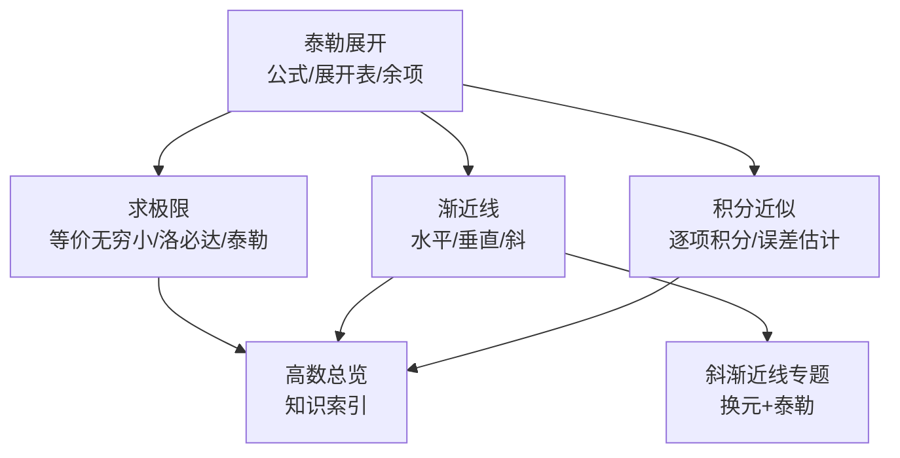
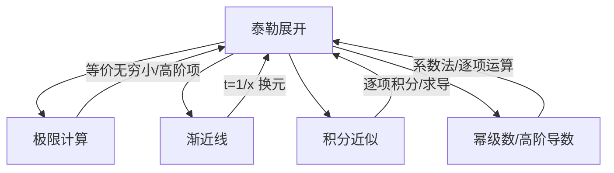
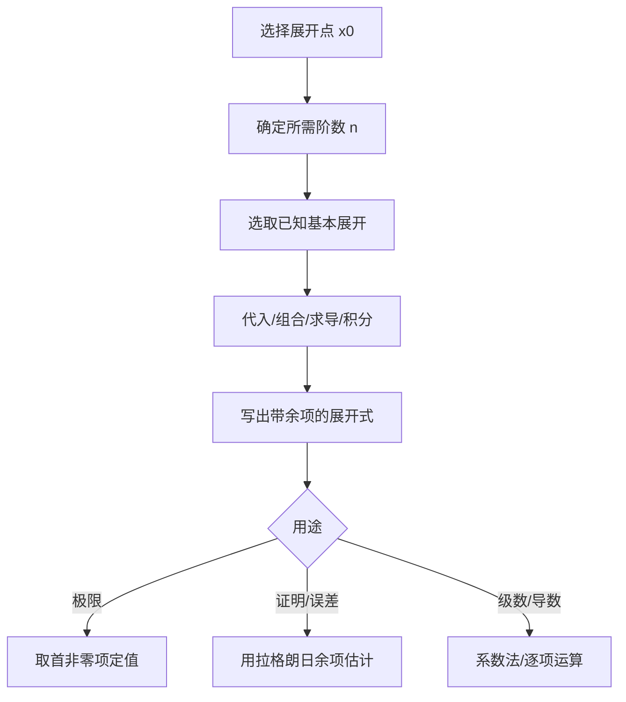
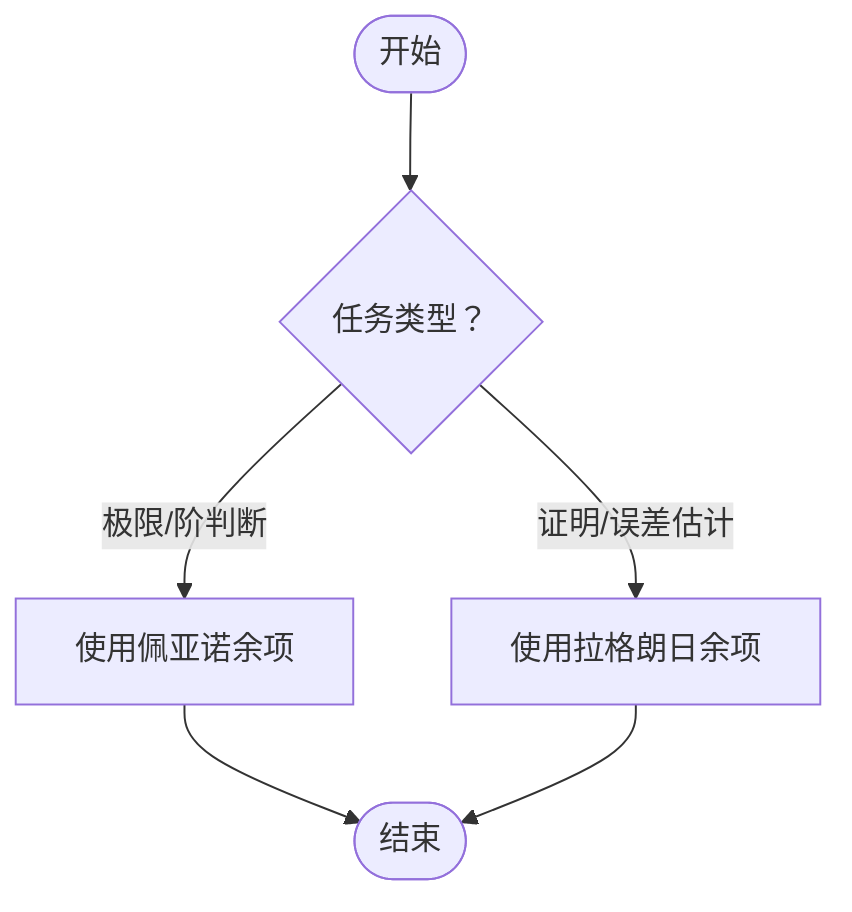
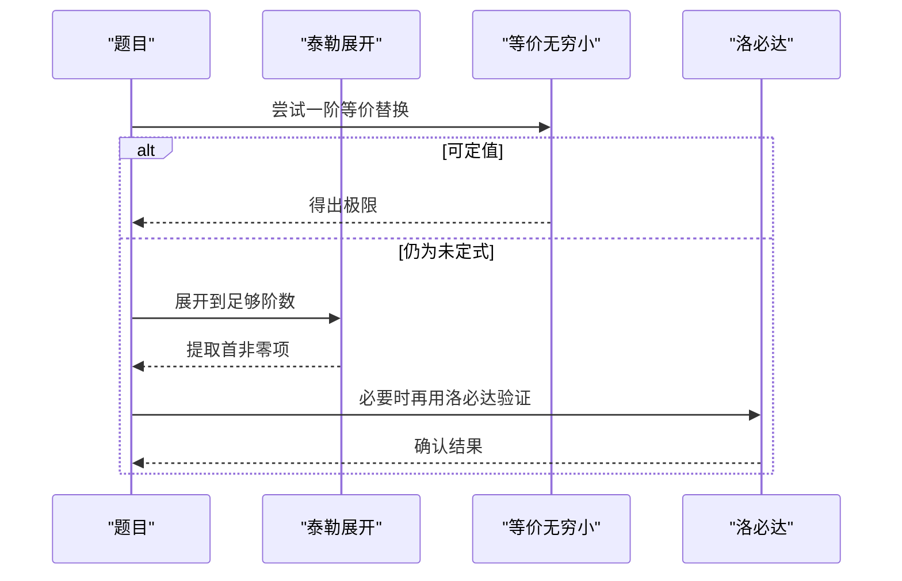
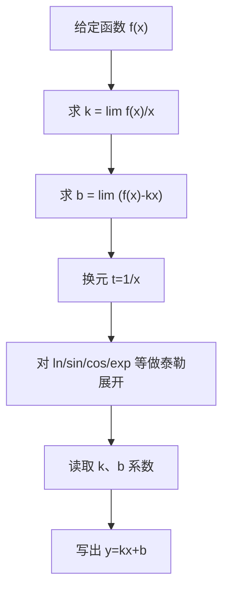
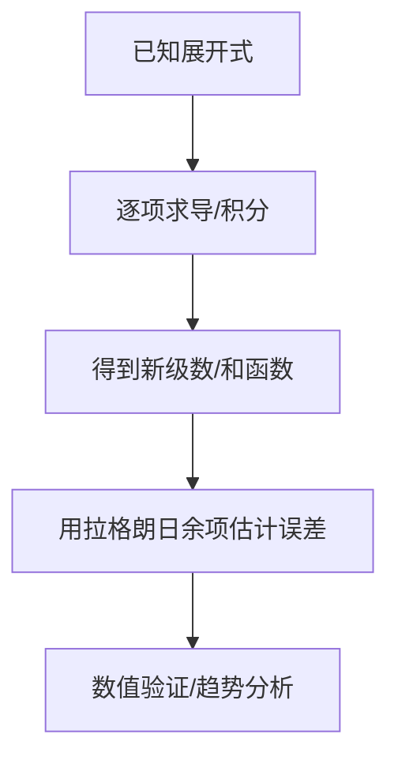
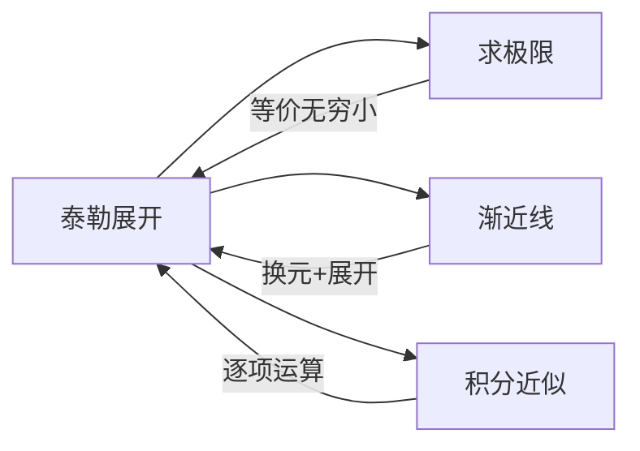

# 泰勒展开与应用

<cite>
**本文引用的文件**   
- [数一/泰勒展开.md](file://数一/泰勒展开.md)
- [数一/求极限.md](file://数一/求极限.md)
- [斜渐近线.md](file://斜渐近线.md)
- [数一/求渐近线.md](file://数一/求渐近线.md)
- [数一/一元积分积分表.md](file://数一/一元积分积分表.md)
- [数一/高数总览.md](file://数一/高数总览.md)
</cite>

## 目录
1. [引言](#引言)
2. [项目结构](#项目结构)
3. [核心组件](#核心组件)
4. [架构总览](#架构总览)
5. [详细组件分析](#详细组件分析)
6. [依赖关系分析](#依赖关系分析)
7. [性能与精度考量](#性能与精度考量)
8. [疑难排错指南](#疑难排错指南)
9. [结论](#结论)
10. [附录：常用展开与技巧速查](#附录常用展开与技巧速查)

## 引言
本学习文档围绕“泰勒展开与应用”构建系统化知识体系，覆盖理论基础（泰勒公式、麦克劳林展开）、常见函数展开式与记忆方法、余项理论（佩亚诺与拉格朗日）的区别与使用场景，以及在高阶无穷小处理、极限计算、积分估算、渐近分析与幂级数应用中的核心用法。通过具体例题与流程化图解，帮助读者掌握从“公式到解题”的完整路径。

## 项目结构
本仓库中与“泰勒展开与应用”直接相关的笔记分布在以下文件：
- 基础理论与常用展开：[数一/泰勒展开.md]
- 极限计算与高阶无穷小：[数一/求极限.md]
- 渐近线与换元展开：[斜渐近线.md]、[数一/求渐近线.md]
- 积分近似与工具：[数一/一元积分积分表.md]
- 知识导航与定位：[数一/高数总览.md]

图表来源
- [数一/泰勒展开.md:20-127](file://数一/泰勒展开.md#L20-L127)
- [数一/求极限.md:19-33](file://数一/求极限.md#L19-L33)
- [数一/求渐近线.md:19-75](file://数一/求渐近线.md#L19-L75)
- [斜渐近线.md:14-114](file://斜渐近线.md#L14-L114)
- [数一/一元积分积分表.md:21-128](file://数一/一元积分积分表.md#L21-L128)
- [数一/高数总览.md:19-31](file://数一/高数总览.md#L19-L31)

章节来源
- [数一/泰勒展开.md:20-127](file://数一/泰勒展开.md#L20-L127)
- [数一/求极限.md:19-33](file://数一/求极限.md#L19-L33)
- [数一/求渐近线.md:19-75](file://数一/求渐近线.md#L19-L75)
- [斜渐近线.md:14-114](file://斜渐近线.md#L14-L114)
- [数一/一元积分积分表.md:21-128](file://数一/一元积分积分表.md#L21-L128)
- [数一/高数总览.md:19-31](file://数一/高数总览.md#L19-L31)

## 核心组件
- 泰勒公式与麦克劳林展开：以多项式逼近函数，提供局部高精度近似；x0=0 时为麦克劳林展开，考研最常用。
- 常见函数展开表：指数、三角、对数、反三角、二项式及其复合形式，配合收敛域与记忆技巧。
- 余项理论：佩亚诺余项用于极限与阶判断；拉格朗日余项用于证明与误差估计。
- 应用场景：
  - 极限计算：等价无穷小是一阶截断，复杂情形需更高阶展开。
  - 渐近线：换元 t=1/x 后泰勒展开，一步读出斜率与截距。
  - 积分估算：逐项积分/求导构造新级数，结合余项控制误差。
  - 高阶导数与幂级数和函数：系数法求 f(n)(0)，逐项运算得和函数。

章节来源
- [数一/泰勒展开.md:20-127](file://数一/泰勒展开.md#L20-L127)
- [数一/求极限.md:19-33](file://数一/求极限.md#L19-L33)
- [斜渐近线.md:14-114](file://斜渐近线.md#L14-L114)
- [数一/一元积分积分表.md:21-128](file://数一/一元积分积分表.md#L21-L128)

## 架构总览
下图展示“泰勒展开”在微积分问题求解中的核心地位与调用关系：

图表来源
- [数一/泰勒展开.md:20-127](file://数一/泰勒展开.md#L20-L127)
- [数一/求极限.md:19-33](file://数一/求极限.md#L19-L33)
- [斜渐近线.md:14-114](file://斜渐近线.md#L14-L114)
- [数一/一元积分积分表.md:21-128](file://数一/一元积分积分表.md#L21-L128)

## 详细组件分析

### 组件A：泰勒公式与麦克劳林展开
- 目标：用多项式逼近函数，使各阶导数在展开点匹配。
- 关键点：
  - 展开点 x0 的选择影响收敛性与计算复杂度。
  - 麦克劳林展开（x0=0）是考研高频形式。
  - 常见函数的展开式与收敛域需熟记，复合函数通过代入与组合得到。
- 典型用途：
  - 差值型展开用于极限中消去低阶项，暴露首非零项。
  - 嵌套函数展开用于复杂表达式的高阶近似。

图表来源
- [数一/泰勒展开.md:20-127](file://数一/泰勒展开.md#L20-L127)

章节来源
- [数一/泰勒展开.md:20-127](file://数一/泰勒展开.md#L20-L127)

### 组件B：余项理论（佩亚诺 vs 拉格朗日）
- 佩亚诺余项 o((x-x0)^n)：
  - 仅给出局部逼近的阶，形式简洁。
  - 适用于求极限、判断无穷小阶数。
- 拉格朗日余项：
  - 给出含 ξ 的具体误差表达式。
  - 适用于证明不等式、误差估计、收敛性分析。
- 使用口诀：求极限用佩亚诺，证不等式或分析收敛性用拉格朗日。

图表来源
- [数一/泰勒展开.md:110-127](file://数一/泰勒展开.md#L110-L127)

章节来源
- [数一/泰勒展开.md:110-127](file://数一/泰勒展开.md#L110-L127)

### 组件C：极限计算中的泰勒展开
- 方法优先级：等价无穷小 → 洛必达 → 泰勒展开 → 取对数。
- 关键技巧：
  - 当等价无穷小精度不够时，升阶至更高阶展开。
  - 差值型展开用于分子分母相减消去低阶项。
- 变限积分与换元：结合莱布尼茨法则与等价替换简化主部。

图表来源
- [数一/求极限.md:19-33](file://数一/求极限.md#L19-L33)
- [数一/泰勒展开.md:144-155](file://数一/泰勒展开.md#L144-L155)

章节来源
- [数一/求极限.md:19-33](file://数一/求极限.md#L19-L33)
- [数一/泰勒展开.md:144-155](file://数一/泰勒展开.md#L144-L155)

### 组件D：渐近线与斜渐近线的泰勒方法
- 三类渐近线：水平、垂直、斜。
- 斜渐近线求法：k = lim f(x)/x，b = lim [f(x)-kx]。
- 泰勒方法：令 t=1/x，将 x→∞ 转化为 t→0 的展开，一步读出 k、b。
- 典型题型：对数、指数、根式等复合结构的渐近线。

图表来源
- [数一/求渐近线.md:55-75](file://数一/求渐近线.md#L55-L75)
- [斜渐近线.md:24-114](file://斜渐近线.md#L24-L114)

章节来源
- [数一/求渐近线.md:55-75](file://数一/求渐近线.md#L55-L75)
- [斜渐近线.md:24-114](file://斜渐近线.md#L24-L114)

### 组件E：积分近似与幂级数应用
- 逐项积分/求导：由已知展开构造更复杂的幂级数和函数。
- 误差控制：利用拉格朗日余项估计积分误差。
- 无法初等表示时的验证：借助泰勒展开进行数值验证与趋势分析。

图表来源
- [数一/泰勒展开.md:151-160](file://数一/泰勒展开.md#L151-L160)
- [数一/一元积分积分表.md:122-150](file://数一/一元积分积分表.md#L122-L150)

章节来源
- [数一/泰勒展开.md:151-160](file://数一/泰勒展开.md#L151-L160)
- [数一/一元积分积分表.md:122-150](file://数一/一元积分积分表.md#L122-L150)

## 依赖关系分析
- 模块耦合：
  - “泰勒展开”是“极限计算”“渐近线”“积分近似”的共同基础。
  - “求极限”依赖“等价无穷小”与“泰勒展开”的衔接。
  - “斜渐近线”依赖“换元 t=1/x + 泰勒展开”的方法链。
- 外部依赖：
  - 基本初等函数展开表与收敛域。
  - 积分表与分部积分技巧辅助构造与验证。

图表来源
- [数一/泰勒展开.md:20-160](file://数一/泰勒展开.md#L20-L160)
- [数一/求极限.md:19-33](file://数一/求极限.md#L19-L33)
- [斜渐近线.md:24-114](file://斜渐近线.md#L24-L114)
- [数一/一元积分积分表.md:122-150](file://数一/一元积分积分表.md#L122-L150)

章节来源
- [数一/泰勒展开.md:20-160](file://数一/泰勒展开.md#L20-L160)
- [数一/求极限.md:19-33](file://数一/求极限.md#L19-L33)
- [斜渐近线.md:24-114](file://斜渐近线.md#L24-L114)
- [数一/一元积分积分表.md:122-150](file://数一/一元积分积分表.md#L122-L150)

## 性能与精度考量
- 阶数选择：根据问题需求选择最低必要阶数，避免过度展开导致计算冗余。
- 收敛域：注意展开式的适用范围，确保代换变量在收敛区间内。
- 误差控制：在需要定量误差估计时优先使用拉格朗日余项；定性判断可用佩亚诺余项。
- 计算效率：优先使用等价无穷小与已知展开的组合，减少重复推导。

[本节为通用指导，不直接分析具体文件]

## 疑难排错指南
- 常见问题：
  - 展开阶数不足：差值型极限中低阶项未完全抵消，导致误判。
  - 收敛域越界：代换变量超出展开收敛范围，导致错误结果。
  - 余项误用：在极限中使用拉格朗日余项增加复杂度；在证明中用佩亚诺无法定量估计。
- 排查步骤：
  - 检查是否满足收敛条件。
  - 核对展开阶数是否达到首非零项。
  - 明确任务类型选择合适余项。
  - 必要时用数值验证或换元简化。

章节来源
- [数一/泰勒展开.md:110-127](file://数一/泰勒展开.md#L110-L127)
- [数一/求极限.md:19-33](file://数一/求极限.md#L19-L33)
- [斜渐近线.md:24-114](file://斜渐近线.md#L24-L114)

## 结论
泰勒展开是连接微分与级数的桥梁，既可用于求极限、高阶导数，也是幂级数求和与积分近似的基础。掌握常见展开、余项理论与换元技巧，能高效解决复杂数学问题。建议以“等价无穷小→泰勒展开→洛必达”的优先级推进，并在需要时引入拉格朗日余项进行误差控制与证明。

[本节为总结，不直接分析具体文件]

## 附录：常用展开与技巧速查
- 基本初等函数展开与收敛域：见“常见函数的麦克劳林展开”表格。
- 差值型展开：用于极限中消去低阶项，快速定位首非零项。
- 嵌套函数展开：通过代入与组合得到复合形式的展开。
- 二项式展开：按“降1乘法”规律记忆系数。
- 指数与三角：互为求导/积分关系，便于相互推导。
- 对数与几何级数：ln(1+x) 与 1/(1-x) 的展开常配合使用。
- 余项选择：极限用佩亚诺，证明/误差用拉格朗日。
- 渐近线方法：换元 t=1/x 后泰勒展开，一步读出 k、b。
- 积分近似：逐项积分/求导构造新级数，结合余项估计误差。

章节来源
- [数一/泰勒展开.md:35-108](file://数一/泰勒展开.md#L35-L108)
- [数一/泰勒展开.md:110-160](file://数一/泰勒展开.md#L110-L160)
- [斜渐近线.md:24-114](file://斜渐近线.md#L24-L114)
- [数一/一元积分积分表.md:122-150](file://数一/一元积分积分表.md#L122-L150)