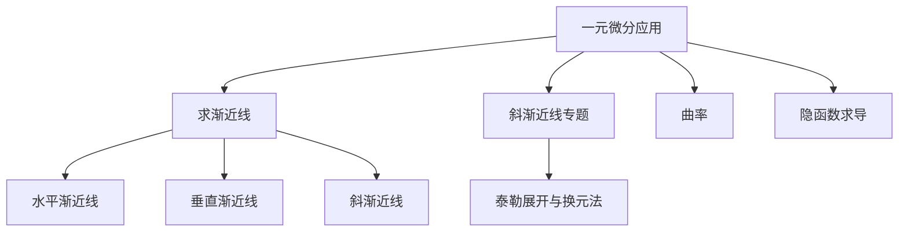
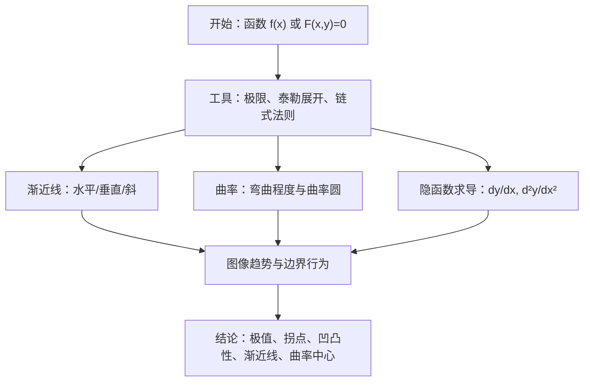
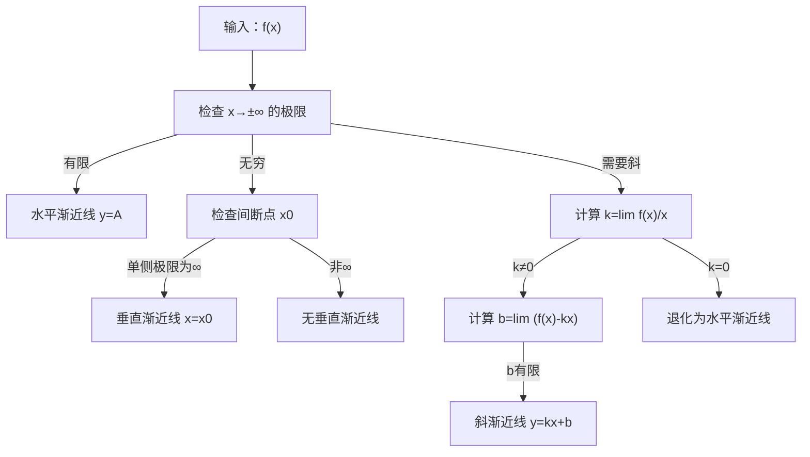
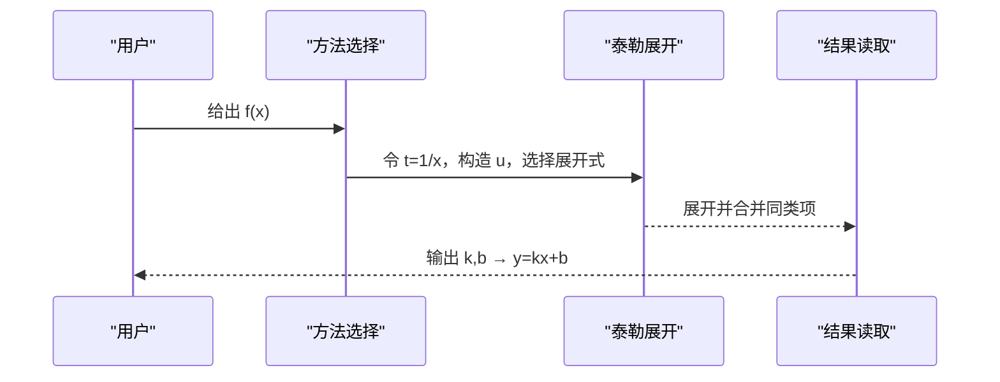
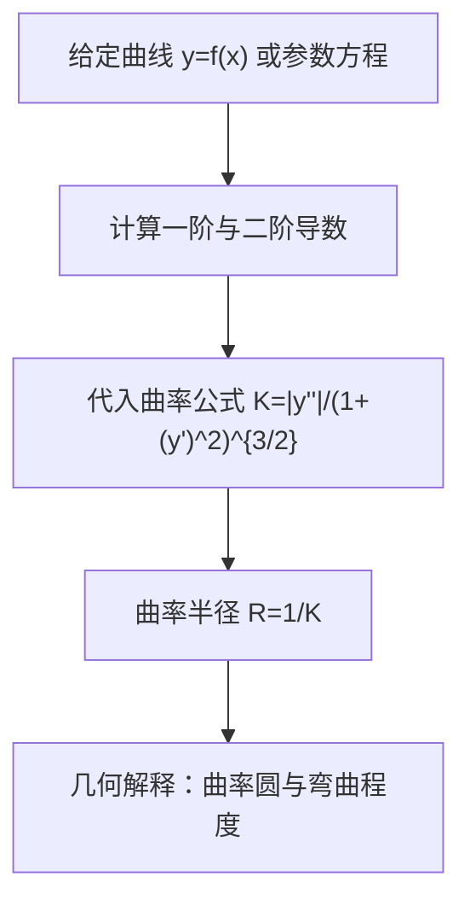
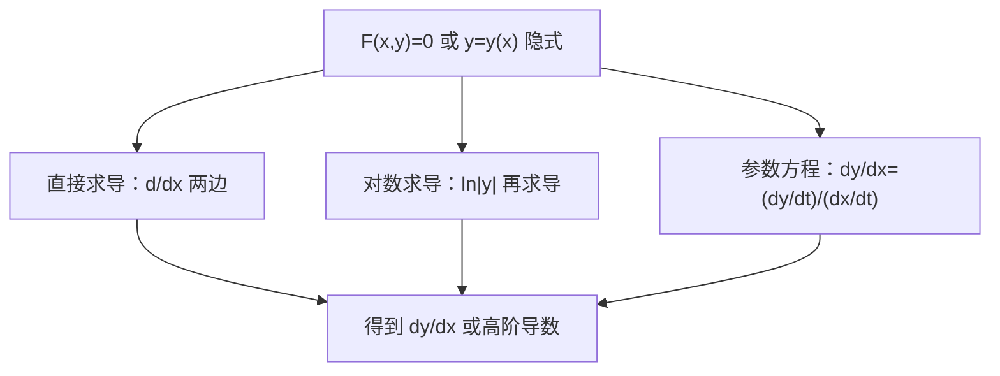
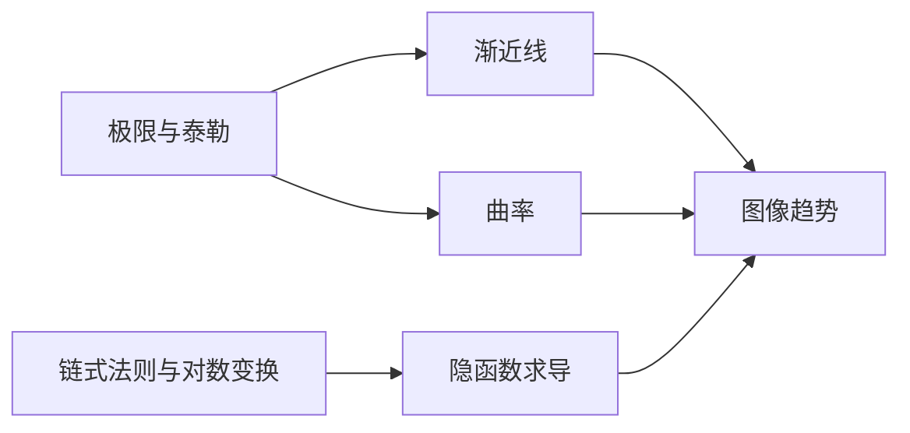

# 微分学应用

<cite>
**本文引用的文件**
- [一元微分应用.md](file://数一/一元微分应用.md)
- [求渐近线.md](file://数一/求渐近线.md)
- [斜渐近线.md](file://斜渐近线.md)
- [曲率.md](file://曲率.md)
- [隐函数求导.md](file://隐函数求导.md)
- [一元微分.md](file://数一/一元微分.md)
</cite>

## 目录
1. [引言](#引言)
2. [项目结构](#项目结构)
3. [核心组件](#核心组件)
4. [架构总览](#架构总览)
5. [详细组件分析](#详细组件分析)
6. [依赖关系分析](#依赖关系分析)
7. [性能与技巧](#性能与技巧)
8. [疑难排查](#疑难排查)
9. [结论](#结论)
10. [附录：考研题型模板与快速判断](#附录考研题型模板与快速判断)

## 引言
本学习指导聚焦微分学在函数图像分析与曲线性质中的三大应用：渐近线、曲率与曲率半径、以及隐函数求导。目标是帮助读者系统掌握三类渐近线的判定与求解技巧，理解曲率的几何意义与计算方法，熟练运用隐函数求导处理复杂函数形态；并通过典型问题模板与快速判断策略，提升解题效率与准确性。

## 项目结构
围绕“微分学应用”的知识组织如下：
- 总览导航：一元微分应用（汇总各专题）
- 渐近线专题：求渐近线（水平、垂直、斜），斜渐近线专题（泰勒展开与换元技巧）
- 曲率专题：曲率与曲率半径（待完善）
- 隐函数求导专题：直接求导、对数求导、参数方程等（待完善）

图表来源
- [一元微分应用.md:13-27](file://数一/一元微分应用.md#L13-L27)
- [求渐近线.md:13-89](file://数一/求渐近线.md#L13-L89)
- [斜渐近线.md:8-11](file://斜渐近线.md#L8-L11)

章节来源
- [一元微分应用.md:13-27](file://数一/一元微分应用.md#L13-L27)

## 核心组件
- 渐近线：水平、垂直、斜三类，分别对应无穷远行为与间断点处发散行为
- 曲率与曲率半径：刻画曲线局部弯曲程度及其几何解释
- 隐函数求导：处理无法显式解出 y 的函数关系，支持幂指函数、参数方程等场景

章节来源
- [求渐近线.md:19-89](file://数一/求渐近线.md#L19-L89)
- [斜渐近线.md:14-278](file://斜渐近线.md#L14-L278)
- [曲率.md:12-22](file://曲率.md#L12-L22)
- [隐函数求导.md:13-24](file://隐函数求导.md#L13-L24)

## 架构总览
从知识体系看，“微分学应用”由“基础工具（极限、泰勒展开）—> 具体方法（渐近线、曲率、隐函数求导）—> 综合应用（函数性态分析、图像绘制）”构成。

[此图为概念性流程图，不直接映射到具体源码文件]

## 详细组件分析

### 渐近线：判定方法与求解技巧
- 水平渐近线
  - 定义要点：当 x→±∞ 时 f(x) 趋于有限常数 A，则 y=A 为水平渐近线
  - 步骤：分别计算 x→+∞ 与 x→−∞ 的极限；若存在且有限，即得一条水平渐近线
  - 注意：两个方向独立考察，可能得到两条不同的水平渐近线
- 垂直渐近线
  - 定义要点：在 x0 的单侧邻域内 f(x)→±∞，则 x=x0 为垂直渐近线
  - 步骤：找间断点（分母为零、对数真数为零、分段点等），计算左右极限；任一侧为无穷大即为垂直渐近线
  - 易错点：只看是否趋于无穷，与左右极限是否相等无关；可去间断点不是垂直渐近线
- 斜渐近线
  - 定义要点：存在直线 y=kx+b（k≠0 且有限），使得 x→±∞ 时 f(x) 与之无限接近
  - 公式：k=lim[f(x)/x]，b=lim[f(x)−kx]；需分别对 x→+∞ 与 x→−∞ 计算
  - 与水平渐近线关系：同一方向上 k=0 时为水平，k≠0 时为斜，二者互斥
  - 条数规则：水平与斜各最多 2 条（正负无穷各 1 条），垂直可有多条

图表来源
- [求渐近线.md:19-89](file://数一/求渐近线.md#L19-L89)

章节来源
- [求渐近线.md:19-89](file://数一/求渐近线.md#L19-L89)

### 斜渐近线专题：泰勒展开与换元技巧
- 核心思路：令 t=1/x，将 x→∞ 转化为 t→0，利用常见函数的泰勒展开（如 ln(1+u)、e^u、sin t、cos t）进行系统化展开，直接读出 k 与 b
- 典型流程
  - 确定定义域与渐近方向（x→+∞ 与 x→−∞ 均需在定义域内）
  - 用 t=1/x 统一变量，构造 u 使出现 ln(1+u) 或 e^u 形式
  - 展开至所需阶数，合并同类项，提取线性项系数作为 k，常数项作为 b
- 例题要点
  - 例1：y=x·ln(2+1/(x−1))，通过 ln(1+u) 展开得到 k=ln2，b=1/2
  - 例2：y=x²·ln(sin(1/x)+cos(1/x))，展开 sin t、cos t 后取 ln，得到 y=x−1
  - 例3：y=x²[(1+1/x)^x/e − 1]，利用 (1+t)^{1/t} 的指数展开，得到 y=−1/2 x + 11/24
- 方法对比
  - 直接泰勒：适合简单形式，步骤少
  - 换元泰勒：系统化展开，适合含 1/(x−1) 的高阶项或更复杂结构

图表来源
- [斜渐近线.md:24-114](file://斜渐近线.md#L24-L114)
- [斜渐近线.md:136-189](file://斜渐近线.md#L136-L189)
- [斜渐近线.md:200-255](file://斜渐近线.md#L200-L255)

章节来源
- [斜渐近线.md:14-278](file://斜渐近线.md#L14-L278)

### 曲率与曲率半径：几何意义与量化方法
- 几何意义
  - 曲率描述曲线在某点的弯曲程度；曲率越大，曲线越“弯”
  - 曲率半径是曲率的倒数，表示在该点附近最贴近曲线的圆的半径
- 计算方法（待补充）
  - 平面曲线 y=f(x) 的曲率公式与曲率半径公式
  - 参数方程形式的曲率表达式
- 应用场景
  - 判断凹凸性与拐点附近的弯曲变化
  - 结合切线与法线，构造曲率圆，辅助图像绘制

[此图为概念性流程图，不直接映射到具体源码文件]

章节来源
- [曲率.md:12-22](file://曲率.md#L12-L22)

### 隐函数求导：方法与应用场景
- 适用场景
  - 无法显式解出 y 的函数关系 F(x,y)=0
  - 幂指函数、复合函数、参数方程等复杂形式
- 常用方法
  - 直接求导：两边同时对 x 求导，解出 dy/dx
  - 对数求导：对幂指函数取对数后再求导，简化运算
  - 参数方程求导：dx/dt、dy/dt 已知时，dy/dx=(dy/dt)/(dx/dt)
  - 反函数求导：利用反函数导数关系
- 注意事项
  - 保持链式法则的正确使用
  - 对数求导时需考虑定义域与符号
  - 高阶导数可通过继续求导获得

[此图为概念性流程图，不直接映射到具体源码文件]

章节来源
- [隐函数求导.md:13-24](file://隐函数求导.md#L13-L24)
- [一元微分.md:13-26](file://数一/一元微分.md#L13-L26)

## 依赖关系分析
- 知识依赖
  - 渐近线求解依赖极限计算与泰勒展开
  - 曲率计算依赖一阶、二阶导数
  - 隐函数求导依赖链式法则与对数变换
- 模块耦合
  - “求渐近线”与“斜渐近线专题”强耦合（后者提供前者的进阶技巧）
  - “曲率”与“隐函数求导”在复杂曲线分析中常联合使用（如参数曲线、隐式曲线）

图表来源
- [求渐近线.md:19-89](file://数一/求渐近线.md#L19-L89)
- [斜渐近线.md:24-114](file://斜渐近线.md#L24-L114)
- [曲率.md:12-22](file://曲率.md#L12-L22)
- [隐函数求导.md:13-24](file://隐函数求导.md#L13-L24)

章节来源
- [求渐近线.md:19-89](file://数一/求渐近线.md#L19-L89)
- [斜渐近线.md:14-278](file://斜渐近线.md#L14-L278)
- [曲率.md:12-22](file://曲率.md#L12-L22)
- [隐函数求导.md:13-24](file://隐函数求导.md#L13-L24)

## 性能与技巧
- 快速判断技巧
  - 水平渐近线：优先看 x→±∞ 的极限是否为有限常数
  - 垂直渐近线：先找间断点，再看左右极限是否无穷大
  - 斜渐近线：先看 f(x)/x 的极限是否存在且非零；再用 f(x)−kx 的极限求截距
- 泰勒展开优化
  - 换元 t=1/x 统一变量，减少复杂分式的展开难度
  - 选择合适的展开阶数：通常保留到能消去低阶项为止
- 数值验证
  - 选取较大的 x 值代入原函数与渐近线，比较误差以确认结果合理性

章节来源
- [求渐近线.md:25-72](file://数一/求渐近线.md#L25-L72)
- [斜渐近线.md:115-124](file://斜渐近线.md#L115-L124)
- [斜渐近线.md:258-267](file://斜渐近线.md#L258-L267)

## 疑难排查
- 常见问题
  - 误把可去间断点当作垂直渐近线：需严格检查极限是否为无穷大
  - 忽略正负无穷方向的差异：水平与斜渐近线需分别计算
  - 泰勒展开阶数不足：导致 k 或 b 计算错误，应逐步提高阶数直至稳定
- 调试建议
  - 分步验证：先算 k，再算 b；每一步都进行极限或展开的中间检查
  - 多方法交叉验证：标准方法与换元泰勒方法同时使用，确保结果一致

章节来源
- [求渐近线.md:41-49](file://数一/求渐近线.md#L41-L49)
- [求渐近线.md:61-72](file://数一/求渐近线.md#L61-L72)
- [斜渐近线.md:104-114](file://斜渐近线.md#L104-L114)

## 结论
- 渐近线是函数图像在无穷远与间断点处的关键特征，掌握三类渐近线的判定与求解是函数性态分析的基础
- 曲率与曲率半径提供了曲线局部弯曲程度的量化指标，有助于深入理解凹凸性与拐点
- 隐函数求导扩展了可处理函数类型，配合泰勒展开与极限工具，能有效解决复杂曲线的导数与性态问题
- 通过典型问题模板与快速判断技巧，可在考试与实践中高效准确地完成相关题目

[本节为总结性内容，不直接分析具体文件]

## 附录：考研题型模板与快速判断
- 渐近线模板
  - 水平：lim_{x→±∞} f(x)=A → y=A
  - 垂直：lim_{x→x0±} f(x)=±∞ → x=x0
  - 斜：k=lim f(x)/x，b=lim (f(x)−kx) → y=kx+b
- 斜渐近线模板（泰勒展开）
  - 令 t=1/x，构造 u，展开 ln(1+u)、e^u、sin t、cos t 等
  - 合并同类项，读取 k 与 b
- 曲率模板
  - 计算 y'、y''，代入 K=|y''|/(1+(y')^2)^{3/2}，R=1/K
- 隐函数求导模板
  - 直接求导：对 F(x,y)=0 两边求导，解 dy/dx
  - 对数求导：对幂指函数取对数后求导
  - 参数方程：dy/dx=(dy/dt)/(dx/dt)

章节来源
- [求渐近线.md:19-89](file://数一/求渐近线.md#L19-L89)
- [斜渐近线.md:24-114](file://斜渐近线.md#L24-L114)
- [曲率.md:12-22](file://曲率.md#L12-L22)
- [隐函数求导.md:13-24](file://隐函数求导.md#L13-L24)