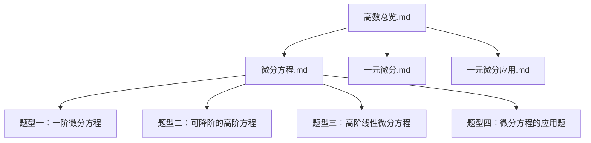
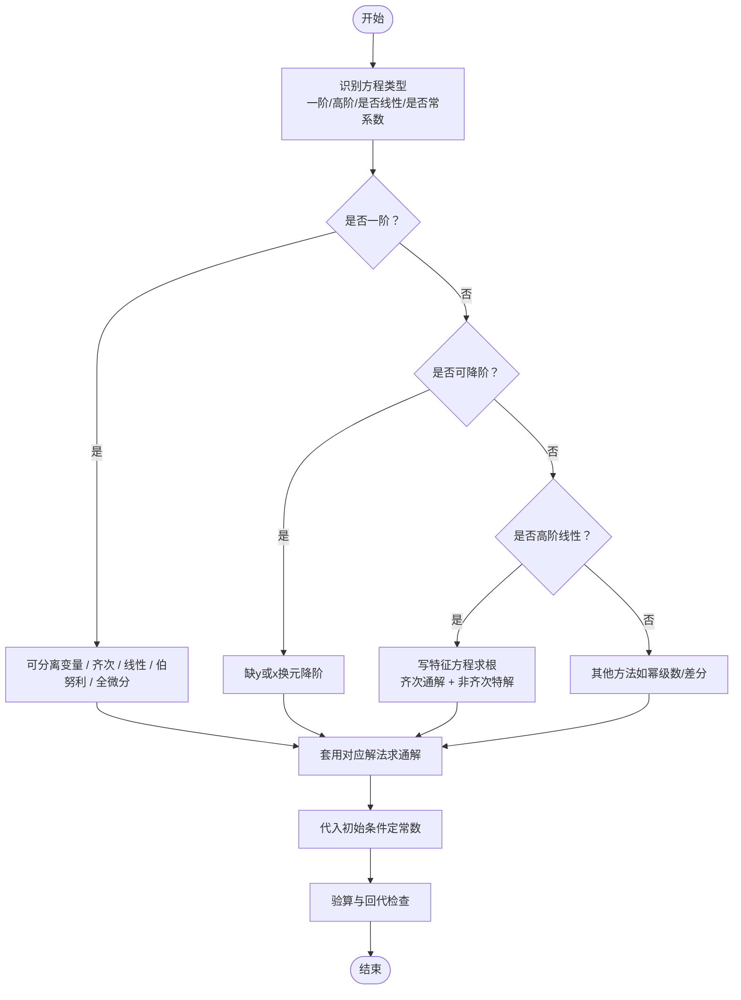
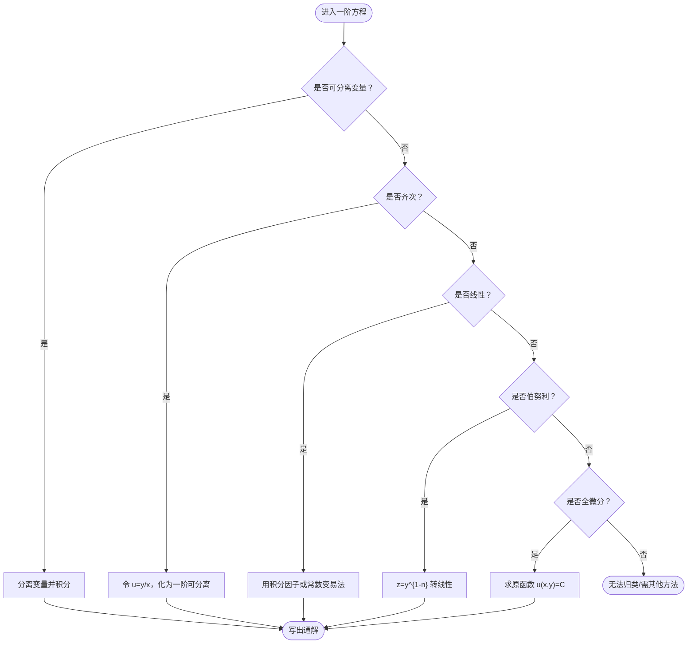
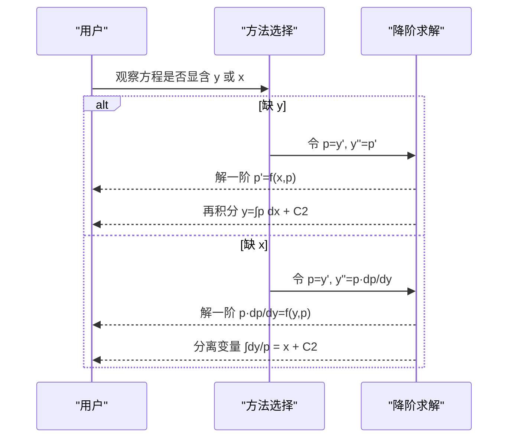
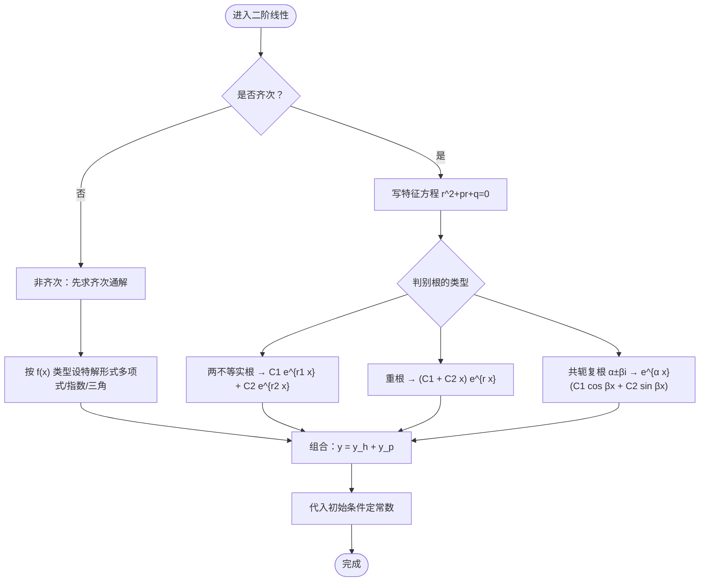
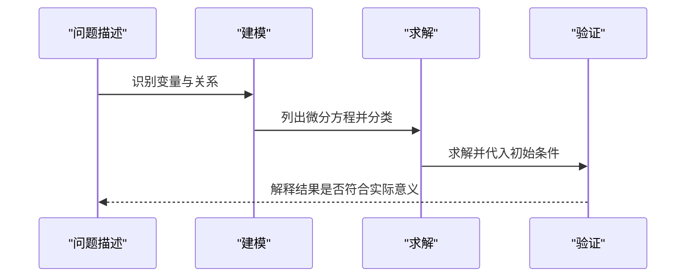

# 微分方程求解

<cite>
**本文引用的文件**
- [微分方程.md](file://数一/微分方程.md)
- [高数总览.md](file://数一/高数总览.md)
- [一元微分.md](file://数一/一元微分.md)
- [一元微分应用.md](file://数一/一元微分应用.md)
</cite>

## 目录
1. [引言](#引言)
2. [项目结构](#项目结构)
3. [核心组件](#核心组件)
4. [架构总览](#架构总览)
5. [详细组件分析](#详细组件分析)
6. [依赖关系分析](#依赖关系分析)
7. [性能与学习建议](#性能与学习建议)
8. [疑难排错指南](#疑难排错指南)
9. [结论](#结论)
10. [附录：标准解法速查与应用场景](#附录标准解法速查与应用场景)

## 引言
本材料围绕“微分方程求解”构建系统学习路径，覆盖基本概念、分类与阶数；重点讲解一阶微分方程（可分离变量、齐次、线性）的识别与求解；系统阐述二阶常系数线性微分方程的求解方法，包括齐次与非齐次的通解结构与特征方程技巧；并通过建模思路与实际例题流程演示初始条件处理与特解确定。内容基于仓库中的数学笔记整理而成，便于从入门到进阶循序渐进地掌握。

## 项目结构
本仓库以专题笔记组织知识，微分方程相关内容集中在“数一”目录下，并与高等数学总览形成索引关联。下图展示与本主题直接相关的文件与层级关系。

图表来源
- [高数总览.md:19-46](file://数一/高数总览.md#L19-L46)
- [微分方程.md:22-256](file://数一/微分方程.md#L22-L256)

章节来源
- [高数总览.md:19-46](file://数一/高数总览.md#L19-L46)

## 核心组件
- 一阶微分方程：可分离变量、齐次、一阶线性（含常数变易法推导）、伯努利、全微分方程
- 可降阶高阶方程：缺 y 或 x 的换元降阶策略
- 高阶线性微分方程：常系数齐次与非齐次、欧拉方程
- 应用题建模：几何与物理背景下的方程建立与求解

章节来源
- [微分方程.md:22-256](file://数一/微分方程.md#L22-L256)

## 架构总览
下图将“识别—选择—求解—验证”的学习流程可视化，对应笔记中的题型分层与方法选择。

[此图为概念流程图，不直接映射具体代码文件]

## 详细组件分析

### 一阶微分方程（识别与解法）
- 可分离变量：将 dy/dx = g(x)h(y) 化为 dy/h(y) = g(x)dx 后积分得通解
- 齐次方程：令 u = y/x，转化为关于 u 的可分离变量方程
- 一阶线性：标准形 y' + P(x)y = Q(x)，使用积分因子或常数变易法得到通解公式
- 伯努利方程：通过 z = y^{1-n} 转化为一阶线性
- 全微分方程：满足恰当条件时，求原函数 u(x,y)=C

图表来源
- [微分方程.md:27-130](file://数一/微分方程.md#L27-L130)

章节来源
- [微分方程.md:27-130](file://数一/微分方程.md#L27-L130)

### 可降阶的高阶方程（缺变量换元）
- 缺 y：令 p = y'，则 y'' = p'，化为一阶方程 p' = f(x,p)
- 缺 x：令 p = y'，则 y'' = p·dp/dy，化为一阶方程 p·dp/dy = f(y,p)
- 关键：明确 p 对谁求导，避免混淆 p' 与 p·dp/dy

图表来源
- [微分方程.md:138-223](file://数一/微分方程.md#L138-L223)

章节来源
- [微分方程.md:138-223](file://数一/微分方程.md#L138-L223)

### 二阶常系数线性微分方程（齐次与非齐次）
- 齐次：y'' + p y' + q y = 0，写特征方程 r^2 + p r + q = 0，根据根的情况写出通解形式
- 非齐次：y'' + p y' + q y = f(x)，通解 = 齐次通解 + 非齐次特解；特解用待定系数法按 f(x) 类型设定形式
- 欧拉方程：x^2 y'' + p x y' + q y = f(x)，令 x = e^t 化为常系数方程

图表来源
- [微分方程.md:228-255](file://数一/微分方程.md#L228-L255)

章节来源
- [微分方程.md:228-255](file://数一/微分方程.md#L228-L255)

### 应用题建模与解题流程
- 几何应用：切线斜率、法线斜率、曲率等关系建立方程
- 物理应用：牛顿第二定律、冷却定律、人口增长模型等
- 建模关键：设未知函数→依据等量关系列方程→判断类型→求解→用初始条件定常数

图表来源
- [微分方程.md:258-274](file://数一/微分方程.md#L258-L274)

章节来源
- [微分方程.md:258-274](file://数一/微分方程.md#L258-L274)

## 依赖关系分析
- 基础依赖：一元微分学（导数与求导法则）为微分方程求解提供工具支撑
- 结构依赖：高数总览作为索引，串联微分方程与其他专题
- 方法依赖：积分学（不定积分、换元、分部积分）贯穿各类方程求解过程

图表来源
- [高数总览.md:19-46](file://数一/高数总览.md#L19-L46)
- [微分方程.md:22-256](file://数一/微分方程.md#L22-L256)
- [一元微分.md:13-27](file://数一/一元微分.md#L13-L27)

章节来源
- [高数总览.md:19-46](file://数一/高数总览.md#L19-L46)
- [微分方程.md:22-256](file://数一/微分方程.md#L22-L256)
- [一元微分.md:13-27](file://数一/一元微分.md#L13-L27)

## 性能与学习建议
- 优先掌握一阶微分方程的识别与求解，这是高频考点
- 高阶线性方程重点在特征方程与待定系数法的熟练运用
- 应用题重在建模能力：准确翻译文字为方程是关键
- 练习建议：按题型分类刷题，总结“识别—选择—求解—验证”的闭环流程

[本节为通用学习建议，不直接分析具体文件]

## 疑难排错指南
- 一阶线性方程：使用前必须化为标准形 y' + P(x)y = Q(x)，确保 y' 系数为 1
- 降阶法：区分缺 y 与缺 x 的不同换元方式，避免混淆 p' 与 p·dp/dy
- 二次积分：降阶后解出 p，还需再积分一次得到 y，注意两个任意常数
- 非齐次特解：根据 f(x) 类型正确设定形式，并注意是否与齐次解重复而需要乘以 x^k
- 初始条件：代入通解后联立方程组求解常数，务必回代验算

章节来源
- [微分方程.md:48-50](file://数一/微分方程.md#L48-L50)
- [微分方程.md:155-159](file://数一/微分方程.md#L155-L159)
- [微分方程.md:218-223](file://数一/微分方程.md#L218-L223)
- [微分方程.md:239-250](file://数一/微分方程.md#L239-L250)

## 结论
本材料系统化梳理了微分方程的分类与求解方法，强调“先识别类型，再套用解法”的核心思想。通过一阶方程、降阶法、高阶线性方程及应用题建模的层层递进，帮助学习者建立完整的解题框架与思维路径。配合初始条件处理与特解确定的实践，可有效提升解决实际问题与考试题型的能力。

[本节为总结性内容，不直接分析具体文件]

## 附录：标准解法速查与应用场景
- 一阶可分离变量：dy/h(y) = g(x)dx → 两边积分
- 一阶齐次：u = y/x → 化为可分离变量
- 一阶线性：y' + P(x)y = Q(x) → 积分因子或常数变易法
- 伯努利：z = y^{1-n} → 转线性
- 全微分：恰当条件成立 → 求原函数 u(x,y)=C
- 可降阶：缺 y 或 x → 换元降阶为一阶
- 二阶常系数齐次：特征方程 r^2 + pr + q = 0 → 依根写通解
- 二阶常系数非齐次：齐次通解 + 待定系数法求特解
- 欧拉方程：x = e^t → 化为常系数

应用场景举例（来自笔记）：
- 几何：切线斜率、法线斜率、曲率关系
- 物理：F = ma、牛顿冷却定律、人口增长模型

章节来源
- [微分方程.md:27-130](file://数一/微分方程.md#L27-L130)
- [微分方程.md:138-223](file://数一/微分方程.md#L138-L223)
- [微分方程.md:228-255](file://数一/微分方程.md#L228-L255)
- [微分方程.md:258-274](file://数一/微分方程.md#L258-L274)