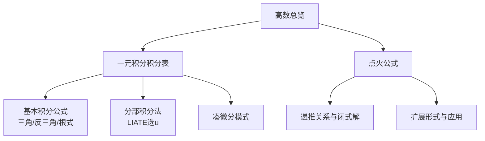
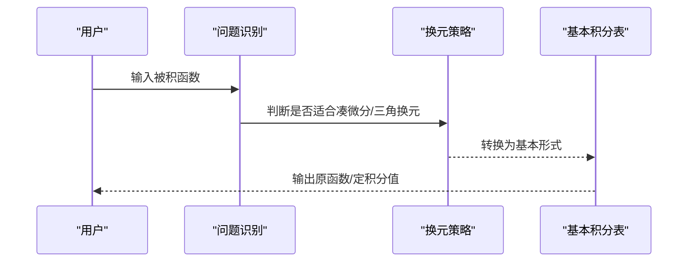
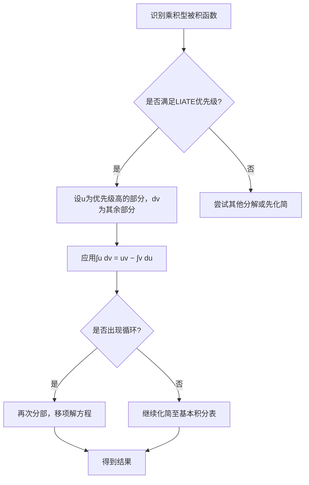
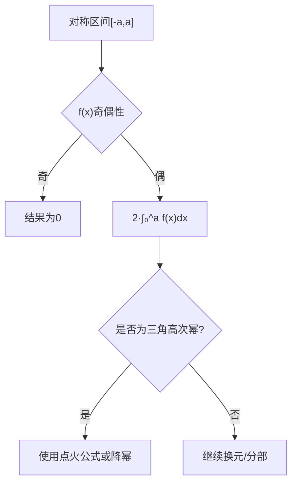
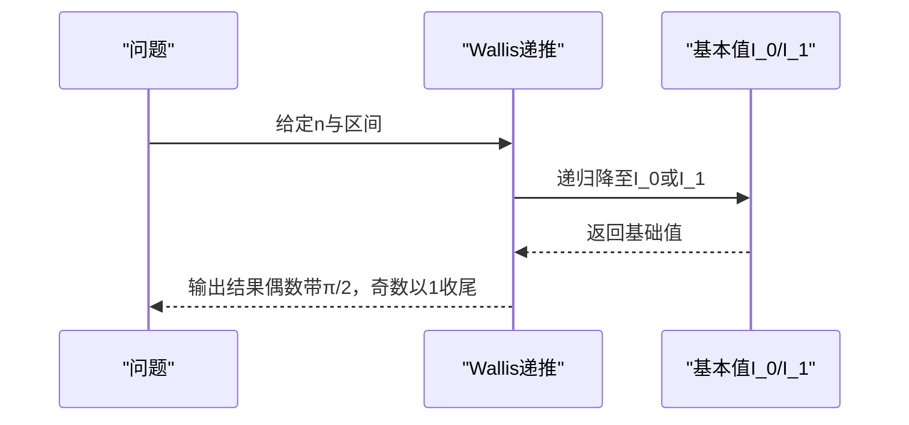
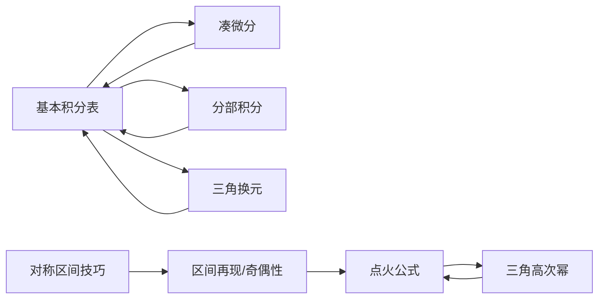

# 积分学方法

<cite>
**本文引用的文件**
- [一元积分积分表.md](file://数一/一元积分积分表.md)
- [点火公式.md](file://数一/点火公式.md)
- [高数总览.md](file://数一/高数总览.md)
</cite>

## 目录
1. [引言](#引言)
2. [项目结构](#项目结构)
3. [核心组件](#核心组件)
4. [架构总览](#架构总览)
5. [详细组件分析](#详细组件分析)
6. [依赖关系分析](#依赖关系分析)
7. [性能与效率考量](#性能与效率考量)
8. [疑难排查指南](#疑难排查指南)
9. [结论](#结论)
10. [附录：常用技巧速查](#附录：常用技巧速查)

## 引言
本学习指南围绕“不定积分与定积分”的核心方法展开，系统梳理基本性质、换元积分法与分部积分法的适用场景与技巧，重点讲解对称区间上的积分计算策略以及Wallis（点火）公式的应用。文档以仓库中的“一元积分积分表”和“点火公式”为核心素材，辅以“高数总览”的知识导航，构建从基础到进阶的完整学习路径，并通过流程图与序列图展示典型解题流程，帮助读者建立清晰的解题思维与验证习惯。

## 项目结构
本指南基于以下笔记文件组织内容：
- 一元积分积分表：提供基本积分公式、三角与反三角相关积分、含根式积分、分部积分要点与凑微分模式、以及“看到什么→用什么”的速查表。
- 点火公式：系统推导并总结三角函数高次幂在[0, π/2]等区间的递推与闭式结果，给出扩展形式与应用场景。
- 高数总览：定位积分学在高等数学知识体系中的位置，并提供相关专题索引。



图表来源
- [高数总览.md:32-40](file://数一/高数总览.md#L32-L40)
- [一元积分积分表.md:21-119](file://数一/一元积分积分表.md#L21-L119)
- [点火公式.md:21-111](file://数一/点火公式.md#L21-L111)

章节来源
- [高数总览.md:32-40](file://数一/高数总览.md#L32-L40)

## 核心组件
- 基本积分与凑微分：掌握幂函数、指数、对数、三角、反三角的基本积分形式，识别“导数配对”信号，快速完成第一类换元（凑微分）。
- 分部积分法：针对两类不同函数的乘积，按LIATE优先级选择u，处理循环型积分时通过两次分部后移项求解。
- 三角换元与根式积分：根据根式类型选择sin/tan/sec换元，将根式化为三角函数后接入基本积分表。
- 对称区间与区间再现：利用奇偶性与x→−x或x=π−u等换元简化对称区间上的积分。
- Wallis（点火）公式：用于三角高次幂在[0, π/2]等区间的快速计算，掌握递推与闭式表达，并能扩展到混合幂次与其他区间。

章节来源
- [一元积分积分表.md:21-119](file://数一/一元积分积分表.md#L21-L119)
- [一元积分积分表.md:122-151](file://数一/一元积分积分表.md#L122-L151)
- [一元积分积分表.md:154-191](file://数一/一元积分积分表.md#L154-L191)
- [点火公式.md:21-111](file://数一/点火公式.md#L21-L111)
- [点火公式.md:130-163](file://数一/点火公式.md#L130-L163)

## 架构总览
下图展示了积分方法的整体架构与数据流：从被积函数特征识别出发，选择合适的方法（凑微分、分部、三角换元、对称性），最终落到基本积分表或Wallis公式进行计算与验证。

```mermaid
flowchart TD
Start(["开始"]) --> Identify["识别被积函数特征"]
Identify --> |f(φ(x))·φ'(x)| Subst["凑微分第一类换元"]
Identify --> |两类函数乘积| Parts["分部积分LIATE选u"]
Identify --> |含√(a²±x²)| TrigSub["三角换元sin/tan/sec"]
Identify --> |对称区间[-a,a]| Sym["利用奇偶性与x→−x"]
Identify --> |∫₀^{π/2} sinⁿx/cosⁿx| Wallis["点火公式Wallis"]
Subst --> Basic["基本积分表"]
Parts --> Basic
TrigSub --> Basic
Sym --> Basic
Wallis --> Basic
Basic --> Verify["结果验证求导/数值估算/特殊点"]
Verify --> End(["结束"])
```

图表来源
- [一元积分积分表.md:194-211](file://数一/一元积分积分表.md#L194-L211)
- [点火公式.md:21-111](file://数一/点火公式.md#L21-L111)

## 详细组件分析

### 不定积分与定积分的基本概念与性质
- 不定积分是原函数的集合，强调“求导逆运算”；定积分是区间上的累积量，强调“面积/代数和”。
- 线性性、可加性、换元不变性、分部积分公式是贯穿不定与定积分的核心性质。
- 常见陷阱：忽略绝对值与定义域、常数C的遗漏、换元后上下限未同步更新、分部积分中边界项计算错误。

章节来源
- [一元积分积分表.md:21-40](file://数一/一元积分积分表.md#L21-L40)
- [一元积分积分表.md:122-151](file://数一/一元积分积分表.md#L122-L151)

### 换元积分法（第一类与第二类）
- 第一类换元（凑微分）：识别“导数配对”，将d(φ(x))配出，直接套用基本积分表。
- 第二类换元（三角换元）：根据根式类型选择换元，化简为三角函数后再回代。
- 关键技巧：
  - 见√(a²−x²)用x=a sinθ；见√(a²+x²)用x=a tanθ；见√(x²−a²)用x=a secθ。
  - 注意换元后的定义域与符号变化，必要时分段讨论。



图表来源
- [一元积分积分表.md:90-119](file://数一/一元积分积分表.md#L90-L119)
- [一元积分积分表.md:154-191](file://数一/一元积分积分表.md#L154-L191)

章节来源
- [一元积分积分表.md:90-119](file://数一/一元积分积分表.md#L90-L119)
- [一元积分积分表.md:154-191](file://数一/一元积分积分表.md#L154-L191)

### 分部积分法
- 适用场景：两类不同函数的乘积（如幂×指、幂×对、幂×反三角、指数×三角等）。
- LIATE优先级：对数、反三角、代数（多项式）、三角、指数。越靠前越优先作为u。
- 循环型积分：两次分部后回到自身，移项解方程得到结果。



图表来源
- [一元积分积分表.md:122-151](file://数一/一元积分积分表.md#L122-L151)

章节来源
- [一元积分积分表.md:122-151](file://数一/一元积分积分表.md#L122-L151)

### 对称区间上的积分计算技巧
- 奇偶性：若f(x)为奇函数，在对称区间上积分为0；若为偶函数，可化为两倍的半区间积分。
- 区间再现：通过x→−x或x=π−u等换元，构造对称关系，消去复杂项或提取系数。
- 结合点火公式：当被积函数为三角高次幂且区间为[0, π/2]或[0, π]时，可直接使用Wallis公式或其推广。



图表来源
- [点火公式.md:143-155](file://数一/点火公式.md#L143-L155)

章节来源
- [点火公式.md:143-155](file://数一/点火公式.md#L143-L155)

### Wallis（点火）公式及其应用
- 核心递推：I_n = (n−1)/n · I_{n−2}，适用于∫₀^{π/2} sinⁿx dx与cosⁿx dx。
- 闭式结果：偶数n带π/2因子，奇数n以1收尾；可用双阶乘或阶乘表示。
- 扩展形式：混合幂次∫₀^{π/2} sin^m x cos^n x dx，区间[0, π]与[0, 2π]的推广，以及与Beta/Gamma函数的联系。
- 应用场景：快速计算高次幂三角积分、概率统计归一化常数、傅里叶正交性积分等。



图表来源
- [点火公式.md:50-111](file://数一/点火公式.md#L50-L111)
- [点火公式.md:130-163](file://数一/点火公式.md#L130-L163)

章节来源
- [点火公式.md:50-111](file://数一/点火公式.md#L50-L111)
- [点火公式.md:130-163](file://数一/点火公式.md#L130-L163)

### 典型例题与解题思路
- 凑微分：识别f'(x)与f(x)的配对，直接套用对数、反正切、反正弦等基本形式。
- 分部积分：按LIATE选择u，遇到e^x·sin x等循环型，两次分部后移项求解。
- 三角换元：根据根式类型选择换元，化简后接入基本积分表。
- 点火公式：对∫₀^{π/2} sinⁿx或cosⁿx，直接使用递推或闭式结果。

章节来源
- [一元积分积分表.md:154-191](file://数一/一元积分积分表.md#L154-L191)
- [一元积分积分表.md:122-151](file://数一/一元积分积分表.md#L122-L151)
- [点火公式.md:118-127](file://数一/点火公式.md#L118-L127)

## 依赖关系分析
- 基本积分表是所有方法的“落点”，换元、分部、三角换元最终都需回归基本形式。
- 点火公式依赖于三角恒等式与分部积分的推导过程，同时与Beta/Gamma函数存在理论联系。
- 对称区间技巧常与点火公式配合，提升计算效率。



图表来源
- [一元积分积分表.md:194-211](file://数一/一元积分积分表.md#L194-L211)
- [点火公式.md:130-163](file://数一/点火公式.md#L130-L163)

章节来源
- [一元积分积分表.md:194-211](file://数一/一元积分积分表.md#L194-L211)
- [点火公式.md:130-163](file://数一/点火公式.md#L130-L163)

## 性能与效率考量
- 优先选择最快路径：能凑微分则不绕弯；乘积型优先分部；根式优先三角换元。
- 避免重复劳动：利用对称性与区间再现减少计算量。
- 使用Wallis公式替代繁琐展开：高次幂三角积分直接递推或闭式。
- 验证环节：求导验算、数值估算、特殊点代入，确保结果正确。

## 疑难排查指南
- 忘记绝对值或对数定义域：检查ln|x|与arcsin/arctan的定义域限制。
- 换元后上下限未更新：定积分换元必须同步变换积分限。
- 分部积分边界项计算错误：仔细计算uv在端点的值。
- 三角换元符号处理不当：注意secθ的正负与根号开方。
- 点火公式误用区间：确认区间是否为[0, π/2]或已做适当变换。

章节来源
- [一元积分积分表.md:21-40](file://数一/一元积分积分表.md#L21-L40)
- [一元积分积分表.md:90-119](file://数一/一元积分积分表.md#L90-L119)
- [点火公式.md:143-155](file://数一/点火公式.md#L143-L155)

## 结论
本指南以“一元积分积分表”与“点火公式”为核心，构建了从基本性质到高级技巧的完整学习路径。通过系统化方法（凑微分、分部、三角换元、对称性、Wallis公式）与可视化流程，帮助读者高效解决各类积分问题，并建立严谨的验证与排错习惯。建议在学习过程中反复对照速查表与流程图，形成条件反射式的解题直觉。

## 附录：常用技巧速查
- 看到f(φ(x))·φ'(x) → 凑微分
- 看到两类函数乘积 → 分部积分（LIATE选u）
- 看到√(a²±x²) → 三角换元（sin/tan/sec）
- 看到∫₀^{π/2} sinⁿx/cosⁿx → 点火公式
- 对称区间 → 奇偶性与区间再现

章节来源
- [一元积分积分表.md:194-211](file://数一/一元积分积分表.md#L194-L211)
- [点火公式.md:244-253](file://数一/点火公式.md#L244-L253)