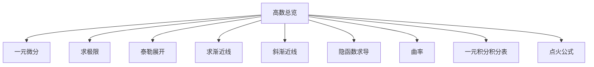
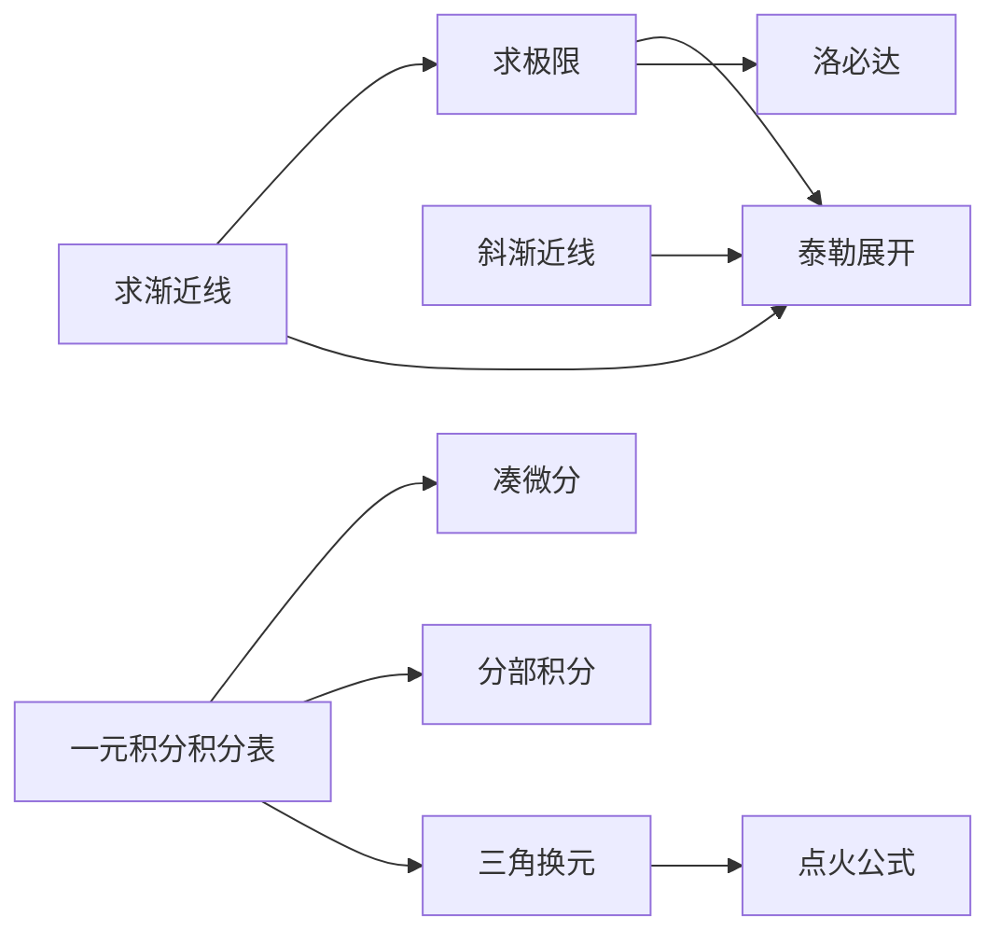
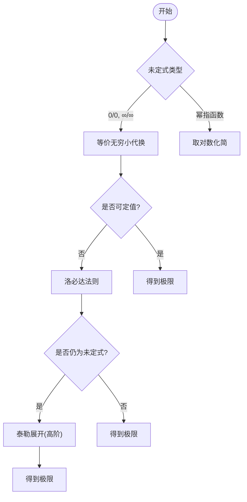
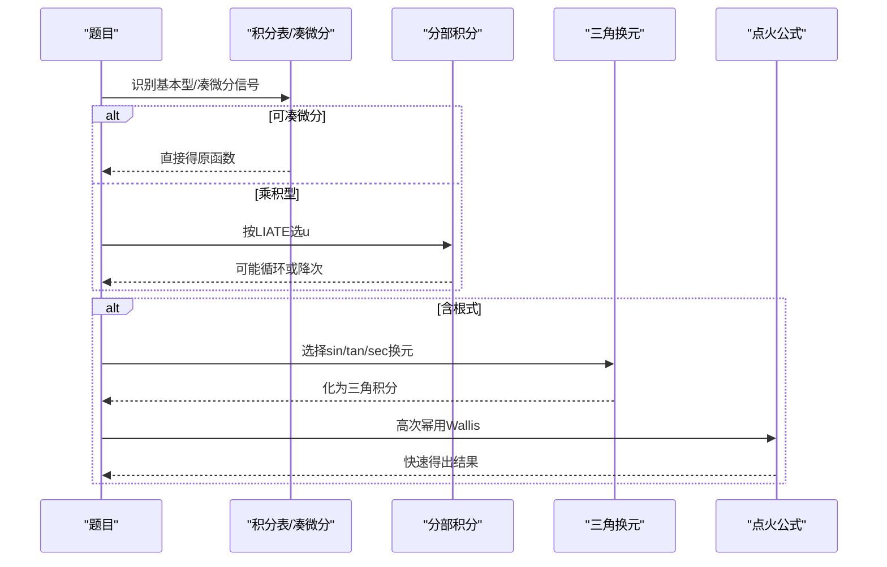
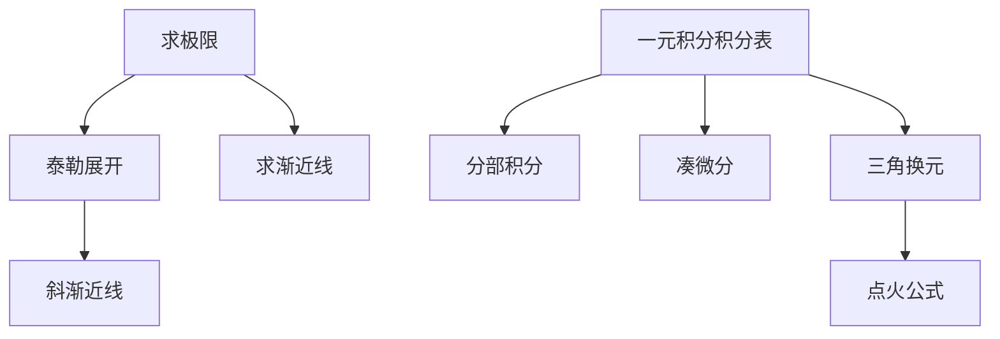

# 高等数学学习指南

<cite>
**本文引用的文件**
- [高数总览.md](file://数一/高数总览.md)
- [一元微分.md](file://数一/一元微分.md)
- [求极限.md](file://数一/求极限.md)
- [泰勒展开.md](file://数一/泰勒展开.md)
- [一元积分积分表.md](file://数一/一元积分积分表.md)
- [点火公式.md](file://数一/点火公式.md)
- [求渐近线.md](file://数一/求渐近线.md)
- [斜渐近线.md](file://斜渐近线.md)
- [隐函数求导.md](file://隐函数求导.md)
- [曲率.md](file://曲率.md)
</cite>

## 目录
1. [引言](#引言)
2. [项目结构](#项目结构)
3. [核心组件](#核心组件)
4. [架构总览](#架构总览)
5. [详细组件分析](#详细组件分析)
6. [依赖关系分析](#依赖关系分析)
7. [性能与效率建议](#性能与效率建议)
8. [疑难排错指南](#疑难排错指南)
9. [结论](#结论)
10. [附录：Obsidian 知识图谱构建建议](#附录obsidian-知识图谱构建建议)

## 引言
本指南面向高等数学学习者，围绕“微分学、积分学、微分方程”三大模块，系统梳理导数与微分的概念理解、求导法则应用、极限计算策略、泰勒展开在近似与极限中的用法，以及积分学的换元法、分部积分法等核心技巧。结合 Obsidian 的双向链接特性，帮助你在笔记中建立知识点之间的逻辑关系，形成可检索、可扩展的学习网络。

## 项目结构
仓库以“专题笔记 + 索引导航”的方式组织内容：
- 索引导航：[高数总览.md] 提供微分学、积分学、微分方程的条目式导航。
- 微分学专题：[一元微分.md]、[求极限.md]、[泰勒展开.md]、[求渐近线.md]、[斜渐近线.md]、[隐函数求导.md]、[曲率.md]。
- 积分学专题：[一元积分积分表.md]、[点火公式.md]。
- 其他：线性代数与概率论总览（与本指南关联度较低）。

图表来源
- [高数总览.md:19-46](file://数一/高数总览.md#L19-L46)

章节来源
- [高数总览.md:19-46](file://数一/高数总览.md#L19-L46)

## 核心组件
- 微分学
  - 导数与微分基础：[一元微分.md]
  - 极限与未定式：[求极限.md]
  - 泰勒展开与余项：[泰勒展开.md]
  - 渐近线与曲线性态：[求渐近线.md]、[斜渐近线.md]
  - 隐函数与参数方程求导：[隐函数求导.md]
  - 曲率与曲率半径：[曲率.md]
- 积分学
  - 基本积分与凑微分、分部积分：[一元积分积分表.md]
  - 三角高次幂积分（Wallis）：[点火公式.md]
- 微分方程
  - 解法体系（索引）：[高数总览.md]

章节来源
- [高数总览.md:19-46](file://数一/高数总览.md#L19-L46)
- [一元微分.md:13-26](file://数一/一元微分.md#L13-L26)
- [求极限.md:13-33](file://数一/求极限.md#L13-L33)
- [泰勒展开.md:20-32](file://数一/泰勒展开.md#L20-L32)
- [求渐近线.md:19-75](file://数一/求渐近线.md#L19-L75)
- [斜渐近线.md:14-55](file://斜渐近线.md#L14-L55)
- [隐函数求导.md:13-23](file://隐函数求导.md#L13-L23)
- [曲率.md:12-21](file://曲率.md#L12-L21)
- [一元积分积分表.md:21-151](file://数一/一元积分积分表.md#L21-L151)
- [点火公式.md:21-115](file://数一/点火公式.md#L21-L115)

## 架构总览
下图展示“方法—工具—题型”的调用关系：极限计算优先等价无穷小→洛必达→泰勒；渐近线求解依赖极限与泰勒；积分求解依赖基本表、凑微分、分部与三角换元；Wallis 用于三角高次幂快速计算。

图表来源
- [求极限.md:13-33](file://数一/求极限.md#L13-L33)
- [泰勒展开.md:129-159](file://数一/泰勒展开.md#L129-L159)
- [求渐近线.md:55-75](file://数一/求渐近线.md#L55-L75)
- [斜渐近线.md:24-55](file://斜渐近线.md#L24-L55)
- [一元积分积分表.md:122-151](file://数一/一元积分积分表.md#L122-L151)
- [点火公式.md:21-115](file://数一/点火公式.md#L21-L115)

## 详细组件分析

### 微分学：导数、极限与泰勒
- 导数与微分
  - 重点：导数的定义、几何意义、微分与线性逼近的关系。
  - 常见误区：混淆导数与微分、忽略定义域与可导条件。
- 极限与未定式
  - 优先级：等价无穷小 → 洛必达 → 泰勒展开 → 取对数化简。
  - 变限积分求导：莱布尼茨法则常用于分子含积分的极限。
- 泰勒展开
  - 皮亚诺余项用于极限与阶判断；拉格朗日余项用于证明与误差估计。
  - 差值型展开是处理相消项的关键，需展开到首个非零项。
- 渐近线与斜渐近线
  - 水平/垂直/斜三类渐近线的判定流程与互斥关系。
  - 斜渐近线常用换元 t=1/x 后泰勒展开一步读出 k、b。

图表来源
- [求极限.md:19-33](file://数一/求极限.md#L19-L33)
- [求极限.md:105-121](file://数一/求极限.md#L105-L121)
- [泰勒展开.md:110-126](file://数一/泰勒展开.md#L110-L126)

章节来源
- [求极限.md:19-33](file://数一/求极限.md#L19-L33)
- [求极限.md:105-121](file://数一/求极限.md#L105-L121)
- [泰勒展开.md:20-32](file://数一/泰勒展开.md#L20-L32)
- [泰勒展开.md:110-126](file://数一/泰勒展开.md#L110-L126)
- [求渐近线.md:19-75](file://数一/求渐近线.md#L19-L75)
- [斜渐近线.md:24-55](file://斜渐近线.md#L24-L55)

### 积分学：换元、分部与 Wallis
- 基本积分与凑微分
  - 识别“导数配对”，将复合函数外层剥掉，直接套用基本表。
- 分部积分
  - LIATE 选 u 优先级：对数 > 反三角 > 代数 > 三角 > 指数。
  - 循环型（如 e^x sin x）通过两次分部回到自身，移项解方程。
- 三角换元与根式
  - 见 sqrt(a^2-x^2) 换 sin，sqrt(a^2+x^2) 换 tan，sqrt(x^2-a^2) 换 sec。
- 点火公式（Wallis）
  - 递推降幂：I_n = (n-1)/n · I_{n-2}，偶数结尾 π/2，奇数结尾 1。
  - 扩展至混合幂次、不同区间及 Beta/Gamma 联系。

图表来源
- [一元积分积分表.md:122-151](file://数一/一元积分积分表.md#L122-L151)
- [一元积分积分表.md:154-191](file://数一/一元积分积分表.md#L154-L191)
- [点火公式.md:50-115](file://数一/点火公式.md#L50-L115)

章节来源
- [一元积分积分表.md:21-151](file://数一/一元积分积分表.md#L21-L151)
- [一元积分积分表.md:154-191](file://数一/一元积分积分表.md#L154-L191)
- [点火公式.md:21-115](file://数一/点火公式.md#L21-L115)

### 微分方程（索引）
- 根据 [高数总览.md] 的条目，微分方程作为第三大模块，建议在完成微分学与积分学后再系统学习各类方程的解法体系。

章节来源
- [高数总览.md:41-46](file://数一/高数总览.md#L41-L46)

## 依赖关系分析
- 极限是微分与积分的基础工具，贯穿渐近线、泰勒展开与变限积分。
- 泰勒展开既服务于极限精度提升，也支撑斜渐近线的一体化求解。
- 积分求解依赖基本表与技巧（凑微分、分部、三角换元），Wallis 是高次三角积分的加速器。
- 隐函数与参数方程求导为复杂函数求导提供补充路径。

图表来源
- [求极限.md:13-33](file://数一/求极限.md#L13-L33)
- [泰勒展开.md:129-159](file://数一/泰勒展开.md#L129-L159)
- [求渐近线.md:55-75](file://数一/求渐近线.md#L55-L75)
- [斜渐近线.md:24-55](file://斜渐近线.md#L24-L55)
- [一元积分积分表.md:122-151](file://数一/一元积分积分表.md#L122-L151)
- [点火公式.md:21-115](file://数一/点火公式.md#L21-L115)

章节来源
- [求极限.md:13-33](file://数一/求极限.md#L13-L33)
- [泰勒展开.md:129-159](file://数一/泰勒展开.md#L129-L159)
- [求渐近线.md:55-75](file://数一/求渐近线.md#L55-L75)
- [斜渐近线.md:24-55](file://斜渐近线.md#L24-L55)
- [一元积分积分表.md:122-151](file://数一/一元积分积分表.md#L122-L151)
- [点火公式.md:21-115](file://数一/点火公式.md#L21-L115)

## 性能与效率建议
- 极限计算遵循“等价无穷小优先、必要时洛必达、精度不足再上泰勒”的策略，避免无谓的高阶展开。
- 渐近线求解采用“换元 t=1/x + 泰勒展开”的一体化方法，减少多步极限运算。
- 积分求解先识别“凑微分信号”，其次考虑分部与三角换元；遇到三角高次幂优先使用 Wallis。
- 记忆与查表并重：基本积分表用于“查”，方法直觉用于“判”。

[本节为通用建议，不直接分析具体文件]

## 疑难排错指南
- 极限易错点
  - 等价替换仅在乘除因子中使用，加减项需谨慎（必要时改用泰勒）。
  - 变限积分求导注意莱布尼茨法则的三项贡献。
- 泰勒展开易错点
  - 展开阶数不够导致相消项无法暴露；差值型展开要展开到首个非零项。
  - 余项选择：求极限用皮亚诺，证明/误差估计用拉格朗日。
- 渐近线易错点
  - 同一方向上水平与斜渐近线互斥；垂直渐近线只看是否趋于无穷。
- 积分易错点
  - 分部选 u 不当导致复杂度上升；循环型需及时回代解方程。
  - 三角换元选择错误导致表达式更复杂；根式形式与换元对应要牢记。

章节来源
- [求极限.md:105-121](file://数一/求极限.md#L105-L121)
- [泰勒展开.md:110-126](file://数一/泰勒展开.md#L110-L126)
- [求渐近线.md:41-75](file://数一/求渐近线.md#L41-L75)
- [一元积分积分表.md:122-151](file://数一/一元积分积分表.md#L122-L151)

## 结论
本指南以“方法—工具—题型”为主线，串联了微分学、积分学的重要方法与技巧，并通过 Obsidian 的双向链接将知识点编织成可检索的知识网络。建议在学习过程中：
- 以索引为导航，按需跳转专题；
- 以问题为导向，反向定位所需工具；
- 以双向链接为纽带，持续完善知识图谱。

[本节为总结性内容，不直接分析具体文件]

## 附录：Obsidian 知识图谱构建建议
- 使用双向链接将“求极限”“泰勒展开”“求渐近线”“斜渐近线”“一元积分积分表”“点火公式”等节点相互连接，形成“方法—工具—题型”的网状结构。
- 在每个专题页添加“相关笔记”区块，便于从任意节点出发快速跳转到关联主题。
- 利用标签统一分类（如“高等数学”“极限”“积分”），配合搜索与过滤提高复习效率。

[本节为方法论建议，不直接分析具体文件]