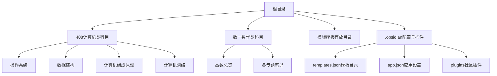
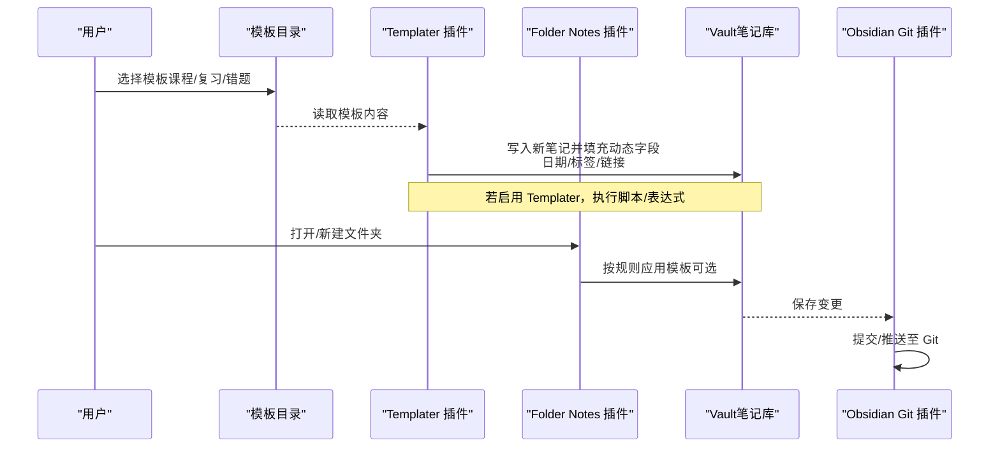
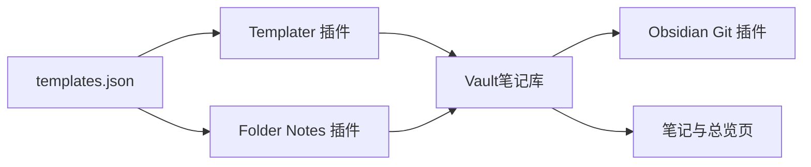
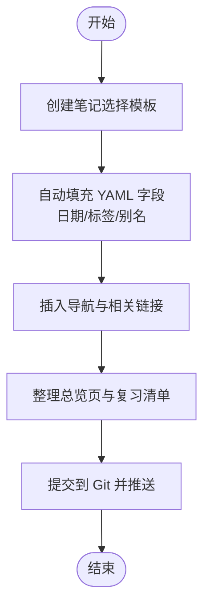

# 模板和工作流

<cite>
**本文引用的文件**
- [templates.json](file://.obsidian\templates.json)
- [app.json](file://.obsidian\app.json)
- [main.js（Templater 插件）](file://.obsidian\plugins\templater-obsidian\main.js)
- [main.js（Folder Notes 插件）](file://.obsidian\plugins\folder-notes\main.js)
- [manifest.json（Obsidian Git 插件）](file://.obsidian\plugins\obsidian-git\manifest.json)
- [main.js（Obsidian Git 插件）](file://.obsidian\plugins\obsidian-git\main.js)
- [408.md](file://408\408.md)
- [操作系统.md](file://408\操作系统\操作系统.md)
- [01-计算机系统概述.md](file://408\操作系统\01-计算机系统概述\01-计算机系统概述.md)
- [高数总览.md](file://数一\高数总览.md)
- [一元微分.md](file://数一\一元微分.md)
- [斜渐近线.md](file://斜渐近线.md)
</cite>

## 目录
1. [简介](#简介)
2. [项目结构](#项目结构)
3. [核心组件](#核心组件)
4. [架构总览](#架构总览)
5. [详细组件分析](#详细组件分析)
6. [依赖关系分析](#依赖关系分析)
7. [性能与效率建议](#性能与效率建议)
8. [故障排查指南](#故障排查指南)
9. [结论](#结论)
10. [附录：模板与工作流示例](#附录模板与工作流示例)

## 简介
本文件面向 Obsidian 学习者，系统化说明仓库中的模板系统与实践工作流。重点包括：
- 如何创建和使用不同类型的笔记模板（课程笔记、复习笔记、错题本等）
- YAML front matter 的字段设计与自动化填充
- 动态内容插入与脚本/插件协同（Templater、Folder Notes、Git）
- 从“新知识学习”到“复习巩固”的完整闭环流程
- 日期自动填充、标签自动生成、链接自动创建等实用技巧
- 与外部工具集成（版本控制、导出等）

## 项目结构
仓库采用“学科/主题 + 章节/专题”的组织方式，配合统一的元数据（YAML front matter）和双向链接，形成可检索、可导航的知识网络。

**图表来源**
- [templates.json:1-3](file://.obsidian\templates.json#L1-L3)
- [app.json:1-4](file://.obsidian\app.json#L1-L4)

**章节来源**
- [templates.json:1-3](file://.obsidian\templates.json#L1-L3)
- [app.json:1-4](file://.obsidian\app.json#L1-L4)

## 核心组件
- 模板目录与配置
  - 模板目录由 templates.json 指定，统一放置于“模版”文件夹，便于集中管理与调用。
  - app.json 中开启“始终更新链接”，确保插入或移动文件后链接自动修正；附件路径固定为“附件”。
- 模板引擎与自动化
  - Templater 插件支持在模板中使用变量、函数与脚本，实现日期、标签、链接等动态内容注入。
  - Folder Notes 插件提供基于文件夹的模板应用能力，可在新建/打开文件夹时自动套用模板。
- 版本控制与协作
  - Obsidian Git 插件将仓库与 Git 集成，支持提交、推送、冲突解决与备份，保障知识资产安全与可追溯。

**章节来源**
- [templates.json:1-3](file://.obsidian\templates.json#L1-L3)
- [app.json:1-4](file://.obsidian\app.json#L1-L4)
- [main.js（Templater 插件）:19-21](file://.obsidian\plugins\templater-obsidian\main.js#L19-L21)
- [main.js（Folder Notes 插件）:232-266](file://.obsidian\plugins\folder-notes\main.js#L232-L266)
- [manifest.json（Obsidian Git 插件）:1-10](file://.obsidian\plugins\obsidian-git\manifest.json#L1-L10)

## 架构总览
下图展示了“模板创建 → 动态填充 → 链接维护 → 版本控制”的整体工作流。

**图表来源**
- [main.js（Templater 插件）:19-21](file://.obsidian\plugins\templater-obsidian\main.js#L19-L21)
- [main.js（Folder Notes 插件）:232-266](file://.obsidian\plugins\folder-notes\main.js#L232-L266)
- [manifest.json（Obsidian Git 插件）:1-10](file://.obsidian\plugins\obsidian-git\manifest.json#L1-L10)

## 详细组件分析

### 模板系统与 YAML front matter
- 常用字段
  - title：笔记标题，便于索引与搜索
  - date：创建/更新日期，用于时间序列与复习计划
  - tags：主题标签，支持多维分类与聚合视图
  - aliases：别名，提升链接鲁棒性
- 实践要点
  - 在模板中预留这些字段，结合 Templater 实现自动填充
  - 通过标签体系组织跨学科知识（如“高等数学”“数学笔记”“总览”）
  - 使用别名避免重名冲突，提高链接稳定性

**章节来源**
- [高数总览.md:1-11](file://数一\高数总览.md#L1-L11)
- [一元微分.md:1-11](file://数一\一元微分.md#L1-L11)
- [斜渐近线.md:1-6](file://斜渐近线.md#L1-L6)

### 动态内容插入与自动化
- 日期自动填充
  - 在模板中使用 Templater 的日期变量，自动写入当前日期到 date 字段
- 标签自动生成
  - 根据笔记所在目录或标题，自动追加学科/主题标签
- 链接自动创建
  - 基于标题生成标准化的内部链接，或在创建时自动插入上级/同级/下级导航
- 批量/条件处理
  - 利用 Templater 的条件语句与循环，针对不同模板类型输出差异化内容

**章节来源**
- [main.js（Templater 插件）:19-21](file://.obsidian\plugins\templater-obsidian\main.js#L19-L21)

### Folder Notes 与模板应用
- 场景
  - 新建/打开某个学科或章节文件夹时，自动应用对应模板，快速搭建目录与导航
- 机制
  - Folder Notes 检测模板插件可用性，优先使用 Templater 进行模板写入；否则回退到内置模板机制或直接写入内容
- 优势
  - 减少重复劳动，保证结构一致性；便于团队协作与标准化

**章节来源**
- [main.js（Folder Notes 插件）:232-266](file://.obsidian\plugins\folder-notes\main.js#L232-L266)

### 链接管理与导航设计
- 上下级导航
  - 每篇笔记顶部/底部包含“返回上一级”“下一章/上一章”等链接，形成线性阅读路径
- 总览页聚合
  - 以“总览”页汇总子笔记，使用表格列出序号、名称、内容与重要程度，便于复习定位
- 自动更新
  - 开启“始终更新链接”，移动/重命名文件后链接自动修正，降低维护成本

**章节来源**
- [操作系统.md:1-31](file://408\操作系统\操作系统.md#L1-L31)
- [01-计算机系统概述.md:1-134](file://408\操作系统\01-计算机系统概述\01-计算机系统概述.md#L1-L134)
- [app.json:1-4](file://.obsidian\app.json#L1-L4)

### 版本控制与协作（Obsidian Git）
- 功能
  - 提交、推送、拉取、分支管理、冲突解决提示
- 最佳实践
  - 每次完成一个学习单元后提交一次，保留清晰日志
  - 遇到冲突时使用“源码模式”对比差异，快速合并
- 安全与可追溯
  - 定期推送到远程仓库，防止数据丢失；通过历史回溯复习思路演进

**章节来源**
- [manifest.json（Obsidian Git 插件）:1-10](file://.obsidian\plugins\obsidian-git\manifest.json#L1-L10)
- [main.js（Obsidian Git 插件）:110-128](file://.obsidian\plugins\obsidian-git\main.js#L110-L128)
- [main.js（Obsidian Git 插件）:404-413](file://.obsidian\plugins\obsidian-git\main.js#L404-L413)

## 依赖关系分析
- 模板目录与插件
  - templates.json 指定模板目录，供 Templater/Folder Notes 读取
  - Templater 负责动态内容注入；Folder Notes 负责按文件夹策略应用模板
- 笔记结构与导航
  - 通过 YAML front matter 与双向链接构建知识图谱
  - 总览页作为入口，串联各章节与专题
- 版本控制
  - Obsidian Git 与 Vault 交互，记录变更历史，支持协作与备份

**图表来源**
- [templates.json:1-3](file://.obsidian\templates.json#L1-L3)
- [main.js（Templater 插件）:19-21](file://.obsidian\plugins\templater-obsidian\main.js#L19-L21)
- [main.js（Folder Notes 插件）:232-266](file://.obsidian\plugins\folder-notes\main.js#L232-L266)
- [manifest.json（Obsidian Git 插件）:1-10](file://.obsidian\plugins\obsidian-git\manifest.json#L1-L10)

**章节来源**
- [templates.json:1-3](file://.obsidian\templates.json#L1-L3)
- [main.js（Templater 插件）:19-21](file://.obsidian\plugins\templater-obsidian\main.js#L19-L21)
- [main.js（Folder Notes 插件）:232-266](file://.obsidian\plugins\folder-notes\main.js#L232-L266)
- [manifest.json（Obsidian Git 插件）:1-10](file://.obsidian\plugins\obsidian-git\manifest.json#L1-L10)

## 性能与效率建议
- 模板精简
  - 保持模板结构清晰，避免过多复杂逻辑导致加载缓慢
- 链接优化
  - 合理使用别名与总览页，减少深层嵌套带来的跳转开销
- 插件协同
  - 按需启用插件，避免同时运行过多重型插件影响编辑体验
- 版本控制节奏
  - 小步提交、频繁推送，降低冲突概率与恢复成本

[本节为通用建议，不直接分析具体文件]

## 故障排查指南
- 模板未生效
  - 检查 templates.json 是否指向正确的模板目录
  - 确认 Templater 插件已安装并启用
- 链接未更新
  - 确认 app.json 中“始终更新链接”已开启
  - 手动触发更新或重新打开文件
- Git 冲突
  - 使用“源码模式”查看冲突标记，逐段合并
  - 必要时回滚到上一个稳定版本再重试

**章节来源**
- [app.json:1-4](file://.obsidian\app.json#L1-L4)
- [main.js（Obsidian Git 插件）:404-413](file://.obsidian\plugins\obsidian-git\main.js#L404-L413)

## 结论
通过模板系统、YAML front matter、Templater 与 Folder Notes 的协同，以及 Obsidian Git 的版本控制，本仓库实现了高效的学习工作流：从“创建模板 → 自动填充 → 结构化导航 → 版本管理”的闭环。建议在现有基础上继续完善：
- 建立更细粒度的模板族（课程笔记、复习笔记、错题本、实验报告等）
- 强化标签体系与总览页，提升检索与复习效率
- 结合 Dataview 等插件实现可视化统计与进度追踪

[本节为总结性内容，不直接分析具体文件]

## 附录：模板与工作流示例

### 课程笔记模板（示例结构）
- 目标：快速搭建章节笔记，包含概述、框架、考点、相关章节
- 关键字段：title、date、tags、aliases
- 动态内容：自动插入日期、上级/下级导航、章节目录表
- 参考实现位置
  - 模板目录配置：[templates.json:1-3](file://.obsidian\templates.json#L1-L3)
  - 动态写入逻辑：[main.js（Templater 插件）:19-21](file://.obsidian\plugins\templater-obsidian\main.js#L19-L21)
  - 章节导航示例：[操作系统.md:1-31](file://408\操作系统\操作系统.md#L1-L31)

**章节来源**
- [templates.json:1-3](file://.obsidian\templates.json#L1-L3)
- [main.js（Templater 插件）:19-21](file://.obsidian\plugins\templater-obsidian\main.js#L19-L21)
- [操作系统.md:1-31](file://408\操作系统\操作系统.md#L1-L31)

### 复习笔记模板（示例结构）
- 目标：以“总览”页聚合知识点，标注重要程度与复习优先级
- 关键字段：title、date、tags、aliases
- 动态内容：自动生成复习清单、考点分布表、相关笔记链接
- 参考实现位置
  - 总览页示例：[高数总览.md:1-53](file://数一\高数总览.md#L1-L53)
  - 章节内复习建议与考点：[01-计算机系统概述.md:48-115](file://408\操作系统\01-计算机系统概述\01-计算机系统概述.md#L48-L115)

**章节来源**
- [高数总览.md:1-53](file://数一\高数总览.md#L1-L53)
- [01-计算机系统概述.md:48-115](file://408\操作系统\01-计算机系统概述\01-计算机系统概述.md#L48-L115)

### 错题本模板（示例结构）
- 目标：记录题目、错误原因、正确解法与反思
- 关键字段：title、date、tags、aliases
- 动态内容：自动插入日期、标签（如“错题”“专题”）、相关知识点链接
- 参考实现位置
  - 专题笔记示例（含方法对比与验证）：[斜渐近线.md:104-126](file://斜渐近线.md#L104-L126)
  - 专题关联与导航：[斜渐近线.md:271-278](file://斜渐近线.md#L271-L278)

**章节来源**
- [斜渐近线.md:104-126](file://斜渐近线.md#L104-L126)
- [斜渐近线.md:271-278](file://斜渐近线.md#L271-L278)

### 工作流流程图（从学习到复习）

[此图为概念性流程示意，不直接映射具体代码文件]