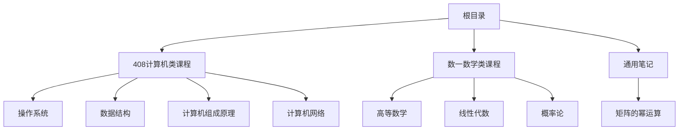
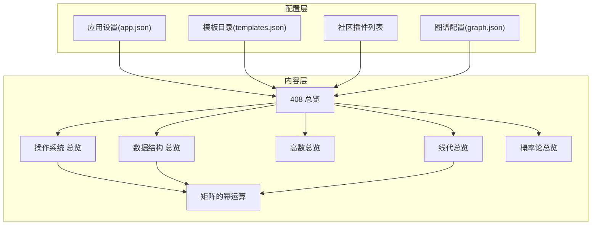
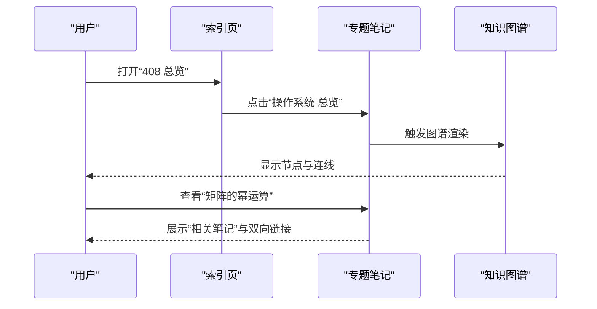
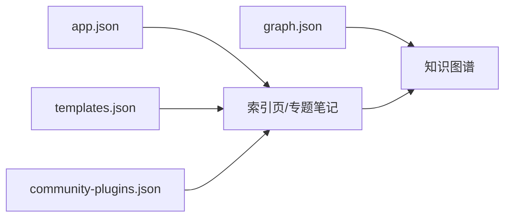

# 知识管理方法

<cite>
**本文引用的文件**
- [app.json](file://.obsidian\app.json)
- [templates.json](file://.obsidian\templates.json)
- [community-plugins.json](file://.obsidian\community-plugins.json)
- [graph.json](file://.obsidian\graph.json)
- [408.md](file://408\408.md)
- [操作系统.md](file://408\操作系统\操作系统.md)
- [数据结构.md](file://408\数据结构\数据结构.md)
- [高数总览.md](file://数一\高数总览.md)
- [线代总览.md](file://数一\线代总览.md)
- [概率论总览.md](file://数一\概率论总览.md)
- [矩阵的幂运算.md](file://矩阵的幂运算.md)
</cite>

## 目录
1. [引言](#引言)
2. [项目结构](#项目结构)
3. [核心组件](#核心组件)
4. [架构总览](#架构总览)
5. [详细组件分析](#详细组件分析)
6. [依赖关系分析](#依赖关系分析)
7. [性能考虑](#性能考虑)
8. [故障排查指南](#故障排查指南)
9. [结论](#结论)
10. [附录](#附录)

## 引言
本文件基于当前 Obsidian 知识库仓库，总结一套以“双向链接 + 标签系统 + 文件夹结构 + 模板”为核心的个人知识管理方法。重点包括：
- 如何组织学科与主题（如 408、数学等），并通过索引页串联知识点
- 如何使用元数据（title、date、tags、aliases）提升检索与可视化效果
- 如何利用社区插件（Dataview、Obsidian Git、Templater 等）增强查询、版本控制与模板能力
- 如何从简单笔记逐步构建复杂的双向链接网络，并配合知识图谱进行全局洞察
- 提供性能优化建议与常见问题解决方案

## 项目结构
仓库采用“按学科/课程分域 + 主题索引页 + 专题笔记”的组织方式：
- 顶层目录包含多个学习域（如 408、数一），以及跨主题的通用笔记（如矩阵的幂运算）
- 每个域内通过“索引页”聚合子主题，形成清晰的导航层级
- 使用 Obsidian 配置与社区插件扩展功能（附件路径、模板目录、图视图、插件列表）

**图表来源**
- [408.md:1-16](file://408\408.md#L1-L16)
- [操作系统.md:1-31](file://408\操作系统\操作系统.md#L1-L31)
- [数据结构.md:1-36](file://408\数据结构\数据结构.md#L1-L36)
- [高数总览.md:1-53](file://数一\高数总览.md#L1-L53)
- [线代总览.md:1-39](file://数一\线代总览.md#L1-L39)
- [概率论总览.md:1-31](file://数一\概率论总览.md#L1-L31)
- [矩阵的幂运算.md:1-263](file://矩阵的幂运算.md#L1-L263)

**章节来源**
- [408.md:1-16](file://408\408.md#L1-L16)
- [操作系统.md:1-31](file://408\操作系统\操作系统.md#L1-L31)
- [数据结构.md:1-36](file://408\数据结构\数据结构.md#L1-L36)
- [高数总览.md:1-53](file://数一\高数总览.md#L1-L53)
- [线代总览.md:1-39](file://数一\线代总览.md#L1-L39)
- [概率论总览.md:1-31](file://数一\概率论总览.md#L1-L31)
- [矩阵的幂运算.md:1-263](file://矩阵的幂运算.md#L1-L263)

## 核心组件
- 配置与插件
  - 应用设置：附件存放路径、链接更新策略
  - 模板目录：集中管理笔记模板
  - 社区插件：启用 Dataview、Obsidian Git、Templater、Kanban、Excalidraw、Tag Wrangler、Terminal 等
- 知识组织
  - 索引页：用于聚合与导航（如 408 总览、各科目总览）
  - 专题笔记：承载具体知识点，使用双向链接与标签建立关联
  - 元数据：标题、日期、标签、别名，便于检索与可视化
- 可视化与查询
  - 知识图谱：通过 graph.json 配置节点大小、连线强度、颜色分组等
  - Dataview：在索引页或专题页中动态列出相关笔记、标签、属性

**章节来源**
- [app.json:1-4](file://.obsidian\app.json#L1-L4)
- [templates.json:1-3](file://.obsidian\templates.json#L1-L3)
- [community-plugins.json:1-12](file://.obsidian\community-plugins.json#L1-L12)
- [graph.json:1-30](file://.obsidian\graph.json#L1-L30)
- [408.md:1-16](file://408\408.md#L1-L16)
- [高数总览.md:1-53](file://数一\高数总览.md#L1-L53)
- [线代总览.md:1-39](file://数一\线代总览.md#L1-L39)
- [概率论总览.md:1-31](file://数一\概率论总览.md#L1-L31)

## 架构总览
下图展示“索引页 → 专题笔记 → 双向链接网络”的知识流动与组织方式，并结合 Obsidian 配置与插件能力。

**图表来源**
- [app.json:1-4](file://.obsidian\app.json#L1-L4)
- [templates.json:1-3](file://.obsidian\templates.json#L1-L3)
- [community-plugins.json:1-12](file://.obsidian\community-plugins.json#L1-L12)
- [graph.json:1-30](file://.obsidian\graph.json#L1-L30)
- [408.md:1-16](file://408\408.md#L1-L16)
- [操作系统.md:1-31](file://408\操作系统\操作系统.md#L1-L31)
- [数据结构.md:1-36](file://408\数据结构\数据结构.md#L1-L36)
- [高数总览.md:1-53](file://数一\高数总览.md#L1-L53)
- [线代总览.md:1-39](file://数一\线代总览.md#L1-L39)
- [概率论总览.md:1-31](file://数一\概率论总览.md#L1-L31)
- [矩阵的幂运算.md:1-263](file://矩阵的幂运算.md#L1-L263)

## 详细组件分析

### 索引页与导航体系
- 作用：将分散的专题笔记聚合为可导航的知识地图，降低查找成本
- 实践要点：
  - 使用统一的“目录”区块，列出子主题与简要说明
  - 通过双向链接实现“返回上一级”“下一章/上一章”等导航
  - 在索引页顶部添加元数据（title、date、tags、aliases），便于检索与图谱着色

示例参考：
- 408 总览：聚合四门课程入口
- 操作系统总览：按章节组织子主题
- 数学类总览：高数、线代、概率论各自索引

**章节来源**
- [408.md:1-16](file://408\408.md#L1-L16)
- [操作系统.md:1-31](file://408\操作系统\操作系统.md#L1-L31)
- [数据结构.md:1-36](file://408\数据结构\数据结构.md#L1-L36)
- [高数总览.md:1-53](file://数一\高数总览.md#L1-L53)
- [线代总览.md:1-39](file://数一\线代总览.md#L1-L39)
- [概率论总览.md:1-31](file://数一\概率论总览.md#L1-L31)

### 专题笔记与元数据管理
- 元数据字段：
  - title：统一显示名称
  - date：记录创建/更新时间
  - tags：分类与检索的关键维度（如“高等数学”“数学笔记”“总览”）
  - aliases：别名，提高搜索命中率
- 正文结构：
  - 使用标题层级组织内容
  - 表格/列表整理要点与索引
  - 使用双向链接连接相关概念
- 示例：
  - “矩阵的幂运算”展示了元数据与结构化内容的结合，并在末尾提供“相关笔记”

**章节来源**
- [高数总览.md:1-53](file://数一\高数总览.md#L1-L53)
- [线代总览.md:1-39](file://数一\线代总览.md#L1-L39)
- [概率论总览.md:1-31](file://数一\概率论总览.md#L1-L31)
- [矩阵的幂运算.md:1-263](file://矩阵的幂运算.md#L1-L263)

### 双向链接与知识图谱
- 双向链接：
  - 在索引页与专题页之间建立强关联，形成“导航链”
  - 在专题内部使用“上一章/下一章”“返回上一级”等链接，增强连贯性
- 知识图谱：
  - 通过 graph.json 调整节点大小、连线强度、颜色分组等，突出重要主题
  - 可针对特定路径（如“408/操作系统”）设置颜色分组，便于识别

**图表来源**
- [408.md:1-16](file://408\408.md#L1-L16)
- [操作系统.md:1-31](file://408\操作系统\操作系统.md#L1-L31)
- [graph.json:1-30](file://.obsidian\graph.json#L1-L30)
- [矩阵的幂运算.md:1-263](file://矩阵的幂运算.md#L1-L263)

**章节来源**
- [408.md:1-16](file://408\408.md#L1-L16)
- [graph.json:1-30](file://.obsidian\graph.json#L1-L30)
- [矩阵的幂运算.md:1-263](file://矩阵的幂运算.md#L1-L263)

### 模板系统与命名规范
- 模板目录：通过 templates.json 指定模板所在文件夹，统一新建笔记的结构
- 命名规范建议：
  - 索引页：使用“Xx总览”“Xx目录”等明确标识
  - 专题页：使用“主题-子主题”或“序号-主题”的清晰命名
  - 避免特殊字符与过长文件名，保证跨平台兼容
- 模板内容建议：
  - 固定元数据块（title、date、tags、aliases）
  - 标准目录结构与占位符
  - 常用引用块与提示块（如“核心结论”“注意”“示例”）

**章节来源**
- [templates.json:1-3](file://.obsidian\templates.json#L1-L3)
- [高数总览.md:1-53](file://数一\高数总览.md#L1-L53)
- [线代总览.md:1-39](file://数一\线代总览.md#L1-L39)
- [概率论总览.md:1-31](file://数一\概率论总览.md#L1-L31)

### Dataview 查询与知识检索
- 插件启用：community-plugins.json 已启用 dataview
- 典型用法：
  - 在索引页列出某标签下的所有笔记
  - 根据元数据（如 date、tags）筛选与排序
  - 生成“待补充”清单或“最近修改”列表
- 结合索引页：
  - 用表格呈现“序号 | 笔记 | 内容”，提升可读性与导航效率

**章节来源**
- [community-plugins.json:1-12](file://.obsidian\community-plugins.json#L1-L12)
- [高数总览.md:1-53](file://数一\高数总览.md#L1-L53)
- [线代总览.md:1-39](file://数一\线代总览.md#L1-L39)
- [概率论总览.md:1-31](file://数一\概率论总览.md#L1-L31)

### 版本控制与协作
- 插件启用：obsidian-git
- 实践建议：
  - 定期提交变更，保留关键里程碑
  - 使用分支管理不同学习阶段或主题迭代
  - 在索引页维护“变更记录”或“版本摘要”

**章节来源**
- [community-plugins.json:1-12](file://.obsidian\community-plugins.json#L1-L12)

## 依赖关系分析
- 配置对内容的影响：
  - app.json 决定附件路径与链接更新行为，影响图片与资源管理
  - templates.json 决定模板位置，影响新建笔记的一致性
  - community-plugins.json 决定可用能力（查询、可视化、版本控制等）
  - graph.json 决定图谱展示样式与分组逻辑
- 内容之间的依赖：
  - 索引页依赖专题页的存在与正确链接
  - 专题页依赖元数据与双向链接，支撑检索与图谱
  - 跨学科笔记（如矩阵的幂运算）被多领域索引引用，体现知识的复用性

**图表来源**
- [app.json:1-4](file://.obsidian\app.json#L1-L4)
- [templates.json:1-3](file://.obsidian\templates.json#L1-L3)
- [community-plugins.json:1-12](file://.obsidian\community-plugins.json#L1-L12)
- [graph.json:1-30](file://.obsidian\graph.json#L1-L30)

**章节来源**
- [app.json:1-4](file://.obsidian\app.json#L1-L4)
- [templates.json:1-3](file://.obsidian\templates.json#L1-L3)
- [community-plugins.json:1-12](file://.obsidian\community-plugins.json#L1-L12)
- [graph.json:1-30](file://.obsidian\graph.json#L1-L30)

## 性能考虑
- 图谱性能：
  - 合理设置节点大小、连线强度与距离，避免过多节点导致卡顿
  - 使用颜色分组聚焦关键路径（如“408/操作系统”）
- 插件性能：
  - 按需启用插件，减少不必要的计算开销
  - 在大量笔记场景下，谨慎使用复杂查询与实时渲染
- 内容组织：
  - 保持索引页简洁，避免过度嵌套
  - 合理使用标签与别名，减少重复与歧义

[本节为通用指导，不直接分析具体文件]

## 故障排查指南
- 附件无法加载或路径错误：
  - 检查 app.json 中的附件文件夹设置
  - 确认图片与资源是否存放在指定目录
- 模板未生效：
  - 检查 templates.json 指向的模板目录是否存在且权限正确
- 图谱异常或无显示：
  - 检查 graph.json 的配置项（如 collapse-filter、showTags、colorGroups）
  - 确认双向链接是否正确，避免断链
- 插件功能不可用：
  - 核对 community-plugins.json 中启用的插件名称是否准确
  - 重启 Obsidian 或重新安装对应插件

**章节来源**
- [app.json:1-4](file://.obsidian\app.json#L1-L4)
- [templates.json:1-3](file://.obsidian\templates.json#L1-L3)
- [graph.json:1-30](file://.obsidian\graph.json#L1-L30)
- [community-plugins.json:1-12](file://.obsidian\community-plugins.json#L1-L12)

## 结论
本方法以“索引页 + 专题笔记 + 元数据 + 双向链接”为核心，结合 Obsidian 配置与社区插件，构建了可扩展、可检索、可视化的个人知识库。通过统一的命名规范、模板化内容与版本控制，能够持续演进从简单笔记到复杂知识网络的过程。建议在实践中坚持“先索引后细化、先链接后扩展”的原则，逐步完善知识体系。

[本节为总结性内容，不直接分析具体文件]

## 附录
- 使用示例与模板建议：
  - 索引页模板：包含标题、日期、标签、别名、目录与“相关笔记”
  - 专题页模板：包含核心结论、注意事项、示例与“相关笔记”
  - 在索引页中使用表格列出“序号 | 笔记 | 内容”，提升导航效率
- 高级技巧：
  - 使用 Dataview 生成“待补充”清单与“最近修改”列表
  - 利用 Tag Wrangler 批量管理标签
  - 使用 Templater 自动化插入元数据与目录结构
  - 使用 Excalidraw 绘制概念图与流程图，嵌入笔记中

[本节为通用指导，不直接分析具体文件]