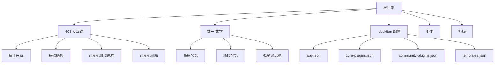
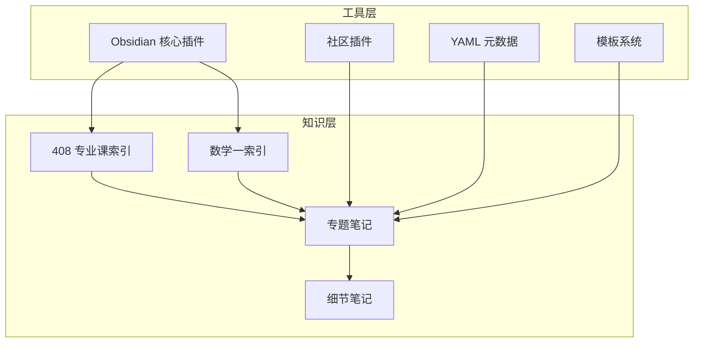
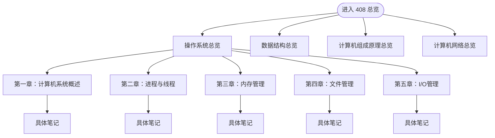
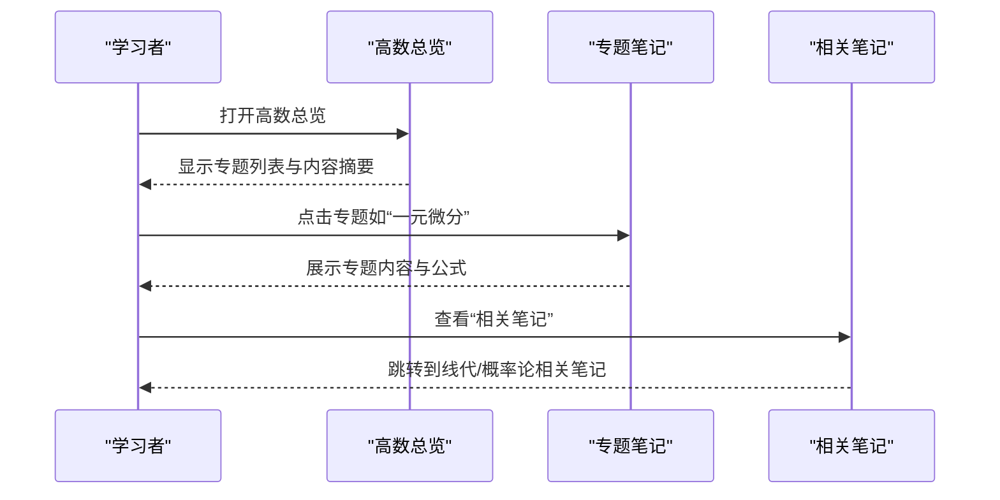
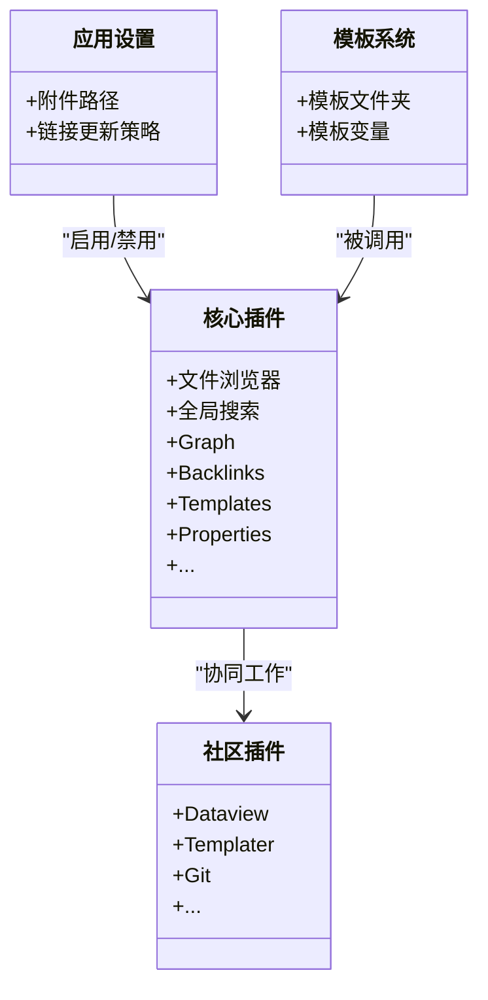
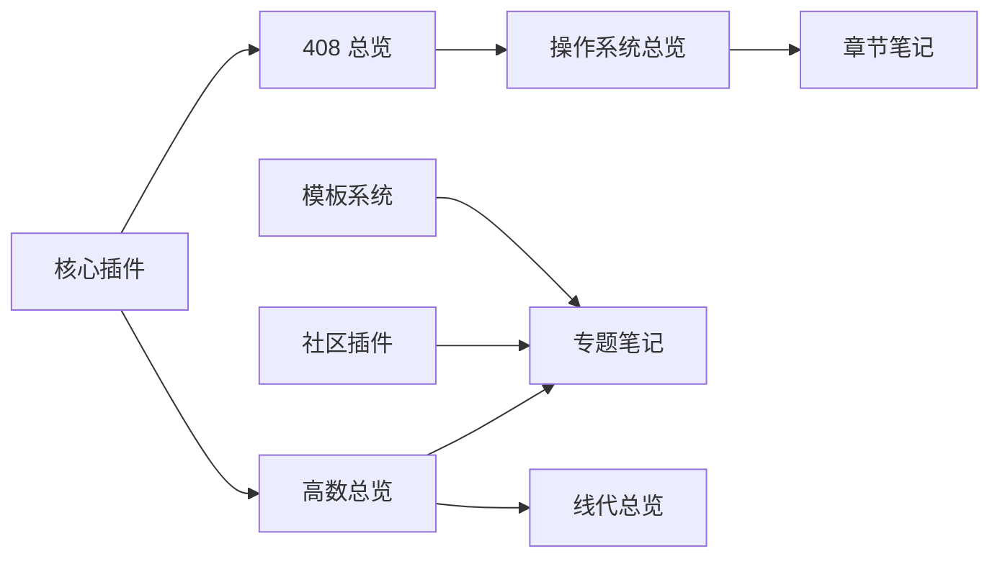

# 项目概述

<cite>
**本文引用的文件**   
- [app.json](file://.obsidian/app.json)
- [community-plugins.json](file://.obsidian/community-plugins.json)
- [core-plugins.json](file://.obsidian/core-plugins.json)
- [templates.json](file://.obsidian/templates.json)
- [408.md](file://408/408.md)
- [操作系统.md](file://408/操作系统/操作系统.md)
- [高数总览.md](file://数一/高数总览.md)
- [线代总览.md](file://数一/线代总览.md)
- [一元微分.md](file://数一/一元微分.md)
- [矩阵的幂运算.md](file://矩阵的幂运算.md)
</cite>

## 目录
1. [简介](#简介)
2. [项目结构](#项目结构)
3. [核心组件](#核心组件)
4. [架构总览](#架构总览)
5. [详细组件分析](#详细组件分析)
6. [依赖关系分析](#依赖关系分析)
7. [性能与使用建议](#性能与使用建议)
8. [故障排查指南](#故障排查指南)
9. [结论](#结论)
10. [附录](#附录)

## 简介
本项目是一个基于 Obsidian 的考研笔记知识库，专注于计算机考研（408）与数学一的系统化知识管理。项目以 Markdown 为存储格式，利用 Obsidian 的双向链接、标签系统与知识图谱能力，构建“总览—专题—细节”的分层知识体系，并通过 YAML Front Matter 对元数据进行统一标注，便于检索、导航与可视化。

目标读者：
- 初学者：了解项目背景、价值与使用方法，快速上手构建个人考研知识体系。
- 有经验用户：掌握 Obsidian 配置、插件生态、模板与数据组织方式，进行二次扩展与自动化。

核心价值：
- 结构化组织：按学科与章节划分，形成清晰的索引与导航。
- 可检索与可视化：通过标签、别名与双向链接，实现跨主题的知识关联与图谱展示。
- 可扩展与可维护：统一的元数据与模板约定，便于批量编辑与版本管理。

## 项目结构
仓库采用“学科模块 + 配置管理”的组织方式：
- 408 专业课模块：包含操作系统、数据结构、计算机组成原理、计算机网络等子模块，每个子模块下按章节或知识点组织笔记，并提供总览页作为入口。
- 数学一学习模块：包含高等数学、线性代数、概率论等方向，提供“总览”类索引页，串联各专题笔记。
- 配置管理模块：位于 .obsidian 目录，集中管理应用设置、核心插件、社区插件、模板路径等。
- 附件与模板：用于存放图片、图表与模板文件，保持内容整洁与复用。

图示来源
- [app.json:1-4](file://.obsidian/app.json#L1-L4)
- [core-plugins.json:1-33](file://.obsidian/core-plugins.json#L1-L33)
- [community-plugins.json:1-12](file://.obsidian/community-plugins.json#L1-L12)
- [templates.json:1-3](file://.obsidian/templates.json#L1-L3)
- [408.md:1-16](file://408/408.md#L1-L16)
- [高数总览.md:1-53](file://数一/高数总览.md#L1-L53)
- [线代总览.md:1-39](file://数一/线代总览.md#L1-L39)

章节来源
- [408.md:1-16](file://408/408.md#L1-L16)
- [高数总览.md:1-53](file://数一/高数总览.md#L1-L53)
- [线代总览.md:1-39](file://数一/线代总览.md#L1-L39)

## 核心组件
- 学科索引与导航
  - 408 总览页提供四门专业课的入口，并指向各专业的总览笔记，形成一级导航。
  - 操作系统等子模块内部进一步按章节组织，提供二级导航。
- 数学一知识索引
  - 高数总览与线代总览分别汇总相关专题，提供表格化索引与交叉引用。
- 元数据与标签
  - 使用 YAML Front Matter 定义标题、日期、标签与别名，增强检索与聚合能力。
- 配置与插件
  - 启用核心插件（如 Graph、Backlinks、Templates、Properties 等）与社区插件（Dataview、Templater、Git 等），提升知识管理与自动化能力。

章节来源
- [操作系统.md:1-31](file://408/操作系统/操作系统.md#L1-L31)
- [高数总览.md:1-53](file://数一/高数总览.md#L1-L53)
- [线代总览.md:1-39](file://数一/线代总览.md#L1-L39)
- [一元微分.md:1-27](file://数一/一元微分.md#L1-L27)
- [core-plugins.json:1-33](file://.obsidian/core-plugins.json#L1-L33)
- [community-plugins.json:1-12](file://.obsidian/community-plugins.json#L1-L12)

## 架构总览
本项目的“架构”体现在知识组织与工具链两方面：
- 知识架构：以“总览—专题—细节”三层结构组织内容，通过双向链接将分散的知识点串联成网络。
- 工具链架构：Obsidian 为核心编辑器，配合核心插件与社区插件，实现标签管理、模板生成、数据查询、版本控制与可视化。

图示来源
- [408.md:1-16](file://408/408.md#L1-L16)
- [高数总览.md:1-53](file://数一/高数总览.md#L1-L53)
- [core-plugins.json:1-33](file://.obsidian/core-plugins.json#L1-L33)
- [community-plugins.json:1-12](file://.obsidian/community-plugins.json#L1-L12)
- [templates.json:1-3](file://.obsidian/templates.json#L1-L3)

## 详细组件分析

### 408 专业课模块
- 功能定位：提供操作系统、数据结构、计算机组成原理、计算机网络四大专业课的索引与导航。
- 组织结构：每门专业课有独立目录与总览页，总览页内按章节列出子笔记，形成清晰的学习路径。
- 关键特性：
  - 使用 Obsidian 双向链接在总览页中串联各章节笔记。
  - 通过“返回上一级”链接维持层级导航的一致性。

图示来源
- [408.md:1-16](file://408/408.md#L1-L16)
- [操作系统.md:1-31](file://408/操作系统/操作系统.md#L1-L31)

章节来源
- [408.md:1-16](file://408/408.md#L1-L16)
- [操作系统.md:1-31](file://408/操作系统/操作系统.md#L1-L31)

### 数学一学习模块
- 功能定位：围绕高等数学、线性代数、概率论构建索引与专题笔记体系，支持跨专题的知识关联。
- 组织结构：以“总览”页为入口，表格化列出专题与内容摘要；专题笔记通过双向链接相互引用。
- 关键特性：
  - 使用 YAML Front Matter 标注标题、日期、标签与别名，便于检索与聚合。
  - 通过“相关笔记”区域建立跨专题的知识网络。

图示来源
- [高数总览.md:1-53](file://数一/高数总览.md#L1-L53)
- [一元微分.md:1-27](file://数一/一元微分.md#L1-L27)
- [线代总览.md:1-39](file://数一/线代总览.md#L1-L39)

章节来源
- [高数总览.md:1-53](file://数一/高数总览.md#L1-L53)
- [一元微分.md:1-27](file://数一/一元微分.md#L1-L27)
- [线代总览.md:1-39](file://数一/线代总览.md#L1-L39)

### 配置管理模块
- 应用设置：附件文件夹路径、链接更新策略等。
- 核心插件：启用文件浏览器、全局搜索、Graph、Backlinks、Canvas、Outgoing Link、Tag Pane、Properties、Page Preview、Daily Notes、Templates、Note Composer、Command Palette、Editor Status、Bookmarks、Markdown Importer、Outline、Word Count、File Recovery、Sync、Bases、Web Viewer 等。
- 社区插件：Dataview、Excalidraw、Kanban、Tag Wrangler、Templater、Copilot、Local REST API、RealClaudian、Git、Terminal 等。
- 模板路径：指定模板文件夹位置，便于统一创建新笔记。

图示来源
- [app.json:1-4](file://.obsidian/app.json#L1-L4)
- [core-plugins.json:1-33](file://.obsidian/core-plugins.json#L1-L33)
- [community-plugins.json:1-12](file://.obsidian/community-plugins.json#L1-L12)
- [templates.json:1-3](file://.obsidian/templates.json#L1-L3)

章节来源
- [app.json:1-4](file://.obsidian/app.json#L1-L4)
- [core-plugins.json:1-33](file://.obsidian/core-plugins.json#L1-L33)
- [community-plugins.json:1-12](file://.obsidian/community-plugins.json#L1-L12)
- [templates.json:1-3](file://.obsidian/templates.json#L1-L3)

### 技术栈与主要特性
- 技术栈
  - Obsidian：本地知识管理与可视化平台。
  - Markdown：通用文本格式，便于阅读与版本控制。
  - YAML Front Matter：结构化元数据，支持标签、别名、日期等。
- 主要特性
  - 双向链接：笔记之间相互引用，形成知识网络。
  - 标签系统：通过标签进行分类与聚合。
  - 模板系统：统一笔记结构与字段，提高创作效率。
  - 知识图谱：Graph 视图直观展示笔记关联。
  - 数据查询：Dataview 插件支持高级检索与报表。
  - 版本控制：Git 插件支持提交、分支与协作。

章节来源
- [core-plugins.json:1-33](file://.obsidian/core-plugins.json#L1-L33)
- [community-plugins.json:1-12](file://.obsidian/community-plugins.json#L1-L12)
- [templates.json:1-3](file://.obsidian/templates.json#L1-L3)

## 依赖关系分析
- 知识层依赖
  - 总览页依赖专题笔记，专题笔记依赖细节笔记，形成单向导航。
  - 数学一模块中的“高数总览”与“线代总览”相互引用，体现跨学科关联。
- 工具层依赖
  - 核心插件提供基础能力（Graph、Backlinks、Templates、Properties）。
  - 社区插件增强能力（Dataview、Templater、Git）。
  - 模板系统依赖 templates.json 指定的文件夹路径。

图示来源
- [408.md:1-16](file://408/408.md#L1-L16)
- [高数总览.md:1-53](file://数一/高数总览.md#L1-L53)
- [linea 总览.md:1-39](file://数一/线代总览.md#L1-L39)
- [core-plugins.json:1-33](file://.obsidian/core-plugins.json#L1-L33)
- [community-plugins.json:1-12](file://.obsidian/community-plugins.json#L1-L12)
- [templates.json:1-3](file://.obsidian/templates.json#L1-L3)

章节来源
- [408.md:1-16](file://408/408.md#L1-L16)
- [高数总览.md:1-53](file://数一/高数总览.md#L1-L53)
- [线代总览.md:1-39](file://数一/线代总览.md#L1-L39)

## 性能与使用建议
- 性能优化
  - 合理拆分笔记粒度，避免单篇过长导致渲染缓慢。
  - 使用标签与别名减少重复内容，提升检索效率。
  - 定期清理无用链接与图片，保持仓库体积可控。
- 使用建议
  - 新建笔记时优先使用模板，确保元数据一致。
  - 在总览页维护稳定的导航结构，便于长期维护。
  - 结合 Dataview 与 Templater 实现批量更新与自动化。
  - 使用 Git 进行版本管理，记录变更历史。

[本节为通用指导，不直接分析具体文件]

## 故障排查指南
- 常见问题
  - 链接失效：检查双向链接是否正确，确认目标笔记存在。
  - 标签未生效：确认 YAML Front Matter 中 tags 字段格式正确。
  - 模板未加载：确认 templates.json 中 folder 路径与实际模板目录一致。
  - 插件冲突：逐步禁用社区插件定位问题。
- 排查步骤
  - 使用 Obsidian 内置“反向链接”面板查找引用情况。
  - 通过“全局搜索”验证关键词是否命中。
  - 检查 .obsidian 配置文件是否有语法错误。
  - 使用 Git 对比差异，恢复误改内容。

章节来源
- [app.json:1-4](file://.obsidian/app.json#L1-L4)
- [templates.json:1-3](file://.obsidian/templates.json#L1-L3)

## 结论
本项目以 Obsidian 为核心，结合 Markdown 与 YAML Front Matter，构建了面向考研（408 与数学一）的结构化知识管理系统。通过总览—专题—细节的分层组织、双向链接与标签系统，实现了知识的可检索、可关联与可视化。借助核心插件与社区插件，项目在效率与扩展性方面具备良好基础，适合持续迭代与团队协作。

[本节为总结性内容，不直接分析具体文件]

## 附录
- 快速开始
  - 安装 Obsidian 并打开仓库。
  - 启用核心插件与社区插件。
  - 从 408 总览或数学一总览开始学习。
- 扩展建议
  - 引入 Dataview 构建动态索引。
  - 使用 Templater 自动生成笔记模板。
  - 结合 Excalidraw 绘制思维导图与流程图。

[本节为补充说明，不直接分析具体文件]