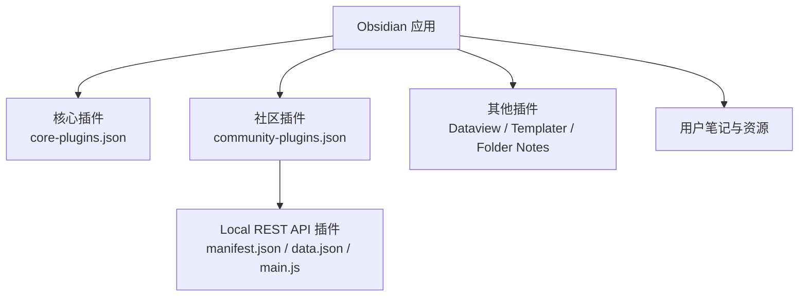
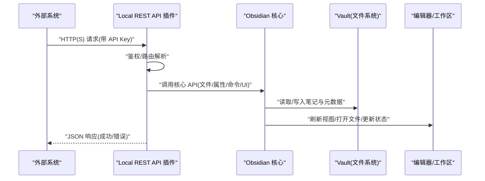
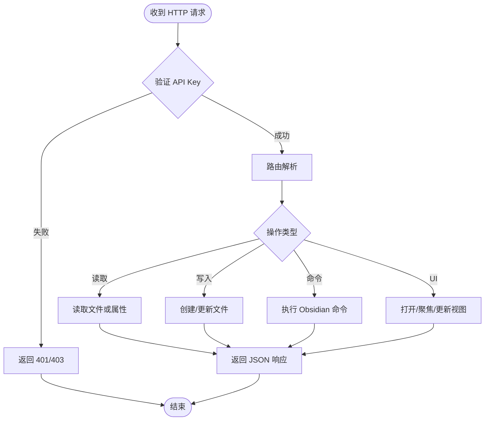
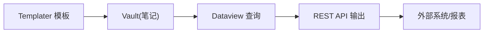
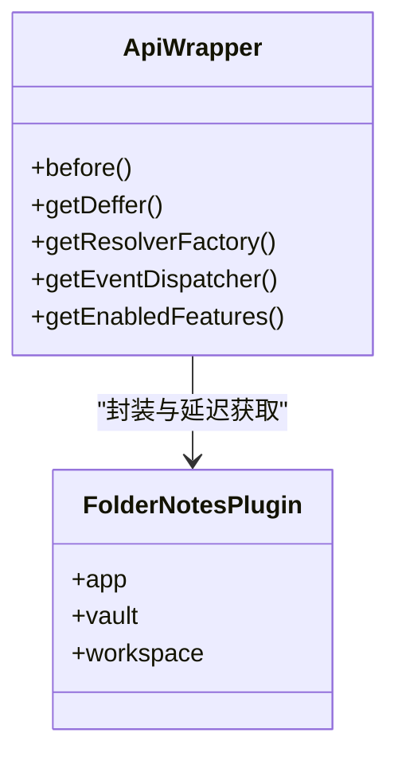
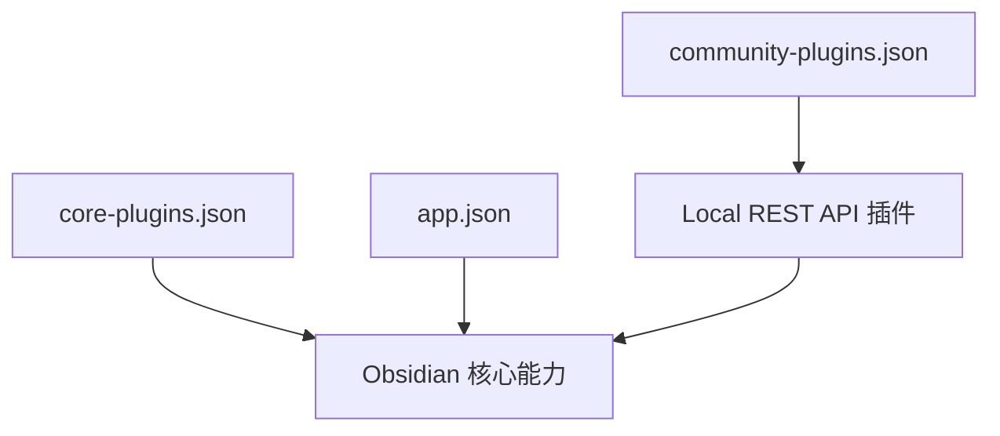

# API 扩展与自定义开发

<cite>
**本文引用的文件**
- [community-plugins.json](file://.obsidian/community-plugins.json)
- [core-plugins.json](file://.obsidian/core-plugins.json)
- [app.json](file://.obsidian/app.json)
- [obsidian-local-rest-api/manifest.json](file://.obsidian/plugins/obsidian-local-rest-api/manifest.json)
- [obsidian-local-rest-api/data.json](file://.obsidian/plugins/obsidian-local-rest-api/data.json)
- [obsidian-local-rest-api/main.js](file://.obsidian/plugins/obsidian-local-rest-api/main.js)
- [templater-obsidian/manifest.json](file://.obsidian/plugins/templater-obsidian/manifest.json)
- [dataview/manifest.json](file://.obsidian/plugins/dataview/manifest.json)
- [folder-notes/main.js](file://.obsidian/plugins/folder-notes/main.js)
</cite>

## 目录
1. [简介](#简介)
2. [项目结构](#项目结构)
3. [核心组件](#核心组件)
4. [架构总览](#架构总览)
5. [详细组件分析](#详细组件分析)
6. [依赖关系分析](#依赖关系分析)
7. [性能考虑](#性能考虑)
8. [故障排查指南](#故障排查指南)
9. [结论](#结论)
10. [附录](#附录)

## 简介
本文件面向希望在 Obsidian 中进行 API 扩展与自定义开发的读者，重点围绕以下主题展开：
- Local REST API 插件的启用、配置与 HTTP 接口调用方式
- 数据交换与外部系统集成思路（如脚本、自动化、第三方服务）
- Obsidian 核心 API 的使用要点（事件监听、命令执行、UI 操作等）
- 开发示例与实践建议（JavaScript 脚本、插件开发基础、集成方案）
- 开发环境搭建、调试技巧与发布部署流程

## 项目结构
当前工作区为 Obsidian 仓库，包含社区插件与核心插件的配置。关键位置如下：
- .obsidian/community-plugins.json：已启用的社区插件列表
- .obsidian/core-plugins.json：Obsidian 内置核心插件开关
- .obsidian/app.json：应用级设置（如附件路径、链接更新策略）
- .obsidian/plugins/*：各插件目录，其中 obsidian-local-rest-api 提供本地 REST API 能力
- 笔记内容：用于演示数据组织与元数据使用（例如 front matter）

图表来源
- [community-plugins.json:1-12](file://.obsidian/community-plugins.json#L1-L12)
- [core-plugins.json:1-33](file://.obsidian/core-plugins.json#L1-L33)
- [obsidian-local-rest-api/manifest.json:1-10](file://.obsidian/plugins/obsidian-local-rest-api/manifest.json#L1-L10)
- [obsidian-local-rest-api/data.json:1-11](file://.obsidian/plugins/obsidian-local-rest-api/data.json#L1-L11)

章节来源
- [community-plugins.json:1-12](file://.obsidian/community-plugins.json#L1-L12)
- [core-plugins.json:1-33](file://.obsidian/core-plugins.json#L1-L33)
- [app.json:1-4](file://.obsidian/app.json#L1-L4)

## 核心组件
- Local REST API 插件
  - 作用：通过本地 HTTP 服务器暴露 REST 接口，允许外部程序读取、修改 Obsidian 中的笔记与元数据
  - 关键配置：端口、是否启用不安全端口、API Key、TLS 证书与密钥
  - 入口：main.js（打包后的实现），manifest.json（插件元信息）
- Templater 与 Dataview
  - 作用：模板渲染与数据视图查询，常与 REST API 配合完成批量生成与展示
- Folder Notes
  - 作用：以文件夹为中心的组织方式，结合 Obsidian 核心 API 进行标签、标题、Tab 管理等

章节来源
- [obsidian-local-rest-api/manifest.json:1-10](file://.obsidian/plugins/obsidian-local-rest-api/manifest.json#L1-L10)
- [obsidian-local-rest-api/data.json:1-11](file://.obsidian/plugins/obsidian-local-rest-api/data.json#L1-L11)
- [templater-obsidian/manifest.json:1-12](file://.obsidian/plugins/templater-obsidian/manifest.json#L1-L12)
- [dataview/manifest.json:1-12](file://.obsidian/plugins/dataview/manifest.json#L1-L12)
- [folder-notes/main.js:106-153](file://.obsidian/plugins/folder-notes/main.js#L106-L153)

## 架构总览
下图展示了从外部系统到 Obsidian 的数据流：外部客户端通过 HTTP(S) 调用 Local REST API，插件在 Obsidian 内部访问 Vault、Workspace、Editor 等核心对象，完成读/写与 UI 交互。

图表来源
- [obsidian-local-rest-api/manifest.json:1-10](file://.obsidian/plugins/obsidian-local-rest-api/manifest.json#L1-L10)
- [obsidian-local-rest-api/data.json:1-11](file://.obsidian/plugins/obsidian-local-rest-api/data.json#L1-L11)
- [folder-notes/main.js:106-153](file://.obsidian/plugins/folder-notes/main.js#L106-L153)

## 详细组件分析

### Local REST API 插件
- 功能定位
  - 提供本地 HTTP/HTTPS 服务，暴露 REST 接口以操作 Obsidian 笔记与元数据
  - 支持 API Key 鉴权与可选的不安全端口
  - 可配置 TLS 证书与私钥，便于在受控环境中启用 HTTPS
- 配置项说明
  - port：HTTPS 端口
  - insecurePort：HTTP 端口（默认关闭）
  - enableInsecureServer：是否启用 HTTP
  - apiKey：访问令牌
  - crypto.cert/privateKey/publicKey：自签名证书与密钥对
- 典型调用流程
  - 外部系统发送携带 API Key 的请求至本地端口
  - 插件校验身份后，调用 Obsidian 核心 API 读写 Vault、触发命令或更新 UI
  - 返回 JSON 结果给调用方

图表来源
- [obsidian-local-rest-api/data.json:1-11](file://.obsidian/plugins/obsidian-local-rest-api/data.json#L1-L11)
- [obsidian-local-rest-api/main.js:1-800](file://.obsidian/plugins/obsidian-local-rest-api/main.js#L1-L800)

章节来源
- [obsidian-local-rest-api/data.json:1-11](file://.obsidian/plugins/obsidian-local-rest-api/data.json#L1-L11)
- [obsidian-local-rest-api/main.js:1-800](file://.obsidian/plugins/obsidian-local-rest-api/main.js#L1-L800)

### Templater 与 Dataview 的协作
- Templater
  - 基于模板快速生成笔记内容，适合批量初始化、结构化文档
  - 可通过 Obsidian 插件 API 获取并写入模板内容
- Dataview
  - 提供强大的数据查询与视图展示能力，常用于汇总、统计与可视化
  - 可与 REST API 联动，将查询结果导出或推送至外部系统

图表来源
- [templater-obsidian/manifest.json:1-12](file://.obsidian/plugins/templater-obsidian/manifest.json#L1-L12)
- [dataview/manifest.json:1-12](file://.obsidian/plugins/dataview/manifest.json#L1-L12)

章节来源
- [templater-obsidian/manifest.json:1-12](file://.obsidian/plugins/templater-obsidian/manifest.json#L1-L12)
- [dataview/manifest.json:1-12](file://.obsidian/plugins/dataview/manifest.json#L1-L12)

### Folder Notes 与 Obsidian 核心 API
- 通过 App 与 Workspace 管理标签页、标题与视图
- 利用 Vault 读取/写入文件与元数据
- 借助 EventDispatcher 与 Resolver 机制处理异步与延迟加载

图表来源
- [folder-notes/main.js:106-153](file://.obsidian/plugins/folder-notes/main.js#L106-L153)

章节来源
- [folder-notes/main.js:106-153](file://.obsidian/plugins/folder-notes/main.js#L106-L153)

## 依赖关系分析
- 插件启用状态由 community-plugins.json 控制，确保 Local REST API 插件处于启用状态
- core-plugins.json 控制内置插件开关，影响可用能力（如命令面板、同步、Web 查看器等）
- app.json 决定应用行为（如附件存储路径、链接更新策略）

图表来源
- [community-plugins.json:1-12](file://.obsidian/community-plugins.json#L1-L12)
- [core-plugins.json:1-33](file://.obsidian/core-plugins.json#L1-L33)
- [app.json:1-4](file://.obsidian/app.json#L1-L4)

章节来源
- [community-plugins.json:1-12](file://.obsidian/community-plugins.json#L1-L12)
- [core-plugins.json:1-33](file://.obsidian/core-plugins.json#L1-L33)
- [app.json:1-4](file://.obsidian/app.json#L1-L4)

## 性能考虑
- 合理设置端口与鉴权，避免不必要的网络开销与安全风险
- 批量操作时尽量合并请求，减少频繁 I/O
- 使用 Dataview 查询优化，避免全库扫描
- 在高频场景下，结合缓存与增量更新策略降低负载

## 故障排查指南
- 无法连接本地 API
  - 检查端口占用与防火墙设置
  - 确认 enableInsecureServer 与端口配置是否正确
  - 验证 API Key 是否匹配
- 权限或鉴权失败
  - 核对 data.json 中的 apiKey
  - 若启用 HTTPS，确保证书与私钥有效且匹配
- 笔记读写异常
  - 检查文件路径与权限
  - 观察 Obsidian 控制台日志，定位具体错误
- 与其他插件冲突
  - 逐步禁用相关插件，定位问题源
  - 关注 Templater/Dataview 的版本与兼容性

章节来源
- [obsidian-local-rest-api/data.json:1-11](file://.obsidian/plugins/obsidian-local-rest-api/data.json#L1-L11)
- [obsidian-local-rest-api/main.js:1-800](file://.obsidian/plugins/obsidian-local-rest-api/main.js#L1-L800)

## 结论
通过 Local REST API 插件，Obsidian 可作为本地知识中枢对外暴露标准化接口，便于与脚本、自动化流程与外部系统集成。结合 Templater 与 Dataview，可实现从模板生成、数据查询到可视化的完整闭环。遵循安全配置与性能优化原则，可在保障稳定性的同时提升效率。

## 附录

### 开发环境搭建
- 安装并启用 Local REST API 插件
- 在 data.json 中配置端口、API Key 与证书（如需 HTTPS）
- 使用 curl 或 Postman 测试基本接口，确认鉴权与路由正常

### 调试技巧
- 开启浏览器开发者工具或 Obsidian 控制台，查看网络与日志
- 逐步缩小请求范围，定位是鉴权、路由还是业务逻辑问题
- 使用最小化请求体与固定参数复现问题

### 发布与部署
- 将插件打包并发布至社区仓库（如需）
- 在生产环境启用 HTTPS 与强密码策略
- 定期更新插件版本，修复已知问题与安全漏洞