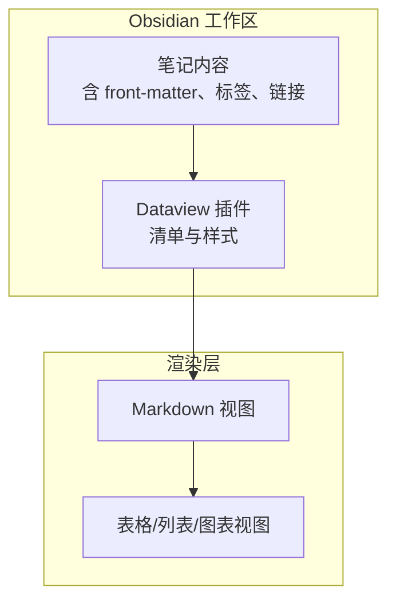
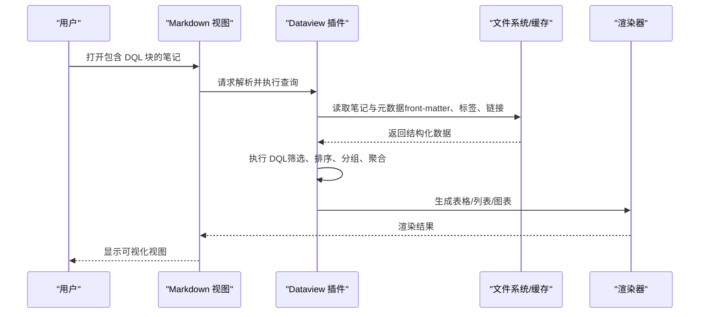
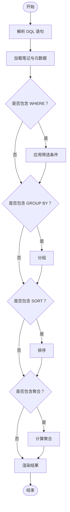

# Dataview 数据查询与可视化

<cite>
**本文引用的文件**
- [dataview/manifest.json](file://.obsidian\plugins\dataview\manifest.json)
- [dataview/styles.css](file://.obsidian\plugins\dataview\styles.css)
- [408/操作系统/01-计算机系统概述/01-计算机系统概述.md](file://408\操作系统\01-计算机系统概述\01-计算机系统概述.md)
- [数一/高数总览.md](file://数一\高数总览.md)
</cite>

## 目录
1. [简介](#简介)
2. [项目结构](#项目结构)
3. [核心组件](#核心组件)
4. [架构总览](#架构总览)
5. [详细组件分析](#详细组件分析)
6. [依赖关系分析](#依赖关系分析)
7. [性能考量](#性能考量)
8. [故障排查指南](#故障排查指南)
9. [结论](#结论)
10. [附录：DQL 常用语法速查与应用场景](#附录dql-常用语法速查与应用场景)

## 简介
本文件面向使用 Obsidian 的读者，系统介绍 Dataview 插件的数据查询与可视化能力。内容涵盖：
- 如何使用 DQL（Dataview Query Language）进行复杂查询
- 如何生成表格、列表、统计图表等可视化视图
- 如何查询笔记元数据、标签、链接等属性
- 典型应用场景：自动生成复习计划、知识图谱分析
- 性能优化建议与常见问题解决方案

说明：本仓库已启用 Dataview 插件（版本见下文），但当前未包含实际的 DQL 代码块示例。本文将基于仓库中的实际文件结构与样式资源，结合通用实践给出可落地的指导。

## 项目结构
仓库为 Obsidian 知识库，包含课程笔记与数学笔记等。关键与 Dataview 相关的资源位于 .obsidian/plugins/dataview 目录下，包括插件清单与样式表；笔记中广泛使用了 front-matter（YAML 元数据）和内部链接，这些正是 DQL 查询的主要数据源。

图示来源
- [dataview/manifest.json:1-11](file://.obsidian\plugins\dataview\manifest.json#L1-L11)
- [dataview/styles.css:1-141](file://.obsidian\plugins\dataview\styles.css#L1-L141)

章节来源
- [dataview/manifest.json:1-11](file://.obsidian\plugins\dataview\manifest.json#L1-L11)
- [dataview/styles.css:1-141](file://.obsidian\plugins\dataview\styles.css#L1-L141)

## 核心组件
- Dataview 插件清单：标识插件 ID、名称、版本、最低应用版本、帮助文档地址等。
- Dataview 样式：定义表格视图、列表视图、错误视图、内联字段等的 CSS 类名与默认样式，确保查询结果在 Markdown 视图中正确渲染。

章节来源
- [dataview/manifest.json:1-11](file://.obsidian\plugins\dataview\manifest.json#L1-L11)
- [dataview/styles.css:1-141](file://.obsidian\plugins\dataview\styles.css#L1-L141)

## 架构总览
下图展示从“笔记数据”到“可视化输出”的整体流程：
- 笔记中的 front-matter、标签、链接作为结构化数据源
- Dataview 解析并执行 DQL 查询
- 将结果渲染为表格、列表或图表
- 通过样式统一呈现

图示来源
- [dataview/manifest.json:1-11](file://.obsidian\plugins\dataview\manifest.json#L1-L11)
- [dataview/styles.css:1-141](file://.obsidian\plugins\dataview\styles.css#L1-L141)

## 详细组件分析

### 数据源：笔记元数据与链接
- front-matter（YAML）：标题、日期、标签、别名等，是 DQL 查询的核心字段来源。
- 标签：可用于按主题、科目、难度等维度筛选与分组。
- 链接：用于构建知识图谱、关联复习路径。

章节来源
- [408/操作系统/01-计算机系统概述/01-计算机系统概述.md:1-10](file://408\操作系统\01-计算机系统概述\01-计算机系统概述.md#L1-L10)
- [数一/高数总览.md:1-11](file://数一\高数总览.md#L1-L11)

### 渲染层：表格、列表、错误提示样式
- 表格视图：支持列宽、悬停高亮、表头加粗等。
- 列表视图：以无序/有序列表形式展示查询结果。
- 错误视图：当查询失败时提供友好的错误框与消息样式。
- 内联字段：对行内键值对的样式增强。

章节来源
- [dataview/styles.css:1-141](file://.obsidian\plugins\dataview\styles.css#L1-L141)

### 查询执行流程（概念级）

图示来源
- [dataview/styles.css:1-141](file://.obsidian\plugins\dataview\styles.css#L1-L141)

## 依赖关系分析
- Dataview 插件依赖 Obsidian 的文件系统与元数据缓存，读取 front-matter、标签、链接等信息。
- 样式依赖 Obsidian 的主题变量（如背景色、文本颜色），保证在不同主题下的一致表现。
- 笔记内容通过 Markdown 视图与 Dataview 渲染器协作，将查询结果转换为可视化元素。

图示来源
- [dataview/manifest.json:1-11](file://.obsidian\plugins\dataview\manifest.json#L1-L11)
- [dataview/styles.css:1-141](file://.obsidian\plugins\dataview\styles.css#L1-L141)

章节来源
- [dataview/manifest.json:1-11](file://.obsidian\plugins\dataview\manifest.json#L1-L11)
- [dataview/styles.css:1-141](file://.obsidian\plugins\dataview\styles.css#L1-L141)

## 性能考量
- 限制查询范围：使用 FROM 指定文件夹或标签，避免全库扫描。
- 减少字段数量：仅选择必要字段，降低渲染开销。
- 合理使用排序与分组：大集合上的排序与分组可能带来性能压力，尽量先筛选再排序。
- 避免深层嵌套：多层分组与复杂表达式会增加解析时间。
- 利用缓存：保持 Obsidian 索引正常，避免频繁重建导致卡顿。
- 分页与增量更新：对于超大结果集，考虑分块展示或使用更精确的筛选条件。

[本节为通用性能建议，不直接引用具体文件]

## 故障排查指南
- 查询无结果：检查筛选条件是否过于严格；确认 front-matter 字段名与类型是否正确。
- 表格样式异常：确认 Dataview 样式已加载；检查主题变量是否存在冲突。
- 错误视图出现：查看错误信息，定位语法错误或字段不存在问题。
- 性能卡顿：缩小查询范围、减少字段、简化表达式。

章节来源
- [dataview/styles.css:108-141](file://.obsidian\plugins\dataview\styles.css#L108-L141)

## 结论
本仓库已启用 Dataview 插件，具备完整的表格、列表、错误视图样式支持；笔记普遍采用 front-matter 与标签组织，非常适合用 DQL 进行数据化检索与可视化。尽管当前未包含具体的 DQL 代码块，但基于现有结构与样式，可以高效地构建复习计划、知识图谱等高级功能。建议在笔记中逐步引入 DQL 查询，并结合本文的优化建议与排障方法，获得稳定高效的可视化体验。

[本节为总结性内容，不直接引用具体文件]

## 附录：DQL 常用语法速查与应用场景

### 基础查询
- 列出某文件夹下的所有笔记
- 按标签筛选笔记
- 按日期范围筛选笔记
- 按 front-matter 字段筛选（如难度、状态）

### 表格与列表
- 生成表格：选择字段、排序、分组
- 生成列表：简洁展示标题与摘要
- 自定义列：使用函数格式化日期、计算差值、拼接字符串

### 统计与图表
- 计数、求和、平均值等聚合
- 分组统计：按标签、科目、难度分组
- 图表：柱状图、折线图、饼图（取决于渲染器支持）

### 元数据、标签、链接
- 读取 front-matter 字段（title、date、tags、aliases 等）
- 按标签分组与筛选
- 基于链接构建知识图谱与复习路径

### 典型应用场景
- 自动生成复习计划：按日期与标签筛选待复习笔记，生成任务列表
- 知识图谱分析：按链接与标签聚合，展示知识点关联度
- 学习进度追踪：按状态字段统计完成度与剩余工作量

[本节为通用指导，不直接引用具体文件]