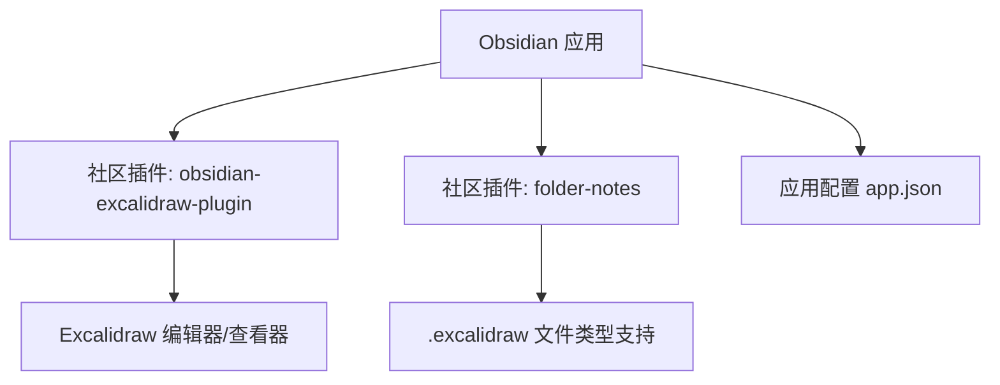
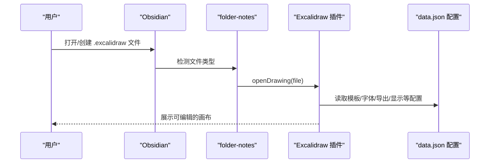
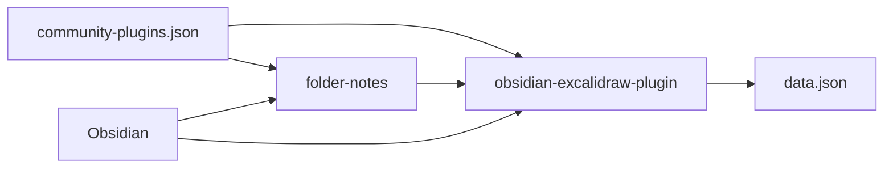

# Excalidraw 绘图工具

<cite>
**本文引用的文件**
- [manifest.json](file://.obsidian/plugins/obsidian-excalidraw-plugin/manifest.json)
- [data.json](file://.obsidian/plugins/obsidian-excalidraw-plugin/data.json)
- [community-plugins.json](file://.obsidian/community-plugins.json)
- [app.json](file://.obsidian/app.json)
- [main.js（folder-notes）](file://.obsidian/plugins/folder-notes/main.js)
- [第五章——图.md](file://408/数据结构/第五章——图.md)
</cite>

## 目录
1. [简介](#简介)
2. [项目结构](#项目结构)
3. [核心组件](#核心组件)
4. [架构总览](#架构总览)
5. [详细组件分析](#详细组件分析)
6. [依赖关系分析](#依赖关系分析)
7. [性能与体验优化](#性能与体验优化)
8. [故障排查指南](#故障排查指南)
9. [结论](#结论)
10. [附录：实战案例与最佳实践](#附录实战案例与最佳实践)

## 简介
本指南面向在 Obsidian 中使用 Excalidraw 的用户，系统介绍如何绘制流程图、架构图、思维导图等图形元素，解释形状、文本、连线、标注等功能模块，并提供将绘图嵌入笔记、与其他插件协同工作的方法。同时给出绘制系统架构图与算法流程图的实操建议与最佳实践。

## 项目结构
仓库中已启用并配置了 Excalidraw 插件，并通过 folder-notes 插件实现了对 .excalidraw 文件的识别与打开。Obsidian 的核心设置也包含附件路径等基础配置。

图表来源
- [manifest.json:1-12](file://.obsidian/plugins/obsidian-excalidraw-plugin/manifest.json#L1-L12)
- [community-plugins.json:1-12](file://.obsidian/community-plugins.json#L1-L12)
- [app.json:1-4](file://.obsidian/app.json#L1-L4)
- [main.js（folder-notes）:3079-3101](file://.obsidian/plugins/folder-notes/main.js#L3079-L3101)

章节来源
- [manifest.json:1-12](file://.obsidian/plugins/obsidian-excalidraw-plugin/manifest.json#L1-L12)
- [community-plugins.json:1-12](file://.obsidian/community-plugins.json#L1-L12)
- [app.json:1-4](file://.obsidian/app.json#L1-L4)
- [main.js（folder-notes）:3079-3101](file://.obsidian/plugins/folder-notes/main.js#L3079-L3101)

## 核心组件
- Excalidraw 插件：提供绘图编辑与查看能力，支持模板、脚本、字体资产、导出、自动保存、主题匹配、链接与嵌入等。
- folder-notes 插件：识别并打开 .excalidraw 文件，支持将其作为“文件夹笔记”类型之一。
- Obsidian 应用配置：控制附件存储位置、链接更新策略等。

章节来源
- [manifest.json:1-12](file://.obsidian/plugins/obsidian-excalidraw-plugin/manifest.json#L1-L12)
- [data.json:1-135](file://.obsidian/plugins/obsidian-excalidraw-plugin/data.json#L1-L135)
- [main.js（folder-notes）:3079-3101](file://.obsidian/plugins/folder-notes/main.js#L3079-L3101)
- [app.json:1-4](file://.obsidian/app.json#L1-L4)

## 架构总览
下图展示了从用户操作到绘图渲染的关键交互路径：用户在 Obsidian 中创建或打开 .excalidraw 文件，folder-notes 检测类型并调用 Excalidraw 插件打开；Excalidraw 根据 data.json 中的配置加载模板、字体、导出与显示行为等。

图表来源
- [main.js（folder-notes）:3079-3101](file://.obsidian/plugins/folder-notes/main.js#L3079-L3101)
- [data.json:1-135](file://.obsidian/plugins/obsidian-excalidraw-plugin/data.json#L1-L135)

## 详细组件分析

### Excalidraw 插件能力与配置要点
- 文件与模板
  - 默认存放目录、模板路径、脚本目录、CJK 字体资产路径均可配置，便于统一管理与团队协作。
- 导入导出与预览
  - 支持 PNG/SVG/PDF 导出，可控制缩放、背景、边距、是否嵌入场景等；支持在 Markdown 中以 SVG 预览。
- 自动保存与性能
  - 桌面/移动端自动保存间隔可配；渲染并发度、图片缓存、缩放范围等影响性能与体验。
- 主题与显示
  - 支持匹配 Obsidian 主题、内联预览、尺寸控制、字体与颜色等。
- 链接与嵌入
  - 支持 Wiki 链接、URL 前缀、嵌入类型、Markdown 注释链接等，便于与笔记双向关联。
- 自定义笔刷
  - 内置多种笔刷（高亮、细尖、喷泉、记号笔等），可调整描边、填充、粗糙度、平滑等参数。

章节来源
- [data.json:1-135](file://.obsidian/plugins/obsidian-excalidraw-plugin/data.json#L1-L135)
- [data.json:137-448](file://.obsidian/plugins/obsidian-excalidraw-plugin/data.json#L137-L448)
- [data.json:460-487](file://.obsidian/plugins/obsidian-excalidraw-plugin/data.json#L460-L487)
- [data.json:488-800](file://.obsidian/plugins/obsidian-excalidraw-plugin/data.json#L488-L800)

### folder-notes 对 .excalidraw 的支持
- 类型识别与打开
  - 当检测到 .excalidraw 扩展名时，调用 Excalidraw 插件的 openDrawing 接口直接打开绘图。
- 模板与空白画布
  - 可通过插件获取空白画布内容，用于新建文件或模板注入。
- 与模板系统的协作
  - 若模板中包含特定提示标记，则跳过插入逻辑，避免重复覆盖。

章节来源
- [main.js（folder-notes）:3079-3101](file://.obsidian/plugins/folder-notes/main.js#L3079-L3101)
- [main.js（folder-notes）:232-267](file://.obsidian/plugins/folder-notes/main.js#L232-L267)

### 与 Obsidian 应用的集成
- 附件管理
  - 通过 app.json 指定附件文件夹，便于统一管理绘图资源与导出产物。
- 链接更新
  - 开启 alwaysUpdateLinks 保证跨文件引用的一致性。

章节来源
- [app.json:1-4](file://.obsidian/app.json#L1-L4)

## 依赖关系分析
- 插件启用
  - community-plugins.json 启用了 obsidian-excalidraw-plugin。
- 运行时依赖
  - folder-notes 在运行时探测并调用 obsidian-excalidraw-plugin 的能力。
- 配置依赖
  - Excalidraw 的行为由 data.json 驱动，包括模板、字体、导出、显示、链接等。

图表来源
- [community-plugins.json:1-12](file://.obsidian/community-plugins.json#L1-L12)
- [main.js（folder-notes）:3079-3101](file://.obsidian/plugins/folder-notes/main.js#L3079-L3101)
- [data.json:1-135](file://.obsidian/plugins/obsidian-excalidraw-plugin/data.json#L1-L135)

章节来源
- [community-plugins.json:1-12](file://.obsidian/community-plugins.json#L1-L12)
- [main.js（folder-notes）:3079-3101](file://.obsidian/plugins/folder-notes/main.js#L3079-L3101)
- [data.json:1-135](file://.obsidian/plugins/obsidian-excalidraw-plugin/data.json#L1-L135)

## 性能与体验优化
- 自动保存与渲染
  - 合理设置自动保存间隔与渲染并发，平衡数据安全与性能。
- 图片与导出
  - 启用图片缓存可减少重复渲染开销；按需选择导出格式与缩放比例。
- 主题与预览
  - 在需要一致视觉时使用主题匹配；在大量嵌入时注意预览尺寸限制。
- 缩放与导航
  - 配置最小/最大缩放级别与步进，提升大画布的浏览效率。

章节来源
- [data.json:15-135](file://.obsidian/plugins/obsidian-excalidraw-plugin/data.json#L15-L135)
- [data.json:460-487](file://.obsidian/plugins/obsidian-excalidraw-plugin/data.json#L460-L487)

## 故障排查指南
- 无法打开 .excalidraw 文件
  - 确认已启用 obsidian-excalidraw-plugin；检查 folder-notes 是否正确识别扩展名并调用 openDrawing。
- 模板未生效
  - 检查 data.json 中模板路径是否存在；若使用 Templater/模板插件，确保模板内容未被特定标记阻止插入。
- 导出异常或体积过大
  - 调整导出缩放、背景与边距；关闭不必要的嵌入场景；选择合适的导出格式。
- 链接与嵌入不工作
  - 检查链接前缀、嵌入类型与 Markdown 注释链接开关；确认 Obsidian 链接更新策略已开启。

章节来源
- [main.js（folder-notes）:3079-3101](file://.obsidian/plugins/folder-notes/main.js#L3079-L3101)
- [main.js（folder-notes）:232-267](file://.obsidian/plugins/folder-notes/main.js#L232-L267)
- [data.json:1-135](file://.obsidian/plugins/obsidian-excalidraw-plugin/data.json#L1-L135)
- [app.json:1-4](file://.obsidian/app.json#L1-L4)

## 结论
在本仓库中，Excalidraw 通过官方插件与 folder-notes 的协同，实现了在 Obsidian 中对 .excalidraw 文件的无缝编辑与查看。借助丰富的配置项，用户可以定制模板、字体、导出、主题与链接行为，满足从学习笔记到系统架构图绘制的多样化需求。结合 Obsidian 的链接与嵌入机制，可将绘图高效融入知识体系。

## 附录：实战案例与最佳实践

### 绘制流程图（以“最短路径算法”为例）
- 目标：用流程图表达 Floyd-Warshall 算法的核心步骤。
- 步骤建议
  - 初始化：列出顶点集合与邻接矩阵。
  - 迭代：按 k=0..n-1 逐步更新距离矩阵。
  - 输出：得到所有顶点对的最短路径长度。
- 图形元素
  - 矩形表示步骤，菱形表示判断，箭头表示流程方向。
  - 使用文本框标注关键变量（如 i、j、k）。
- 参考素材
  - 可在“第五章——图”中查阅算法思想与复杂度说明，辅助梳理流程节点。

章节来源
- [第五章——图.md:454-511](file://408/数据结构/第五章——图.md#L454-L511)

### 绘制系统架构图（微服务分层）
- 目标：展示前端、网关、后端服务、数据库之间的关系。
- 图形元素
  - 容器/方框表示服务或组件，连线表示调用关系，标注协议或数据流向。
  - 使用不同形状区分外部依赖（如第三方 API）。
- 最佳实践
  - 保持层级清晰，避免交叉连线过多；为每个组件添加简短职责描述。
  - 使用框架（Frame）分组，便于后续扩展与维护。

### 绘制思维导图（知识点结构化）
- 目标：将复杂概念拆解为层次化结构。
- 步骤建议
  - 中心主题置于画布中央，向外辐射一级分支，再逐级细化。
  - 使用颜色与图标区分类别，增强可读性。
- 技巧
  - 利用对齐与网格提高整洁度；使用“标注”补充说明。

### 将绘图嵌入笔记
- 方式
  - 在 Markdown 中直接插入 .excalidraw 文件，Obsidian 将以可交互或静态预览形式呈现。
- 注意事项
  - 根据 data.json 的嵌入类型与预览设置，选择合适的显示模式与尺寸。
  - 如需固定尺寸，可在嵌入时指定宽高。

### 与其他功能集成
- 与 Templater/模板系统
  - 通过模板快速生成标准绘图骨架，统一风格与命名。
- 与 Dataview/Kanban
  - 在看板或数据视图中引用绘图文件，形成可视化任务或知识索引。
- 与 Git
  - 配合版本管理追踪绘图变更，便于回溯与协作。

### 绘图技巧与最佳实践
- 一致性
  - 使用统一的配色、字体与线宽；通过模板固化规范。
- 可读性
  - 控制信息密度，合理使用留白与分组；关键路径加粗或高亮。
- 可维护性
  - 为重要元素添加名称与备注；使用框架组织复杂页面。
- 性能
  - 大图分屏或分页；谨慎使用高分辨率图片；合理设置导出选项。