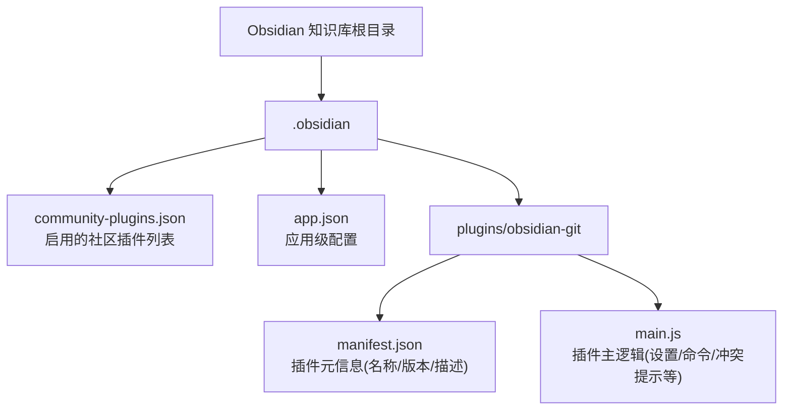
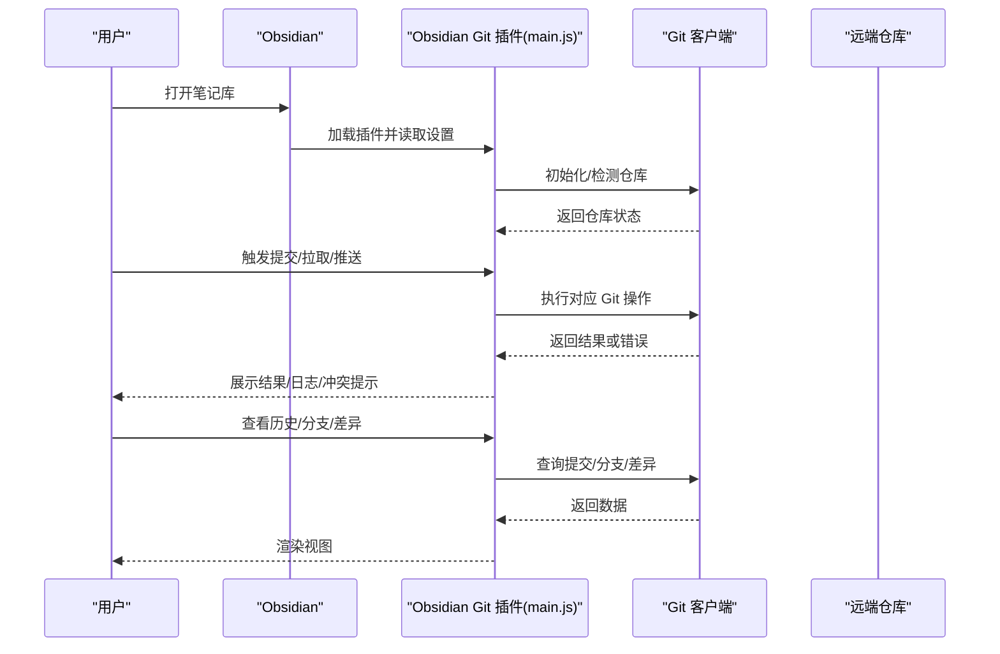
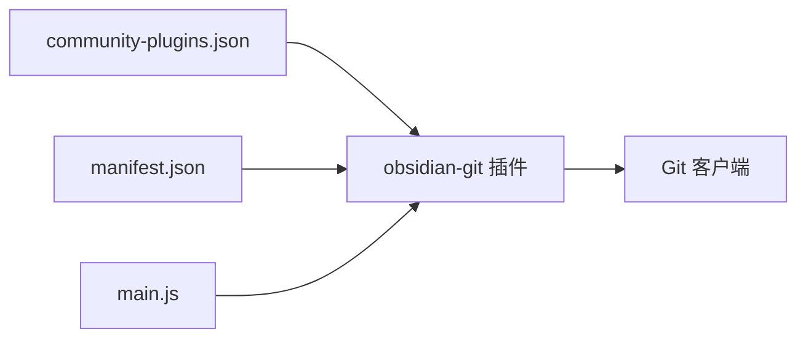

# Git 版本控制集成

<cite>
**本文引用的文件**
- [community-plugins.json](file://.obsidian\community-plugins.json)
- [app.json](file://.obsidian\app.json)
- [manifest.json](file://.obsidian\plugins\obsidian-git\manifest.json)
- [main.js](file://.obsidian\plugins\obsidian-git\main.js)
</cite>

## 目录
1. [简介](#简介)
2. [项目结构](#项目结构)
3. [核心组件](#核心组件)
4. [架构总览](#架构总览)
5. [详细组件分析](#详细组件分析)
6. [依赖关系分析](#依赖关系分析)
7. [性能考虑](#性能考虑)
8. [故障排除指南](#故障排除指南)
9. [结论](#结论)
10. [附录](#附录)

## 简介
本指南面向使用 Obsidian 的笔记用户与团队，聚焦 Obsidian Git 插件的版本控制与协作能力。内容涵盖：如何配置本地/远程 Git 仓库、设置自动备份与同步策略、分支管理与冲突解决、历史版本查看；并提供团队协作最佳实践与常见问题排查方法。文档基于当前工作区中已安装的 Obsidian Git 插件及其入口代码进行分析，确保建议可落地且与插件行为一致。

## 项目结构
当前工作区是一个 Obsidian 知识库，已启用社区插件 obsidian-git（版本 2.38.0）。Obsidian 通过 .obsidian/plugins 管理插件，Git 插件的核心逻辑位于 main.js，元数据在 manifest.json 中声明。

图表来源
- [manifest.json:1-10](file://.obsidian\plugins\obsidian-git\manifest.json#L1-L10)
- [main.js:68-173](file://.obsidian\plugins\obsidian-git\main.js#L68-L173)

章节来源
- [community-plugins.json:1-12](file://.obsidian\community-plugins.json#L1-L12)
- [app.json:1-4](file://.obsidian\app.json#L1-L4)
- [manifest.json:1-10](file://.obsidian\plugins\obsidian-git\manifest.json#L1-L10)

## 核心组件
- 插件注册与发现：Obsidian 通过 community-plugins.json 加载 obsidian-git。
- 插件元信息：manifest.json 声明插件 ID、名称、版本与功能描述。
- 插件主逻辑：main.js 提供设置项、命令、与 Git 交互的封装、冲突处理提示等。

章节来源
- [community-plugins.json:1-12](file://.obsidian\community-plugins.json#L1-L12)
- [manifest.json:1-10](file://.obsidian\plugins\obsidian-git\manifest.json#L1-L10)
- [main.js:68-173](file://.obsidian\plugins\obsidian-git\main.js#L68-L173)

## 架构总览
Obsidian Git 插件作为 Obsidian 的扩展，负责将笔记库映射为 Git 仓库并进行版本管理。其典型流程包括：初始化仓库、拉取/推送远端、提交变更、显示差异与冲突、执行定时备份。

图表来源
- [main.js:68-173](file://.obsidian\plugins\obsidian-git\main.js#L68-L173)

## 详细组件分析

### 插件清单与启用
- 插件清单 manifest.json 定义了插件的基本信息与版本，便于 Obsidian 识别与加载。
- community-plugins.json 列出了已启用的插件，包含 obsidian-git，确保插件在启动时被加载。

章节来源
- [manifest.json:1-10](file://.obsidian\plugins\obsidian-git\manifest.json#L1-L10)
- [community-plugins.json:1-12](file://.obsidian\community-plugins.json#L1-L12)

### 设置项与环境变量
- main.js 中包含对 PATH 环境变量追加路径的设置项，用于指定自定义 Git 二进制位置或附加环境。
- 支持“重载以应用新环境变量”，以便在不重启 Obsidian 的情况下更新 Git 运行环境。

章节来源
- [main.js:166-173](file://.obsidian\plugins\obsidian-git\main.js#L166-L173)

### 仓库初始化与配置
- main.js 包含创建裸仓库与非裸仓库的配置片段，以及写入 HEAD 引用等初始化步骤，用于在库内建立 Git 仓库。
- 这些逻辑确保 Obsidian 库可作为 Git 仓库被版本化管理。

章节来源
- [main.js:79-85](file://.obsidian\plugins\obsidian-git\main.js#L79-L85)

### 冲突处理与提示
- main.js 提供了冲突文件的查看指引，建议在“源码模式”下编辑冲突标记，并给出示例冲突块说明。
- 该提示帮助团队在多人协作时快速定位并解决合并冲突。

章节来源
- [main.js:404-413](file://.obsidian\plugins\obsidian-git\main.js#L404-L413)

### 行作者信息与编辑器集成
- main.js 暴露了“显示每行提交作者信息”的设置项，用于增强协作时的可追溯性（仅桌面端可用）。
- 该功能有助于在多作者环境下追踪修改来源。

章节来源
- [main.js:173-174](file://.obsidian\plugins\obsidian-git\main.js#L173-L174)

### 附件与链接更新
- app.json 中的 alwaysUpdateLinks 开启后，Obsidian 会尝试在保存时更新内部链接，配合 Git 可更好地维护引用一致性。
- attachmentFolderPath 指定附件存放目录，便于统一归档与版本化。

章节来源
- [app.json:1-4](file://.obsidian\app.json#L1-L4)

## 依赖关系分析
- Obsidian 通过 community-plugins.json 加载 obsidian-git。
- obsidian-git 的 manifest.json 提供插件元信息，main.js 实现具体功能。
- main.js 依赖系统 Git 客户端进行版本控制操作，并通过设置项调整运行环境（如 PATH）。

图表来源
- [community-plugins.json:1-12](file://.obsidian\community-plugins.json#L1-L12)
- [manifest.json:1-10](file://.obsidian\plugins\obsidian-git\manifest.json#L1-L10)
- [main.js:68-173](file://.obsidian\plugins\obsidian-git\main.js#L68-L173)

章节来源
- [community-plugins.json:1-12](file://.obsidian\community-plugins.json#L1-L12)
- [manifest.json:1-10](file://.obsidian\plugins\obsidian-git\manifest.json#L1-L10)
- [main.js:68-173](file://.obsidian\plugins\obsidian-git\main.js#L68-L173)

## 性能考虑
- 合理设置 Git 忽略规则（例如 .gitignore），避免将大型二进制文件或临时文件纳入版本控制，减少仓库体积与同步开销。
- 在大型库中，优先使用增量提交与合理的分支粒度，降低 diff 计算与网络传输成本。
- 利用 Obsidian 的附件集中管理（attachmentFolderPath）与链接更新（alwaysUpdateLinks），减少碎片化文件带来的性能影响。

[本节为通用指导，不直接分析具体文件]

## 故障排除指南
- 无法找到 Git 或权限问题
  - 检查系统 PATH 是否包含 Git 可执行文件路径；必要时通过插件设置项追加自定义 PATH 并点击“重载以应用新环境变量”。
  - 确认当前用户对仓库目录具有读写权限。
- 拉取/推送失败
  - 检查远端地址、认证方式（SSH/HTTPS）与网络连通性。
  - 若出现冲突，按插件提示在源码模式下清理冲突标记并重新提交。
- 冲突解决
  - 使用插件提供的冲突提示，参考示例冲突块，删除冲突标记并保留期望内容。
  - 完成后重新提交并推送。
- 历史版本与差异
  - 通过 Obsidian Git 的命令面板查看提交历史、分支与差异；必要时回滚到特定版本。
- 性能问题
  - 定期清理未跟踪文件与大对象；避免将缓存或临时目录纳入版本控制。

章节来源
- [main.js:166-173](file://.obsidian\plugins\obsidian-git\main.js#L166-L173)
- [main.js:404-413](file://.obsidian\plugins\obsidian-git\main.js#L404-L413)

## 结论
Obsidian Git 插件为知识库提供了强大的版本控制与协作能力。通过正确配置仓库、设置环境变量、合理使用分支与冲突解决流程，并结合团队协作最佳实践，可以显著提升知识管理的可靠性与效率。建议结合 .gitignore、附件集中管理与链接更新策略，进一步优化性能与维护成本。

[本节为总结性内容，不直接分析具体文件]

## 附录

### 配置与工作流程建议（基于仓库现状）
- 启用插件：已在 community-plugins.json 中启用 obsidian-git。
- 仓库初始化：由 main.js 提供初始化逻辑，可在 Obsidian 中通过插件命令完成本地仓库创建与远端关联。
- 自动备份与同步：通过插件设置项配置定时任务（如自动提交/推送），结合远端托管服务实现多设备同步。
- 分支策略：建议使用特性分支进行编辑，合并至主干前进行审查与冲突解决。
- 冲突处理：遵循插件提示，在源码模式下清理冲突标记并提交。
- 历史查看：通过插件命令查看提交历史、分支与差异，必要时回滚。

章节来源
- [community-plugins.json:1-12](file://.obsidian\community-plugins.json#L1-L12)
- [manifest.json:1-10](file://.obsidian\plugins\obsidian-git\manifest.json#L1-L10)
- [main.js:68-173](file://.obsidian\plugins\obsidian-git\main.js#L68-L173)
- [main.js:404-413](file://.obsidian\plugins\obsidian-git\main.js#L404-L413)