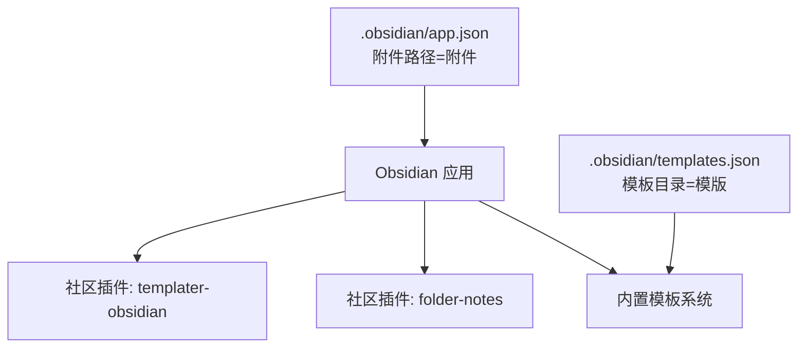
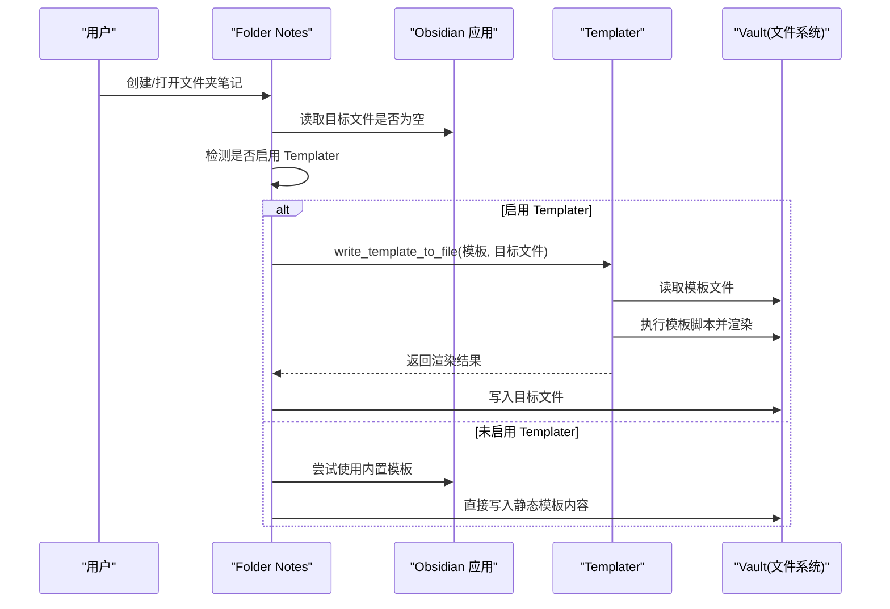
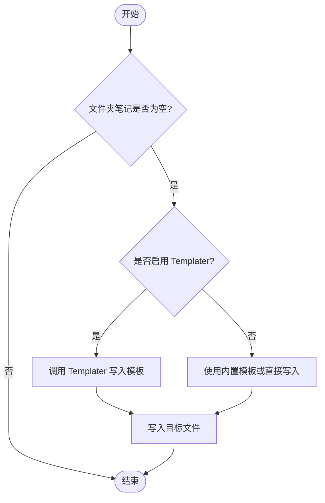
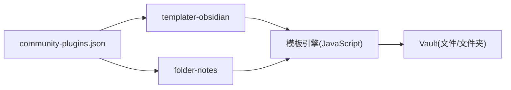

# 自动化与模板系统

<cite>
**本文引用的文件**
- [community-plugins.json](file://.obsidian/community-plugins.json)
- [templates.json](file://.obsidian/templates.json)
- [app.json](file://.obsidian/app.json)
- [folder-notes/main.js](file://.obsidian/plugins/folder-notes/main.js)
- [templater-obsidian/manifest.json](file://.obsidian/plugins/templater-obsidian/manifest.json)
- [templater-obsidian/main.js](file://.obsidian/plugins/templater-obsidian/main.js)
- [操作系统.md](file://408/操作系统/操作系统.md)
- [高数总览.md](file://数一/高数总览.md)
</cite>

## 目录
1. [简介](#简介)
2. [项目结构](#项目结构)
3. [核心组件](#核心组件)
4. [架构总览](#架构总览)
5. [详细组件分析](#详细组件分析)
6. [依赖关系分析](#依赖关系分析)
7. [性能考量](#性能考量)
8. [故障排查指南](#故障排查指南)
9. [结论](#结论)
10. [附录](#附录)

## 简介
本文件面向 Obsidian 用户，系统化介绍“自动化与模板系统”的落地方案：以 Templater 插件为核心实现动态模板、条件逻辑、日期时间处理；以 Folder Notes 插件实现文件夹级笔记（Folder Note）的自动创建与管理；并提供可复用的自动化工作流示例（自动生成学习笔记、批量处理文件、定时任务），以及脚本编写与调试方法，帮助用户构建个性化的高效知识管理流程。

## 项目结构
当前知识库已启用社区插件体系，并通过配置指定模板目录。关键要点：
- 已启用 Templater 与 Folder Notes 等社区插件
- 模板目录指向仓库根下的“模版”文件夹
- 附件默认存放于“附件”目录
- 已有大量学科笔记，可作为自动化模板与工作流的素材

图表来源
- [community-plugins.json:1-12](file://.obsidian/community-plugins.json#L1-L12)
- [templates.json:1-3](file://.obsidian/templates.json#L1-L3)
- [app.json:1-4](file://.obsidian/app.json#L1-L4)

章节来源
- [community-plugins.json:1-12](file://.obsidian/community-plugins.json#L1-L12)
- [templates.json:1-3](file://.obsidian/templates.json#L1-L3)
- [app.json:1-4](file://.obsidian/app.json#L1-L4)

## 核心组件
- Templater 插件：提供强大的模板引擎，支持在模板中嵌入 JavaScript 脚本，实现动态内容、条件分支、日期时间格式化、读取/写入文件、调用 API 等高级能力。
- Folder Notes 插件：为每个文件夹生成一个“文件夹笔记”，并可在该笔记中聚合展示子文件、按规则排序过滤、应用模板等，提升层级化知识的导航与维护效率。
- 内置模板系统：配合 templates.json 指定模板目录，便于快速插入基础模板。

章节来源
- [templater-obsidian/manifest.json:1-11](file://.obsidian/plugins/templater-obsidian/manifest.json#L1-L11)
- [templates.json:1-3](file://.obsidian/templates.json#L1-L3)
- [folder-notes/main.js:232-284](file://.obsidian/plugins/folder-notes/main.js#L232-L284)

## 架构总览
Templater 与 Folder Notes 在 Obsidian 生态中的协作方式如下：
- Folder Notes 在创建或打开空白的文件夹笔记时，会检测是否启用了 Templater；若启用则调用 Templater 将模板写入新文件，否则回退到内置模板系统或直接写入静态内容。
- Templater 通过其运行时环境暴露 app、user、config 等模块，供模板脚本使用，从而实现高度定制化的自动化。

图表来源
- [folder-notes/main.js:232-284](file://.obsidian/plugins/folder-notes/main.js#L232-L284)
- [templater-obsidian/main.js:1-25](file://.obsidian/plugins/templater-obsidian/main.js#L1-L25)

## 详细组件分析

### Templater 插件：动态模板与脚本
- 作用：在模板中运行 JavaScript，访问 Obsidian 上下文（如 app、vault、moment 等），实现动态标题、日期时间、条件逻辑、批量操作等。
- 典型用法：
  - 动态日期时间：在模板中使用 moment 进行格式化输出。
  - 条件逻辑：根据标签、属性或外部数据决定模板分支。
  - 文件读写：读取现有笔记元数据或写入新的结构化内容。
  - 批量处理：遍历文件或文件夹，批量更新元数据、链接或内容。
- 错误提示：当模板执行出错时，会通过通知与控制台输出错误信息，便于定位问题。

章节来源
- [templater-obsidian/main.js:1-25](file://.obsidian/plugins/templater-obsidian/main.js#L1-L25)

### Folder Notes 插件：文件夹级笔记
- 作用：为每个文件夹生成一个“文件夹笔记”，用于汇总该文件夹下的内容、设置样式、排序过滤、应用模板等。
- 模板集成：
  - 当目标文件夹笔记为空时，Folder Notes 会优先调用 Templater 写入模板；若未启用 Templater，则回退到内置模板或直接写入静态内容。
  - 支持选择模板路径，并在设置中维护模板位置。
- 文件组织：
  - 支持将文件夹笔记存储在“父文件夹”或“文件夹内部”。
  - 支持自定义扩展名与批量创建。
- 列表与排序：
  - 支持按创建时间、修改时间、名称等维度排序。
  - 支持深度控制与黑名单过滤。

图表来源
- [folder-notes/main.js:232-284](file://.obsidian/plugins/folder-notes/main.js#L232-L284)

章节来源
- [folder-notes/main.js:232-284](file://.obsidian/plugins/folder-notes/main.js#L232-L284)
- [folder-notes/main.js:3898-3963](file://.obsidian/plugins/folder-notes/main.js#L3898-L3963)
- [folder-notes/main.js:3476-3520](file://.obsidian/plugins/folder-notes/main.js#L3476-L3520)
- [folder-notes/main.js:5952-6062](file://.obsidian/plugins/folder-notes/main.js#L5952-L6062)

### 实际工作流示例

#### 工作流一：自动生成学习笔记（基于 Templater）
- 触发方式：新建笔记时插入 Templater 模板。
- 模板能力：
  - 动态生成标题、日期、标签、别名等元数据。
  - 根据主题或课程自动插入目录结构与占位符。
  - 条件逻辑：根据标签或属性显示不同区块（如复习计划、参考链接）。
- 建议实践：
  - 在“模版”目录下创建“学习笔记.md”模板。
  - 在模板中定义常用字段与结构，使用 Templater 语法填充动态内容。
  - 结合 Folder Notes，为每门课程建立文件夹并自动生成课程总览笔记。

章节来源
- [templates.json:1-3](file://.obsidian/templates.json#L1-L3)

#### 工作流二：批量处理文件（基于 Templater 脚本）
- 场景：为一批笔记统一添加标签、修正链接、批量更新元数据。
- 步骤：
  - 在 Templater 中编写脚本，遍历指定文件夹或匹配条件的文件。
  - 读取 YAML front matter 或正文内容，按需修改。
  - 保存变更并输出统计信息。
- 注意事项：
  - 先在小范围测试，确认无误后再全量执行。
  - 利用日志与通知反馈执行进度与异常。

章节来源
- [templater-obsidian/main.js:1-25](file://.obsidian/plugins/templater-obsidian/main.js#L1-L25)

#### 工作流三：定时任务（结合 Terminal/Git 插件）
- 思路：
  - 使用 Terminal 插件执行本地脚本（如 Node.js/Python），定期扫描笔记并执行批处理任务。
  - 使用 obsidian-git 插件进行版本管理与同步，确保变更可追溯。
- 常见任务：
  - 每日生成学习日报（汇总当天新增/修改的笔记）。
  - 每周整理标签与链接健康度检查。
  - 定时备份与推送至远程仓库。

章节来源
- [community-plugins.json:1-12](file://.obsidian/community-plugins.json#L1-L12)

### 脚本编写指南与调试方法
- 脚本入口与环境：
  - Templater 提供 app、user、config 等模块，便于访问 Obsidian 上下文与配置。
  - 可通过 console 输出调试信息，并结合 Obsidian 控制台查看错误堆栈。
- 最佳实践：
  - 模块化：将复杂逻辑拆分为函数，提高可读性与复用性。
  - 容错：对文件不存在、权限不足等情况做捕获与提示。
  - 幂等：重复执行不会产生副作用（如避免重复插入相同内容）。
- 调试技巧：
  - 使用 Notice 与 console.log 输出中间状态。
  - 先在单文件或小范围验证，再扩展到批量任务。
  - 结合 Git 提交记录，便于回溯变更。

章节来源
- [templater-obsidian/main.js:1-25](file://.obsidian/plugins/templater-obsidian/main.js#L1-L25)

## 依赖关系分析
- 插件启用：
  - community-plugins.json 列出了已启用的社区插件，包括 templater-obsidian 与 folder-notes。
- 模板目录：
  - templates.json 指定了模板目录为“模版”，便于集中管理模板文件。
- 应用配置：
  - app.json 设置了附件存储路径为“附件”，有助于资源统一管理。

图表来源
- [community-plugins.json:1-12](file://.obsidian/community-plugins.json#L1-L12)
- [templates.json:1-3](file://.obsidian/templates.json#L1-L3)
- [app.json:1-4](file://.obsidian/app.json#L1-L4)

章节来源
- [community-plugins.json:1-12](file://.obsidian/community-plugins.json#L1-L12)
- [templates.json:1-3](file://.obsidian/templates.json#L1-L3)
- [app.json:1-4](file://.obsidian/app.json#L1-L4)

## 性能考量
- 批量操作：
  - 尽量分批处理大文件集合，避免一次性加载过多内容导致卡顿。
  - 使用异步与 Promise 并行处理，但注意并发上限与 I/O 压力。
- 模板复杂度：
  - 复杂条件与深层嵌套会增加渲染开销，建议拆分模板与脚本。
- 存储与索引：
  - 合理组织文件夹与命名规范，减少搜索与索引负担。
  - 合理使用标签与别名，避免过度冗余。

## 故障排查指南
- Templater 错误：
  - 当模板执行失败时，会在界面弹出错误通知，并在控制台输出详细信息。
  - 建议优先检查模板语法、变量赋值与文件路径是否正确。
- Folder Notes 模板应用失败：
  - 检查是否已正确启用 Templater，且模板路径有效。
  - 若模板包含特殊标记（如 Excalidraw 视图切换提示），可能跳过写入。
- 常见问题定位：
  - 使用控制台查看错误堆栈。
  - 逐步缩小范围，从单文件测试到批量任务。
  - 借助 Git 历史对比变更，快速定位问题引入点。

章节来源
- [templater-obsidian/main.js:1-25](file://.obsidian/plugins/templater-obsidian/main.js#L1-L25)
- [folder-notes/main.js:232-284](file://.obsidian/plugins/folder-notes/main.js#L232-L284)

## 结论
通过将 Templater 的动态模板能力与 Folder Notes 的文件夹级笔记功能结合，可以在 Obsidian 中构建高效、可扩展的自动化工作流。无论是自动生成学习笔记、批量处理文件，还是定时任务与版本管理，都能显著提升知识管理的效率与一致性。建议在实践中遵循模块化、容错与幂等原则，并结合调试工具持续优化。

## 附录
- 示例笔记结构参考：
  - 学科总览与目录组织，便于后续自动化生成与维护。
  - 使用 YAML front matter 管理元数据，便于查询与筛选。

章节来源
- [操作系统.md:1-31](file://408/操作系统/操作系统.md#L1-L31)
- [高数总览.md:1-53](file://数一/高数总览.md#L1-L53)