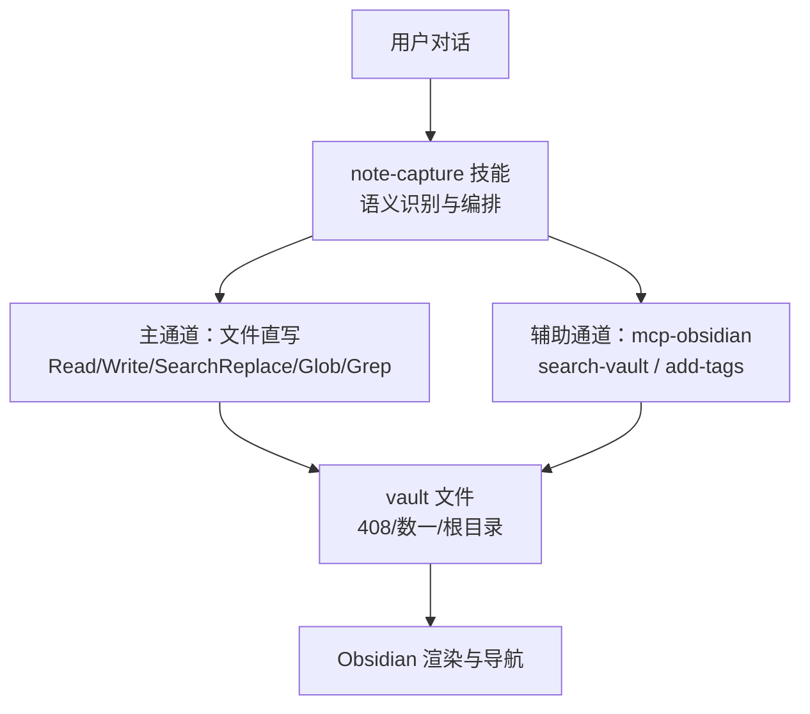
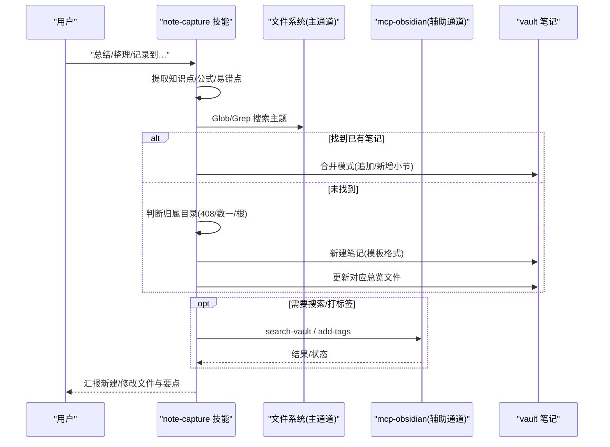
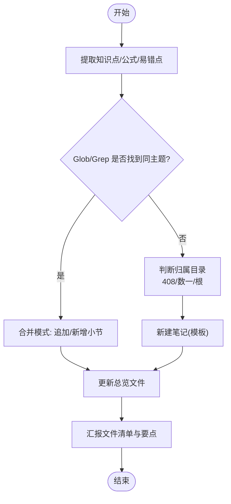
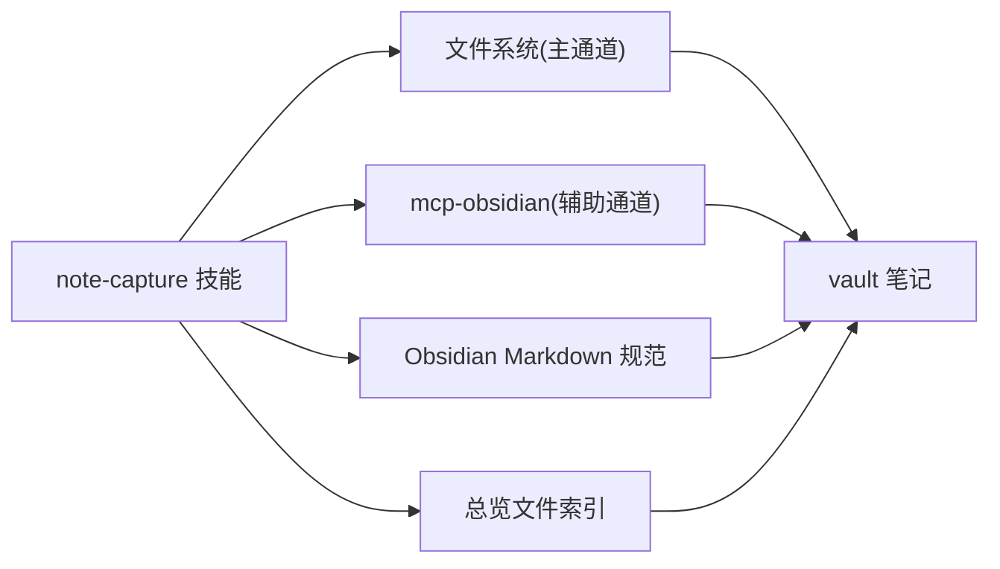

# Obsidian 笔记代理系统

<cite>
**本文引用的文件**
- [设计文档](file://agent/specs/2026-08-23-obsidian-note-agent-design.md)
- [实施计划](file://agent/specs/2026-08-23-obsidian-note-agent-plan.md)
- [note-capture 技能规范](file://agent/skills/note-capture/SKILL.md)
- [Obsidian Markdown 技能规范](file://agent/skills/obsidian-markdown/SKILL.md)
- [Obsidian CLI 技能规范](file://agent/skills/obsidian-cli/SKILL.md)
- [Obsidian Bases 技能规范](file://agent/skills/obsidian-bases/SKILL.md)
- [资产检测测试笔记](file://agent/Obsidian集成资产检测.md)
- [应用配置](file://.obsidian/app.json)
- [工作区配置](file://.obsidian/workspace.json)
- [数据结构总览](file://408/数据结构/数据结构.md)
- [高数总览](file://数一/高数总览.md)
- [操作系统总览](file://408/操作系统/操作系统.md)
</cite>

## 目录
1. [简介](#简介)
2. [项目结构](#项目结构)
3. [核心组件](#核心组件)
4. [架构总览](#架构总览)
5. [详细组件分析](#详细组件分析)
6. [依赖关系分析](#依赖关系分析)
7. [性能与可靠性](#性能与可靠性)
8. [故障排查指南](#故障排查指南)
9. [结论](#结论)
10. [附录](#附录)

## 简介
本仓库是一个以 Obsidian 管理的知识笔记库，并在此基础上构建了一套“对话转笔记”的 Agent 工作流。其目标是在 Qoder 中通过自然语言触发（如“总结”“整理”“记录到…”），自动将对话中的知识点、解题方法、公式与易错点提炼为符合仓库规范的 Markdown 笔记，写入 vault，并维护科目总览文件的链接索引。该方案采用“Skill 规范 + 直接文件写入”的主通道，辅以 mcp-obsidian 进行搜索与批量操作，确保在工具不可用时仍可稳定运行。

## 项目结构
仓库围绕 agent 能力与笔记内容组织：
- agent/specs：设计与实施规划文档，定义三层架构、工作流程、安全规则与交付物清单
- agent/skills：权威 skill 副本，包含 note-capture 核心技能以及 Obsidian Markdown、CLI、Bases 等辅助技能
- agent/backup：备份与迁移指导
- .obsidian：Obsidian 应用与工作区配置
- 408、数一等：学科笔记与总览文件
- 根目录：零散笔记与附件

图表来源
- [设计文档:18-26](file://agent/specs/2026-08-23-obsidian-note-agent-design.md#L18-L26)
- [实施计划:5-16](file://agent/specs/2026-08-23-obsidian-note-agent-plan.md#L5-L16)

章节来源
- [设计文档:18-26](file://agent/specs/2026-08-23-obsidian-note-agent-design.md#L18-L26)
- [实施计划:5-16](file://agent/specs/2026-08-23-obsidian-note-agent-plan.md#L5-L16)

## 核心组件
- note-capture 技能：负责从对话中提取知识点、定位已有笔记或新建笔记、按模板写入并更新总览文件，同时遵循“只增不毁、无标记依赖、批量变更确认”的安全规则
- Obsidian Markdown 技能：提供 WikiLink、Embed、Callout、Properties、标签、LaTeX、Mermaid 等语法规范
- Obsidian CLI 技能：提供与运行中 Obsidian 实例交互的命令参考（备用通道）
- Obsidian Bases 技能：提供 .base 数据库视图、过滤、公式与汇总的能力（扩展能力）
- 应用与工作区配置：控制 Obsidian 行为与界面布局

章节来源
- [note-capture 技能规范:1-54](file://agent/skills/note-capture/SKILL.md#L1-L54)
- [Obsidian Markdown 技能规范:1-197](file://agent/skills/obsidian-markdown/SKILL.md#L1-L197)
- [Obsidian CLI 技能规范:1-107](file://agent/skills/obsidian-cli/SKILL.md#L1-L107)
- [Obsidian Bases 技能规范:1-498](file://agent/skills/obsidian-bases/SKILL.md#L1-L498)
- [应用配置:1-4](file://.obsidian/app.json#L1-L4)
- [工作区配置:1-267](file://.obsidian/workspace.json#L1-L267)

## 架构总览
系统采用三层架构：
- 触发与编排层：note-capture 技能识别意图并编排流程
- 执行层：文件直写为主通道；mcp-obsidian 为辅助通道
- 规范与备份层：agent 目录存放权威 skill 副本与备份指导

图表来源
- [设计文档:54-82](file://agent/specs/2026-08-23-obsidian-note-agent-design.md#L54-L82)
- [note-capture 技能规范:10-19](file://agent/skills/note-capture/SKILL.md#L10-L19)

## 详细组件分析

### note-capture 技能（对话转笔记）
- 职责：语义触发、内容提取、定位与写入、总览更新、错误处理与汇报
- 关键规则：
  - 只增不毁：默认追加；替换需展示 diff 并经确认
  - 无标记依赖：输出结构与手写笔记一致
  - 批量修改：≥2 文件先列变更计划，确认后逐一执行
- 模板：首行返回目录链接、标题、中文编号分节、分隔线、考点提示引用块、无 frontmatter

图表来源
- [note-capture 技能规范:10-19](file://agent/skills/note-capture/SKILL.md#L10-L19)
- [note-capture 技能规范:21-41](file://agent/skills/note-capture/SKILL.md#L21-L41)
- [note-capture 技能规范:43-53](file://agent/skills/note-capture/SKILL.md#L43-L53)

章节来源
- [note-capture 技能规范:1-54](file://agent/skills/note-capture/SKILL.md#L1-L54)

### Obsidian Markdown 技能（语法规范）
- 覆盖：WikiLink、Embed、Callout、Properties、Tags、Comments、LaTeX、Mermaid、Footnotes
- 使用建议：内部链接优先使用 WikiLink；外部链接使用标准 Markdown；数学公式用 LaTeX；复杂信息用 Callout

章节来源
- [Obsidian Markdown 技能规范:1-197](file://agent/skills/obsidian-markdown/SKILL.md#L1-L197)

### Obsidian CLI 技能（备用通道）
- 用途：与运行中的 Obsidian 实例交互，读取、创建、搜索、管理笔记与任务、插件调试等
- 注意：需要 Obsidian 已打开；本期作为备用通道

章节来源
- [Obsidian CLI 技能规范:1-107](file://agent/skills/obsidian-cli/SKILL.md#L1-L107)

### Obsidian Bases 技能（扩展能力）
- 用途：创建 .base 文件，定义过滤器、公式、属性与视图（表格/卡片/列表/地图）
- 适用场景：对笔记进行数据库式管理与可视化

章节来源
- [Obsidian Bases 技能规范:1-498](file://agent/skills/obsidian-bases/SKILL.md#L1-L498)

### 笔记内容与总览
- 数据结构总览：以章节为单位列出 WikiLink 条目，便于导航
- 高数总览：使用表格与前置元数据组织专题索引
- 操作系统总览：按章节组织 WikiLink 条目

章节来源
- [数据结构总览:1-36](file://408/数据结构/数据结构.md#L1-L36)
- [高数总览:1-53](file://数一/高数总览.md#L1-L53)
- [操作系统总览:1-31](file://408/操作系统/操作系统.md#L1-L31)

## 依赖关系分析
- 触发依赖：note-capture 技能依赖 Qoder 的文件读写与搜索能力（主通道），可选依赖 mcp-obsidian（辅助通道）
- 内容依赖：笔记遵循 Obsidian Markdown 语法；总览文件维护 WikiLink 索引
- 环境依赖：Obsidian 应用与工作区配置影响渲染与界面；git 用于版本管理

图表来源
- [设计文档:18-26](file://agent/specs/2026-08-23-obsidian-note-agent-design.md#L18-L26)
- [note-capture 技能规范:10-19](file://agent/skills/note-capture/SKILL.md#L10-L19)

章节来源
- [设计文档:18-26](file://agent/specs/2026-08-23-obsidian-note-agent-design.md#L18-L26)
- [note-capture 技能规范:10-19](file://agent/skills/note-capture/SKILL.md#L10-L19)

## 性能与可靠性
- 主通道优先：文件直写始终可用，保证基本功能不受外部依赖影响
- 辅助通道降级：mcp-obsidian 不可用时不影响主流程
- 安全写入：只增不毁与批量确认机制降低误改风险
- 总览同步：新建章节级笔记后自动更新总览，提升检索效率

[本节为通用指导，无需具体文件来源]

## 故障排查指南
- 归属目录无法判断：询问用户确认后再写入
- 目标笔记结构不符：降级为文末追加新小节，保持只增不毁
- MCP/npx 不可用：回退到文件直写，继续流程
- 替换已有内容：先展示 diff，等待用户确认再执行
- 备份与恢复：使用 obsidian-git 日常备份；skill 权威副本位于 agent/skills，生效副本位于 .qoder/skills（若存在）

章节来源
- [设计文档:74-82](file://agent/specs/2026-08-23-obsidian-note-agent-design.md#L74-L82)
- [note-capture 技能规范:49-53](file://agent/skills/note-capture/SKILL.md#L49-L53)

## 结论
本系统通过 note-capture 技能实现“对话转笔记”的自动化流程，结合 Obsidian Markdown 规范与总览索引，形成可维护、可扩展的知识管理体系。主通道与辅助通道的分层设计确保了稳定性与灵活性，安全写入与错误处理机制保障了笔记质量与一致性。建议在后续使用中持续完善总览索引与标签体系，并结合 Bases 能力进行更丰富的数据化呈现。

[本节为总结性内容，无需具体文件来源]

## 附录
- 冒烟测试产物：agent/Obsidian集成资产检测.md，记录了 Qoder、Vault 侧插件与 Trae 可移植资产情况，可用于验证集成链路
- 应用与工作区配置：.obsidian/app.json 与 workspace.json 定义了附件路径与界面布局

章节来源
- [资产检测测试笔记:1-24](file://agent/Obsidian集成资产检测.md#L1-L24)
- [应用配置:1-4](file://.obsidian/app.json#L1-L4)
- [工作区配置:1-267](file://.obsidian/workspace.json#L1-L267)