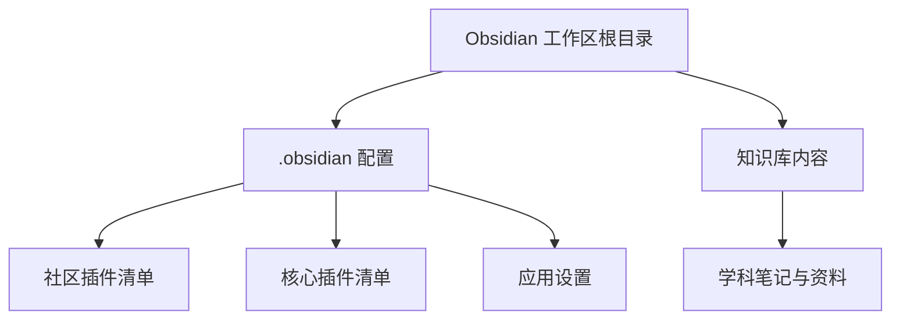
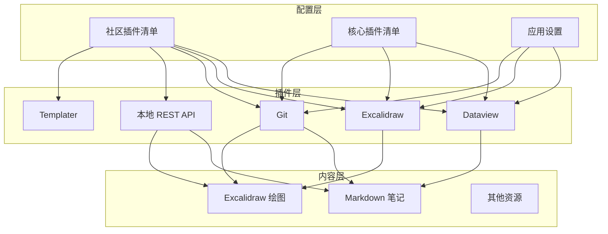
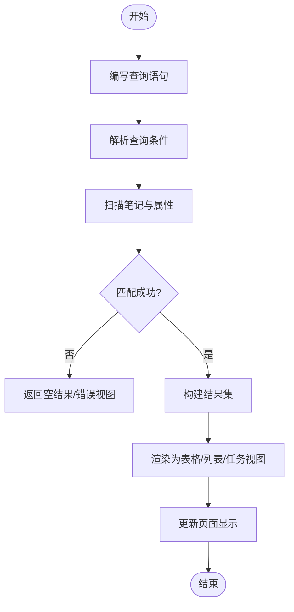
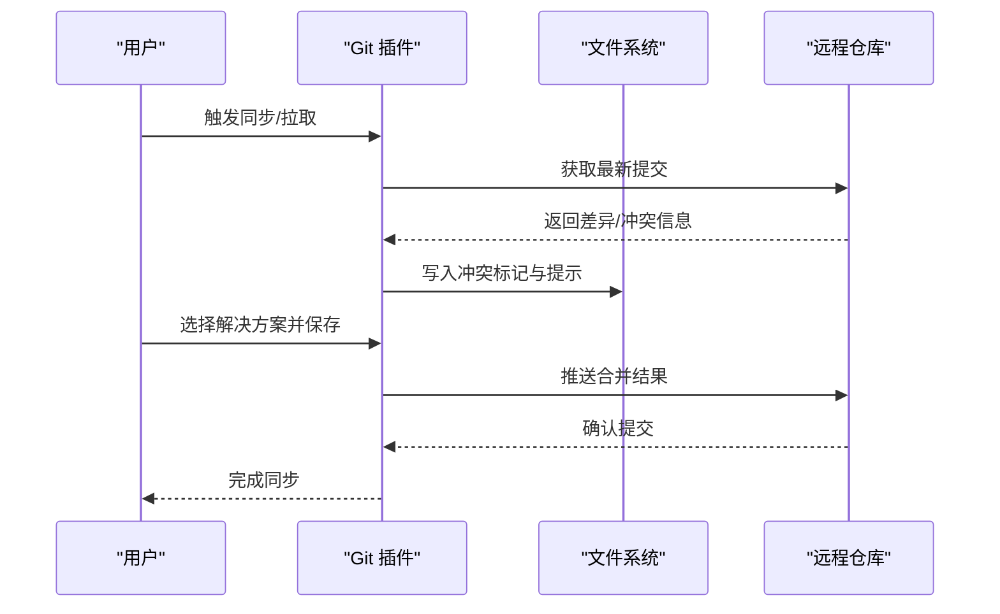
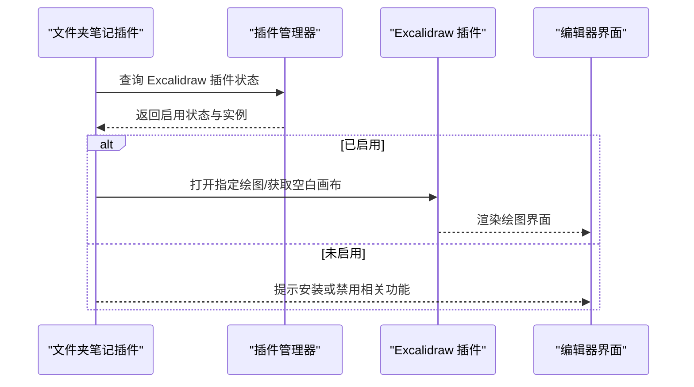
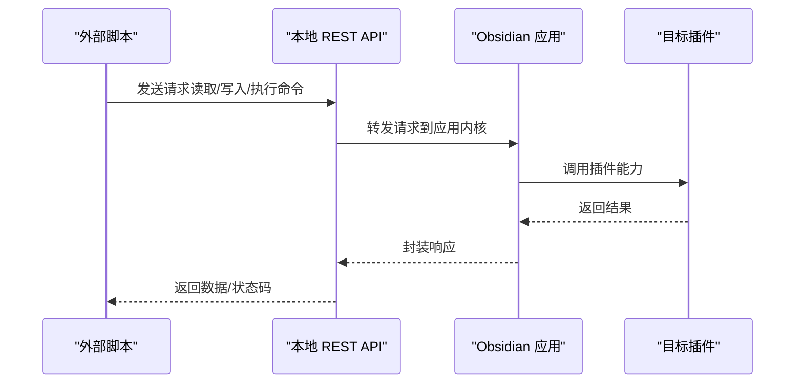
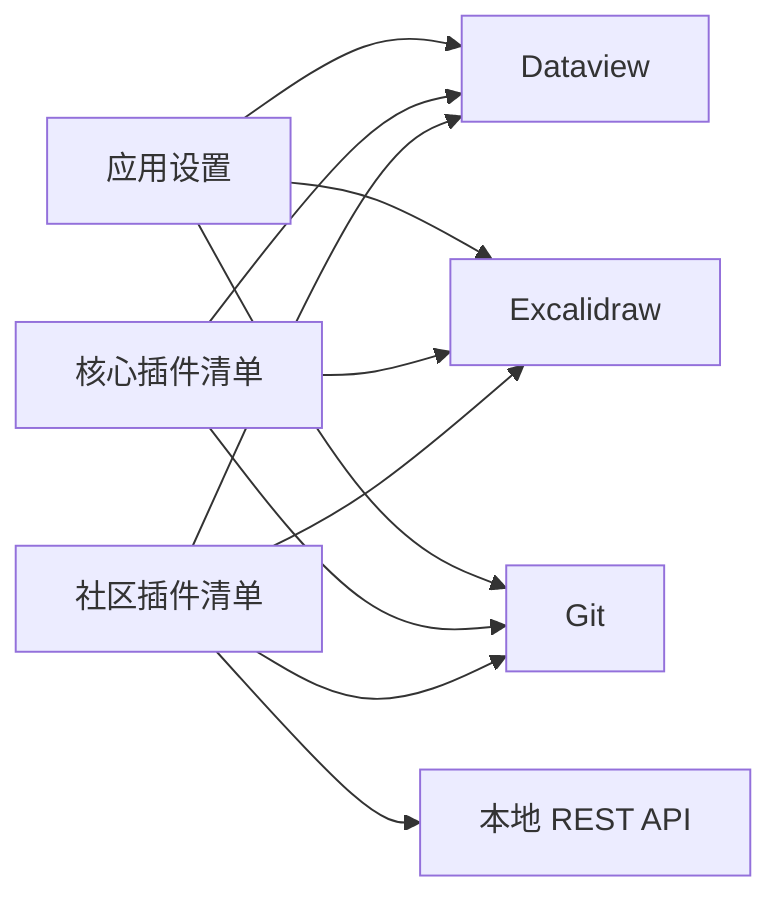

# 高级功能

<cite>
**本文引用的文件**
- [community-plugins.json](file://.obsidian\community-plugins.json)
- [core-plugins.json](file://.obsidian\core-plugins.json)
- [app.json](file://.obsidian\app.json)
- [dataview/manifest.json](file://.obsidian\plugins\dataview\manifest.json)
- [dataview/styles.css](file://.obsidian\plugins\dataview\styles.css)
- [obsidian-excalidraw-plugin/manifest.json](file://.obsidian\plugins\obsidian-excalidraw-plugin\manifest.json)
- [folder-notes/main.js](file://.obsidian\plugins\folder-notes\main.js)
- [obsidian-git/manifest.json](file://.obsidian\plugins\obsidian-git\manifest.json)
- [obsidian-git/main.js](file://.obsidian\plugins\obsidian-git\main.js)
</cite>

## 目录
1. [简介](#简介)
2. [项目结构](#项目结构)
3. [核心组件](#核心组件)
4. [架构总览](#架构总览)
5. [详细组件分析](#详细组件分析)
6. [依赖关系分析](#依赖关系分析)
7. [性能考虑](#性能考虑)
8. [故障排除指南](#故障排除指南)
9. [结论](#结论)
10. [附录](#附录)

## 简介
本章节面向高级用户，系统介绍 Obsidian 的高级能力与扩展生态，重点覆盖：
- Dataview 插件的数据查询与可视化（表格、列表、任务视图等）
- Git 集成的版本控制与协作流程
- Excalidraw 绘图工具在流程图、架构图中的使用
- 通过 API 与脚本实现自定义工作流
- 配置示例、典型场景、性能优化与排错方法

## 项目结构
仓库采用“知识库 + 插件配置”的组织方式：
- .obsidian 目录存放应用与社区插件的配置清单
- 知识内容按主题分目录组织（如 408、数一等）
- 插件以独立子目录形式存在，便于管理与升级

**图表来源**
- [community-plugins.json:1-12](file://.obsidian\community-plugins.json#L1-L12)
- [core-plugins.json:1-33](file://.obsidian\core-plugins.json#L1-L33)
- [app.json:1-4](file://.obsidian\app.json#L1-L4)

**章节来源**
- [community-plugins.json:1-12](file://.obsidian\community-plugins.json#L1-L12)
- [core-plugins.json:1-33](file://.obsidian\core-plugins.json#L1-L33)
- [app.json:1-4](file://.obsidian\app.json#L1-L4)

## 核心组件
- Dataview：提供数据视图能力，支持表格、列表、任务视图等动态展示。
- Excalidraw：用于绘制流程图、架构图、草图等可视化内容。
- Git：集成版本控制，支持自动备份、冲突解决与协作。
- 本地 REST API：暴露接口以便外部脚本或自动化流程调用。
- 模板与命令：配合 Templater 等插件提升写作效率。

**章节来源**
- [community-plugins.json:1-12](file://.obsidian\community-plugins.json#L1-L12)
- [dataview/manifest.json:1-11](file://.obsidian\plugins\dataview\manifest.json#L1-L11)
- [obsidian-excalidraw-plugin/manifest.json:1-12](file://.obsidian\plugins\obsidian-excalidraw-plugin\manifest.json#L1-L12)
- [obsidian-git/manifest.json:1-10](file://.obsidian\plugins\obsidian-git\manifest.json#L1-L10)

## 架构总览
下图展示了 Obsidian 工作区中各插件与配置的交互关系：

**图表来源**
- [community-plugins.json:1-12](file://.obsidian\community-plugins.json#L1-L12)
- [core-plugins.json:1-33](file://.obsidian\core-plugins.json#L1-L33)
- [app.json:1-4](file://.obsidian\app.json#L1-L4)
- [dataview/manifest.json:1-11](file://.obsidian\plugins\dataview\manifest.json#L1-L11)
- [obsidian-excalidraw-plugin/manifest.json:1-12](file://.obsidian\plugins\obsidian-excalidraw-plugin\manifest.json#L1-L12)
- [obsidian-git/manifest.json:1-10](file://.obsidian\plugins\obsidian-git\manifest.json#L1-L10)

## 详细组件分析

### Dataview 数据查询与可视化
- 能力概览
  - 表格视图：将笔记中的元数据与属性渲染为结构化表格，支持排序、分组与筛选。
  - 列表视图：以列表形式展示查询结果，适合快速浏览与导航。
  - 任务视图：聚合任务并支持状态管理。
  - 内联字段样式：对键值对进行高亮显示，增强可读性。
- 样式与渲染
  - 通过样式表定义表格、列表、任务项的视觉风格，包括悬停效果、边框与字体大小等。
  - 错误视图提供统一的错误提示区域，便于定位问题。
- 使用建议
  - 在笔记中使用一致的元数据命名规范，提高查询稳定性。
  - 合理拆分复杂查询，避免一次性加载过多数据导致卡顿。
  - 结合 Templater 生成动态内容，减少重复劳动。

**图表来源**
- [dataview/manifest.json:1-11](file://.obsidian\plugins\dataview\manifest.json#L1-L11)
- [dataview/styles.css:1-141](file://.obsidian\plugins\dataview\styles.css#L1-L141)

**章节来源**
- [dataview/manifest.json:1-11](file://.obsidian\plugins\dataview\manifest.json#L1-L11)
- [dataview/styles.css:1-141](file://.obsidian\plugins\dataview\styles.css#L1-L141)

### Git 版本控制与协作
- 能力概览
  - 自动备份：定期提交变更，保障数据安全。
  - 冲突解决：提供冲突标记与操作指引，辅助合并分支。
  - 协作工作流：基于远程仓库进行多人协作与历史追踪。
- 冲突处理流程
  - 当本地与远程发生冲突时，插件会列出冲突文件并提供操作说明。
  - 建议在源码模式下查看冲突，逐段替换所需内容后保存并提交。

**图表来源**
- [obsidian-git/manifest.json:1-10](file://.obsidian\plugins\obsidian-git\manifest.json#L1-L10)
- [obsidian-git/main.js:404-413](file://.obsidian\plugins\obsidian-git\main.js#L404-L413)

**章节来源**
- [obsidian-git/manifest.json:1-10](file://.obsidian\plugins\obsidian-git\manifest.json#L1-L10)
- [obsidian-git/main.js:404-413](file://.obsidian\plugins\obsidian-git\main.js#L404-L413)

### Excalidraw 绘图工具
- 能力概览
  - 在 Obsidian 中直接创建、编辑与查看 Excalidraw 绘图。
  - 支持流程图、架构图、思维导图等可视化表达。
  - 与其他插件联动，例如文件夹笔记可打开对应绘图。
- 与文件夹笔记的集成
  - 通过文件夹笔记插件检测 Excalidraw 是否启用，并在需要时打开绘图或获取空白画布。
  - 支持多种文件类型作为“文件夹笔记”，包括 Markdown、Canvas、Bases 与 Excalidraw。

**图表来源**
- [obsidian-excalidraw-plugin/manifest.json:1-12](file://.obsidian\plugins\obsidian-excalidraw-plugin\manifest.json#L1-L12)
- [folder-notes/main.js:3079-3101](file://.obsidian\plugins\folder-notes\main.js#L3079-L3101)

**章节来源**
- [obsidian-excalidraw-plugin/manifest.json:1-12](file://.obsidian\plugins\obsidian-excalidraw-plugin\manifest.json#L1-L12)
- [folder-notes/main.js:3079-3101](file://.obsidian\plugins\folder-notes\main.js#L3079-L3101)

### 通过 API 与脚本实现自定义功能
- 本地 REST API
  - 暴露 HTTP 接口，允许外部脚本或自动化流程读取/写入笔记、执行命令。
  - 适用于批量导入、定时任务、跨工具集成等场景。
- 脚本与自动化
  - 结合终端插件与脚本语言，实现复杂工作流（如批量重命名、标签整理）。
  - 与 Templater 配合，在创建笔记时自动生成结构与内容。

**图表来源**
- [community-plugins.json:1-12](file://.obsidian\community-plugins.json#L1-L12)

**章节来源**
- [community-plugins.json:1-12](file://.obsidian\community-plugins.json#L1-L12)

## 依赖关系分析
- 社区插件清单定义了启用的第三方插件集合，影响整体功能边界。
- 核心插件清单控制内置能力的开关，如搜索、图、回链、属性面板等。
- 应用设置决定全局行为，例如附件存储路径、链接更新策略。

**图表来源**
- [community-plugins.json:1-12](file://.obsidian\community-plugins.json#L1-L12)
- [core-plugins.json:1-33](file://.obsidian\core-plugins.json#L1-L33)
- [app.json:1-4](file://.obsidian\app.json#L1-L4)

**章节来源**
- [community-plugins.json:1-12](file://.obsidian\community-plugins.json#L1-L12)
- [core-plugins.json:1-33](file://.obsidian\core-plugins.json#L1-L33)
- [app.json:1-4](file://.obsidian\app.json#L1-L4)

## 性能考虑
- 控制数据量
  - 在 Dataview 查询中限制范围与字段数量，避免全库扫描。
  - 合理使用分组与排序，减少渲染开销。
- 插件协同
  - 同时启用大量插件可能增加内存占用；按需启用，关闭不常用功能。
  - 文件夹笔记支持的文件类型过多会影响性能，建议精简白名单。
- 样式与渲染
  - 自定义样式需保持简洁，避免过度复杂的 CSS 规则。
  - 大文档分页或懒加载有助于提升响应速度。

[本节为通用指导，不直接分析具体文件]

## 故障排除指南
- Dataview 错误视图
  - 当查询失败或数据缺失时，插件会显示统一错误框与提示信息，便于定位问题。
  - 检查笔记元数据格式与查询语法，确保键名一致且数据类型正确。
- Git 冲突解决
  - 遇到冲突时，按照插件提示在源码模式下逐段替换冲突块，保存后重新提交。
  - 若多次冲突，建议先拉取最新代码再合并，减少手动工作量。
- Excalidraw 无法打开
  - 确认 Excalidraw 插件已启用；若由文件夹笔记触发，检查其是否检测到插件实例。
  - 若仍无法打开，尝试重启 Obsidian 或重装插件。

**章节来源**
- [dataview/styles.css:111-123](file://.obsidian\plugins\dataview\styles.css#L111-L123)
- [obsidian-git/main.js:404-413](file://.obsidian\plugins\obsidian-git\main.js#L404-L413)
- [folder-notes/main.js:3079-3101](file://.obsidian\plugins\folder-notes\main.js#L3079-L3101)

## 结论
通过合理配置与组合 Dataview、Git、Excalidraw 以及 API/脚本能力，Obsidian 可以成为强大的个人知识管理系统与协作平台。关键在于：
- 建立一致的元数据规范与命名约定
- 控制查询范围与插件负载，保障性能
- 利用版本控制与协作流程，确保数据安全与团队协同
- 借助 API 与脚本，打通外部工具与工作流

[本节为总结性内容，不直接分析具体文件]

## 附录
- 典型场景
  - 学习进度看板：使用 Dataview 汇总课程笔记与任务状态，生成表格与列表。
  - 架构设计文档：用 Excalidraw 绘制系统架构图，并通过 Obsidian 双向链接关联知识点。
  - 团队协作：基于 Git 进行多人编辑与版本回溯，结合本地 REST API 实现自动化发布。
- 配置要点
  - 在应用设置中指定附件存储路径，便于集中管理资源。
  - 在社区插件清单中按需启用插件，避免不必要的性能损耗。
  - 在核心插件清单中开启必要的内置能力，如属性面板、大纲、书签等。

**章节来源**
- [app.json:1-4](file://.obsidian\app.json#L1-L4)
- [community-plugins.json:1-12](file://.obsidian\community-plugins.json#L1-L12)
- [core-plugins.json:1-33](file://.obsidian\core-plugins.json#L1-L33)