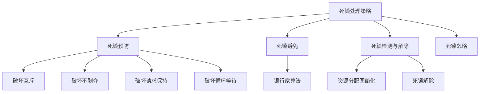

[[02-进程与线程|← 返回目录]]

# 死锁

> [!abstract] 知识定位
> 本节是操作系统进程管理的重要内容，涵盖死锁的定义、四个必要条件、处理策略（预防、避免、检测解除、忽略）、银行家算法、资源分配图等。在408统考中，本节内容通常以1-2道选择题或综合应用题的形式出现，重点考查银行家算法的安全性检查、死锁预防方法以及资源分配图的简化。

---

## 一、死锁的定义

### 1.1 死锁的概念

**死锁（Deadlock）** 是指多个进程因竞争资源而造成的一种僵局，若无外力作用，这些进程都将无法继续执行。

> [!info] 死锁的通俗理解
> 死锁就像两个人过独木桥，两人在桥中间相遇，谁也不肯退让，结果谁也过不去。

### 1.2 死锁的例子

```
进程P1                    进程P2
┌─────────┐              ┌─────────┐
│ 占有R1  │              │ 占有R2  │
│ 请求R2  │──────死锁────▶│ 请求R1  │
│ 等待... │              │ 等待... │
└─────────┘              └─────────┘
```

---

## 二、死锁产生的四个必要条件

> [!important] 必背内容
> 死锁产生的四个必要条件是408考试的高频考点，必须熟练掌握。

| 条件 | 说明 | 破坏方法 |
|:-----|:-----|:---------|
| **互斥条件** | 资源一次只能被一个进程占用 | 难以破坏（某些资源 inherently 互斥） |
| **不剥夺条件** | 进程已获得的资源不能被强制剥夺 | 允许抢占资源 |
| **请求和保持条件** | 进程持有资源的同时又请求新资源 | 一次性申请所有资源 |
| **循环等待条件** | 存在进程-资源的循环等待链 | 按序分配资源 |

> [!note] 必要条件 vs 充分条件
> 四个条件**同时满足**是死锁产生的**必要条件**，但不是**充分条件**。也就是说，死锁发生时四个条件一定都满足，但四个条件都满足时不一定发生死锁。

### 2.1 互斥条件

- **含义**：资源一次只能被一个进程使用
- **例子**：打印机、磁带机等物理设备
- **能否破坏**：通常不能，因为某些资源 inherently 需要互斥访问

### 2.2 不剥夺条件

- **含义**：进程已获得的资源，在未使用完之前，不能被其他进程强行夺走
- **能否破坏**：可以，但实现复杂，代价高

### 2.3 请求和保持条件

- **含义**：进程已经保持了至少一个资源，但又提出了新的资源请求，而该资源已被其他进程占有，此时请求进程被阻塞，但对自己已获得的资源保持不放
- **能否破坏**：可以，通过要求进程一次性申请所有需要的资源

### 2.4 循环等待条件

- **含义**：存在一种进程资源的循环等待链，链中每一个进程已获得的资源同时被链中下一个进程所请求
- **能否破坏**：可以，通过对资源进行编号，按序申请

---

## 三、死锁的处理策略

> [!important] 四种策略

| 策略 | 思路 | 优点 | 缺点 |
|:-----|:-----|:-----|:-----|
| **死锁预防** | 破坏四个必要条件之一 | 简单，一劳永逸 | 资源利用率低，系统开销大 |
| **死锁避免** | 动态检查，不进入不安全状态 | 限制条件宽松 | 需要知道未来资源需求 |
| **死锁检测与解除** | 允许死锁发生，然后检测并解除 | 资源利用率高 | 检测和解除开销大 |
| **死锁忽略** | 假装不知道死锁 | 开销最小 | 可能导致系统崩溃 |



---

## 四、死锁预防

### 4.1 破坏互斥条件

**方法**：使资源可共享使用

| 资源类型 | 方法 | 例子 |
|:---------|:-----|:-----|
| **可共享资源** | 直接共享 | 只读文件 |
| **不可共享资源** | 虚拟化技术 | SPOOLing技术将独占设备变为共享设备 |

> [!warning] 局限性
> 很多资源 inherently 需要互斥访问（如打印机），无法破坏互斥条件。

### 4.2 破坏不剥夺条件

**方法**：允许抢占资源

| 方法 | 说明 | 缺点 |
|:-----|:-----|:-----|
| **抢占等待进程的资源** | 当进程请求新资源失败时，释放已占有的资源 | 实现复杂，可能导致前功尽弃 |
| **优先级抢占** | 高优先级进程可以抢占低优先级进程的资源 | 可能导致低优先级进程饥饿 |

> [!note] 适用场景
> 状态易于保存和恢复的资源（如CPU寄存器、内存）。

### 4.3 破坏请求和保持条件

**方法1：一次性申请所有资源**

- 进程在开始执行前一次性申请所有需要的资源
- 如果所有资源都可用，则分配；否则不分配任何资源，进程等待

| 优点 | 缺点 |
|:-----|:-----|
| 简单 | 资源利用率低（进程可能长时间占用不用的资源） |
| 不会发生死锁 | 进程可能不知道需要哪些资源 |

**方法2：申请新资源前释放已占有的资源**

- 进程在申请新资源时，先释放已占有的所有资源
- 然后一次性申请所有需要的资源（包括原来的和新申请的）

### 4.4 破坏循环等待条件

**方法：按序分配资源**

- 给系统中的所有资源类型编号
- 要求每个进程按资源编号递增的顺序申请资源

```
资源编号：R1=1, R2=2, R3=3, R4=4

进程申请顺序必须递增：
- 合法：R1→R2→R4, R2→R3, R1→R3
- 非法：R2→R1, R3→R2
```

> [!success] 为什么能破坏循环等待？
> 如果所有进程都按递增顺序申请资源，则不可能出现循环等待链。因为循环等待要求链中存在一个进程持有编号大的资源而请求编号小的资源，这与按序分配矛盾。

### 4.5 死锁预防方法总结

| 破坏条件 | 方法 | 优点 | 缺点 |
|:---------|:-----|:-----|:-----|
| 互斥 | 资源共享/SPOOLing | - | 不适用所有资源 |
| 不剥夺 | 允许抢占 | - | 实现复杂，开销大 |
| 请求和保持 | 一次性申请 | 简单 | 资源利用率低 |
| 循环等待 | 按序分配 | 实现简单 | 限制用户编程自由 |

---

## 五、死锁避免

### 5.1 安全状态与不安全状态

> [!important] 核心概念

| 状态 | 定义 | 说明 |
|:-----|:-----|:-----|
| **安全状态** | 存在一个安全序列，使所有进程都能顺利完成 | 不会发生死锁 |
| **不安全状态** | 不存在安全序列 | 可能发生死锁 |

> [!note] 关键结论
> - **安全状态 → 一定不会死锁**
> - **不安全状态 → 可能死锁（不是一定死锁）**
> - 死锁避免的核心思想：**确保系统始终处于安全状态**

### 5.2 安全序列

**安全序列** 是指一个进程序列 $<P_1, P_2, ..., P_n>$，对于每个进程 $P_i$，其还需要的资源数量不超过系统当前可用资源加上所有在 $P_i$ 之前的进程 $P_j$（$j < i$）所占有的资源之和。

> [!tip] 通俗理解
> 安全序列就是找到一个"还款顺序"，使得每个"借款人"（进程）都能按顺序"还清债务"（完成执行）。

### 5.3 银行家算法

> [!important] 408核心考点
> 银行家算法是死锁避免的经典算法，也是408综合应用题的常考内容。

#### 5.3.1 数据结构

| 数据结构 | 大小 | 含义 |
|:---------|:-----|:-----|
| **Available** | 向量[m] | 系统可用资源数，Available[j]=k表示资源Rj有k个可用 |
| **Max** | 矩阵[n×m] | 各进程最大需求，Max[i,j]=k表示进程Pi最多需要k个Rj |
| **Allocation** | 矩阵[n×m] | 已分配资源，Allocation[i,j]=k表示Pi已分配k个Rj |
| **Need** | 矩阵[n×m] | 还需要的资源，Need[i,j]=Max[i,j]-Allocation[i,j] |

> [!note] 关系
> $$
> \text{Need}[i,j] = \text{Max}[i,j] - \text{Allocation}[i,j]
> $$

#### 5.3.2 安全性算法

**目的**：判断系统是否处于安全状态

```
1. 初始化：Work = Available，Finish[i] = false（所有进程）
2. 查找进程Pi，满足：
   - Finish[i] == false
   - Need[i] <= Work（Pi需要的资源不超过当前可用）
3. 如果找到这样的Pi：
   - Work = Work + Allocation[i]（Pi完成后释放资源）
   - Finish[i] = true
   - 回到步骤2
4. 如果所有进程的Finish[i]都为true，则系统处于安全状态
```

#### 5.3.3 资源请求算法

**目的**：判断进程的资源请求是否可以分配

```
1. 如果Request[i] > Need[i]，出错（请求超过最大需求）
2. 如果Request[i] > Available，进程等待（资源不足）
3. 尝试分配：
   - Available = Available - Request[i]
   - Allocation[i] = Allocation[i] + Request[i]
   - Need[i] = Need[i] - Request[i]
4. 执行安全性算法，检查是否安全
5. 如果安全，正式分配；否则，恢复原来的状态，进程等待
```

#### 5.3.4 计算示例

> [!example] 银行家算法完整示例
> 系统有5个进程P0-P4，3种资源A、B、C，总数分别为10、5、7。
>
> **初始状态**：
> | 进程 | Allocation A B C | Max A B C | Need A B C |
> |:----:|:----------------:|:---------:|:----------:|
> | P0 | 0 1 0 | 7 5 3 | 7 4 3 |
> | P1 | 2 0 0 | 3 2 2 | 1 2 2 |
> | P2 | 3 0 2 | 9 0 2 | 6 0 0 |
> | P3 | 2 1 1 | 2 2 2 | 0 1 1 |
> | P4 | 0 0 2 | 4 3 3 | 4 3 1 |
>
> Available = (3, 3, 2)
>
> **安全性检查**：
> 1. Work = (3, 3, 2)
> 2. 找Need <= Work的进程：
>    - P0: (7,4,3) > (3,3,2) ❌
>    - P1: (1,2,2) <= (3,3,2) ✅
>    - P2: (6,0,0) > (3,3,2) ❌
>    - P3: (0,1,1) <= (3,3,2) ✅
>    - P4: (4,3,1) > (3,3,2) ❌
>
> 选择P1：
> - Work = (3,3,2) + (2,0,0) = (5,3,2)
> - Finish[P1] = true
>
> 继续：
> - P3: (0,1,1) <= (5,3,2) ✅
> - Work = (5,3,2) + (2,1,1) = (7,4,3)
> - Finish[P3] = true
>
> 继续：
> - P0: (7,4,3) <= (7,4,3) ✅
> - Work = (7,4,3) + (0,1,0) = (7,5,3)
> - Finish[P0] = true
>
> 继续：
> - P2: (6,0,0) <= (7,5,3) ✅
> - Work = (7,5,3) + (3,0,2) = (10,5,5)
> - Finish[P2] = true
>
> 继续：
> - P4: (4,3,1) <= (10,5,5) ✅
> - Work = (10,5,5) + (0,0,2) = (10,5,7)
> - Finish[P4] = true
>
> **安全序列**：<P1, P3, P0, P2, P4>
> **结论**：系统处于安全状态
>
> ---
>
> **P1请求资源 (1, 0, 2)**：
> 1. Request(1,0,2) <= Need(1,2,2) ✅
> 2. Request(1,0,2) <= Available(3,3,2) ✅
> 3. 尝试分配：
>    - Available = (3,3,2) - (1,0,2) = (2,3,0)
>    - Allocation[P1] = (2,0,0) + (1,0,2) = (3,0,2)
>    - Need[P1] = (1,2,2) - (1,0,2) = (0,2,0)
>
> 4. 安全性检查：
>    - Work = (2,3,0)
>    - P1: Need(0,2,0) <= (2,3,0) ✅
>    - Work = (2,3,0) + (3,0,2) = (5,3,2)
>    - P3: Need(0,1,1) <= (5,3,2) ✅
>    - Work = (5,3,2) + (2,1,1) = (7,4,3)
>    - ...（后续同前）
>
> **安全序列**：<P1, P3, P0, P2, P4>
> **结论**：可以分配，系统仍处于安全状态

---

## 六、死锁检测与解除

### 6.1 死锁检测

#### 资源分配图（RAG, Resource Allocation Graph）

**资源分配图** 是描述进程和资源分配状态的有向图。

```
图例：
○ 进程节点
□ 资源节点（□中的圆点表示资源实例）
○ → □ 请求边：进程请求资源
□ → ○ 分配边：资源已分配给进程
```

**示例**：
```
    P1          P2
    ○ ──→ □R1 ──→ ○
    ↑     ↑↓      ↓
    └──□R2←───────┘
```

#### 死锁定理

> [!important] 死锁定理
> **如果资源分配图中不存在环路，则系统不存在死锁。**
> **如果资源分配图中存在环路，则：**
> - **每种资源只有一个实例**：环路即死锁
> - **每种资源有多个实例**：环路是死锁的必要条件，但不是充分条件

### 6.2 资源分配图简化方法

**简化步骤**：

```
1. 找出一个既不孤立又不阻塞的进程节点Pi
   （孤立：没有请求边；阻塞：请求的资源不可用）
2. 假设Pi可获得所需资源顺利运行完毕
3. 消去Pi的所有请求边和分配边，使Pi成为孤立节点
4. 重复步骤1-3，直到无法简化
5. 如果所有节点都成为孤立节点，则系统未死锁
   如果存在非孤立节点，则这些节点对应的进程处于死锁状态
```

> [!example] 资源分配图简化示例
> ```
>     P1          P2          P3
>     ○ ──→ □R1 ●──→ ○ ──→ □R2 ●──→ ○
>     ↑              ↑              ↓
>     └──────□R3●←─────────────────┘
> ```
>
> **简化过程**：
> 1. P3不阻塞（R3可用），假设P3完成，消去P3的边
> 2. P2现在不阻塞（R2可用），假设P2完成，消去P2的边
> 3. P1现在不阻塞（R1可用），假设P1完成，消去P1的边
> 4. 所有节点都孤立，**系统未死锁**

### 6.3 死锁解除

当检测到死锁后，需要采取措施解除死锁。

| 方法 | 说明 | 优点 | 缺点 |
|:-----|:-----|:-----|:-----|
| **资源剥夺** | 从死锁进程中强行剥夺资源，分配给其他进程 | 不会终止进程 | 可能导致进程反复被剥夺（饥饿） |
| **撤销进程** | 终止（撤销）一个或多个死锁进程 | 简单有效 | 进程工作可能前功尽弃 |
| **进程回退** | 让进程回退到某个检查点，释放资源 | 损失较小 | 需要记录进程状态，开销大 |

#### 撤销进程的选择策略

1. **优先级最低**：优先撤销优先级低的进程
2. **已运行时间最短**：撤销运行时间短的进程，损失小
3. **还需运行时间最长**：撤销还需时间长的进程，尽快释放资源
4. **已占用资源最少**：撤销占用资源少的进程，释放的资源可能不足以解除死锁
5. **交互式进程优先保留**：优先撤销批处理进程，保留交互式进程

---

## 七、死锁忽略

### 7.1 鸵鸟算法

**鸵鸟算法** 是指忽略死锁问题，假装死锁不会发生。

> [!info] 为什么可以忽略死锁？
> - 死锁发生的概率很低
> - 预防、避免、检测死锁的开销很大
> - 如果死锁发生，可以通过重启系统解决

### 7.2 适用场景

| 系统类型 | 是否忽略死锁 | 原因 |
|:---------|:------------:|:-----|
| **个人计算机** | 是 | 重启成本低 |
| **嵌入式系统** | 否 | 可靠性要求高 |
| **服务器** | 否 | 需要高可用性 |
| **实时系统** | 否 | 可靠性要求极高 |

---

## 八、四种策略对比

> [!success] 必背对比表

| 策略 | 时机 | 开销 | 资源利用率 | 适用场景 |
|:-----|:-----|:-----|:-----------|:---------|
| **死锁预防** | 事前 | 小 | 低 | 资源需求可预测的系统 |
| **死锁避免** | 运行时 | 中 | 中 | 需要较高可靠性的系统 |
| **死锁检测与解除** | 事后 | 大 | 高 | 资源利用率要求高的系统 |
| **死锁忽略** | 无 | 最小 | 最高 | 个人系统、死锁概率低的系统 |

---

## 九、考点总结

> [!success] 核心考点清单

### 必考点

1. **死锁四个必要条件**：互斥、不剥夺、请求和保持、循环等待
2. **死锁预防方法**：破坏四个条件的具体方法
3. **安全状态与不安全状态**：定义和区别
4. **银行家算法**：数据结构、安全性算法、资源请求算法
5. **资源分配图**：画法、简化方法、死锁定理

### 常考点

6. **死锁解除方法**：资源剥夺、撤销进程、进程回退
7. **安全序列**：定义和查找方法
8. **死锁避免 vs 死锁预防**：区别和联系

### 易混淆点

| 概念A | 概念B | 区别 |
|:------|:------|:-----|
| 安全状态 | 不安全状态 | 是否存在安全序列 |
| 不安全状态 | 死锁状态 | 不安全可能死锁，但不是一定 |
| 死锁预防 | 死锁避免 | 静态破坏条件 vs 动态检查 |
| 银行家算法 | 安全性算法 | 银行家算法包含安全性检查 |
| 资源剥夺 | 撤销进程 | 保留进程 vs 终止进程 |

### 真题回顾

> [!question] 2023年统考真题
> 下列关于银行家算法的叙述中，正确的是（）
> A. 银行家算法可以预防死锁
> B. 银行家算法可以检测死锁
> C. 银行家算法可以避免死锁
> D. 银行家算法可以解除死锁
>
> **答案：C**
> **解析**：银行家算法是死锁避免算法，通过安全性检查确保系统不进入不安全状态。

> [!question] 2022年统考真题
> 某系统有3个进程P1、P2、P3，各进程的最大资源需求和已分配资源如下表所示。系统可用资源为(2, 1, 0)。问系统是否处于安全状态？
>
> | 进程 | 已分配 | 最大需求 |
> |:----:|:------:|:--------:|
> | P1 | (1, 0, 0) | (3, 2, 1) |
> | P2 | (0, 1, 0) | (2, 1, 1) |
> | P3 | (0, 0, 1) | (2, 1, 2) |
>
> **解**：
> Need = Max - Allocation：
> - P1: (3,2,1)-(1,0,0) = (2,2,1)
> - P2: (2,1,1)-(0,1,0) = (2,0,1)
> - P3: (2,1,2)-(0,0,1) = (2,1,1)
>
> Available = (2,1,0)
>
> 检查：
> - P1: (2,2,1) > (2,1,0) ❌
> - P2: (2,0,1) > (2,1,0) ❌（第3维1>0）
> - P3: (2,1,1) > (2,1,0) ❌（第3维1>0）
>
> 没有进程的Need <= Available，**系统处于不安全状态**。

---

## 十、思维导图

```
死锁
├── 定义
│   └── 多个进程因竞争资源而僵局
├── 四个必要条件
│   ├── 互斥条件
│   ├── 不剥夺条件
│   ├── 请求和保持条件
│   └── 循环等待条件
├── 处理策略
│   ├── 死锁预防（破坏条件）
│   ├── 死锁避免（银行家算法）
│   ├── 死锁检测与解除
│   └── 死锁忽略（鸵鸟算法）
├── 银行家算法
│   ├── 数据结构
│   ├── 安全性算法
│   └── 资源请求算法
└── 资源分配图
    ├── 画法
    ├── 简化方法
    └── 死锁定理
```

---

## 参考链接

- [[02-进程与线程/进程与线程概念|进程与线程概念]]
- [[02-进程与线程/CPU调度|CPU调度]]
- [[02-进程与线程/同步与互斥|同步与互斥]]
- [[操作系统|返回操作系统总目录]]

[[操作系统|返回上一级]]
