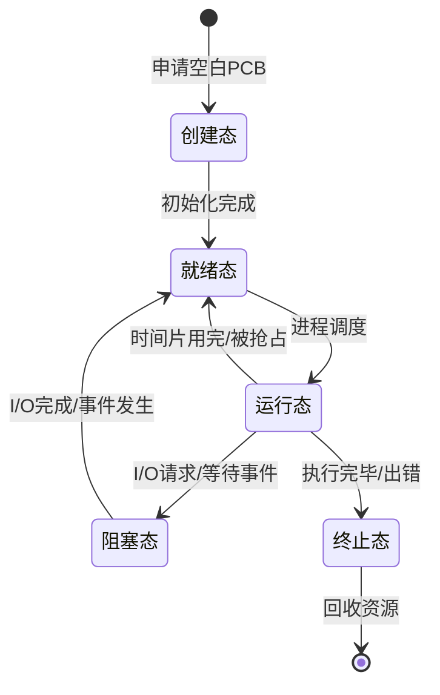
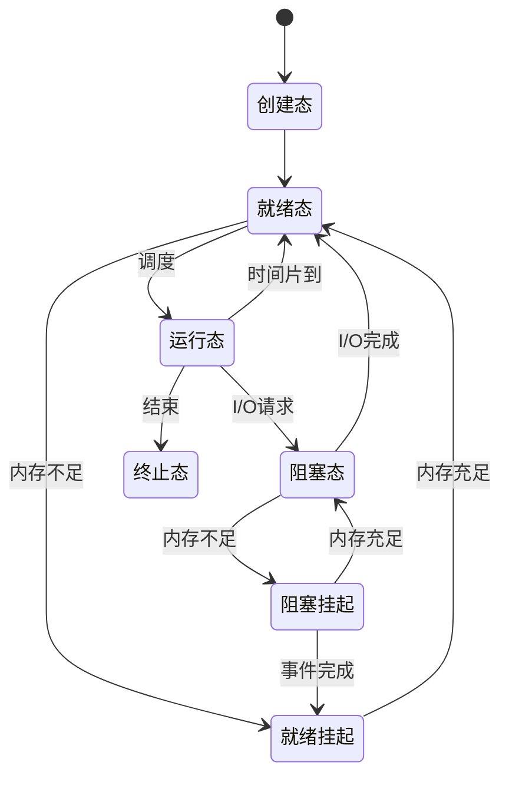

[[02-进程与线程|← 返回目录]]

# 进程与线程概念

> [!abstract] 知识定位
> 本节是操作系统进程管理的基础，涵盖进程的定义、特征、组成、状态转换、进程控制、线程概念与实现方式、进程通信等内容。在408统考中，本节内容通常以2-3道选择题的形式出现，重点考查进程与程序的区别、进程状态转换、线程实现方式对比、进程通信方式等。

---

## 一、进程的定义与特征

### 1.1 进程的定义

**进程（Process）** 是程序的一次执行过程，是系统进行资源分配和调度的独立单位。

> [!info] 进程 vs 程序
> - **程序**是静态的，是一组有序指令的集合，永久保存在存储介质上
> - **进程**是动态的，是程序的一次执行过程，有生命周期（创建→执行→终止）
> - 一个程序可以对应多个进程（如同时打开多个Word文档）
> - 一个进程可以执行多个程序（通过exec系统调用）

### 1.2 进程的特征

| 特征 | 说明 | 重要性 |
|:-----|:-----|:-------|
| **动态性** | 进程有生命周期，会创建、执行、终止 | 最基本特征 |
| **并发性** | 多个进程可以在一段时间内同时执行 | 提高资源利用率 |
| **独立性** | 进程是独立获得资源、独立运行的基本单位 | 便于管理 |
| **异步性** | 进程按各自独立的、不可预知的速度向前推进 | 需要同步机制 |
| **结构性** | 进程由程序段、数据段、PCB组成 | 便于操作系统管理 |

> [!important] 动态性是进程最基本特征
> 进程的动态性体现在：由创建而产生，由调度而执行，由撤销而消亡。程序本身不具备动态性。

### 1.3 进程与程序的区别

| 对比项 | 进程 | 程序 |
|:-------|:-----|:-----|
| **本质** | 动态的执行过程 | 静态的指令集合 |
| **生命周期** | 有（创建→执行→终止） | 无（永久存在） |
| **组成** | 程序段+数据段+PCB | 仅指令和数据 |
| **存在位置** | 内存 | 外存 |
| **数量关系** | 一个程序可对应多个进程 | 一个进程可执行多个程序 |
| **资源占用** | 占用CPU、内存、I/O等资源 | 不占用运行资源 |

---

## 二、进程的组成

### 2.1 进程的组成结构

进程由三大部分组成：

```
┌─────────────────────────────────────┐
│           进程控制块（PCB）           │  ← 进程存在的唯一标志
├─────────────────────────────────────┤
│           程序段（代码段）            │  ← 程序的指令序列
├─────────────────────────────────────┤
│           数据段                     │  ← 原始数据、中间结果、最终结果
└─────────────────────────────────────┘
```

### 2.2 进程控制块（PCB）

> [!important] 核心考点
> PCB是进程存在的唯一标志，当进程被创建时，操作系统会为其创建PCB；当进程终止时，其PCB也会被销毁。

#### PCB的内容

| 信息类别 | 具体内容 | 说明 |
|:---------|:---------|:-----|
| **进程标识信息** | 进程ID（PID）、父进程ID、用户ID | 唯一标识一个进程 |
| **处理机状态信息** | 通用寄存器、程序计数器PC、程序状态字PSW | 进程切换时保存和恢复 |
| **进程控制信息** | 进程状态、优先级、资源清单、打开文件表 | 用于进程控制和管理 |
| **调度信息** | 等待时间、执行时间、就绪队列指针 | 用于进程调度 |
| **内存信息** | 代码段地址、数据段地址、栈地址 | 内存管理使用 |
| **会计信息** | 创建时间、CPU使用时间、实际使用时间 | 计费和审计 |

#### PCB的作用

1. **标识进程**：PCB是进程存在的唯一标志
2. **记录状态**：记录进程的当前状态和运行环境
3. **支持调度**：提供调度所需的信息
4. **支持通信**：记录进程间的通信关系
5. **支持同步**：记录进程的同步和互斥信息

#### PCB的组织方式

| 组织方式 | 说明 | 特点 |
|:---------|:-----|:-----|
| **线性表** | 将所有PCB放入一个数组 | 实现简单，查找效率低 |
| **链接表** | 按状态将PCB链接成队列 | 便于管理，常用方式 |
| **索引表** | 按状态建立索引表 | 查找效率高 |

```
就绪队列：PCB1 → PCB3 → PCB5 → NULL
阻塞队列：PCB2 → PCB4 → NULL
运行指针：PCB6（单CPU系统中只有一个）
```

---

## 三、进程的状态及转换

### 3.1 进程的五种基本状态

> [!important] 必考内容
> 进程的五种状态及转换是408考试的高频考点，需要熟练掌握每种状态的含义和转换条件。

| 状态 | 英文 | 说明 |
|:-----|:-----|:-----|
| **创建态（New）** | New | 进程正在被创建，尚未加入就绪队列 |
| **就绪态（Ready）** | Ready | 进程已准备好，等待CPU调度 |
| **运行态（Running）** | Running | 进程正在CPU上执行 |
| **阻塞态（Blocked/Waiting）** | Waiting | 进程等待某事件完成（如I/O） |
| **终止态（Terminated）** | Terminated | 进程执行完毕，等待系统回收资源 |

### 3.2 五状态模型转换图



### 3.3 状态转换的详细说明

| 转换 | 触发条件 | 说明 |
|:-----|:---------|:-----|
| **创建态 → 就绪态** | 进程初始化完成，获得除CPU外的所有资源 | 进程进入就绪队列等待调度 |
| **就绪态 → 运行态** | 进程被调度程序选中，分配CPU | 从就绪队列取出，成为运行态 |
| **运行态 → 就绪态** | 时间片用完、被更高优先级进程抢占 | 回到就绪队列等待下次调度 |
| **运行态 → 阻塞态** | 请求I/O、等待某事件、申请资源失败 | 进入阻塞队列，让出CPU |
| **阻塞态 → 就绪态** | I/O完成、事件发生、资源可用 | 进入就绪队列等待调度 |
| **运行态 → 终止态** | 程序执行完毕、发生错误、被kill | 进入终止态，等待资源回收 |

> [!warning] 重要限制
> - **阻塞态不能直接转换为运行态**：必须先经过就绪态
> - **就绪态不能直接转换为阻塞态**：进程必须先在运行态才能请求I/O或等待事件

### 3.4 七状态模型（扩展）

在具有**挂起（Suspend）**功能的系统中，进程状态扩展为七种：

| 新增状态 | 说明 |
|:---------|:-----|
| **就绪挂起** | 进程在外存，只要调入内存即可运行 |
| **阻塞挂起** | 进程在外存，等待某事件 |



> [!note] 挂起的目的
> 1. **缓解内存紧张**：将暂不运行的进程换出到磁盘
> 2. **调试程序**：挂起被调试进程，方便检查状态
> 3. **系统维护**：挂起某些进程进行系统维护

---

## 四、进程控制

### 4.1 进程控制的概念

**进程控制** 是指对进程生命周期中的各种操作进行管理和控制，包括创建、终止、阻塞、唤醒、切换等。这些操作通过**原语（Primitive）**来实现。

> [!info] 原语的特点
> - **原子性**：原语操作是不可分割的，要么全做，要么全不做
> - **内核态执行**：原语在内核态下执行
> - **屏蔽中断**：执行原语时屏蔽中断，防止被中断打断

### 4.2 进程创建原语（Create）

#### 引起进程创建的事件

| 事件 | 说明 |
|:-----|:-----|
| **用户登录** | 系统为用户创建新进程 |
| **作业调度** | 批处理系统中，作业被调度时创建进程 |
| **提供服务** | 系统为用户请求创建服务进程 |
| **应用请求** | 用户程序自己创建子进程（如fork） |

#### 进程创建的过程

```
1. 申请空白PCB
2. 为新进程分配资源（内存、打开文件等）
3. 初始化PCB（填写标识信息、处理机状态信息、控制信息）
4. 将新进程插入就绪队列
```

```c
// Linux中创建进程的伪代码
pid_t fork() {
    // 1. 申请空白PCB
    PCB *new_pcb = allocate_pcb();
    
    // 2. 复制父进程的地址空间
    copy_address_space(parent, new_pcb);
    
    // 3. 复制父进程的资源（打开文件表等）
    copy_resources(parent, new_pcb);
    
    // 4. 初始化PCB（PID、状态、优先级等）
    init_pcb(new_pcb);
    
    // 5. 将子进程插入就绪队列
    insert_ready_queue(new_pcb);
    
    // 6. 返回（父进程返回子进程PID，子进程返回0）
    return child_pid;
}
```

### 4.3 进程终止原语（Terminate）

#### 引起进程终止的事件

| 事件 | 说明 |
|:-----|:-----|
| **正常结束** | 程序执行完毕，调用exit系统调用 |
| **异常结束** | 发生错误（除零、非法指令、越界访问） |
| **外界干预** | 用户或操作系统强制终止（kill命令） |
| **父进程终止** | 父进程终止时，子进程也被终止 |

#### 进程终止的过程

```
1. 从PCB集合中找到该进程的PCB
2. 若进程正在运行，立即剥夺CPU
3. 终止其所有子进程
4. 回收进程占用的所有资源
5. 从所在队列中移除该PCB
6. 释放PCB
```

### 4.4 进程阻塞原语（Block）

#### 引起进程阻塞的事件

| 事件 | 说明 |
|:-----|:-----|
| **请求I/O** | 进程请求读写文件或设备 |
| **等待资源** | 申请的资源暂时不可用 |
| **等待消息** | 等待其他进程发来的消息 |
| **等待信号** | 等待某个信号或条件成立 |

#### 进程阻塞的过程

```
1. 立即停止执行该进程
2. 将进程状态改为阻塞态
3. 将PCB插入相应的阻塞队列
4. 转调度程序，重新调度
```

### 4.5 进程唤醒原语（Wakeup）

#### 引起进程唤醒的事件

| 事件 | 说明 |
|:-----|:-----|
| **I/O完成** | 请求的I/O操作已完成 |
| **资源可用** | 等待的资源已释放 |
| **消息到达** | 等待的消息已到达 |
| **信号发生** | 等待的信号或条件已满足 |

#### 进程唤醒的过程

```
1. 从阻塞队列中找到该进程的PCB
2. 将进程状态改为就绪态
3. 将PCB从阻塞队列移出
4. 将PCB插入就绪队列
```

> [!note] 阻塞与唤醒的配对
> 进程的阻塞和唤醒必须成对出现，否则会导致进程永远阻塞（死锁的一种表现）。

### 4.6 进程切换原语（Switch）

#### 进程切换的过程

```
1. 保存当前进程的CPU现场（寄存器、PC、PSW等）到PCB
2. 修改当前进程状态（运行→就绪/阻塞）
3. 将当前进程PCB移到相应队列
4. 选择新进程执行（调度）
5. 从新进程PCB恢复CPU现场
6. 修改新进程状态为运行态
7. 跳转到新进程的程序计数器位置执行
```

> [!warning] 进程切换 vs 模式切换
> - **进程切换**：从一个进程切换到另一个进程，需要保存/恢复整个CPU现场
> - **模式切换**：用户态和内核态之间的切换（如系统调用），同一进程内，只需保存/恢复部分寄存器

---

## 五、线程的概念

### 5.1 线程的引入

> [!info] 为什么引入线程？
> 进程是资源分配单位，创建、切换、通信开销大。引入线程是为了**减小程序并发执行时的时空开销**，使并发粒度更细，并发性更好。

#### 引入线程的好处

| 好处 | 说明 |
|:-----|:-----|
| **创建更快** | 无需分配大量资源，只需创建线程控制块 |
| **切换更快** | 只需保存/恢复寄存器和栈，无需切换地址空间 |
| **通信更方便** | 同一进程内的线程共享地址空间，可直接读写数据 |
| **并发度更高** | 线程是更小的调度单位，可以更好地利用多核CPU |

### 5.2 线程的定义

**线程（Thread）** 是进程中的一个实体，是被系统独立调度和分派的基本单位。线程只拥有少量必不可少的资源（程序计数器、寄存器组、栈），但可与同属一个进程的其他线程共享进程的全部资源。

### 5.3 线程与进程的比较

> [!success] 必背对比表

| 对比项 | 进程 | 线程 |
|:-------|:-----|:-----|
| **资源拥有** | 拥有独立的地址空间和系统资源 | 共享进程的地址空间和资源 |
| **调度单位** | 传统OS中是调度单位 | 现代OS中是调度单位 |
| **并发性** | 进程间可并发 | 线程间可并发，同一进程的线程也可并发 |
| **系统开销** | 大（创建、撤销、切换开销大） | 小（创建、撤销、切换开销小） |
| **独立性** | 独立性强，一个进程崩溃不影响其他进程 | 独立性弱，一个线程崩溃可能导致整个进程崩溃 |
| **通信方式** | 需要IPC机制（管道、消息队列等） | 直接读写进程数据，无需特殊机制 |
| **切换开销** | 需要切换页表、刷新TLB | 只需保存/恢复寄存器 |

### 5.4 线程的属性

1. **轻型实体**：线程中的实体基本上不拥有系统资源
2. **独立调度和分派的基本单位**：线程是CPU调度的基本单位
3. **可并发执行**：同一进程的线程之间可以并发执行
4. **共享进程资源**：线程可以共享进程的资源

---

## 六、线程的实现方式

> [!important] 核心考点
> 线程的三种实现方式（用户级、内核级、组合方式）的对比是408考试的高频考点。

### 6.1 用户级线程（ULT, User-Level Thread）

#### 实现原理

用户级线程由**用户空间的线程库**实现，操作系统内核并不知道线程的存在，内核只调度进程。

```
用户空间                    内核空间
┌─────────────────┐        ┌─────────────┐
│  线程库管理      │        │             │
│  ┌───┐ ┌───┐   │        │   进程A      │
│  │T1 │ │T2 │   │───────▶│  （内核视角）│
│  └───┘ └───┘   │        │             │
│  ┌───┐ ┌───┐   │        └─────────────┘
│  │T3 │ │T4 │   │
│  └───┘ └───┘   │
└─────────────────┘
```

#### 特点

| 方面 | 说明 |
|:-----|:-----|
| **管理主体** | 用户空间的线程库 |
| **内核感知** | 内核不知道线程存在，只调度进程 |
| **切换开销** | 小，无需切换到内核态 |
| **阻塞影响** | 一个线程阻塞，整个进程阻塞 |
| **并行性** | 不能利用多核CPU并行（内核只看到一个进程） |
| **调度** | 由线程库调度 |

#### 优点与缺点

| 优点 | 缺点 |
|:-----|:-----|
| 线程切换不需要内核介入，开销小 | 一个线程阻塞会导致整个进程阻塞 |
| 线程库可在任何操作系统上运行，可移植性好 | 不能利用多核CPU的并行性 |
| 用户可自定义调度算法 | 内核只将CPU时间分配给进程，线程间时间分配不公平 |

### 6.2 内核级线程（KLT, Kernel-Level Thread）

#### 实现原理

内核级线程由**操作系统内核**直接支持，线程的创建、撤销、切换都在内核态完成。

```
用户空间                    内核空间
┌─────────────────┐        ┌─────────────┐
│                 │        │  线程T1      │
│   进程A          │◀───────│  线程T2      │
│                 │        │  线程T3      │
└─────────────────┘        │  线程T4      │
                           └─────────────┘
```

#### 特点

| 方面 | 说明 |
|:-----|:-----|
| **管理主体** | 操作系统内核 |
| **内核感知** | 内核知道每个线程的存在 |
| **切换开销** | 大，需要切换到内核态 |
| **阻塞影响** | 一个线程阻塞，不影响同进程的其他线程 |
| **并行性** | 可以利用多核CPU并行 |
| **调度** | 由内核调度 |

#### 优点与缺点

| 优点 | 缺点 |
|:-----|:-----|
| 一个线程阻塞不影响同进程的其他线程 | 线程切换需要内核介入，开销大 |
| 可以利用多核CPU的并行性 | 线程管理需要内核支持，可移植性差 |
| 内核可以将CPU时间直接分配给线程 | 创建线程需要内核参与，开销大 |

### 6.3 组合方式（多对多模型）

#### 实现原理

组合方式将**多个用户级线程映射到多个内核级线程**上，兼顾了两者的优点。

```
用户空间                    内核空间
┌─────────────────┐        ┌─────────────┐
│  用户线程        │        │  内核线程    │
│  ┌───┐ ┌───┐   │        │  ┌───┐      │
│  │T1 │ │T2 │   │───────▶│  │K1 │      │
│  └───┘ └───┘   │        │  └───┘      │
│  ┌───┐ ┌───┐   │        │  ┌───┐      │
│  │T3 │ │T4 │   │───────▶│  │K2 │      │
│  └───┘ └───┘   │        │  └───┘      │
│  ┌───┐         │        │  ┌───┐      │
│  │T5 │         │───────▶│  │K3 │      │
│  └───┘         │        │  └───┘      │
└─────────────────┘        └─────────────┘
```

#### 特点

| 方面 | 说明 |
|:-----|:-----|
| **映射关系** | 多对多（n个用户线程映射到m个内核线程，n ≥ m） |
| **灵活性** | 用户线程可自由创建，不受内核线程数量限制 |
| **并行性** | 可以利用多核CPU并行 |
| **阻塞影响** | 一个内核线程阻塞，只影响映射到它的用户线程 |

### 6.4 三种实现方式对比

> [!success] 必背对比表

| 特性 | 用户级线程（ULT） | 内核级线程（KLT） | 组合方式 |
|:-----|:----------------|:------------------|:---------|
| **管理者** | 用户空间线程库 | 操作系统内核 | 两者结合 |
| **切换开销** | 小（无需内核态） | 大（需要内核态） | 中等 |
| **阻塞影响** | 一个阻塞，整个进程阻塞 | 只阻塞该线程 | 只阻塞映射的线程 |
| **多核并行** | 不支持 | 支持 | 支持 |
| **线程数量** | 不受限制 | 受内核资源限制 | 用户线程不受限制 |
| **可移植性** | 好 | 差 | 较好 |
| **调度灵活性** | 高（用户自定义） | 低（内核统一调度） | 中等 |
| **代表系统** | POSIX Pthreads（用户模式） | Windows、Linux | Solaris |

### 6.5 线程模型总结

```
线程模型
├── 一对一模型（1 ULT : 1 KLT）
│   └── 每个用户线程对应一个内核线程
│   └── 并发性好，但开销大
├── 多对一模型（n ULT : 1 KLT）
│   └── 多个用户线程映射到一个内核线程
│   └── 开销小，但无法并行
└── 多对多模型（n ULT : m KLT）
    └── 多个用户线程映射到多个内核线程
    └── 兼顾灵活性和并发性
```

---

## 七、进程通信

> [!important] 核心考点
> 三种进程通信方式的对比是408考试的常考内容。

### 7.1 进程通信的概念

**进程通信（Inter-Process Communication, IPC）** 是指进程之间交换信息的过程。由于进程拥有独立的地址空间，一个进程不能直接访问另一个进程的内存，因此需要特殊的通信机制。

### 7.2 共享存储（Shared Memory）

#### 原理

在内存中开辟一块共享存储区，多个进程可以读写这块区域来实现通信。

```
进程A的地址空间              共享存储区              进程B的地址空间
┌─────────────┐            ┌─────────────┐           ┌─────────────┐
│   代码段     │            │             │           │   代码段     │
├─────────────┤            │   共享数据   │           ├─────────────┤
│   数据段     │◀──────────▶│   （映射到   │◀─────────▶│   数据段     │
├─────────────┤   映射      │   两个进程   │   映射     ├─────────────┤
│   堆        │            │   的地址空间）│           │   堆        │
├─────────────┤            │             │           ├─────────────┤
│   栈        │            └─────────────┘           │   栈        │
└─────────────┘                                      └─────────────┘
```

#### 特点

| 优点 | 缺点 |
|:-----|:-----|
| 通信效率高（无需数据拷贝） | 需要同步机制（信号量、互斥锁） |
| 适合大量数据交换 | 编程复杂，容易出现数据不一致 |

> [!note] 共享存储是最快的IPC方式
> 因为数据不需要在内核和用户空间之间复制，进程直接读写共享内存。

### 7.3 消息传递（Message Passing）

#### 原理

进程通过**发送消息**和**接收消息**两个原语进行通信，数据在内核中传递。

```
进程A                    内核                    进程B
┌─────┐               ┌─────────┐               ┌─────┐
│send │──────────────▶│ 消息队列 │◀──────────────│recv │
│(msg)│               │         │               │(msg)│
└─────┘               └─────────┘               └─────┘
```

#### 消息传递的方式

| 方式 | 说明 |
|:-----|:-----|
| **直接通信** | 发送方直接指定接收方（send(P, message)、receive(Q, message)） |
| **间接通信** | 通过信箱（邮箱）中转（send(mailbox, message)、receive(mailbox, message)） |

#### 特点

| 优点 | 缺点 |
|:-----|:-----|
| 编程简单，无需处理同步 | 需要数据拷贝，效率较低 |
| 适合分布式系统 | 消息大小受限 |

### 7.4 管道通信（Pipe）

#### 原理

管道是连接两个进程的**共享文件**，一个进程向管道写数据，另一个进程从管道读数据。

```
进程A（写）              管道（内核缓冲区）           进程B（读）
┌─────┐                 ┌─────────────┐             ┌─────┐
│write│────────────────▶│  环形缓冲区  │────────────▶│read │
└─────┘                 │  （有限大小）│             └─────┘
                        └─────────────┘
```

#### 管道的特点

1. **半双工通信**：数据只能单向流动
2. **有限大小**：管道缓冲区大小有限（如Linux中通常为64KB）
3. **互斥访问**：同一时间只能有一个进程读写
4. **同步机制**：
   - 写满时，写进程阻塞，等待读进程读取
   - 读空时，读进程阻塞，等待写进程写入

#### 管道的类型

| 类型 | 说明 |
|:-----|:-----|
| **匿名管道** | 用于父子进程间通信，无名字 |
| **命名管道（FIFO）** | 有名字，可用于无亲缘关系进程间通信 |

### 7.5 三种通信方式对比

> [!success] 必背对比表

| 特性 | 共享存储 | 消息传递 | 管道通信 |
|:-----|:---------|:---------|:---------|
| **通信方式** | 直接读写共享内存 | 发送/接收消息 | 读写管道文件 |
| **数据拷贝** | 无需拷贝（最快） | 需要内核拷贝 | 需要内核缓冲 |
| **同步机制** | 需要额外同步（信号量） | 内置同步 | 内置同步 |
| **通信方向** | 双向 | 双向 | 单向（半双工） |
| **数据格式** | 原始数据 | 结构化消息 | 字节流 |
| **编程复杂度** | 复杂 | 简单 | 简单 |
| **适用场景** | 大量数据、频繁通信 | 分布式系统、少量数据 | 父子进程通信 |
| **代表系统调用** | shmget/shmat | msgsnd/msgrcv | pipe/mkfifo |

---

## 八、考点总结

> [!success] 核心考点清单

### 必考点

1. **进程与程序的区别**：动态vs静态、有生命周期vs永久存在
2. **PCB的作用和内容**：进程存在的唯一标志、包含的信息
3. **进程五种状态及转换**：创建→就绪→运行→阻塞→终止，转换条件
4. **进程控制原语**：创建、终止、阻塞、唤醒、切换的过程
5. **线程与进程的区别**：资源拥有、调度单位、系统开销
6. **线程三种实现方式**：ULT、KLT、组合方式的对比
7. **三种进程通信方式**：共享存储、消息传递、管道的对比

### 常考点

8. **七状态模型**：就绪挂起、阻塞挂起的概念
9. **进程切换 vs 模式切换**：区别和联系
10. **fork系统调用**：父子进程的执行特点

### 易混淆点

| 概念A | 概念B | 区别 |
|:------|:------|:-----|
| 进程 | 线程 | 资源分配单位 vs 调度单位 |
| 用户级线程 | 内核级线程 | 内核是否感知线程存在 |
| 阻塞 | 就绪 | 等待事件 vs 等待CPU |
| 共享存储 | 消息传递 | 是否需要数据拷贝 |
| 进程切换 | 模式切换 | 不同进程 vs 同一进程的不同态 |

### 真题回顾

> [!question] 2024年统考真题
> 下列关于线程的叙述中，正确的是（）
> A. 用户级线程的切换需要内核支持
> B. 内核级线程的一个线程被阻塞，同进程的其他线程也被阻塞
> C. 用户级线程不能利用多核CPU的并行性
> D. 内核级线程的切换不需要进入内核态
>
> **答案：C**
> **解析**：用户级线程由线程库管理，内核不知道线程存在，因此内核只将进程作为一个调度单位，无法将不同线程分配到不同CPU核心上执行。

> [!question] 2023年统考真题
> 进程从运行态转换为就绪态的可能原因是（）
> A. 进程运行结束
> B. 进程请求I/O
> C. 时间片用完
> D. 等待的事件发生
>
> **答案：C**
> **解析**：A导致进程变为终止态；B导致进程变为阻塞态；D导致阻塞态进程变为就绪态。只有C（时间片用完或被抢占）会使运行态进程变为就绪态。

> [!question] 2022年统考真题
> 下列关于进程通信的叙述中，正确的是（）
> A. 管道通信是全双工的
> B. 消息传递不需要操作系统的支持
> C. 共享存储是最快的进程通信方式
> D. 共享存储不需要同步机制
>
> **答案：C**
> **解析**：A错，管道是半双工的；B错，消息传递需要内核支持；D错，共享存储需要额外的同步机制。

---

## 九、思维导图

```
进程与线程概念
├── 进程定义与特征
│   ├── 定义：程序的一次执行过程
│   ├── 特征：动态性、并发性、独立性、异步性、结构性
│   └── 与程序的区别
├── 进程组成
│   ├── PCB（进程存在的唯一标志）
│   ├── 程序段
│   └── 数据段
├── 进程状态
│   ├── 五状态：创建、就绪、运行、阻塞、终止
│   ├── 七状态（增加挂起）
│   └── 状态转换条件
├── 进程控制
│   ├── 创建原语
│   ├── 终止原语
│   ├── 阻塞原语
│   ├── 唤醒原语
│   └── 切换原语
├── 线程
│   ├── 引入原因：减小开销，提高并发
│   ├── 与进程的区别
│   └── 实现方式
│       ├── 用户级线程（ULT）
│       ├── 内核级线程（KLT）
│       └── 组合方式
└── 进程通信
    ├── 共享存储
    ├── 消息传递
    └── 管道通信
```

---

## 参考链接

- [[02-进程与线程/CPU调度|CPU调度]]
- [[02-进程与线程/同步与互斥|同步与互斥]]
- [[02-进程与线程/死锁|死锁]]
- [[操作系统|返回操作系统总目录]]

[[操作系统|返回上一级]]
