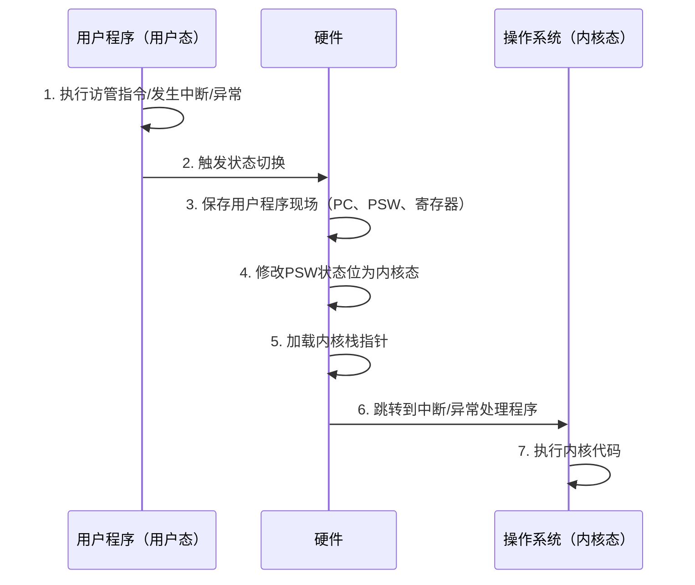
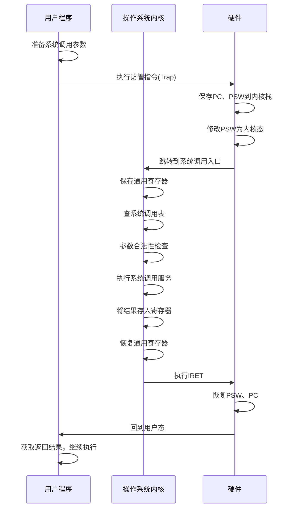

[[第一章——计算机系统概述/第一章——计算机系统概述|← 返回目录]]

# 操作系统体系结构

> [!abstract] 知识定位
> 本节介绍操作系统的体系结构设计，包括大内核与微内核的对比、分层结构和模块化结构的特点，以及内核态与用户态切换、系统调用的详细执行过程。在408统考中，本节内容通常以选择题形式出现，重点考查不同体系结构的优缺点对比和系统调用的执行过程。

---

## 一、操作系统体系结构概述

操作系统的体系结构决定了操作系统的**功能划分**、**模块组织方式**以及**运行效率**。常见的体系结构包括：

| 体系结构 | 核心思想 | 代表系统 |
|:---------|:---------|:---------|
| **简单结构** | 无结构，所有功能混杂在一起 | MS-DOS |
| **模块化结构** | 按功能划分为模块，模块间通过接口通信 | 早期UNIX |
| **分层结构** | 按功能层次组织，每层只与相邻层交互 | THE系统 |
| **大内核（宏内核）** | 大部分功能放在内核空间 | Linux、传统UNIX |
| **微内核** | 仅最基本功能放在内核，其他在用户空间 | Minix、QNX、L4 |
| **外核** | 内核只负责资源分配，库操作系统负责抽象 | Exokernel |
| **虚拟机** | 在硬件上运行多个操作系统 | VMware、Xen |

---

## 二、大内核与微内核

> [!important] 核心考点
> 大内核与微内核的对比是408考试的高频考点，需要熟练掌握二者在性能、安全性、可维护性等方面的差异。

### 2.1 大内核（Monolithic Kernel）

**大内核（宏内核）** 将操作系统的主要功能模块（进程管理、内存管理、文件系统、设备驱动等）都作为系统内核，运行在**内核态**。

#### 大内核的结构

```
┌─────────────────────────────────────┐
│           用户应用程序                │  用户态
├─────────────────────────────────────┤
│  系统调用接口                        │
├─────────────────────────────────────┤
│  进程管理 │ 内存管理 │ 文件系统 │ 设备驱动 │  内核态
│  调度    │ 虚拟内存 │ 目录管理 │ I/O控制 │
├─────────────────────────────────────┤
│           硬件抽象层                 │
├─────────────────────────────────────┤
│              硬件                    │
└─────────────────────────────────────┘
```

#### 大内核的特点

| 方面 | 特点 |
|:-----|:-----|
| **性能** | 高，因为大部分功能在内核态，减少了用户态/内核态切换 |
| **代码量** | 大，内核代码量庞大 |
| **耦合度** | 高，各模块之间紧密耦合 |
| **可维护性** | 差，修改一个模块可能影响其他模块 |
| **可靠性** | 较低，一个模块出错可能导致整个系统崩溃 |
| **安全性** | 较低，攻击面大 |
| **可扩展性** | 差，添加新功能需要修改内核 |

#### 大内核的代表

- **Linux**：采用模块化的大内核设计，支持动态加载内核模块
- **传统UNIX**：典型的大内核结构
- **Windows NT**：混合结构，但偏向大内核

### 2.2 微内核（Microkernel）

**微内核** 只将操作系统最基本的功能（进程通信、地址空间管理、线程管理、中断处理）放在内核空间，其他功能（文件系统、设备驱动、网络协议栈）作为**用户态服务**运行。

#### 微内核的结构

```
┌─────────────────────────────────────────────┐
│  文件系统服务 │ 设备驱动服务 │ 网络服务 │ 其他服务 │  用户态
├─────────────────────────────────────────────┤
│           微内核接口（消息传递）               │
├─────────────────────────────────────────────┤
│  进程通信 │ 地址空间管理 │ 线程管理 │ 中断处理 │  内核态
├─────────────────────────────────────────────┤
│              硬件抽象层                       │
├─────────────────────────────────────────────┤
│                 硬件                         │
└─────────────────────────────────────────────┘
```

#### 微内核的特点

| 方面 | 特点 |
|:-----|:-----|
| **性能** | 较低，因为需要频繁的用户态/内核态切换和进程间通信 |
| **代码量** | 小，内核代码量通常只有几千到几万行 |
| **耦合度** | 低，各服务独立运行 |
| **可维护性** | 好，各服务可以独立修改和更新 |
| **可靠性** | 高，一个服务崩溃不会影响整个系统 |
| **安全性** | 高，服务运行在用户态，权限受限 |
| **可扩展性** | 好，添加新服务不需要修改内核 |

#### 微内核的代表

- **Minix**：教学用微内核操作系统
- **QNX**：工业级微内核，广泛用于汽车、医疗设备
- **L4**：高性能微内核家族
- **Mach**：早期微内核，影响了Mac OS X

### 2.3 大内核 vs 微内核对比

> [!success] 必背对比表

| 对比维度 | 大内核 | 微内核 |
|:---------|:-------|:-------|
| **内核大小** | 大（数百万行代码） | 小（数千到数万行代码） |
| **功能位置** | 大部分在内核态 | 只有最基本功能在内核态 |
| **性能** | 高（切换少） | 较低（切换多、IPC开销） |
| **可维护性** | 差 | 好 |
| **可靠性** | 较低 | 高（服务隔离） |
| **安全性** | 较低 | 高 |
| **可扩展性** | 差 | 好 |
| **移植性** | 差 | 好 |
| **通信方式** | 直接函数调用 | 消息传递（IPC） |
| **开发难度** | 高（需要理解整个内核） | 较低（服务独立开发） |
| **代表系统** | Linux、传统UNIX | Minix、QNX、L4 |

### 2.4 混合内核（Hybrid Kernel）

**混合内核** 结合了大内核和微内核的优点，将部分关键服务放入内核态以提高性能，同时保持一定的模块化。

- **Windows NT/2000/XP/Vista/7/8/10/11**：混合内核结构
- **Mac OS X（XNU）**：基于Mach微内核和BSD大内核的混合体
- **Linux**（某种程度上）：虽然是单体内核，但支持可加载模块，具有一些微内核的特性

---

## 三、分层结构

### 3.1 分层结构的概念

**分层结构** 将操作系统按功能划分为若干层，每一层只使用其下层提供的服务，并为上层提供服务。最底层是硬件，最上层是用户接口。

### 3.2 分层结构的示例

以**THE操作系统**（Dijkstra设计）为例：

| 层次 | 功能 | 说明 |
|:----:|:-----|:-----|
| 5 | 用户程序层 | 用户应用程序 |
| 4 | 缓冲区管理层 | 管理I/O缓冲区 |
| 3 | 操作员控制台层 | 控制台通信 |
| 2 | 进程管理层 | 进程调度和同步 |
| 1 | 内存管理层 | 内存分配和虚拟内存 |
| 0 | 处理器分配层 | 处理器调度和多道程序 |

### 3.3 分层结构的优缺点

| 优点 | 缺点 |
|:-----|:-----|
| 结构清晰，易于理解和实现 | 层与层之间通信开销大 |
| 便于调试和验证（逐层验证） | 功能定位困难（某些功能跨多层） |
| 层间接口固定，便于替换实现 | 效率较低（需要逐层传递） |
| 有利于系统的维护和扩充 | 灵活性较差 |

---

## 四、模块化结构

### 4.1 模块化结构的概念

**模块化结构** 将操作系统按功能划分为若干独立的模块，每个模块完成特定的功能，模块之间通过**接口**进行通信。

### 4.2 模块化的特点

```
┌─────────────────────────────────────┐
│  主模块（内核）                      │
│  ├── 进程管理模块                   │
│  ├── 内存管理模块                   │
│  ├── 文件系统模块                   │
│  ├── 设备管理模块                   │
│  └── 网络模块（可选加载）            │
└─────────────────────────────────────┘
```

| 优点 | 缺点 |
|:-----|:-----|
| 模块独立，便于开发 | 模块间接口设计困难 |
| 支持动态加载/卸载 | 模块间可能循环依赖 |
| 提高代码复用性 | 调试困难（错误可能跨模块传播） |
| 便于维护和更新 | 性能可能受影响（间接调用） |

### 4.3 可加载内核模块（LKM）

现代操作系统（如Linux）采用**可加载内核模块**技术，允许在系统运行时动态加载和卸载内核模块。

```bash
# Linux加载内核模块
insmod module.ko

# 卸载内核模块
rmmod module

# 查看已加载模块
lsmod
```

---

## 五、内核态与用户态切换

> [!important] 高频考点
> 内核态与用户态的切换机制、特权指令、PSW寄存器是408考试的高频考点。

### 5.1 程序状态字（PSW）

**程序状态字（Program Status Word, PSW）** 是一个专门的寄存器，用于存储CPU的运行状态信息。

#### PSW的主要内容

| 字段 | 说明 |
|:-----|:-----|
| **状态标志位** | 记录CPU当前状态（内核态/用户态） |
| **条件码** | 记录上一条指令的执行结果（零、负、进位等） |
| **中断屏蔽位** | 控制中断的允许/禁止 |
| **优先级字段** | 当前运行程序的优先级 |
| **其他控制位** | 各种控制标志 |

> [!tip] PSW的关键作用
> PSW中的**状态标志位**决定了CPU当前处于内核态还是用户态。修改PSW的状态位就可以实现内核态与用户态的切换。

### 5.2 特权指令

**特权指令** 是指只能在内核态下执行的指令。用户程序在用户态下执行特权指令会触发**非法指令异常**。

| 特权指令类型 | 具体指令 | 功能 |
|:-------------|:---------|:-----|
| **I/O指令** | IN、OUT、INS、OUTS | 直接访问I/O端口 |
| **中断控制指令** | CLI、STI | 清除/设置中断允许标志 |
| **内存管理指令** | LGDT、LLDT、LTR | 加载全局/局部描述符表 |
| **特权级切换指令** | IRET、SYSRET | 从中断/系统调用返回 |
| **停机指令** | HLT | 停止CPU运行 |
| **特殊寄存器访问** | MOV CR0, reg | 访问控制寄存器 |

> [!warning] 常见陷阱
> - **访管指令（Trap/INT）**：不是特权指令，用户程序可以执行，但会触发切换到内核态
> - **设置时钟指令**：是特权指令（控制硬件资源）
> - **取数指令（Load）**：非特权指令

### 5.3 内核态与用户态切换过程

#### 用户态 → 内核态



**详细步骤**：

| 步骤 | 操作 | 说明 |
|:----:|:-----|:-----|
| 1 | 触发切换 | 系统调用、中断或异常发生 |
| 2 | 保存断点 | 将PC（程序计数器）值压入内核栈 |
| 3 | 保存PSW | 将程序状态字压入内核栈 |
| 4 | 修改PSW | 将PSW中的状态位改为内核态 |
| 5 | 保存寄存器 | 将通用寄存器内容压入内核栈 |
| 6 | 切换栈 | 从用户栈切换到内核栈 |
| 7 | 跳转执行 | 跳转到对应的中断/异常处理程序 |

#### 内核态 → 用户态

| 步骤 | 操作 | 说明 |
|:----:|:-----|:-----|
| 1 | 恢复寄存器 | 从内核栈弹出通用寄存器内容 |
| 2 | 恢复PSW | 从内核栈弹出PSW（包含用户态状态位） |
| 3 | 恢复断点 | 从内核栈弹出PC值 |
| 4 | 切换栈 | 从内核栈切换到用户栈 |
| 5 | 执行IRET | 执行中断返回指令，CPU回到用户态 |
| 6 | 继续执行 | 从断点处继续执行用户程序 |

### 5.4 状态切换的开销

每次内核态与用户态的切换都需要：

1. **保存/恢复现场**：寄存器、PSW、PC等
2. **切换栈**：用户栈 ↔ 内核栈
3. **缓存失效**：切换可能导致TLB和缓存失效
4. **安全检查**：验证系统调用参数等

> [!note] 为什么微内核性能较低？
> 微内核将许多服务放在用户态，导致需要频繁地进行用户态/内核态切换和进程间通信（IPC），这些切换和通信带来了额外的开销。

---

## 六、系统调用

> [!important] 核心考点
> 系统调用的分类、执行过程、参数传递方式是408考试的常考内容。

### 6.1 系统调用的概念

**系统调用** 是操作系统提供给用户程序请求操作系统服务的接口。用户程序通过执行**访管指令（Trap/INT）**主动陷入内核态，请求操作系统完成特定功能。

> [!info] 系统调用 vs 普通函数调用
> | 对比项 | 系统调用 | 普通函数调用 |
> |:-------|:---------|:-------------|
> | 执行环境 | 用户态 → 内核态 → 用户态 | 始终在用户态 |
> | 调用方式 | 访管指令（Trap） | CALL指令 |
> | 开销 | 大（需要状态切换） | 小（栈操作） |
> | 安全性 | 高（内核验证参数） | 低 |
> | 功能范围 | 操作系统服务 | 程序内部功能 |

### 6.2 系统调用的分类

#### 6.2.1 进程控制类

| 系统调用 | 功能 | 说明 |
|:---------|:-----|:-----|
| `fork()` | 创建子进程 | 复制父进程的地址空间 |
| `exit()` | 终止进程 | 释放进程占用的资源 |
| `wait()` | 等待子进程结束 | 父进程阻塞等待 |
| `exec()` | 执行新程序 | 用新程序替换当前进程映像 |
| `getpid()` | 获取进程ID | 返回当前进程标识符 |

#### 6.2.2 文件操作类

| 系统调用 | 功能 | 说明 |
|:---------|:-----|:-----|
| `open()` | 打开文件 | 返回文件描述符 |
| `read()` | 读文件 | 从文件读取数据到缓冲区 |
| `write()` | 写文件 | 将缓冲区数据写入文件 |
| `close()` | 关闭文件 | 释放文件描述符 |
| `lseek()` | 定位文件指针 | 改变文件读写位置 |
| `creat()` | 创建文件 | 创建新文件 |

#### 6.2.3 设备管理类

| 系统调用 | 功能 | 说明 |
|:---------|:-----|:-----|
| `ioctl()` | 设备控制 | 对设备进行特殊控制操作 |
| `read()`/`write()` | 设备读写 | 对设备进行数据读写 |

#### 6.2.4 信息维护类

| 系统调用 | 功能 | 说明 |
|:---------|:-----|:-----|
| `getpid()` | 获取进程ID | |
| `getuid()` | 获取用户ID | |
| `alarm()` | 设置定时器 | 指定时间后发送信号 |
| `time()` | 获取系统时间 | |

#### 6.2.5 通信类

| 系统调用 | 功能 | 说明 |
|:---------|:-----|:-----|
| `pipe()` | 创建管道 | 用于父子进程间通信 |
| `shmget()` | 创建共享内存 | 用于进程间共享数据 |
| `semop()` | 信号量操作 | P/V操作 |
| `msgget()` | 创建消息队列 | 用于进程间消息传递 |
| `socket()` | 创建套接字 | 网络通信 |

### 6.3 系统调用的执行过程

#### 6.3.1 执行流程

```
用户程序
    │
    ▼
┌─────────────────┐
│ 1. 准备参数     │  用户态
│ 2. 执行访管指令 │
└─────────────────┘
    │
    ▼ 触发陷入（Trap）
┌─────────────────┐
│ 3. 切换到内核态 │
│ 4. 保存现场     │  内核态
│ 5. 查系统调用表 │
│ 6. 执行服务程序 │
│ 7. 恢复现场     │
│ 8. 切换回用户态 │
└─────────────────┘
    │
    ▼
继续执行用户程序
```

#### 6.3.2 详细步骤

| 步骤 | 操作 | 说明 |
|:----:|:-----|:-----|
| 1 | 准备参数 | 将系统调用号和参数放入指定位置 |
| 2 | 执行访管指令 | 执行Trap/INT指令，触发异常 |
| 3 | 切换内核态 | CPU从用户态切换到内核态 |
| 4 | 保存现场 | 保存PC、PSW、寄存器等 |
| 5 | 查系统调用表 | 根据系统调用号查找对应的服务程序入口 |
| 6 | 参数检查 | 内核检查参数的合法性 |
| 7 | 执行服务 | 执行系统调用服务程序 |
| 8 | 返回结果 | 将结果放入指定寄存器或内存位置 |
| 9 | 恢复现场 | 恢复之前保存的状态 |
| 10 | 切换用户态 | CPU从内核态切换回用户态 |
| 11 | 继续执行 | 从访管指令之后继续执行 |



### 6.4 系统调用的参数传递方式

> [!success] 三种参数传递方式

| 方式 | 说明 | 优点 | 缺点 | 适用场景 |
|:-----|:-----|:-----|:-----|:---------|
| **寄存器传递** | 将参数放入通用寄存器 | 速度快，无需内存访问 | 参数数量有限（受寄存器数量限制） | 参数较少时 |
| **堆栈传递** | 将参数压入用户栈，传递栈指针 | 参数数量不限 | 需要内存访问，速度较慢 | 参数较多时 |
| **内存块传递** | 将参数放入内存块，传递块地址 | 适合大量参数，结构清晰 | 需要额外内存访问 | 大量参数或复杂结构 |

#### 寄存器传递示例

```c
// x86-64 Linux系统调用约定
// 系统调用号放在 rax 寄存器
// 参数依次放在 rdi, rsi, rdx, r10, r8, r9 寄存器

// 示例：write(fd, buf, count)
// rax = 1 (write的系统调用号)
// rdi = fd (文件描述符)
// rsi = buf (缓冲区地址)
// rdx = count (写入字节数)
```

#### 堆栈传递示例

```c
// 将参数压入用户栈
push count
push buf
push fd

// 执行系统调用
int 0x80  // 触发中断，切换到内核态

// 内核从用户栈读取参数
```

---

## 七、体系结构对比总结

### 7.1 各种体系结构综合对比

| 特性 | 简单结构 | 分层结构 | 模块化 | 大内核 | 微内核 |
|:-----|:---------|:---------|:-------|:-------|:-------|
| 复杂度 | 低 | 中 | 中 | 高 | 低（内核） |
| 性能 | 高 | 低 | 中 | 高 | 较低 |
| 可维护性 | 差 | 好 | 较好 | 差 | 好 |
| 可靠性 | 差 | 中 | 中 | 较低 | 高 |
| 可扩展性 | 差 | 中 | 好 | 差 | 好 |
| 安全性 | 差 | 中 | 中 | 较低 | 高 |
| 适用场景 | 嵌入式 | 教学 | 通用 | 桌面/服务器 | 实时/嵌入式 |

### 7.2 现代操作系统的发展趋势

1. **模块化大内核**：Linux采用可加载模块，兼顾性能和灵活性
2. **混合内核**：Windows和Mac OS X结合大内核和微内核优点
3. **虚拟化支持**：硬件辅助虚拟化（Intel VT-x、AMD-V）
4. **安全增强**：地址空间布局随机化（ASLR）、数据执行保护（DEP）

---

## 八、考点总结

> [!success] 核心考点清单

### 必考点

1. **大内核 vs 微内核**：性能、可维护性、可靠性、安全性对比
2. **内核态与用户态切换**：切换时机、PSW作用、切换过程
3. **特权指令**：哪些是特权指令，哪些不是
4. **系统调用执行过程**：从访管指令到返回的完整流程
5. **系统调用参数传递**：三种传递方式的特点

### 常考点

6. **分层结构**：层次划分的原则和优缺点
7. **模块化结构**：模块化的优缺点和LKM技术
8. **混合内核**：现代操作系统的内核设计趋势

### 易混淆点

| 概念A | 概念B | 区别 |
|:------|:------|:-----|
| 大内核 | 微内核 | 功能在内核态还是用户态 |
| 系统调用 | 库函数 | 是否切换到内核态 |
| 访管指令 | 特权指令 | 访管指令不是特权指令 |
| 中断 | 异常 | 来源不同（外部/内部） |
| 用户态→内核态 | 内核态→用户态 | 触发条件和执行指令不同 |

### 真题回顾

> [!question] 2024年统考真题
> 在微内核结构中，文件系统应该运行在（）
> A. 内核态  B. 用户态  C. 既可以内核态也可以用户态  D. 取决于具体实现
>
> **答案：B**
> **解析**：微内核结构将文件系统等非核心服务放在用户态运行，只有进程通信、地址空间管理等最基本功能在内核态。

> [!question] 2023年统考真题
> 下列关于系统调用的叙述中，正确的是（）
> A. 系统调用与库函数的实现方式相同
> B. 系统调用执行时不需要切换到内核态
> C. 系统调用是操作系统为用户程序提供的接口
> D. 系统调用的参数只能通过寄存器传递
>
> **答案：C**
> **解析**：系统调用是操作系统提供的接口（A错，库函数是语言提供的；B错，系统调用必须切换到内核态；D错，参数传递有三种方式）。

> [!question] 2021年统考真题
> 执行系统调用时，CPU的状态会从用户态切换到内核态，这一转换是通过（）实现的
> A. 硬件中断  B. 特权指令  C. 访管指令  D. I/O指令
>
> **答案：C**
> **解析**：系统调用通过执行访管指令（Trap/INT）触发，使CPU从用户态切换到内核态。

---

## 九、思维导图

```
操作系统体系结构
├── 体系结构类型
│   ├── 简单结构（MS-DOS）
│   ├── 分层结构（THE系统）
│   ├── 模块化结构（早期UNIX）
│   ├── 大内核（Linux）
│   ├── 微内核（Minix、QNX）
│   ├── 外核（Exokernel）
│   └── 虚拟机（VMware）
├── 大内核 vs 微内核
│   ├── 大内核：性能高、可维护性差
│   └── 微内核：性能较低、可靠性高
├── 内核态与用户态
│   ├── PSW寄存器
│   ├── 特权指令
│   ├── 切换时机
│   └── 切换过程
└── 系统调用
    ├── 分类（进程/文件/设备/信息/通信）
    ├── 执行过程
    └── 参数传递方式
```

---

## 参考链接

- [[第一章——计算机系统概述/操作系统概述|操作系统概述]]
- [[第二章——进程与线程|下一章：进程与线程]]
- [[操作系统|返回操作系统总目录]]

[[操作系统|返回上一级]]
