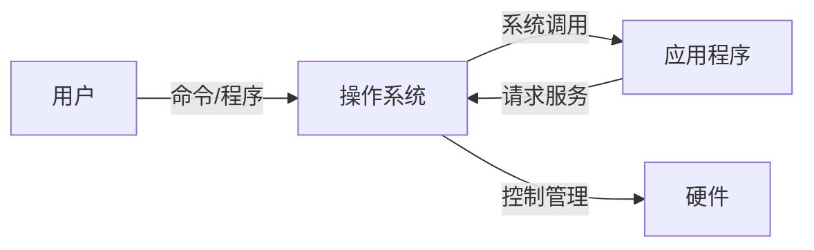
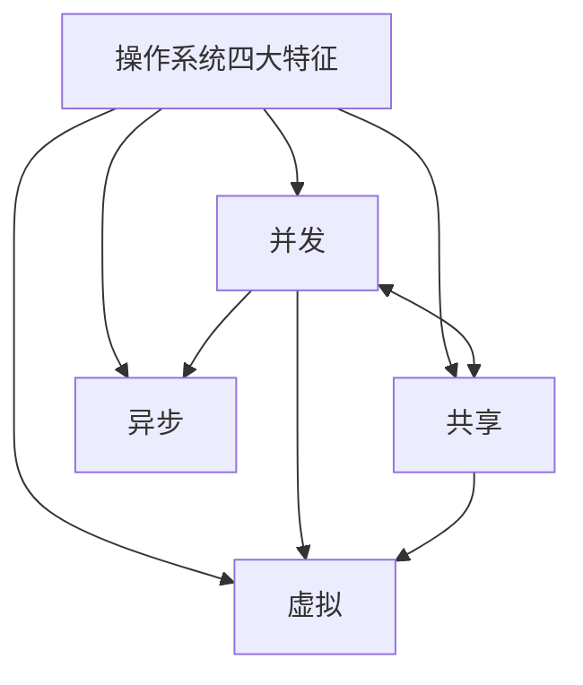
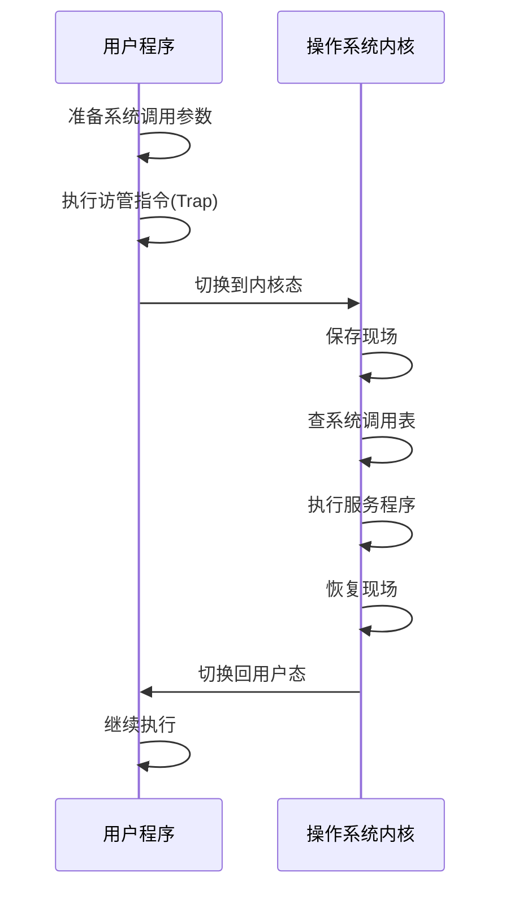

[[第一章——计算机系统概述/第一章——计算机系统概述|← 返回目录]]

# 操作系统概述

> [!abstract] 知识定位
> 本节是操作系统课程的基础，涵盖操作系统的定义、功能、特征、发展历程及运行环境。在408统考中，本节内容通常以1-2道选择题的形式出现，重点考查操作系统的四大特征、运行环境（内核态/用户态、中断/异常、系统调用）等核心概念。

---

## 一、操作系统的定义

### 1.1 概念定义

**操作系统（Operating System, OS）** 是控制和管理整个计算机系统的硬件和软件资源，合理地组织调度计算机的工作和资源的分配，进而为用户和其他软件提供方便接口与环境的**程序集合**。

> [!info] 操作系统是系统软件
> 操作系统是最基本的系统软件，它直接运行在硬件之上，是用户和计算机硬件系统之间的接口，也是计算机系统资源的管理者。

### 1.2 操作系统的目标

| 目标 | 说明 |
|:-----|:-----|
| **方便性** | 提供友好的用户接口，使计算机更易使用 |
| **有效性** | 提高系统资源的利用率和吞吐量 |
| **可扩充性** | 易于增加新的功能和修改现有功能 |
| **开放性** | 遵循标准规范，实现软硬件的互操作性 |

### 1.3 操作系统的作用



1. **作为用户与计算机硬件系统之间的接口**
   - 命令接口（联机/脱机）
   - 程序接口（系统调用）
   - 图形用户接口（GUI）

2. **作为计算机系统资源的管理者**
   - 处理机管理
   - 存储器管理
   - I/O设备管理
   - 文件管理

3. **实现对计算机资源的抽象**
   - 将物理资源抽象为逻辑资源
   - 隐藏硬件操作的细节

---

## 二、操作系统的五大功能

> [!important] 核心考点
> 操作系统的五大管理功能是408考试的常考内容，需准确记忆每个功能的管理对象和核心任务。

### 2.1 处理机管理（进程管理）

处理机管理是操作系统**最核心的功能**，因为处理机（CPU）是计算机系统中最宝贵的资源。

| 子功能 | 说明 |
|:-------|:-----|
| **进程控制** | 创建、撤销、阻塞、唤醒进程 |
| **进程同步** | 协调多个进程的执行顺序，避免竞争条件 |
| **进程通信** | 实现进程之间的信息交换 |
| **处理机调度** | 按一定算法从就绪队列中选择进程分配CPU |

### 2.2 存储器管理

存储器管理的主要任务是**为多道程序的运行提供良好的环境**，提高存储器的利用率。

| 子功能 | 说明 |
|:-------|:-----|
| **内存分配与回收** | 为进程分配内存空间，进程结束后回收 |
| **地址映射** | 将逻辑地址转换为物理地址 |
| **内存保护** | 确保各进程在自己的内存空间运行，互不干扰 |
| **内存扩充** | 利用虚拟存储技术，从逻辑上扩充内存容量 |

### 2.3 文件管理

文件管理负责管理**外存上的信息**。

| 子功能 | 说明 |
|:-------|:-----|
| **文件存储空间管理** | 管理外存空间，分配和回收存储块 |
| **目录管理** | 建立、维护文件目录，实现按名存取 |
| **文件的读写管理** | 提供读写接口，控制文件的存取 |
| **文件保护** | 防止文件被非法使用，控制访问权限 |

### 2.4 设备管理

设备管理用于管理计算机系统中的**所有I/O设备**。

| 子功能 | 说明 |
|:-------|:-----|
| **缓冲管理** | 管理I/O缓冲区，缓和CPU与I/O设备速度不匹配的矛盾 |
| **设备分配** | 根据设备类型和分配算法为进程分配设备 |
| **设备处理** | 实现CPU与设备控制器之间的通信 |
| **设备独立性** | 用户程序中使用逻辑设备名，与实际物理设备无关 |

### 2.5 用户接口

操作系统向用户提供了**三种类型的接口**：

| 接口类型 | 说明 | 使用方式 |
|:---------|:-----|:---------|
| **命令接口** | 用户通过命令直接控制作业运行 | 命令行输入 |
| **程序接口** | 用户程序请求操作系统服务的接口 | 系统调用 |
| **图形接口** | 以图形方式提供的操作环境 | 鼠标点击、拖拽 |

> [!tip] 联机命令接口 vs 脱机命令接口
> - **联机命令接口（交互式）**：用户输入一条命令，系统立即执行并返回结果（如Shell）
> - **脱机命令接口（批处理）**：用户将一组命令写入作业控制说明书，系统按说明书批量执行（如批处理脚本）

---

## 三、操作系统的四大特征

> [!important] 必考内容
> 并发、共享、虚拟、异步是操作系统的四大基本特征，其中**并发和共享是最基本的特征**，二者互为存在条件。

### 3.1 并发（Concurrency）

**并发**是指两个或多个事件在**同一时间间隔内**发生。在操作系统中，并发是指宏观上在一段时间内有多道程序在同时运行，但微观上这些程序是交替执行的。

> [!warning] 并发 vs 并行
> - **并发（Concurrency）**：宏观同时，微观交替（单核CPU即可实现）
> - **并行（Parallelism）**：真正意义上的同时执行（需要多核CPU支持）
>
> 例如：单核CPU上运行多个程序是并发；多核CPU上不同核心同时运行不同程序是并行。

**并发的意义**：
- 提高系统资源利用率
- 提高系统吞吐量
- 改善用户体验

### 3.2 共享（Sharing）

**共享**是指系统中的资源可供内存中多个并发执行的进程共同使用。

| 共享方式 | 说明 | 例子 |
|:---------|:-----|:-----|
| **互斥共享** | 资源在一段时间内只允许一个进程访问 | 打印机、磁带机 |
| **同时共享** | 资源在一段时间内允许多个进程同时访问 | 磁盘、内存 |

> [!note] 并发与共享的关系
> 并发和共享是操作系统**最基本的两个特征**，二者互为存在条件：
> - 如果系统不支持并发，就不需要共享
> - 如果系统不能实现共享，并发就无法实现

### 3.3 虚拟（Virtual）

**虚拟**是指把一个物理实体变为若干逻辑上的对应物。物理实体是实际存在的，而逻辑上的对应物是用户感受到的。

| 虚拟技术 | 物理实体 | 逻辑对应物 |
|:---------|:---------|:-----------|
| **虚拟处理器** | 一个CPU | 多个逻辑CPU（让每个用户感觉自己独占CPU） |
| **虚拟内存** | 一定容量的内存 | 更大的逻辑地址空间 |
| **虚拟设备** | 一台I/O设备 | 多台逻辑I/O设备（SPOOLing技术） |

### 3.4 异步（Asynchronism）

**异步**是指进程的执行走走停停，以不可预知的速度向前推进。这是由并发和共享导致的必然结果。

**异步性的特点**：
- 进程的推进速度不可预知
- 但只要运行环境相同，操作系统必须保证多次运行进程的结果相同
- 操作系统需要保证在异步环境下程序执行的可再现性

### 3.5 四大特征关系图



> [!success] 特征总结
> - **最基本特征**：并发、共享
> - **并发是前提**，共享是并发带来的需求
> - **虚拟是技术**，通过并发和共享实现
> - **异步是结果**，由并发导致

---

## 四、操作系统的发展历程

### 4.1 发展脉络

```
手工操作阶段 → 批处理阶段 → 分时系统 → 实时系统 → 网络操作系统 → 分布式操作系统
```

### 4.2 各阶段详细对比

| 发展阶段 | 时间 | 特点 | 优点 | 缺点 |
|:---------|:-----|:-----|:-----|:-----|
| **手工操作** | 1940s | 用户亲自操作计算机，纸带输入 | 简单直接 | 资源利用率极低，人机矛盾突出 |
| **单道批处理** | 1950s | 作业成批输入，逐个执行 | 减少人工干预 | 内存中只有一道作业，CPU空闲等待I/O |
| **多道批处理** | 1960s | 多道作业同时在内存，交替执行 | 资源利用率高，吞吐量大 | 无交互性，周转时间长 |
| **分时系统** | 1960s | 将CPU时间划分为时间片，轮流为多个终端服务 | 人机交互好，多用户共享 | 不能优先处理紧急任务 |
| **实时系统** | 1960s+ | 在规定时间内完成处理并做出响应 | 响应及时，可靠性高 | 资源利用率相对较低 |
| **网络OS** | 1980s+ | 实现网络中资源共享和通信 | 资源共享，通信便利 | 依赖网络环境 |
| **分布式OS** | 1990s+ | 多台计算机协同工作，用户透明 | 分布性、并行性、透明性 | 复杂度高 |

### 4.3 多道批处理系统

> [!important] 多道程序设计技术
> 多道程序设计技术是指在内存中同时存放若干道程序，使它们在管理程序的控制下相互穿插地运行。

**多道批处理系统的特点**：
1. **多道性**：内存中同时存在多个作业
2. **无序性**：作业完成顺序与进入内存顺序无关
3. **调度性**：需要作业调度和进程调度
4. **无交互性**：用户提交作业后无法干预

**多道批处理需要解决的问题**：
- 处理机争用问题
- 内存分配与保护问题
- I/O设备管理问题
- 文件组织与管理问题
- 作业管理问题

### 4.4 分时系统

**分时系统**是指在一台主机上连接多个带有显示器和键盘的终端，同时允许多个用户通过自己的终端以交互方式使用计算机，共享主机中的资源。

**分时系统的特征**：

| 特征 | 说明 |
|:-----|:-----|
| **多路性** | 多个用户同时使用一台计算机 |
| **交互性** | 用户通过终端与系统进行人机对话 |
| **独立性** | 各用户互不干扰，独立操作 |
| **及时性** | 用户请求能在较短时间内获得响应（通常1-3秒） |

**分时系统实现的关键技术**：
- **时间片轮转**：将CPU时间划分为固定大小的时间片
- **优先级调度**：保证紧急任务优先执行

### 4.5 实时系统

**实时系统**是指系统能及时响应外部事件的请求，在规定的时间内完成对该事件的处理，并控制所有实时任务协调一致地运行。

| 类型 | 要求 | 应用场景 |
|:-----|:-----|:---------|
| **硬实时系统** | 必须在绝对严格的规定时间内完成 | 工业控制、航空航天、军事 |
| **软实时系统** | 偶尔违反时间规定不会导致严重后果 | 多媒体系统、信息查询 |

**实时系统的特征**：
1. **及时性**：响应时间极短（毫秒级甚至微秒级）
2. **可靠性**：高度可靠，容错能力强
3. **确定性**：系统行为可预测

---

## 五、操作系统的运行环境

### 5.1 内核态与用户态

> [!important] 高频考点
> 内核态与用户态的区别、特权指令、状态切换是408考试的高频考点。

#### 5.1.1 两种运行状态

| 状态 | 别名 | 特点 | 可执行指令 |
|:-----|:-----|:-----|:-----------|
| **内核态** | 管态、核心态、系统态 | 操作系统运行的状态，可访问所有资源 | 所有指令（包括特权指令） |
| **用户态** | 目态、用户模式 | 用户程序运行的状态，访问受限 | 非特权指令 |

#### 5.1.2 特权指令与非特权指令

**特权指令**是指只能在内核态下执行的指令，主要包括：

| 类型 | 具体指令 | 说明 |
|:-----|:---------|:-----|
| **I/O指令** | IN、OUT等 | 直接控制I/O设备 |
| **中断指令** | CLI、STI等 | 控制中断的开启和关闭 |
| **内存管理指令** | 修改页表、段表 | 控制内存管理寄存器 |
| **特殊寄存器操作** | 修改PSW、加载程序状态字 | 改变CPU运行状态 |
| **停机指令** | HLT | 停止CPU运行 |

**非特权指令**是用户程序可以执行的指令，如算术运算、逻辑运算、数据传输等。

> [!warning] 常见陷阱
> - **设置时钟指令**：属于特权指令（控制硬件）
> - **取数指令（Load）**：非特权指令
> - **访管指令（Trap/Int）**：非特权指令，但会触发切换到内核态

#### 5.1.3 状态切换


**用户态 → 内核态的切换时机**：
1. **系统调用**：用户程序主动请求操作系统服务
2. **中断**：外部设备发出中断请求
3. **异常**：程序执行过程中发生错误（如缺页、除零）

**内核态 → 用户态的切换时机**：
- 操作系统完成服务后，通过**中断返回指令（IRET）**将CPU状态恢复为用户态

> [!tip] 状态切换的本质
> 状态切换的本质是修改**程序状态字（PSW）**中的状态标志位。PSW是一个专门的寄存器，用于存储CPU的运行状态信息。

### 5.2 中断与异常

#### 5.2.1 中断与异常的概念

| 类型 | 别名 | 来源 | 性质 | 例子 |
|:-----|:-----|:-----|:-----|:-----|
| **中断** | 外中断 | CPU外部 | 异步 | I/O完成、时钟中断、键盘中断 |
| **异常** | 内中断、陷入、例外 | CPU内部 | 同步 | 除零、缺页、非法指令、系统调用 |

> [!note] 同步 vs 异步
> - **同步**：事件的发生与程序执行有确定的时序关系，可以预知
> - **异步**：事件的发生与程序执行无关，随机出现

#### 5.2.2 中断的分类

```
中断（外中断）
├── 可屏蔽中断（INTR）
│   └── 可以通过中断屏蔽字屏蔽的中断
│   └── 例子：I/O设备中断、定时器中断
└── 不可屏蔽中断（NMI）
    └── 必须立即响应的中断
    └── 例子：电源故障、内存校验错误
```

#### 5.2.3 异常的分类

| 类型 | 说明 | 例子 |
|:-----|:-----|:-----|
| **陷阱（Trap）** | 有意的异常，用于系统调用 | 执行INT/Trap指令 |
| **故障（Fault）** | 可能可恢复的异常 | 缺页异常、除零错误 |
| **终止（Abort）** | 不可恢复的致命错误 | 硬件故障、双重故障 |

#### 5.2.4 中断/异常的处理过程

```
1. 关中断（保护现场不被打断）
2. 保存断点（将PC值压入栈中）
3. 识别中断源（确定是哪个设备/原因引起的中断）
4. 保存现场（保存通用寄存器等状态信息）
5. 执行中断服务程序（处理中断）
6. 恢复现场（恢复寄存器状态）
7. 开中断
8. 中断返回（恢复PC，继续执行原程序）
```

> [!important] 注意
> - 中断处理过程在**内核态**下执行
> - 进入中断处理程序时，CPU自动从用户态切换到内核态
> - 中断返回时，CPU从内核态切换回用户态

#### 5.2.5 中断向量

**什么是中断向量**：每个中断源（中断类型）都有一个唯一编号，称为**中断号（中断类型码）**。该中断号对应的**中断服务程序（ISR）的入口地址**，就称为**中断向量**。

**中断向量里有什么**：

| 组成部分 | 内容 | 说明 |
|:---------|:-----|:-----|
| **中断向量** | 中断服务程序的入口地址 | 本质就是一个地址（部分体系结构还附带PSW/段地址等信息） |
| **中断向量表** | 所有中断向量的集合 | 按中断号顺序存放在内存的固定区域，中断号即表内索引 |

**中断向量的作用**：

```
中断发生 → CPU获得中断号 → 以中断号为索引查中断向量表
→ 取出对应中断向量（ISR入口地址） → 跳转到该地址执行中断服务程序
```

即：中断向量建立了**中断号 → 中断服务程序**的映射，使CPU能迅速定位并跳转到正确的处理程序。

> [!warning] 易混淆辨析（高频考点）
> - **中断号**：中断源的编号，是身份标识
> - **中断向量**：中断服务程序的**入口地址**，不是中断源的标识，也不是中断向量表的地址
> - **中断向量表**：中断向量的有序集合，存放在内存固定区域
> - 常见陷阱题："中断向量表中存放的是____" → 答案是**中断服务程序的入口地址**

### 5.3 系统调用

#### 5.3.1 系统调用的概念

**系统调用**是操作系统提供给用户程序请求操作系统服务的接口。用户程序通过执行**访管指令（Trap/INT）**主动陷入内核态，请求操作系统完成特定功能。

> [!info] 系统调用 vs 库函数
> - **系统调用**：是操作系统内核提供的接口，执行时会切换到内核态
> - **库函数**：是编程语言提供的封装，可能调用系统调用，也可能不调用
>
> 例如：C语言的`printf()`是库函数，它内部会调用`write()`系统调用。

#### 5.3.2 系统调用的分类

| 类别 | 功能说明 | 典型系统调用 |
|:-----|:---------|:-------------|
| **进程控制** | 创建、终止、阻塞、唤醒进程 | fork、exit、wait、exec |
| **文件操作** | 文件的创建、打开、读写、关闭 | open、read、write、close |
| **设备管理** | 设备的请求、释放、读写 | ioctl、read、write |
| **信息维护** | 获取/设置系统信息 | getpid、gettime、setlimit |
| **通信** | 进程间通信 | pipe、shmget、semop、msgget |

#### 5.3.3 系统调用的执行过程

```
1. 用户程序执行访管指令（Trap/INT）
2. CPU从用户态切换到内核态
3. 保存用户程序的现场（寄存器、PC等）
4. 根据系统调用号查找系统调用表
5. 执行对应的系统调用服务程序
6. 恢复用户程序的现场
7. CPU从内核态切换回用户态
8. 继续执行用户程序
```



#### 5.3.4 参数传递方式

系统调用的参数传递有三种方式：

| 方式 | 说明 | 优点 | 缺点 |
|:-----|:-----|:-----|:-----|
| **寄存器传递** | 将参数放入寄存器 | 速度快 | 参数数量有限 |
| **堆栈传递** | 将参数压入用户栈 | 参数数量不限 | 需要内存访问 |
| **内存块传递** | 将参数放入内存块，传递块地址 | 适合大量参数 | 需要额外内存访问 |

---

## 六、计算示例

### 6.1 CPU执行时间计算

> [!example] 经典计算题
> CPU执行时间的基本计算公式：

$$
\text{CPU执行时间} = \text{指令数} \times \text{CPI} \times \text{时钟周期}
$$

或

$$
\text{CPU执行时间} = \frac{\text{指令数} \times \text{CPI}}{\text{时钟频率}}
$$

其中：
- **指令数**：程序执行的指令总数
- **CPI（Cycles Per Instruction）**：每条指令的平均时钟周期数
- **时钟周期**：一个时钟周期的时间（秒）
- **时钟频率**：每秒的时钟周期数（Hz）

#### 例题

> [!example] 例题1
> 某计算机的时钟频率为2GHz，某程序在该计算机上运行需要执行 $10^9$ 条指令，其平均CPI为2。求该程序的执行时间。
>
> **解**：
> $$
> \text{CPU执行时间} = \frac{10^9 \times 2}{2 \times 10^9} = 1 \text{秒}
> $$

> [!example] 例题2
> 某程序在A机器上运行时间为10秒，A机器的时钟频率为2GHz。现在设计B机器，希望该程序在B机器上运行时间缩短为6秒。B机器的时钟频率提高到A机器的1.5倍，但由于硬件结构变化，B机器上该程序的CPI是A机器的1.2倍。问B机器能否达到设计要求？
>
> **解**：
> 设A机器上程序的指令数为 $I$，CPI为 $CPI_A$
> $$
> 10 = \frac{I \times CPI_A}{2 \times 10^9}
> $$
>
> B机器：时钟频率 $f_B = 1.5 \times 2GHz = 3GHz$， $CPI_B = 1.2 \times CPI_A$
> $$
> T_B = \frac{I \times CPI_B}{f_B} = \frac{I \times 1.2 \times CPI_A}{3 \times 10^9}
> $$
> $$
> = \frac{1.2}{3} \times \frac{I \times CPI_A}{10^9} = 0.4 \times \frac{I \times CPI_A}{10^9}
> $$
>
> 由A机器：$\frac{I \times CPI_A}{10^9} = 20$
> $$
> T_B = 0.4 \times 20 = 8 \text{秒}
> $$
>
> **结论**：B机器上程序执行时间为8秒，大于设计目标的6秒，**不能达到设计要求**。

### 6.2 性能指标计算

| 指标 | 公式 | 说明 |
|:-----|:-----|:-----|
| **CPU执行时间** | $IC \times CPI \times T$ | 程序实际运行时间 |
| **MIPS** | $\frac{f}{CPI \times 10^6}$ | 每秒百万条指令数 |
| **MFLOPS** | $\frac{\text{浮点操作次数}}{\text{执行时间} \times 10^6}$ | 每秒百万次浮点操作 |
| **吞吐量** | $\frac{\text{完成作业数}}{\text{总时间}}$ | 单位时间完成的作业数 |
| **周转时间** | 作业提交到完成的时间 | 包含等待和执行时间 |

---

## 七、考点总结

> [!success] 核心考点清单

### 必考点

1. **操作系统四大特征**：并发、共享、虚拟、异步的含义及关系
2. **五大功能**：处理机管理、存储器管理、文件管理、设备管理、用户接口
3. **内核态与用户态**：区别、特权指令、切换时机
4. **中断与异常**：分类、区别、处理过程
5. **系统调用**：概念、分类、执行过程

### 常考点

6. **发展历程**：各阶段特点、多道批处理、分时系统、实时系统
7. **CPU执行时间计算**：$T = IC \times CPI \times T_{clock}$
8. **接口类型**：命令接口（联机/脱机）、程序接口、图形接口

### 易混淆点

| 概念A | 概念B | 区别 |
|:------|:------|:-----|
| 并发 | 并行 | 并发是交替执行，并行是真正同时 |
| 中断 | 异常 | 中断来自外部异步，异常来自内部同步 |
| 系统调用 | 普通函数调用 | 系统调用会切换到内核态 |
| 内核态 | 用户态 | 内核态可执行特权指令 |
| 联机接口 | 脱机接口 | 联机即时交互，脱机批量执行 |

### 真题回顾

> [!question] 2023年统考真题
> 下列操作中，必须在核心态下执行的是（）
> A. 读时钟  B. 取数指令  C. 系统调用  D. 寄存器清零
>
> **答案：C**
> **解析**：系统调用需要切换到内核态执行。读时钟和取数指令可以在用户态执行，寄存器清零也是非特权操作。

> [!question] 2022年统考真题
> 下列关于操作系统结构的叙述中，正确的是（）
> A. 大内核结构的操作系统运行效率高，但可维护性差
> B. 微内核结构的操作系统运行效率高，且可维护性好
> C. 大内核结构的操作系统运行效率低，但可维护性好
> D. 微内核结构的操作系统运行效率低，且可维护性差
>
> **答案：A**
> **解析**：大内核将大部分功能放在内核空间，减少了用户态和内核态的切换，运行效率高，但代码量大、耦合度高，可维护性差。微内核相反。

---

## 八、思维导图

```
操作系统概述
├── 定义与目标
│   ├── 定义：管理硬件软件资源，提供接口
│   ├── 目标：方便性、有效性、可扩充性、开放性
│   └── 作用：用户接口、资源管理、资源抽象
├── 五大功能
│   ├── 处理机管理（进程控制、同步、通信、调度）
│   ├── 存储器管理（分配、映射、保护、扩充）
│   ├── 文件管理（空间、目录、读写、保护）
│   ├── 设备管理（缓冲、分配、处理、独立性）
│   └── 用户接口（命令、程序、图形）
├── 四大特征
│   ├── 并发（最基本）
│   ├── 共享（最基本）
│   ├── 虚拟
│   └── 异步
├── 发展历程
│   ├── 手工操作
│   ├── 批处理（单道→多道）
│   ├── 分时系统
│   ├── 实时系统
│   └── 网络/分布式
└── 运行环境
    ├── 内核态/用户态
    ├── 中断/异常
    └── 系统调用
```

---

## 参考链接

- [[第一章——计算机系统概述/操作系统体系结构|操作系统体系结构]]
- [[第二章——进程与线程|下一章：进程与线程]]
- [[操作系统|返回操作系统总目录]]

[[操作系统|返回上一级]]
