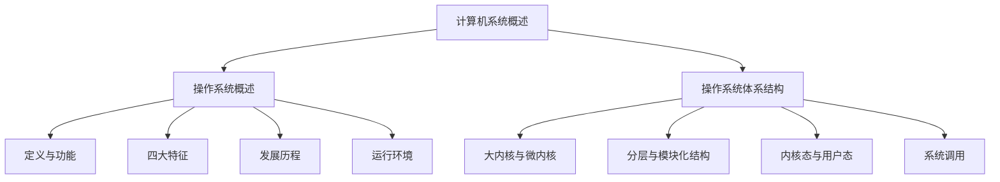

[[操作系统|返回上一级]]

# 第一章——计算机系统概述

> [!abstract] 章节概述
> 本章是操作系统课程的开篇章节，主要介绍操作系统的基本概念、功能、特征、发展历程以及运行环境。本章内容在408统考中通常以选择题形式出现，分值约为2-4分。重点掌握操作系统的四大特征、五大功能、运行环境（内核态与用户态、中断与异常、系统调用）等核心概念。

---

## 本章知识框架

---

## 本章包含的笔记

| 序号 | 笔记名称 | 主要内容 | 重要程度 |
|:----:|:--------|:--------|:--------:|
| 1 | [[第一章——计算机系统概述/操作系统概述\|操作系统概述]] | 定义、功能、特征、发展历程、运行环境 | ★★★★★ |
| 2 | [[第一章——计算机系统概述/操作系统体系结构\|操作系统体系结构]] | 体系结构对比、内核态/用户态、系统调用 | ★★★★☆ |

---

## 考点分布与分值统计

> [!tip] 历年真题考点
> - **2024年**：操作系统特征、系统调用执行过程（2分）
> - **2023年**：中断与异常分类、内核态与用户态切换（2分）
> - **2022年**：操作系统功能、发展历程（2分）
> - **2021年**：系统调用、特权指令（2分）
> - **2020年**：操作系统特征、中断处理（2分）

| 考点 | 考查频率 | 常见题型 |
|:-----|:--------:|:--------|
| 操作系统四大特征 | 高频 | 选择题 |
| 内核态与用户态 | 高频 | 选择题 |
| 中断与异常 | 高频 | 选择题 |
| 系统调用 | 高频 | 选择题 |
| 大内核/微内核对比 | 中频 | 选择题 |
| 发展历程 | 低频 | 选择题 |

---

## 核心概念速查

### 操作系统四大特征

> [!info] 并发、共享、虚拟、异步
> 1. **并发（Concurrency）**：两个或多个事件在同一时间间隔内发生
> 2. **共享（Sharing）**：系统中的资源可供多个并发执行的进程共同使用
> 3. **虚拟（Virtual）**：把一个物理实体变为若干逻辑上的对应物
> 4. **异步（Asynchronism）**：进程的执行走走停停，以不可预知的速度向前推进

### 五大管理功能

| 功能 | 管理对象 | 核心任务 |
|:-----|:--------|:--------|
| 处理机管理 | CPU | 进程控制、进程同步、进程通信、调度 |
| 存储器管理 | 内存 | 内存分配、地址映射、内存保护、虚拟内存 |
| 文件管理 | 文件 | 文件存储空间管理、目录管理、读写管理、保护 |
| 设备管理 | I/O设备 | 缓冲管理、设备分配、设备处理、虚拟设备 |
| 用户接口 | 用户 | 命令接口、程序接口（系统调用）、图形接口 |

### 运行环境核心概念

| 概念 | 说明 |
|:-----|:-----|
| **内核态（管态）** | CPU可执行所有指令，访问所有资源 |
| **用户态（目态）** | CPU只能执行非特权指令，访问受限资源 |
| **中断** | 来自CPU外部的异步事件（如I/O完成、时钟中断） |
| **异常（内中断/陷入）** | 来自CPU内部的同步事件（如除零、缺页、系统调用） |
| **系统调用** | 用户程序请求操作系统服务的接口 |

---

## 学习建议

> [!warning] 易混淆点
> 1. **并发 vs 并行**：并发是宏观同时微观交替，并行是真正意义上的同时执行（需要多核支持）
> 2. **中断 vs 异常**：中断来自外部、异步；异常来自内部、同步
> 3. **内核态 vs 用户态**：区分哪些指令是特权指令，哪些操作会触发状态切换
> 4. **系统调用 vs 普通函数调用**：系统调用会触发陷入指令，切换到内核态执行

### 复习重点

1. **必须掌握**：四大特征的含义与相互关系、五大功能的具体内容
2. **重点理解**：内核态与用户态的区别、中断与异常的分类
3. **熟练应用**：系统调用的执行过程、CPU执行时间的计算
4. **了解即可**：各代操作系统的具体实现细节

---

## 相关章节链接

- [[第二章——进程与线程|下一章：进程与线程]]
- [[操作系统|返回操作系统总目录]]

---

> [!success] 本章目标
> 完成本章学习后，你应该能够：
> - [x] 准确描述操作系统的定义、功能和特征
> - [x] 理解操作系统的发展历程及各阶段特点
> - [x] 掌握内核态与用户态的区别及切换机制
> - [x] 区分中断与异常，理解其处理过程
> - [x] 理解系统调用的作用及执行过程
> - [x] 比较大内核与微内核的优缺点

[[操作系统|返回上一级]]
