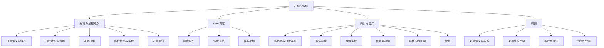

[[操作系统|返回上一级]]

# 第二章——进程与线程

> [!abstract] 章节概述
> 本章是操作系统课程的核心章节，涵盖进程与线程的基本概念、CPU调度算法、进程同步与互斥、死锁等核心内容。在408统考中，本章分值约为8-12分，既有选择题也有综合应用题。进程同步与互斥、调度算法计算、银行家算法是本章的重中之重。

---

## 本章知识框架



---

## 本章包含的笔记（按主题分组）

### 一、进程与线程模型

| 序号 | 笔记名称 | 主要内容 | 重要程度 |
|:----:|:--------|:--------|:--------:|
| 1 | [[第二章——进程与线程/进程概念与进程控制\|进程概念与进程控制]] | 进程定义、状态转换、PCB、进程控制原语 | ★★★★★ |
| 2 | [[第二章——进程与线程/线程\|线程]] | 线程概念、ULT/KLT、线程实现方式 | ★★★★★ |
| 3 | [[第二章——进程与线程/进程通信与考点\|进程通信与考点]] | 通信方式、考点总结、思维导图 | ★★★★☆ |

### 二、CPU 调度

| 序号 | 笔记名称 | 主要内容 | 重要程度 |
|:----:|:--------|:--------|:--------:|
| 4 | [[第二章——进程与线程/调度基础（概念、时机与性能指标）\|调度基础]] | 调度层次、调度时机、性能指标公式 | ★★★★★ |
| 5 | [[第二章——进程与线程/调度算法与考点\|调度算法与考点]] | 各类调度算法及计算、对比总结 | ★★★★★ |

### 三、同步与互斥（原巨型笔记拆分为 4 篇）

| 序号 | 笔记名称 | 主要内容 | 重要程度 |
|:----:|:--------|:--------|:--------:|
| 6 | [[第二章——进程与线程/同步与互斥基础（临界区与软硬件实现）\|同步与互斥基础]] | 临界资源/临界区四区、同步准则、软件/硬件实现 | ★★★★★ |
| 7 | [[第二章——进程与线程/信号量机制\|信号量机制]] | P/V操作、信号量值反推、前驱图实现 | ★★★★★ |
| 8 | [[第二章——进程与线程/经典同步问题\|经典同步问题]] | 生产者消费者、读者写者、哲学家就餐 | ★★★★★ |
| 9 | [[第二章——进程与线程/管程与考点总结\|管程与考点总结]] | 管程组成、银行账户例、考点与思维导图 | ★★★★☆ |
| 10 | [[第二章——进程与线程/死锁\|死锁]] | 死锁条件、处理策略、银行家算法、资源分配图 | ★★★★☆ |

---

## 考点分布与分值统计

> [!tip] 历年真题考点
> - **2024年**：调度算法计算、信号量应用（4分）
> - **2023年**：进程状态转换、银行家算法（6分）
> - **2022年**：经典同步问题、死锁预防（6分）
> - **2021年**：调度算法、进程同步（8分）
> - **2020年**：银行家算法综合题（7分）

| 考点 | 考查频率 | 常见题型 |
|:-----|:--------:|:--------|
| 进程状态转换 | 高频 | 选择题 |
| 线程实现方式对比 | 高频 | 选择题 |
| 调度算法计算 | 高频 | 选择题/综合题 |
| 信号量与PV操作 | 高频 | 选择题/综合题 |
| 经典同步问题 | 高频 | 综合题 |
| 银行家算法 | 中频 | 选择题/综合题 |
| 死锁处理策略 | 中频 | 选择题 |
| 进程通信方式 | 中频 | 选择题 |

---

## 核心概念速查

### 进程 vs 线程

| 对比项 | 进程（Process） | 线程（Thread） |
|:-------|:----------------|:---------------|
| **定义** | 程序的一次执行过程 | CPU调度的基本单位 |
| **资源拥有** | 拥有独立的地址空间和资源 | 共享进程的地址空间和资源 |
| **调度单位** | 传统上是调度单位 | 现代OS中的调度单位 |
| **并发性** | 进程间可并发 | 线程间可并发 |
| **系统开销** | 大（创建、切换开销大） | 小（创建、切换开销小） |
| **通信** | 需要特殊机制（IPC） | 直接读写进程数据 |
| **独立性** | 独立 | 依赖于进程 |

### 进程五种状态

```
        创建
         │
         ▼
    ┌─────────┐  调度      ┌─────────┐
    │  就绪   │───────────▶│  运行   │
    └─────────┘            └─────────┘
         ▲                      │
         │  时间片到/被抢占      │ I/O请求/等待事件
         │                      ▼
         │                 ┌─────────┐
         │                 │  阻塞   │
         │                 └─────────┘
         │                      │
         │                      │ I/O完成/事件发生
         │                      ▼
         │                 ┌─────────┐
         │                 │  终止   │
         │                 └─────────┘
```

### 调度算法速查

| 算法 | 类型 | 特点 | 优点 | 缺点 |
|:-----|:-----|:-----|:-----|:-----|
| **FCFS** | 非抢占 | 先来先服务 | 简单公平 | 对短作业不利（护航效应） |
| **SJF** | 非抢占 | 短作业优先 | 平均等待时间最小 | 可能饥饿长作业 |
| **SRTN** | 抢占 | 最短剩余时间优先 | 响应快 | 开销大，可能饥饿 |
| **优先级** | 两者皆可 | 按优先级调度 | 灵活 | 可能饥饿低优先级 |
| **HRRN** | 非抢占 | 高响应比优先 | 兼顾长短作业 | 需要计算响应比 |
| **RR** | 抢占 | 时间片轮转 | 公平，响应好 | 时间片大小难定 |
| **多级反馈队列** | 抢占 | 动态调整优先级 | 综合性能好 | 复杂 |

### 死锁四条件

> [!danger] 死锁必要条件（Coffman条件）
> 1. **互斥条件**：资源一次只能被一个进程占用
> 2. **不剥夺条件**：进程已获得的资源不能被强制剥夺
> 3. **请求和保持条件**：进程持有资源的同时又请求新资源
> 4. **循环等待条件**：存在进程-资源的循环等待链

---

## 学习建议

> [!warning] 易混淆点
> 1. **进程 vs 线程**：进程是资源分配单位，线程是调度单位
> 2. **抢占式 vs 非抢占式**：抢占式可以强制收回CPU，非抢占式必须等进程主动放弃
> 3. **P操作 vs V操作**：P是申请资源（可能阻塞），V是释放资源（可能唤醒）
> 4. **死锁预防 vs 死锁避免**：预防是破坏条件，避免是银行家算法检查安全性
> 5. **饥饿 vs 死锁**：饥饿是无限等待，死锁是循环等待

### 复习重点

1. **必须掌握**：进程状态转换、调度算法计算、PV操作、银行家算法
2. **重点理解**：线程实现方式对比、经典同步问题解法
3. **熟练应用**：调度算法性能指标计算、安全性算法
4. **了解即可**：管程的实现细节

---

## 相关章节链接

- [[第一章——计算机系统概述/第一章——计算机系统概述|上一章：计算机系统概述]]
- [[第三章——内存管理|下一章：内存管理]]
- [[操作系统|返回操作系统总目录]]

---

> [!success] 本章目标
> 完成本章学习后，你应该能够：
> - [x] 理解进程与线程的区别和联系
> - [x] 掌握进程五种状态及转换条件
> - [x] 熟练计算各种调度算法的性能指标
> - [x] 使用信号量解决同步互斥问题
> - [x] 独立完成生产者-消费者、哲学家就餐、读者-写者问题的代码
> - [x] 掌握银行家算法的安全性检查
> - [x] 理解死锁的预防、避免、检测和解除方法

[[操作系统|返回上一级]]
