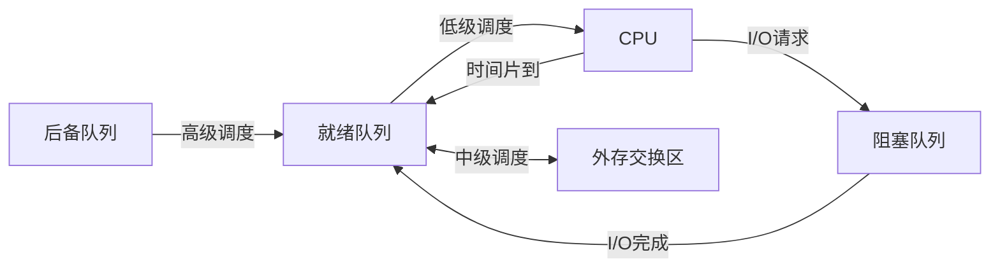

[[第二章——进程与线程/第二章——进程与线程|← 返回目录]]

# 调度基础（概念、时机与性能指标）

## 一、调度的基本概念

### 1.1 调度的定义

**处理机调度** 是指按照某种策略从就绪队列中选取一个进程，将CPU分配给它执行。调度的目的是**提高CPU利用率**、**提高系统吞吐量**、**减少进程等待时间**。

### 1.2 调度的三个层次

> [!important] 核心考点
> 三级调度的概念、功能和关系是408考试的基础考点。

| 调度层次 | 别名 | 调度对象 | 频率 | 功能 |
|:---------|:-----|:---------|:-----|:-----|
| **高级调度** | 作业调度、长程调度 | 作业 | 最低（分钟级） | 决定哪些作业可进入内存 |
| **中级调度** | 内存调度 | 进程 | 中等 | 决定哪些进程挂起/解挂 |
| **低级调度** | 进程调度、短程调度 | 进程 | 最高（毫秒级） | 决定哪个进程获得CPU |

#### 高级调度（作业调度）

- **调度对象**：作业（Job）
- **发生时机**：作业进入系统时
- **主要功能**：
  1. 从后备队列中选择作业进入内存
  2. 为选中的作业创建进程
  3. 分配必要的资源
- **特点**：频率最低，每次调度间隔时间较长

#### 中级调度（内存调度）

- **调度对象**：进程
- **发生时机**：内存紧张时
- **主要功能**：
  1. 将暂时不能运行的进程换出到外存（挂起）
  2. 将具备运行条件的进程换入内存（解挂）
- **目的**：提高内存利用率和系统吞吐量

#### 低级调度（进程调度）

- **调度对象**：进程/线程
- **发生时机**：非常频繁
- **主要功能**：从就绪队列中选择一个进程，将CPU分配给它
- **特点**：频率最高，是操作系统最核心的调度

### 1.3 三级调度的关系



### 1.4 调度准则与作业类型

#### 调度准则

| 类别 | 准则 | 说明 |
|:-----|:-----|:-----|
| **面向用户** | 周转时间短 | 从提交到完成的时间 |
| | 响应时间快 | 从提交请求到首次响应的时间 |
| | 截止时间保证 | 实时系统的关键要求 |
| | 优先权准则 | 高优先级优先 |
| **面向系统** | 系统吞吐量高 | 单位时间内完成的作业数 |
| | 处理机利用率高 | 处理机忙的时间比例 |
| | 各类资源平衡利用 | CPU与I/O设备都保持忙碌 |

#### CPU繁忙型 vs I/O繁忙型

| 类型 | 特征 | 典型例子 |
|:-----|:-----|:---------|
| **CPU繁忙型** | 长时间连续计算，很少请求I/O；CPU burst长 | 视频编码、科学计算、矩阵运算 |
| **I/O繁忙型** | 频繁请求I/O，每次计算很短；CPU burst短 | 数据库查询、文本编辑、交互式程序 |

#### 与调度算法的关系

| 要点 | 说明 |
|:-----|:-----|
| **FCFS** | 有利于CPU繁忙型，不利于I/O繁忙型（长CPU作业占住处理机，I/O型作业排队） |
| **SJF/SPF** | I/O繁忙型作业的CPU burst通常短，天然受短作业优先类算法偏爱 |
| **优先级原则** | **I/O繁忙型 > CPU繁忙型**：让I/O型作业先运行，I/O设备尽早工作，CPU同时处理其他作业，提高并行性 |
| **时间片轮转** | I/O繁忙型常在时间片用完前主动让出CPU，时间片大小对其影响小；CPU繁忙型则时间片越大切换越少、效率越高 |

#### 与多道程序度、CPU利用率的关系

> [!important] 计算题考点
> 经典概率模型：若每个进程有 $p$ 比例的时间在等待I/O，多道程序度为 $n$，则
> $$\text{CPU利用率} = 1 - p^n$$
> - I/O繁忙型作业 $p$ 大 → 必须**增大多道程序度**才能让CPU保持忙碌
> - CPU繁忙型作业 $p$ 小 → 较少的多道程序度即可打满CPU

**平衡利用的实践**：让CPU繁忙型和I/O繁忙型作业混合搭配，使CPU和I/O设备都忙起来。

> [!tip] 易错提醒
> 题目问"提高I/O繁忙型作业的响应速度/系统吞吐量的措施"，答案方向是：提高优先级、采用短作业优先、增大多道程序度——而不是加大时间片（那是给CPU繁忙型的）。

> [!note] 跨章节联动
> - **中级调度**：I/O繁忙型作业经常阻塞，是换出（挂起）到外存的首选对象
> - **阻塞/唤醒**：I/O繁忙型进程阻塞频繁，常作为同步原语题目的背景

---

## 二、调度时机

### 2.1 需要进程调度的时机

| 情况 | 说明 |
|:-----|:-----|
| **进程终止** | 运行进程执行完毕 |
| **进程阻塞** | 运行进程请求I/O或等待事件 |
| **时间片用完** | 分时系统中时间片到期 |
| **I/O中断** | I/O完成，阻塞进程变为就绪 |
| **更高优先级进程到达** | 抢占式调度中 |

### 2.2 不能进行进程调度的时机

| 情况 | 说明 |
|:-----|:-----|
| **处理中断时** | 中断处理是原子操作 |
| **进程在操作系统内核临界区** | 防止系统不一致 |
| **执行原子操作时** | 原语执行不可中断 |

### 2.3 调度方式

> [!important] 抢占式 vs 非抢占式

| 调度方式 | 说明 | 特点 |
|:---------|:-----|:-----|
| **非抢占式（非剥夺式）** | 一旦进程获得CPU，除非主动放弃，否则一直运行 | 实现简单，但可能导致响应时间长 |
| **抢占式（剥夺式）** | 操作系统可以强制收回CPU，分配给其他进程 | 响应性好，但切换开销大 |

**抢占式调度的原则**：
1. **优先级原则**：高优先级进程可抢占低优先级进程的CPU
2. **时间片原则**：时间片用完，强制让出CPU
3. **短作业优先原则**：短作业到达时可抢占长作业的CPU

### 2.4 进程调度的任务

> [!important] 核心考点
> 进程调度不是简单地"选一个进程运行"，而是"保存旧进程现场 → 选取新进程 → 恢复新进程现场"的完整过程。

进程调度要完成的任务（完整流程）：

| 步骤 | 任务 | 说明 |
|:----:|:-----|:-----|
| 1 | **保存当前进程的CPU现场** | 寄存器、PC、PSW等保存到其PCB |
| 2 | **更新当前进程状态** | 运行态 → 就绪态/阻塞态 |
| 3 | **移交队列** | 将当前进程PCB移入相应队列（就绪/阻塞队列） |
| 4 | **选取新进程** | 按调度算法从就绪队列选择一个进程 |
| 5 | **恢复新进程现场** | 从新进程PCB恢复寄存器、PC、PSW |
| 6 | **分配CPU** | 置新进程为运行态，跳转到其PC所指位置执行 |

### 2.5 上下文与上下文切换

**上下文（Context）的组成**：

| 类别 | 内容 | 保存位置 |
|:-----|:-----|:---------|
| **硬件上下文（CPU现场）** | 通用寄存器、程序计数器PC、程序状态字PSW、栈指针SP | PCB的处理机状态信息区 |
| **软件上下文** | 进程状态、优先级、页表基址、打开文件表等 | PCB的各信息区 |

**上下文切换的过程**：

```
旧进程现场 → 保存到旧PCB → 调度程序选取新进程
                              ↓
新进程从PCB恢复现场 → 装入PC → 从断点处继续执行
（跨地址空间时还需：切换页表基址、刷新TLB）
```

> [!warning] 进程切换 vs 模式切换
> - **进程切换**：不同进程之间切换，保存/恢复**整个**CPU现场，可能伴随地址空间切换
> - **模式切换**：用户态↔内核态（同一进程内），只需保存/恢复**部分**寄存器
> 详见 [[第二章——进程与线程/进程概念与进程控制|进程概念与进程控制]] 中的进程切换原语

> [!tip] 切换开销
> 上下文切换是纯系统开销，不产生有效计算。如2024统考真题：时间片20ms、切换开销5ms时开销占比达20%——这也是时间片不能太小的原因。

---

## 三、调度性能指标

> [!important] 核心考点
> 各种性能指标的计算是408考试的综合题常考内容。

### 3.1 主要性能指标

| 指标 | 符号 | 公式 | 说明 |
|:-----|:-----|:-----|:-----|
| **周转时间** | $T$ | $T = \text{完成时间} - \text{到达时间}$ | 从提交到完成的总时间 |
| **带权周转时间** | $W$ | $W = \frac{T}{\text{实际运行时间}}$ | 周转时间与实际运行时间的比值 |
| **等待时间** | $W_t$ | $W_t = T - \text{实际运行时间}$ | 在就绪队列中等待的时间 |
| **响应时间** | $R$ | $R = \text{首次响应时间} - \text{到达时间}$ | 从提交到首次响应的时间 |
| **吞吐量** | - | $\frac{\text{完成作业数}}{\text{总时间}}$ | 单位时间完成的作业数 |
| **CPU利用率** | - | $\frac{\text{CPU有效工作时间}}{\text{总时间}}$ | CPU的利用程度 |

### 3.2 指标关系

```
周转时间 = 等待时间 + 实际运行时间
         = 在就绪队列等待时间 + 在CPU上运行时间 + 在阻塞队列等待时间

带权周转时间 = 周转时间 / 实际运行时间
             = 1 + (等待时间 / 实际运行时间)
```

> [!tip] 带权周转时间的意义
> 带权周转时间反映了进程的"相对等待程度"。对于短作业，带权周转时间更能体现调度算法的公平性。

---

[[第二章——进程与线程/第二章——进程与线程|← 返回目录]]
