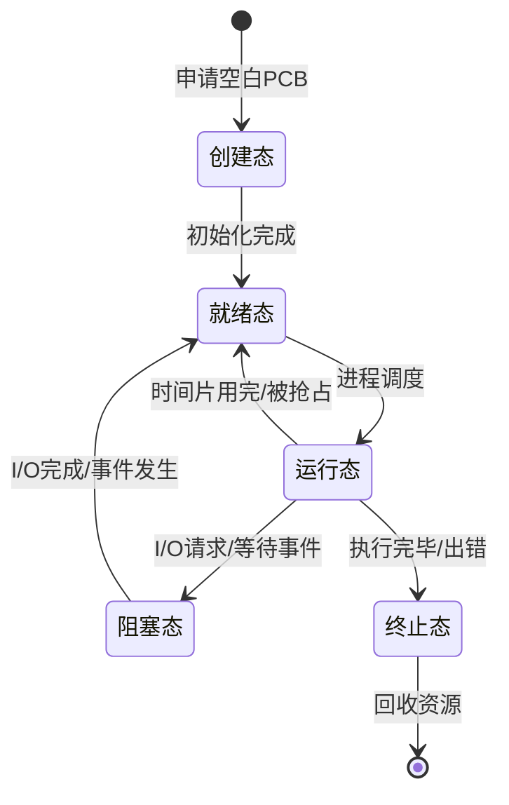
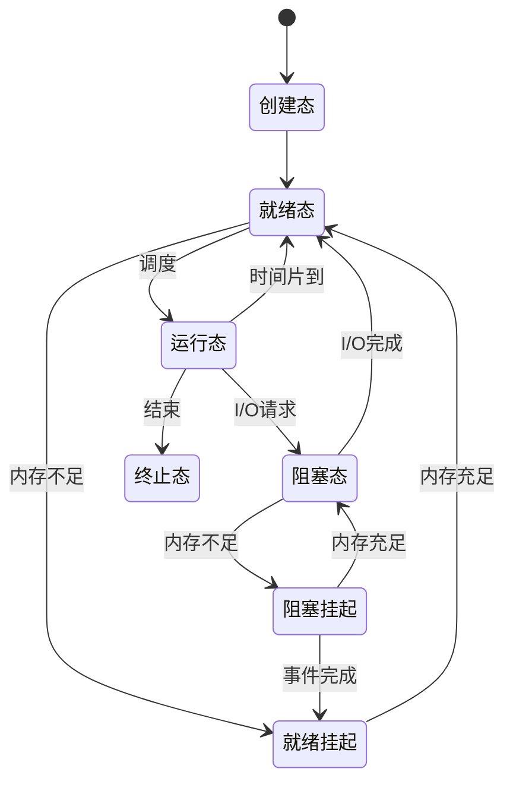

[[第二章——进程与线程/第二章——进程与线程|← 返回目录]]

# 进程概念与进程控制

## 一、进程的定义与特征

### 1.1 进程的定义

**进程（Process）** 是程序的一次执行过程，是系统进行资源分配和调度的独立单位。

> [!info] 进程 vs 程序
> - **程序**是静态的，是一组有序指令的集合，永久保存在存储介质上
> - **进程**是动态的，是程序的一次执行过程，有生命周期（创建→执行→终止）
> - 一个程序可以对应多个进程（如同时打开多个Word文档）
> - 一个进程可以执行多个程序（通过exec系统调用）

### 1.2 进程的特征

| 特征 | 说明 | 重要性 |
|:-----|:-----|:-------|
| **动态性** | 进程有生命周期，会创建、执行、终止 | 最基本特征 |
| **并发性** | 多个进程可以在一段时间内同时执行 | 提高资源利用率 |
| **独立性** | 进程是独立获得资源、独立运行的基本单位 | 便于管理 |
| **异步性** | 进程按各自独立的、不可预知的速度向前推进 | 需要同步机制 |
| **结构性** | 进程由程序段、数据段、PCB组成 | 便于操作系统管理 |

> [!important] 动态性是进程最基本特征
> 进程的动态性体现在：由创建而产生，由调度而执行，由撤销而消亡。程序本身不具备动态性。

### 1.3 进程与程序的区别

| 对比项 | 进程 | 程序 |
|:-------|:-----|:-----|
| **本质** | 动态的执行过程 | 静态的指令集合 |
| **生命周期** | 有（创建→执行→终止） | 无（永久存在） |
| **组成** | 程序段+数据段+PCB | 仅指令和数据 |
| **存在位置** | 内存 | 外存 |
| **数量关系** | 一个程序可对应多个进程 | 一个进程可执行多个程序 |
| **资源占用** | 占用CPU、内存、I/O等资源 | 不占用运行资源 |

---

## 二、进程的组成

### 2.1 进程的组成结构

进程由三大部分组成：

```
┌─────────────────────────────────────┐
│           进程控制块（PCB）           │  ← 进程存在的唯一标志
├─────────────────────────────────────┤
│           程序段（代码段）            │  ← 程序的指令序列
├─────────────────────────────────────┤
│           数据段                     │  ← 原始数据、中间结果、最终结果
└─────────────────────────────────────┘
```

### 2.2 进程控制块（PCB）

> [!important] 核心考点
> PCB是进程存在的唯一标志，当进程被创建时，操作系统会为其创建PCB；当进程终止时，其PCB也会被销毁。

#### PCB的内容

| 信息类别 | 具体内容 | 说明 |
|:---------|:---------|:-----|
| **进程标识信息** | 进程ID（PID）、父进程ID、用户ID | 唯一标识一个进程 |
| **处理机状态信息** | 通用寄存器、程序计数器PC、程序状态字PSW | 进程切换时保存和恢复 |
| **进程控制信息** | 进程状态、优先级、资源清单、打开文件表 | 用于进程控制和管理 |
| **调度信息** | 等待时间、执行时间、就绪队列指针 | 用于进程调度 |
| **内存信息** | 代码段地址、数据段地址、栈地址 | 内存管理使用 |
| **会计信息** | 创建时间、CPU使用时间、实际使用时间 | 计费和审计 |

#### PCB的作用

1. **标识进程**：PCB是进程存在的唯一标志
2. **记录状态**：记录进程的当前状态和运行环境
3. **支持调度**：提供调度所需的信息
4. **支持通信**：记录进程间的通信关系
5. **支持同步**：记录进程的同步和互斥信息

#### PCB的组织方式

| 组织方式 | 说明 | 特点 |
|:---------|:-----|:-----|
| **线性表** | 将所有PCB放入一个数组 | 实现简单，查找效率低 |
| **链接表** | 按状态将PCB链接成队列 | 便于管理，常用方式 |
| **索引表** | 按状态建立索引表 | 查找效率高 |

```
就绪队列：PCB1 → PCB3 → PCB5 → NULL
阻塞队列：PCB2 → PCB4 → NULL
运行指针：PCB6（单CPU系统中只有一个）
```

---

## 三、进程的状态及转换

### 3.1 进程的五种基本状态

> [!important] 必考内容
> 进程的五种状态及转换是408考试的高频考点，需要熟练掌握每种状态的含义和转换条件。

| 状态 | 英文 | 说明 |
|:-----|:-----|:-----|
| **创建态（New）** | New | 进程正在被创建，尚未加入就绪队列 |
| **就绪态（Ready）** | Ready | 进程已准备好，等待CPU调度 |
| **运行态（Running）** | Running | 进程正在CPU上执行 |
| **阻塞态（Blocked/Waiting）** | Waiting | 进程等待某事件完成（如I/O） |
| **终止态（Terminated）** | Terminated | 进程执行完毕，等待系统回收资源 |

### 3.2 五状态模型转换图



### 3.3 状态转换的详细说明

| 转换 | 触发条件 | 说明 |
|:-----|:---------|:-----|
| **创建态 → 就绪态** | 进程初始化完成，获得除CPU外的所有资源 | 进程进入就绪队列等待调度 |
| **就绪态 → 运行态** | 进程被调度程序选中，分配CPU | 从就绪队列取出，成为运行态 |
| **运行态 → 就绪态** | 时间片用完、被更高优先级进程抢占 | 回到就绪队列等待下次调度 |
| **运行态 → 阻塞态** | 请求I/O、等待某事件、申请资源失败 | 进入阻塞队列，让出CPU |
| **阻塞态 → 就绪态** | I/O完成、事件发生、资源可用 | 进入就绪队列等待调度 |
| **运行态 → 终止态** | 程序执行完毕、发生错误、被kill | 进入终止态，等待资源回收 |

> [!warning] 重要限制
> - **阻塞态不能直接转换为运行态**：必须先经过就绪态
> - **就绪态不能直接转换为阻塞态**：进程必须先在运行态才能请求I/O或等待事件

### 3.4 七状态模型（扩展）

在具有**挂起（Suspend）**功能的系统中，进程状态扩展为七种：

| 新增状态 | 说明 |
|:---------|:-----|
| **就绪挂起** | 进程在外存，只要调入内存即可运行 |
| **阻塞挂起** | 进程在外存，等待某事件 |



> [!note] 挂起的目的
> 1. **缓解内存紧张**：将暂不运行的进程换出到磁盘
> 2. **调试程序**：挂起被调试进程，方便检查状态
> 3. **系统维护**：挂起某些进程进行系统维护

---

## 四、进程控制

### 4.1 进程控制的概念

**进程控制** 是指对进程生命周期中的各种操作进行管理和控制，包括创建、终止、阻塞、唤醒、切换等。这些操作通过**原语（Primitive）**来实现。

> [!info] 原语的特点
> - **原子性**：原语操作是不可分割的，要么全做，要么全不做
> - **内核态执行**：原语在内核态下执行
> - **屏蔽中断**：执行原语时屏蔽中断，防止被中断打断

### 4.2 进程创建原语（Create）

#### 引起进程创建的事件

| 事件 | 说明 |
|:-----|:-----|
| **用户登录** | 系统为用户创建新进程 |
| **作业调度** | 批处理系统中，作业被调度时创建进程 |
| **提供服务** | 系统为用户请求创建服务进程 |
| **应用请求** | 用户程序自己创建子进程（如fork） |

#### 进程创建的过程

```
1. 申请空白PCB
2. 为新进程分配资源（内存、打开文件等）
3. 初始化PCB（填写标识信息、处理机状态信息、控制信息）
4. 将新进程插入就绪队列
```

```c
// Linux中创建进程的伪代码
pid_t fork() {
    // 1. 申请空白PCB
    PCB *new_pcb = allocate_pcb();
    
    // 2. 复制父进程的地址空间
    copy_address_space(parent, new_pcb);
    
    // 3. 复制父进程的资源（打开文件表等）
    copy_resources(parent, new_pcb);
    
    // 4. 初始化PCB（PID、状态、优先级等）
    init_pcb(new_pcb);
    
    // 5. 将子进程插入就绪队列
    insert_ready_queue(new_pcb);
    
    // 6. 返回（父进程返回子进程PID，子进程返回0）
    return child_pid;
}
```

### 4.3 进程终止原语（Terminate）

#### 引起进程终止的事件

| 事件 | 说明 |
|:-----|:-----|
| **正常结束** | 程序执行完毕，调用exit系统调用 |
| **异常结束** | 发生错误（除零、非法指令、越界访问） |
| **外界干预** | 用户或操作系统强制终止（kill命令） |
| **父进程终止** | 父进程终止时，子进程也被终止 |

#### 进程终止的过程

```
1. 从PCB集合中找到该进程的PCB
2. 若进程正在运行，立即剥夺CPU
3. 终止其所有子进程
4. 回收进程占用的所有资源
5. 从所在队列中移除该PCB
6. 释放PCB
```

### 4.4 进程阻塞原语（Block）

#### 引起进程阻塞的事件

| 事件 | 说明 |
|:-----|:-----|
| **请求I/O** | 进程请求读写文件或设备 |
| **等待资源** | 申请的资源暂时不可用 |
| **等待消息** | 等待其他进程发来的消息 |
| **等待信号** | 等待某个信号或条件成立 |

#### 进程阻塞的过程

```
1. 立即停止执行该进程
2. 将进程状态改为阻塞态
3. 将PCB插入相应的阻塞队列
4. 转调度程序，重新调度
```

### 4.5 进程唤醒原语（Wakeup）

#### 引起进程唤醒的事件

| 事件 | 说明 |
|:-----|:-----|
| **I/O完成** | 请求的I/O操作已完成 |
| **资源可用** | 等待的资源已释放 |
| **消息到达** | 等待的消息已到达 |
| **信号发生** | 等待的信号或条件已满足 |

#### 进程唤醒的过程

```
1. 从阻塞队列中找到该进程的PCB
2. 将进程状态改为就绪态
3. 将PCB从阻塞队列移出
4. 将PCB插入就绪队列
```

> [!note] 阻塞与唤醒的配对
> 进程的阻塞和唤醒必须成对出现，否则会导致进程永远阻塞（死锁的一种表现）。

### 4.6 进程切换原语（Switch）

#### 进程切换的过程

```
1. 保存当前进程的CPU现场（寄存器、PC、PSW等）到PCB
2. 修改当前进程状态（运行→就绪/阻塞）
3. 将当前进程PCB移到相应队列
4. 选择新进程执行（调度）
5. 从新进程PCB恢复CPU现场
6. 修改新进程状态为运行态
7. 跳转到新进程的程序计数器位置执行
```

> [!warning] 进程切换 vs 模式切换
> - **进程切换**：从一个进程切换到另一个进程，需要保存/恢复整个CPU现场
> - **模式切换**：用户态和内核态之间的切换（如系统调用），同一进程内，只需保存/恢复部分寄存器

---

[[第二章——进程与线程/第二章——进程与线程|← 返回目录]]
