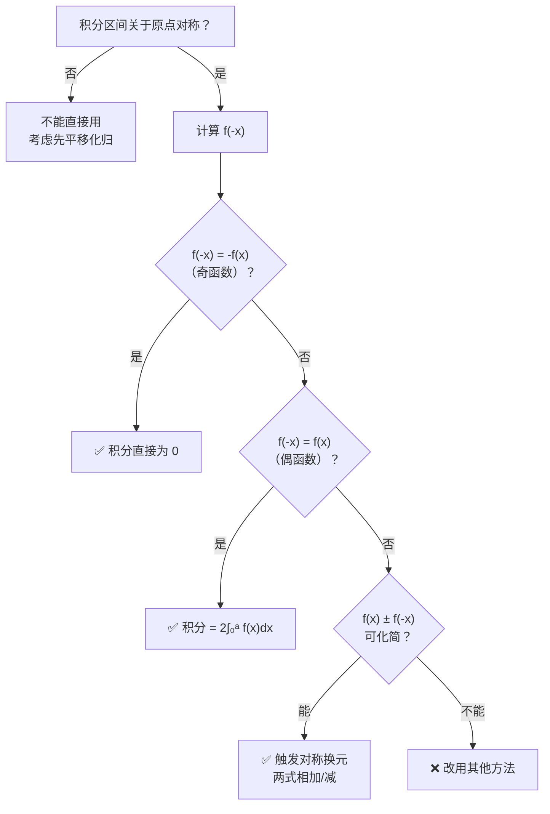

# 对称换元法完全笔记

> 对称区间上定积分的核心技巧 —— 触发条件、分类与应用

---

## 一、什么是对称换元法

**对称换元法**（又称**负替换法**）是计算对称区间 $[-a, a]$ 上定积分的一种经典技巧。其核心操作是：对积分

$$I = \int_{-a}^{a} f(x)\,dx$$

作变量代换 $x = -t$，得到另一个等价表达式，再将**新旧两个积分相加（或相减）**，利用 $f(x) \pm f(-x)$ 的化简来求解。

$$x = -t \quad \Longrightarrow \quad I = \int_{-a}^{a} f(-x)\,dx$$

> [!info] 核心思想
> 对称换元并不直接求出积分，而是**将 $f(x)$ 替换为 $f(-x)$**，让新旧积分产生关系。能否化简，取决于 $f(x) + f(-x)$ 或 $f(x) - f(-x)$ 是否等于一个更简单的表达式。

---

## 二、触发条件

对称换元法并非万能，需要**两个条件同时满足**才能触发。

### 条件一：积分区间关于原点对称

> [!warning] 硬性条件
> 积分必须是（或可化归为）$\displaystyle\int_{-a}^{a}$ 的形式。区间不对称就无法直接触发。

- ✅ $\displaystyle\int_{-1}^{1}$、$\displaystyle\int_{-\pi/2}^{\pi/2}$、$\displaystyle\int_{-\infty}^{+\infty}$
- ❌ $\displaystyle\int_{0}^{1}$、$\displaystyle\int_{1}^{3}$（不对称，不能直接用）

> [!tip] 区间化归
> 若区间不对称但可经平移化归为对称区间，仍可使用。例如 $\displaystyle\int_{0}^{2}$ 令 $x = u+1$ 后变为 $\displaystyle\int_{-1}^{1}$。参见 [[#四、区间化归技巧]]。

### 条件二：换元后能产生"可利用的关系"

换元 $x \to -x$ 后得到新积分 $I' = \displaystyle\int_{-a}^{a} f(-x)\,dx$，**$I$ 与 $I'$ 之间必须能建立有用的等式**（通常是相加或相减后化简）。这要求被积函数 $f(x)$ 具备以下结构特征之一：

| 特征 | 含义 | 换元后效果 |
|:---:|:---|:---|
| **A. 含奇函数因子** | $f(x)$ 中有 $x$、$\sin x$、$\arctan x$ 等奇函数 | 奇因子产生负号翻转 |
| **B. $f(x) \pm f(-x)$ 可化简** | $f(x)+f(-x)$ 或 $f(x)-f(-x)$ 等于简单表达式 | 相加/相减后大幅化简 |
| **C. 含三角函数配对** | $\sin x$（奇）与 $\cos x$（偶）的组合 | 正负号翻转产生化简 |

> [!danger] 何时不能用
> 若 $f(-x)$ 与 $f(x)$ 之间无法建立任何有用的关系（$f(x) \pm f(-x)$ 都无法化简），则对称换元无效，应改用 [[一元积分积分表|直接积分]]、分部积分或其他方法。

### 判断流程图

> [!note] 快速检验口诀
> 先算 $f(-x)$：等于 $-f(x)$ 直接归零，等于 $f(x)$ 折半，==既不等也不等不了但能化简==——这才是对称换元真正的舞台。

---

## 三、种类与分类

根据 $f(x)$ 与 $f(-x)$ 的关系，对称换元可分为**三类**，难度递增。

### 第一类：奇函数直接归零

**条件**：$f(-x) = -f(x)$，即 $f(x)$ 为奇函数。

$$\int_{-a}^{a} f(x)\,dx = 0$$

> [!example] 例
> $$\int_{-1}^{1} x^3 e^{x^2}\,dx = 0 \quad（x^3 \text{ 为奇，} e^{x^2} \text{ 为偶，积为奇}）$$
> $$\int_{-\pi}^{\pi} x\sin^2 x\,dx = 0 \quad（x \text{ 为奇，} \sin^2 x \text{ 为偶，积为奇}）$$

**特点**：无需换元，直接判断奇偶性即可。这是最基础的情形。

### 第二类：偶函数折半

**条件**：$f(-x) = f(x)$，即 $f(x)$ 为偶函数。

$$\int_{-a}^{a} f(x)\,dx = 2\int_{0}^{a} f(x)\,dx$$

> [!example] 例
> $$\int_{-1}^{1} x^2\,dx = 2\int_{0}^{1} x^2\,dx = \frac{2}{3}$$
> $$\int_{-\pi/2}^{\pi/2} \cos x\,dx = 2\int_{0}^{\pi/2} \cos x\,dx = 2$$

**特点**：将对称区间化为半区间，简化计算。可配合 [[点火公式]] 使用。

### 第三类：非平凡对称换元（核心）

**条件**：$f(-x)$ 既不等于 $f(x)$ 也不等于 $-f(x)$，但 $f(x) + f(-x)$ 或 $f(x) - f(-x)$ 可以化简为简单表达式。

设 $I = \displaystyle\int_{-a}^{a} f(x)\,dx$，换元 $x \to -x$ 得 $I = \displaystyle\int_{-a}^{a} f(-x)\,dx$。

- **相加法**：$2I = \displaystyle\int_{-a}^{a} \big[f(x) + f(-x)\big]\,dx$
- **相减法**：$0 = \displaystyle\int_{-a}^{a} \big[f(x) - f(-x)\big]\,dx$（用于推导恒等式）

> [!important] 这才是对称换元法真正的威力所在
> 前两类本质上是"奇偶性判断"，不需要换元操作。==第三类==才是真正需要"换元 → 建立方程 → 求解"的完整流程。

---

## 四、常用函数的 $f(x) \pm f(-x)$ 速查表

> [!tip] 核心工具表
> 下表是对称换元法最常用的化简关系，==建议熟记==。掌握这些恒等式，就能快速判断能否触发对称换元。

### 4.1 指数-对数类

|         函数 $f(x)$         |    $f(x) + f(-x)$    |    $f(x) - f(-x)$     | 备注            |
| :-----------------------: | :------------------: | :-------------------: | :------------ |
|   $\dfrac{e^x}{1+e^x}$    |         $1$          |  $\tanh\dfrac{x}{2}$  | ==最经典==，相加为 1 |
|    $\dfrac{1}{1+e^x}$     |         $1$          | $-\tanh\dfrac{x}{2}$  | 同上            |
|  $\dfrac{e^x}{1+e^{2x}}$  |          —           | $\dfrac{1}{2\cosh x}$ | 相减化简          |
|       $\ln(1+e^x)$        | $x + 2\ln(1+e^{-x})$ |          $x$          | ==第12题核心==    |
| $\ln(e^x+1) + \ln(e^x-1)$ |         $2x$         |           —           | 相加为 $2x$      |
|       $\arctan e^x$       |   $\dfrac{\pi}{2}$   |           —           | 相加为常数         |

> [!note] 关键恒等式推导
> $\ln(1+e^x) = \ln\big[e^x(e^{-x}+1)\big] = x + \ln(1+e^{-x})$
>
> 因此 $\ln(1+e^x) - \ln(1+e^{-x}) = x$。

### 4.2 三角函数类

| 函数 $f(x)$ | $f(x) + f(-x)$ | $f(x) - f(-x)$ | 备注 |
|:---:|:---:|:---:|:---|
| $\sin x$ | $0$ | $2\sin x$ | 奇函数 |
| $\cos x$ | $2\cos x$ | $0$ | 偶函数 |
| $x\sin x$ | — | — | 偶函数（奇×奇） |
| $x\cos x$ | — | — | 奇函数（奇×偶） |
| $\dfrac{x}{1+\cos x}$ | — | — | 奇函数 |
| $\sin x \cdot \ln(1+e^x)$ | $x\sin x$ | — | 相加化简（奇×对数） |

### 4.3 反三角-对数类

| 函数 $f(x)$ | $f(x) + f(-x)$ | 备注 |
|:---:|:---:|:---|
| $\arctan x + \arctan\dfrac{1}{x}$ | $\dfrac{\pi}{2}\operatorname{sgn}(x)$ | 经典恒等式 |
| $\ln\sqrt{\dfrac{1+x}{1-x}}$ | — | 奇函数（$\operatorname{artanh} x$） |

---

## 五、经典例题

### 例1：第12题 —— $\ln(1+e^x)$ 型

$$I = \int_{-1}^{1} x\ln(1+e^x)\,dx$$

> [!example] 解法：对称换元法
> **Step 1**：令 $x = -t$，则
> $$I = \int_{-1}^{1}(-x)\ln(1+e^{-x})\,dx = -\int_{-1}^{1} x\ln(1+e^{-x})\,dx$$
>
> **Step 2**：利用恒等式 $\ln(1+e^{-x}) = \ln(1+e^x) - x$：
> $$I = -\int_{-1}^{1} x\big[\ln(1+e^x) - x\big]\,dx = -I + \int_{-1}^{1} x^2\,dx$$
>
> **Step 3**：解方程
> $$2I = \frac{2}{3} \quad \Longrightarrow \quad \boxed{I = \frac{1}{3}}$$

**触发分析**：
- ✅ 区间 $[-1,1]$ 对称
- ✅ $x$ 是奇函数因子，$\ln(1+e^x) - \ln(1+e^{-x}) = x$ 可化简
- 属于 ==第三类非平凡对称换元==

### 例2：$\dfrac{e^x}{1+e^x}$ 型

$$I = \int_{-1}^{1} \frac{x^2\,e^x}{1+e^x}\,dx$$

> [!example] 解法
> 令 $x \to -x$：
> $$I = \int_{-1}^{1} \frac{x^2\,e^{-x}}{1+e^{-x}}\,dx = \int_{-1}^{1} \frac{x^2}{1+e^x}\,dx$$
>
> 两式相加，利用 $\dfrac{e^x}{1+e^x} + \dfrac{1}{1+e^x} = 1$：
> $$2I = \int_{-1}^{1} x^2\,dx = \frac{2}{3} \quad \Longrightarrow \quad I = \frac{1}{3}$$

### 例3：三角-对数混合型

$$I = \int_{-\pi/2}^{\pi/2} \sin x \cdot \ln(1+e^x)\,dx$$

> [!example] 解法
> 令 $x \to -x$，利用 $\sin(-x) = -\sin x$ 和 $\ln(1+e^{-x}) = \ln(1+e^x) - x$：
> $$I = \int_{-\pi/2}^{\pi/2} (-\sin x)\big[\ln(1+e^x) - x\big]\,dx = -I + \int_{-\pi/2}^{\pi/2} x\sin x\,dx$$
>
> 其中 $\int_{-\pi/2}^{\pi/2} x\sin x\,dx = 2\int_0^{\pi/2} x\sin x\,dx = 2\big[-x\cos x + \sin x\big]_0^{\pi/2} = 2$（偶函数折半 + 分部积分）
>
> $$2I = 2 \quad \Longrightarrow \quad I = 1$$

### 例4：区间再现公式

> [!tip] 经典推论
> 对于 $\displaystyle\int_0^{\pi} x\,f(\sin x)\,dx$，令 $x = \pi - u$（这是一种**非原点对称**的换元，但思想相同）：
> $$\int_0^{\pi} x\,f(\sin x)\,dx = \frac{\pi}{2}\int_0^{\pi} f(\sin x)\,dx$$
>
> 使含 $x$ 的积分也能利用 [[点火公式]] 计算。详见 [[点火公式#六、扩展技巧汇总]]。

---

## 六、区间化归技巧

当积分区间不对称时，有时可以先**平移换元**化为对称区间，再使用对称换元。

### 6.1 平移化归

$$\int_{a}^{b} f(x)\,dx \quad \xrightarrow{x = t + \frac{a+b}{2}} \quad \int_{-\frac{b-a}{2}}^{\frac{b-a}{2}} f\!\left(t + \frac{a+b}{2}\right)\,dt$$

> [!example] 例
> $\displaystyle\int_{0}^{2} (x-1)\ln(1+e^{x-1})\,dx$，令 $t = x-1$ 化为 $\displaystyle\int_{-1}^{1} t\ln(1+e^t)\,dt$，即第12题。

### 6.2 分段化归

将非对称区间拆为对称部分 + 非对称部分：

$$\int_{0}^{3} f(x)\,dx = \int_{0}^{1} f(x)\,dx + \int_{1}^{3} f(x)\,dx$$

> [!warning] 注意
> 平移后被积函数形式可能变复杂。是否值得化归，取决于化简后的 $f(x) \pm f(-x)$ 是否仍然简洁。

---

## 七、与其他方法的联系

| 方法 | 适用场景 | 与对称换元的关系 |
|:---:|:---|:---|
| [[一元积分积分表\|直接积分]] | 原函数可求 | 对称换元失效时的退路 |
| 分部积分 | $u \cdot dv$ 型 | 可与对称换元组合使用（见例2的 $x^2$ 因子） |
| [[点火公式]] | $[0, \pi/2]$ 上三角高次幂 | 对称换元可将 $[-\pi/2, \pi/2]$ 折半后衔接点火公式 |
| [[泰勒展开]] | 无法解析求解时近似 | 对称换元得到的化简结果可用泰勒展开验证 |
| 奇偶性判断 | $f(x)$ 有明确奇偶性 | 对称换元的第一、二类的特例 |
| 区间再现公式 | $[0, \pi]$ 上含 $x$ 的积分 | 本质是**非原点对称换元**的推广 |

---

## 八、方法论总结

> [!abstract] 对称换元法三步走
> 1. **判断对称性**：区间是否关于原点对称？不对称则先化归。
> 2. **检验可化简性**：算 $f(-x)$，查 $f(x) \pm f(-x)$ 能否化简（查 [[#四、常用函数的速查表]]）。
> 3. **换元建方程**：令 $x \to -x$，新旧积分相加（或相减），解出 $I$。

> [!success] 核心直觉
> 对称换元法的本质是：==利用区间的对称性，把"难算的 $f(x)$"转换为"好算的 $f(x) + f(-x)$"==。能否成功，取决于 $f(x) + f(-x)$ 是否比 $f(x)$ 本身更简单。

---

## 九、速查卡

$$\boxed{\int_{-a}^{a} f(x)\,dx \quad \xrightarrow{x \to -x} \quad \int_{-a}^{a} f(-x)\,dx}$$

| $f(x)$ 类型 | $f(x) + f(-x)$ | 结论 |
|:---:|:---:|:---|
| 奇函数 | $0$ | $\displaystyle\int_{-a}^{a} = 0$ |
| 偶函数 | $2f(x)$ | $\displaystyle\int_{-a}^{a} = 2\int_0^a$ |
| $\dfrac{e^x}{1+e^x}$ 型 | $1$ | $\displaystyle\int_{-a}^{a} = \frac{1}{2}\int_{-a}^{a} g(x)\,dx$（$g$ 为剩余因子） |
| $\ln(1+e^x)$ 型 | 含 $x$ 项 | 奇函数因子 + 恒等式化简 |

---

> 对称换元法是定积分技巧的基石之一，与[[点火公式]]、分部积分并列为对称区间积分的三大法宝。

## 相关笔记

- [[一元积分积分表]] — 基本积分公式
- [[点火公式]] — 三角高次幂积分
- [[泰勒展开]] — 近似验证工具
- [[高数总览]] — 高数知识体系
