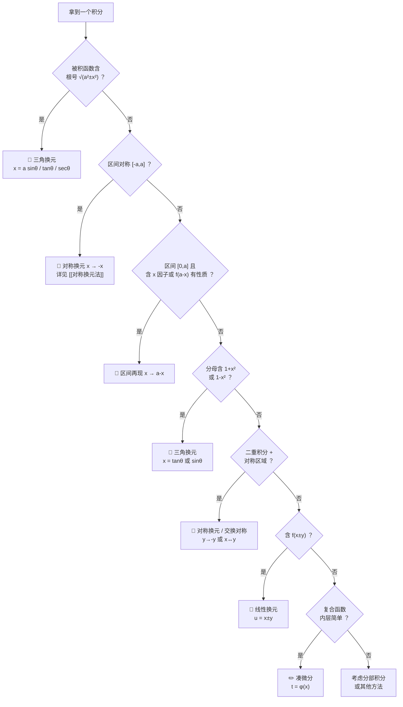

# 换元法完全笔记

> 积分换元的核心逻辑 —— 什么时候换、怎么换、换完之后干什么

---

## 一、什么是换元法

**换元法**（变量代换）是积分计算中最核心的技巧。其基本思想是：通过引入新变量 $t$，将原积分 $\int f(x)\,dx$ 转化为 $\int g(t)\,dt$，使后者更容易计算。

$$\int_{a}^{b} f(x)\,dx \quad \xrightarrow{x = \varphi(t)} \quad \int_{\alpha}^{\beta} f\big(\varphi(t)\big)\,\varphi'(t)\,dt$$

其中 $\varphi(\alpha) = a$，$\varphi(\beta) = b$。

> [!info] 核心思想
> 换元的本质是**换掉难算的部分**。被积函数中让你"卡住"的那个因子——根号、分母、复合函数的内层——就是换元的目标。==换元不是目的，化简才是目的==。

---

## 二、什么时候换元（触发条件）

这是最关键的问题。换元不是凭感觉，而是有明确的**触发信号**。

### 2.1 触发信号速查表

| 信号 | 典式 | 换元策略 | 类型 |
|:---|:---|:---|:---:|
| 含 $\sqrt{a^2 - x^2}$ | $\int \sqrt{1-x^2}\,dx$ | $x = a\sin\theta$ | 三角换元 |
| 含 $\sqrt{a^2 + x^2}$ | $\int \frac{dx}{1+x^2}$ | $x = a\tan\theta$ | 三角换元 |
| 含 $\sqrt{x^2 - a^2}$ | $\int \frac{dx}{\sqrt{x^2-1}}$ | $x = a\sec\theta$ | 三角换元 |
| 分母含 $1+x^2$ | $\int_0^1 \frac{\ln(1+x)}{1+x^2}dx$ | $x = \tan\theta$ | 三角换元 |
| 区间 $[0,a]$ + 含 $x$ 因子 | $\int_0^\pi x f(\sin x)\,dx$ | $x \to a - x$ | 区间再现 |
| 区间 $[-a,a]$ | $\int_{-a}^a f(x)\,dx$ | $x \to -x$ | 对称换元 |
| 含 $f(x+y)$ 或 $f(x-y)$ | $\iint \ln\|sin(x-y)\|$ | $u = x \pm y$ | 线性换元 |
| 二重积分 + 对称区域 | $\iint_D \frac{g(x,y)}{1+e^{-y}}$ | $y \to -y$ 或 $x \leftrightarrow y$ | 对称换元 |
| 复合函数内层简单 | $\int f(\varphi(x))\varphi'(x)\,dx$ | $t = \varphi(x)$ | 凑微分 |
| 反三角函数 | $\int \arctan x\,dx$ | 分部积分 + 换元 | 组合 |

### 2.2 判断流程图

> [!tip] 口诀
> ==根号三角换，对称看区间，$[0,a]$ 用再现，复合先凑微==。四句话覆盖 90% 的换元场景。

---

## 三、换元法分类总览

| 类型 | 核心操作 | 适用场景 | 详见 |
|:---:|:---|:---|:---|
| **三角换元** | $x = a\sin\theta / \tan\theta / \sec\theta$ | 含 $\sqrt{a^2 \pm x^2}$、$1+x^2$ | [[#四、三角换元]] |
| **区间再现** | $x \to a+b-x$ | $[a,b]$ 上含 $x$ 或利用对称 | [[#五、区间再现公式]] |
| **对称换元** | $x \to -x$ | $[-a,a]$ 对称区间 | [[对称换元法]] |
| **线性换元** | $u = x \pm y$ | 二重积分含 $f(x \pm y)$ | [[#六、线性换元与二重积分换元]] |
| **交换对称** | $x \leftrightarrow y$ | 区域关于 $y=x$ 对称 | [[#六、线性换元与二重积分换元]] |
| **凑微分** | $t = \varphi(x)$ | $f(\varphi(x))\varphi'(x)$ 型 | [[一元积分积分表]] |

> [!warning] 重要区分
> [[对称换元法]]（$x \to -x$）和**区间再现**（$x \to a+b-x$）是两种不同的换元：
> - 对称换元要求区间关于**原点**对称 $[-a, a]$
> - 区间再现适用于**任意** $[a, b]$，核心是利用 $f(x)$ 与 $f(a+b-x)$ 的关系
> - 两者思想相通——都是换元后建立方程，但触发条件和操作不同

---

## 四、三角换元

### 4.1 三大标准三角换元

> [!important] 核心口诀
> ==见 $\sqrt{a^2-x^2}$ 换 $\sin$，见 $\sqrt{a^2+x^2}$ 换 $\tan$，见 $\sqrt{x^2-a^2}$ 换 $\sec$==

| 被积函数特征 | 换元 | 恒等式 | 新区间 |
|:---:|:---:|:---|:---|
| $\sqrt{a^2 - x^2}$ | $x = a\sin\theta$ | $a^2 - a^2\sin^2\theta = a^2\cos^2\theta$ | $\theta \in [-\frac{\pi}{2}, \frac{\pi}{2}]$ |
| $\sqrt{a^2 + x^2}$ | $x = a\tan\theta$ | $a^2 + a^2\tan^2\theta = a^2\sec^2\theta$ | $\theta \in (-\frac{\pi}{2}, \frac{\pi}{2})$ |
| $\sqrt{x^2 - a^2}$ | $x = a\sec\theta$ | $a^2\sec^2\theta - a^2 = a^2\tan^2\theta$ | $\theta \in [0, \frac{\pi}{2})$ |

### 4.2 三角换元的"隐式触发"

有时候被积函数没有显式的根号，但仍然应该用三角换元：

> [!example] 隐式触发场景
> - **分母含 $1+x^2$**：$\displaystyle\int_0^1 \frac{\ln(1+x)}{1+x^2}\,dx$ → 令 $x = \tan\theta$，$dx = \sec^2\theta\,d\theta$，$1+x^2 = \sec^2\theta$，分母直接消掉
> - **含 $\arctan x$**：$\displaystyle\int \frac{x\arctan x}{1+x^2}\,dx$ → 同上
> - **含 $\frac{1}{1-x^2}$**：令 $x = \sin\theta$，转化为 $\sec\theta$

### 4.3 三角换元后常接区间再现

> [!tip] 组合技
> 三角换元常常把 $[0, 1]$ 变成 $[0, \frac{\pi}{4}]$ 或 $[0, \frac{\pi}{2}]$，而这些区间恰好是**区间再现**的舞台。
> 
> 例如 $x = \tan\theta$ 将 $[0,1]$ 映射到 $[0, \frac{\pi}{4}]$，而 $\frac{\pi}{4} - \theta$ 的替换可以利用 $\tan(\frac{\pi}{4}-\theta) = \frac{1-\tan\theta}{1+\tan\theta}$ 产生化简。详见 [[#例1：三角换元 + 区间再现]]。

---

## 五、区间再现公式

### 5.1 基本公式

$$\boxed{\int_{a}^{b} f(x)\,dx = \int_{a}^{b} f(a+b-x)\,dx}$$

> [!info] 本质
> 令 $x = a + b - t$，则当 $x = a$ 时 $t = b$，当 $x = b$ 时 $t = a$，$dx = -dt$，积分限翻转后负号消去。
> 
> 这不是"计算"，而是**给积分换一个等价形式**，然后利用 $f(x)$ 与 $f(a+b-x)$ 之间的关系。

### 5.2 什么时候用区间再现

| 触发条件 | 典型场景 | 换元后效果 |
|:---|:---|:---|
| $[0, \pi]$ 上含 $x$ | $\int_0^\pi x f(\sin x)\,dx$ | $x \to \pi - x$，$\sin(\pi-x) = \sin x$ |
| $[0, \frac{\pi}{2}]$ 上含三角 | $\int_0^{\pi/2} \ln(\sin x)\,dx$ | $x \to \frac{\pi}{2} - x$，$\sin \leftrightarrow \cos$ |
| $[0, a]$ 上含 $\ln$ 或 $e$ | $\int_0^1 \frac{\ln(1+x)}{1+x^2}dx$ | 先三角换元再区间再现 |
| $f(x) + f(a+b-x)$ 可化简 | 任何 $[a,b]$ | 两式相加求解 |

### 5.3 区间再现的三大经典推论

> [!important] 必背推论
> 
> **推论一**（$x$ 提取）：
> $$\int_0^\pi x\,f(\sin x)\,dx = \frac{\pi}{2}\int_0^\pi f(\sin x)\,dx$$
> 
> **推论二**（正余弦互换）：
> $$\int_0^{\pi/2} f(\sin x)\,dx = \int_0^{\pi/2} f(\cos x)\,dx$$
> 
> **推论三**（对数积分）：
> $$\int_0^{\pi/2} \ln(\sin x)\,dx = \int_0^{\pi/2} \ln(\cos x)\,dx = -\frac{\pi}{2}\ln 2$$

### 5.4 推论三的推导（区间再现的经典应用）

$$I = \int_0^{\pi/2} \ln(\sin x)\,dx$$

令 $x \to \frac{\pi}{2} - x$，则 $\sin x \to \cos x$：

$$I = \int_0^{\pi/2} \ln(\cos x)\,dx$$

两式相加：

$$2I = \int_0^{\pi/2} \ln(\sin x \cos x)\,dx = \int_0^{\pi/2} \ln\frac{\sin 2x}{2}\,dx = \int_0^{\pi/2} \ln(\sin 2x)\,dx - \frac{\pi}{2}\ln 2$$

令 $t = 2x$：

$$\int_0^{\pi/2} \ln(\sin 2x)\,dx = \frac{1}{2}\int_0^\pi \ln(\sin t)\,dt = \frac{1}{2} \cdot 2\int_0^{\pi/2} \ln(\sin t)\,dt = I$$

因此 $2I = I - \frac{\pi}{2}\ln 2$，解得：

$$\boxed{I = -\frac{\pi}{2}\ln 2}$$

> [!note] 由此推得
> $$\int_0^\pi \ln(\sin x)\,dx = 2I = -\pi\ln 2$$
> 这个结果在 [[#例3：线性换元 + 区间再现]] 中将被直接使用。

---

## 六、线性换元与二重积分换元

### 6.1 二重积分换元法（Jacobian）

对于二重积分，若令 $x = x(u,v)$，$y = y(u,v)$，则：

$$\iint_D f(x,y)\,dx\,dy = \iint_{D'} f\big(x(u,v), y(u,v)\big)\,|J|\,du\,dv$$

其中 $J = \dfrac{\partial(x,y)}{\partial(u,v)} = \begin{vmatrix} x_u & x_v \\ y_u & y_v \end{vmatrix}$ 为**雅可比行列式**。

### 6.2 线性换元（分离变量型）

当被积函数含 $f(x - y)$ 或 $f(x + y)$ 时，令 $u = x \pm y$ 可以**分离变量**。

| 被积函数特征 | 换元 | 雅可比 $\|J\|$ | 效果 |
|:---:|:---:|:---:|:---|
| $f(x - y)$ | $u = x - y,\; v = x$ | $1$ | 分离出 $f(u)$ |
| $f(x + y)$ | $u = x + y,\; v = x$ | $1$ | 分离出 $f(u)$ |
| $f\!\left(\frac{y}{x}\right)$ | 极坐标 | $r$ | 分离出 $f(\theta)$ |

### 6.3 对称换元（二重积分版）

二重积分中的对称换元有两种形式：

**形式一：反射对称**（$y \to -y$ 或 $x \to -x$）

当积分区域 $D$ 关于 $x$ 轴对称时：

$$I = \iint_D f(x,y)\,dxdy = \iint_D f(x,-y)\,dxdy$$

若 $\frac{1}{1+e^{-y}} + \frac{1}{1+e^y} = 1$，则两式相加可消去指数项。

**形式二：交换对称**（$x \leftrightarrow y$）

当积分区域 $D$ 关于 $y = x$ 对称时：

$$I = \iint_D f(x,y)\,dxdy = \iint_D f(y,x)\,dxdy$$

两式相加：$2I = \iint_D [f(x,y) + f(y,x)]\,dxdy$，若 $f(x,y) + f(y,x)$ 可化简则成功。

> [!tip] 交换对称的黄金搭档
> 当被积函数含 $\arctan\frac{A}{B}$（其中 $A$、$B$ 是 $x$、$y$ 的函数），交换 $x \leftrightarrow y$ 后得到 $\arctan\frac{B}{A}$，利用恒等式 $\arctan t + \arctan\frac{1}{t} = \frac{\pi}{2}$（$t > 0$）即可化简为常数。

---

## 七、经典例题

> 以下三道例题覆盖了三角换元、区间再现、对称换元、交换对称、线性换元等核心技巧。

### 例1：三角换元 + 区间再现

$$I = \int_0^1 \frac{\ln(1+x)}{1+x^2}\,dx$$

> [!question] 触发分析
> - 分母含 $1 + x^2$ → ==三角换元== $x = \tan\theta$
> - 换元后区间变为 $[0, \frac{\pi}{4}]$，被积函数含 $\ln(1+\tan\theta)$ → ==区间再现== $\theta \to \frac{\pi}{4} - \theta$

> [!example] 解题过程
> 
> **Step 1：三角换元**
> 
> 令 $x = \tan\theta$，则 $dx = \sec^2\theta\,d\theta$，$1 + x^2 = \sec^2\theta$。
> 
> 当 $x = 0$：$\theta = 0$；当 $x = 1$：$\theta = \dfrac{\pi}{4}$。
> 
> $$I = \int_0^{\pi/4} \frac{\ln(1+\tan\theta)}{\sec^2\theta}\cdot\sec^2\theta\,d\theta = \int_0^{\pi/4} \ln(1+\tan\theta)\,d\theta$$
> 
> 分母 $\sec^2\theta$ 被 $dx$ 中的 $\sec^2\theta$ ==直接消掉==，这就是三角换元的价值。
> 
> **Step 2：区间再现**
> 
> 令 $\theta \to \dfrac{\pi}{4} - \theta$（即 $a + b - \theta$，其中 $a = 0$，$b = \frac{\pi}{4}$）：
> 
> $$I = \int_0^{\pi/4} \ln\!\left(1 + \tan\!\left(\frac{\pi}{4}-\theta\right)\right)d\theta$$
> 
> 利用 $\tan\!\left(\dfrac{\pi}{4}-\theta\right) = \dfrac{1 - \tan\theta}{1 + \tan\theta}$：
> 
> $$1 + \frac{1-\tan\theta}{1+\tan\theta} = \frac{(1+\tan\theta)+(1-\tan\theta)}{1+\tan\theta} = \frac{2}{1+\tan\theta}$$
> 
> 因此：
> 
> $$I = \int_0^{\pi/4} \ln\frac{2}{1+\tan\theta}\,d\theta = \int_0^{\pi/4} \big[\ln 2 - \ln(1+\tan\theta)\big]\,d\theta$$
> 
> **Step 3：解方程**
> 
> $$I = \frac{\pi}{4}\ln 2 - \int_0^{\pi/4}\ln(1+\tan\theta)\,d\theta = \frac{\pi}{4}\ln 2 - I$$
> 
> $$2I = \frac{\pi}{4}\ln 2 \quad \Longrightarrow \quad \boxed{I = \frac{\pi}{8}\ln 2}$$

> [!success] 技巧总结
> | 步骤 | 技巧 | 作用 |
> |:---:|:---|:---|
> | 1 | 三角换元 $x = \tan\theta$ | 消去分母 $1+x^2$ |
> | 2 | 区间再现 $\theta \to \frac{\pi}{4}-\theta$ | 利用 $\tan(\frac{\pi}{4}-\theta) = \frac{1-\tan\theta}{1+\tan\theta}$ 产生 $\ln 2$ |
> | 3 | 两式相加解方程 | $2I = \frac{\pi}{4}\ln 2$ |

---

### 例2：对称换元 + 交换对称

$$I = \iint_D \frac{\arctan\dfrac{1+x^2}{1+y^2}}{1+e^{-y}}\,dx\,dy, \qquad D: x^2+y^2 \leq 1$$

> [!question] 触发分析
> - 区域 $D$（单位圆）关于 $x$ 轴对称 → ==反射对称== $y \to -y$，消去 $e^{-y}$
> - 区域 $D$ 关于 $y = x$ 对称 → ==交换对称== $x \leftrightarrow y$，配合 $\arctan$ 互补恒等式

> [!example] 解题过程
> 
> **Step 1：反射对称消去指数项**
> 
> $D$ 关于 $x$ 轴对称，令 $y \to -y$：
> 
> - 分子 $\arctan\dfrac{1+x^2}{1+(-y)^2} = \arctan\dfrac{1+x^2}{1+y^2}$（不变，因为 $y^2$）
> - 分母 $1 + e^{-(-y)} = 1 + e^y$（变了！）
> 
> $$I = \iint_D \frac{\arctan\dfrac{1+x^2}{1+y^2}}{1+e^{y}}\,dx\,dy$$
> 
> 两式相加：
> 
> $$2I = \iint_D \arctan\frac{1+x^2}{1+y^2}\left(\frac{1}{1+e^{-y}} + \frac{1}{1+e^{y}}\right)dx\,dy$$
> 
> 关键化简：
> 
> $$\frac{1}{1+e^{-y}} + \frac{1}{1+e^y} = \frac{e^y}{1+e^y} + \frac{1}{1+e^y} = \frac{1+e^y}{1+e^y} = 1$$
> 
> $$2I = \iint_D \arctan\frac{1+x^2}{1+y^2}\,dx\,dy \;\;=:\;\; J$$
> 
> **Step 2：交换对称消去 arctan**
> 
> $D$ 关于 $y = x$ 对称，令 $x \leftrightarrow y$：
> 
> $$J = \iint_D \arctan\frac{1+y^2}{1+x^2}\,dx\,dy$$
> 
> 两式相加，利用恒等式（$t > 0$ 时 $\arctan t + \arctan\frac{1}{t} = \frac{\pi}{2}$）：
> 
> $$\arctan\frac{1+x^2}{1+y^2} + \arctan\frac{1+y^2}{1+x^2} = \frac{\pi}{2}$$
> 
> $$2J = \iint_D \frac{\pi}{2}\,dx\,dy = \frac{\pi}{2}\cdot\text{Area}(D) = \frac{\pi}{2}\cdot\pi = \frac{\pi^2}{2}$$
> 
> $$J = \frac{\pi^2}{4}$$
> 
> **Step 3：回代**
> 
> $$2I = J = \frac{\pi^2}{4} \quad \Longrightarrow \quad \boxed{I = \frac{\pi^2}{8}}$$

> [!success] 技巧总结
> | 步骤 | 技巧 | 作用 |
> |:---:|:---|:---|
> | 1 | 反射对称 $y \to -y$ | 消去 $e^{-y}$，利用 $\frac{1}{1+e^{-y}}+\frac{1}{1+e^y}=1$ |
> | 2 | 交换对称 $x \leftrightarrow y$ | 配合 $\arctan t + \arctan\frac{1}{t} = \frac{\pi}{2}$ 消去 arctan |
> | 3 | 计算 $\text{Area}(D) = \pi$ | 单位圆面积 |
> 
> ==两次对称换元，一步步消去复杂因子，最终化为求面积==。

---

### 例3：线性换元 + 区间再现

$$I = \iint_D \ln|\sin(x-y)|\,dx\,dy, \qquad D = \{0 \leq x \leq y \leq \pi\}$$

> [!question] 触发分析
> - 被积函数含 $\sin(x - y)$ → ==线性换元== $u = y - x$ 分离变量
> - 换元后含 $\int_0^\pi (\pi - u)\ln(\sin u)\,du$ → ==区间再现== $u \to \pi - u$
> - 最终依赖经典结果 $\int_0^\pi \ln(\sin u)\,du = -\pi\ln 2$（其推导见 [[#5.4 推论三的推导]]）

> [!example] 解题过程
> 
> **Step 1：线性换元分离变量**
> 
> 令 $u = y - x$，$v = x$，则 $x = v$，$y = u + v$。
> 
> 雅可比行列式：
> 
> $$J = \frac{\partial(x,y)}{\partial(u,v)} = \begin{vmatrix} 0 & 1 \\ 1 & 1 \end{vmatrix} = -1, \qquad |J| = 1$$
> 
> 区域变换：$D = \{0 \leq x \leq y \leq \pi\}$ → $D' = \{u \geq 0,\; v \geq 0,\; u + v \leq \pi\}$
> 
> 被积函数：$\sin(x - y) = \sin(-u) = -\sin u$，因 $u \geq 0$ 且 $u \leq \pi$，故 $\sin u \geq 0$，$|\sin(-u)| = \sin u$。
> 
> $$I = \iint_{D'} \ln(\sin u)\,du\,dv$$
> 
> 被积函数只含 $u$，可分离变量。固定 $u \in [0, \pi]$，$v$ 从 $0$ 到 $\pi - u$：
> 
> $$I = \int_0^\pi \ln(\sin u)\int_0^{\pi-u}dv\,du = \int_0^\pi (\pi - u)\ln(\sin u)\,du$$
> 
> **Step 2：区间再现**
> 
> 令 $u \to \pi - u$（区间再现，$a = 0$，$b = \pi$）：
> 
> $$I = \int_0^\pi u\,\ln(\sin u)\,du$$
> 
> （因为 $(\pi - (\pi-u)) = u$，$\sin(\pi - u) = \sin u$）
> 
> **Step 3：解方程**
> 
> 两式相加：
> 
> $$2I = \int_0^\pi \big[(\pi - u) + u\big]\ln(\sin u)\,du = \pi\int_0^\pi \ln(\sin u)\,du$$
> 
> 代入经典结果 $\displaystyle\int_0^\pi \ln(\sin u)\,du = -\pi\ln 2$（见 [[#5.4 推论三的推导]]）：
> 
> $$2I = \pi \cdot (-\pi\ln 2) = -\pi^2\ln 2$$
> 
> $$\boxed{I = -\frac{\pi^2}{2}\ln 2}$$

> [!success] 技巧总结
> | 步骤 | 技巧 | 作用 |
> |:---:|:---|:---|
> | 1 | 线性换元 $u = y - x$ | 分离 $\sin(x-y)$，被积函数变为只含 $u$ |
> | 2 | 确定新区域 + 分离变量 | 二重积分化为一重积分 $\int_0^\pi (\pi-u)\ln(\sin u)\,du$ |
> | 3 | 区间再现 $u \to \pi - u$ | 得 $I = \int_0^\pi u\ln(\sin u)\,du$，相加消去 $u$ |
> | 4 | 经典积分 $\int_0^\pi \ln(\sin u)\,du = -\pi\ln 2$ | 最终求值 |
> 
> ==线性换元分离变量 → 区间再现消去线性因子 → 经典积分收尾==，三步环环相扣。

---

## 八、方法论总结

> [!abstract] 换元法四步法
> 1. **识别信号**：根号？对称区间？$1+x^2$？$f(x\pm y)$？→ 查 [[#2.1 触发信号速查表]]
> 2. **选择换元**：根据信号确定换元类型（三角 / 区间再现 / 对称 / 线性）
> 3. **换元 + 化简**：注意换限、算 Jacobian、检查 $f(x) \pm f(\text{新元})$ 能否化简
> 4. **建方程求解**：若换元后 $I$ 仍含自身，两式相加/减解方程

> [!success] 核心直觉
> 换元法的本质是 ==把"难算的结构"映射到"好算的结构"==：
> - $\sqrt{1+x^2}$ 难算 → $x = \tan\theta$ 后变成 $\sec\theta$（三角恒等式好处理）
> - $e^{-y}$ 在对称区域难算 → $y \to -y$ 后两式相加消去
> - $\sin(x-y)$ 在二重积分难算 → $u = y - x$ 后分离变量
> 
> **换元不是为了换元，而是为了创造"可以化简的结构"**。

---

## 九、速查卡

### 9.1 换元类型决策表

$$\boxed{\text{根号} \to \text{三角换元} \qquad \text{对称区间} \to \text{对称换元} \qquad [0,a] \text{含} x \to \text{区间再现}}$$

| 看到什么 | 做什么换元 | 关键化简 |
|:---|:---:|:---|
| $\sqrt{a^2-x^2}$ | $x = a\sin\theta$ | $a^2\cos^2\theta$ |
| $\sqrt{a^2+x^2}$ 或 $1+x^2$ | $x = a\tan\theta$ | $a^2\sec^2\theta$ |
| $\sqrt{x^2-a^2}$ | $x = a\sec\theta$ | $a^2\tan^2\theta$ |
| $[a,b]$ 上含 $x$ | $x \to a+b-x$ | $f(x)+f(a+b-x)$ |
| $[-a,a]$ | $x \to -x$ | $f(x) \pm f(-x)$ |
| $\frac{1}{1+e^{-y}}$ + 对称域 | $y \to -y$ | $\frac{1}{1+e^{-y}}+\frac{1}{1+e^y}=1$ |
| $\arctan\frac{A}{B}$ + $y=x$ 对称域 | $x \leftrightarrow y$ | $\arctan t + \arctan\frac{1}{t} = \frac{\pi}{2}$ |
| $f(x-y)$ | $u = y-x,\; v=x$ | 分离变量，$\|J\|=1$ |

### 9.2 必背经典积分

| 积分 | 结果 | 推导方法 |
|:---|:---:|:---|
| $\int_0^{\pi/2} \ln(\sin x)\,dx$ | $-\dfrac{\pi}{2}\ln 2$ | 区间再现 |
| $\int_0^\pi \ln(\sin x)\,dx$ | $-\pi\ln 2$ | 由上推得 |
| $\int_0^\pi x\,f(\sin x)\,dx$ | $\dfrac{\pi}{2}\int_0^\pi f(\sin x)\,dx$ | 区间再现 |
| $\int_0^{\pi/2} f(\sin x)\,dx$ | $= \int_0^{\pi/2} f(\cos x)\,dx$ | 区间再现 |
| $\dfrac{1}{1+e^{-y}} + \dfrac{1}{1+e^y}$ | $= 1$ | 代数恒等式 |
| $\arctan t + \arctan\dfrac{1}{t}$ | $= \dfrac{\pi}{2}$（$t > 0$） | 反三角恒等式 |

---

## 十、三道例题的换元链路对比

> [!example] 换元组合对比
> 
> | | 例1 | 例2 | 例3 |
> |:---:|:---|:---|:---|
> | **积分类型** | 定积分 | 二重积分 | 二重积分 |
> | **第一次换元** | 三角换元 $x=\tan\theta$ | 反射对称 $y \to -y$ | 线性换元 $u=y-x$ |
> | **第一次效果** | 消去 $1+x^2$ | 消去 $e^{-y}$ | 分离 $\sin(x-y)$ |
> | **第二次换元** | 区间再现 $\theta\to\frac{\pi}{4}-\theta$ | 交换对称 $x\leftrightarrow y$ | 区间再现 $u\to\pi-u$ |
> | **第二次效果** | 产生 $\ln 2$ | 消去 $\arctan$，化为面积 | 消去 $u$，化为 $\int\ln(\sin)$ |
> | **最终依赖** | $\int\ln 2\,d\theta$ | $\text{Area}(D)=\pi$ | $\int_0^\pi\ln(\sin u)\,du=-\pi\ln 2$ |
> | **结果** | $\dfrac{\pi}{8}\ln 2$ | $\dfrac{\pi^2}{8}$ | $-\dfrac{\pi^2}{2}\ln 2$ |
> | **共同模式** | colspan=3 align="center" | ==换元 → 建方程 $I = \cdots - I$ → 解出 $I$== |

> [!tip] 万变不离其宗
> 三道题虽然换元类型不同，但==核心模式完全一致==：
> 1. 换元得到 $I$ 的另一个等价表达式
> 2. 新旧表达式相加，消去复杂部分
> 3. 解方程 $2I = \text{简单积分}$，得出结果
> 
> 这就是换元法的终极套路。

---

## 相关笔记

- [[对称换元法]] — 对称区间 $[-a,a]$ 上 $x \to -x$ 的详细笔记
- [[一元积分积分表]] — 基本积分公式与凑微分
- [[点火公式]] — 三角高次幂积分（常与三角换元衔接）
- [[泰勒展开]] — 近似验证工具
- [[高数总览]] — 高数知识体系
